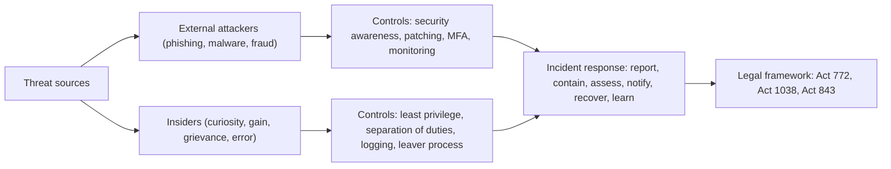

## Introduction

As Ghana's economy becomes increasingly digital (through mobile money, online banking, e-government services, the Ghana Card identity system and e-commerce) the opportunities for crime committed through or against information systems have grown accordingly. Mobile-money fraud, phishing, SIM-swap attacks, business email compromise, ransomware and online romance scams are familiar concerns for Ghanaian businesses and households. At the same time, not all misuse comes from outside. Employees and contractors with legitimate access sometimes abuse it: browsing customer records, selling data, sabotaging systems or using company resources for personal gain.

For IT professionals, cybercrime is both a legal and an ethical subject. Legally, professionals need to know, in general terms, what conduct the law prohibits, what duties organisations have and which institutions are responsible for enforcement. Ethically, they hold powerful skills and privileged access that can be used to protect or to harm. This lesson classifies forms of cybercrime and system misuse, outlines Ghana's main legal framework, and examines the ethical issues around insider misuse, security research and professional responsibility. Legal summaries are general and educational; they are not legal advice, and the current text of each statute should be consulted for detail.

## Learning Objectives

- Classify common forms of cybercrime and misuse of information systems, distinguishing cyber-dependent from cyber-enabled crime.
- Describe, in general terms, the purpose and main features of Ghana's Cybersecurity Act, 2020 (Act 1038) and Electronic Transactions Act, 2008 (Act 772).
- Explain why insider misuse is ethically and practically significant and identify controls to reduce it.
- Evaluate the ethics of hacking, security testing and vulnerability disclosure using ethical theories and the ACM Code.
- Recommend an organisational response to a suspected cyber incident that respects legal and ethical duties.

## Prerequisite Knowledge

- The lesson on workplace ethics, especially the ethics of privileged access.
- The Data and Privacy module, including Ghana's Data Protection Act, 2012 (Act 843).

## Key Terminology

- **Cybercrime**: Criminal activity that targets computers, networks or data, or that uses them as a significant means of committing an offence.
- **Cyber-dependent crime**: An offence that can only be committed using computers or networks, such as hacking, malware distribution or denial-of-service attacks.
- **Cyber-enabled crime**: A traditional offence, such as fraud or theft, whose scale or reach is increased by the use of technology.
- **Unauthorised access**: Accessing a computer system or data without permission, or exceeding the access one has been granted.
- **Insider threat**: Risk posed by current or former employees, contractors or partners who misuse their authorised access, intentionally or negligently.
- **Critical information infrastructure (CII)**: Computer systems and networks whose disruption would seriously affect national security, the economy, public health or safety.
- **Social engineering**: Manipulating people into revealing information or performing actions that compromise security, as in phishing.
- **Coordinated vulnerability disclosure**: A process in which a security researcher reports a vulnerability privately to the responsible organisation and allows time for a fix before public disclosure.

## Detailed Explanation

### Classifying cybercrime

A common classification distinguishes:

| Category | Description | Examples |
|---|---|---|
| Cyber-dependent | Offences that exist only because of computers | Hacking, malware and ransomware, denial-of-service attacks, botnets |
| Cyber-enabled | Traditional crimes amplified by technology | Mobile-money fraud, phishing, online romance and advance-fee scams, identity theft |
| Content-related | Offences concerning illegal content | Child sexual abuse material, certain forms of online harassment and non-consensual sharing of intimate images |
| Insider misuse | Abuse of authorised access | Selling customer data, unauthorised look-ups, sabotage, fraud by employees |

Two features make cybercrime distinctive. First, it is often **transnational**: an attacker in one country can target victims in another, complicating investigation and jurisdiction. Second, many attacks exploit **people rather than technology**. Phishing, SIM-swap fraud and business email compromise rely on deceiving staff or customers, which is why security awareness and procedural controls are as important as technical defences.

### Misuse of information systems by insiders

Insider misuse deserves particular attention because insiders already have access and knowledge. Motives include financial gain, grievance, curiosity, coercion and carelessness. Some forms are clearly criminal, such as selling customer records to fraudsters. Others are ethically wrong and contrary to policy even if they would not necessarily be prosecuted, such as looking up a neighbour's account balance out of curiosity.

Organisations reduce insider risk through:

- **least privilege**: granting only the access each role needs;
- **separation of duties**: so that no single person can initiate and approve sensitive transactions;
- **logging and monitoring** of privileged activity, with transparent policies;
- **joiner-mover-leaver processes**: promptly changing and removing access when roles change or staff leave;
- **acceptable-use policies**, training and a culture in which misuse is taken seriously.

Monitoring itself raises ethical questions about employee privacy, which are examined in the case-study module. The key principle is **proportionality**: monitoring should be transparent, targeted at genuine risks and compliant with data protection law.

### Hacking, security testing and disclosure

Not all "hacking" is malicious. Security professionals conduct **authorised penetration testing**, and independent researchers discover vulnerabilities that vendors have missed. The ethical and legal dividing line is **authorisation**. Accessing a system without permission is generally unlawful even if the intent is benign, and ACM principle 2.8 states that computing professionals should access computing resources only when authorised or when compelled by the public good, and the Code's guidance makes clear that the public-good exception is narrow.

Ethical security practice therefore involves:

- written authorisation and an agreed scope before testing;
- testing only systems one owns or is explicitly authorised to test;
- avoiding harm to data and service availability;
- reporting findings responsibly, through **coordinated vulnerability disclosure** or a vendor's bug-bounty programme, rather than exploiting or publicly releasing them prematurely.

### The ethics of cybercrime

Different ethical theories converge in condemning most cybercrime but help analyse harder cases:

- **Deontology**: unauthorised access violates others' rights and autonomy over their systems and data, regardless of whether harm results.
- **Utilitarianism**: cybercrime causes direct financial losses and wider harms, loss of trust in digital services, which is especially damaging in an economy that depends on mobile money for financial inclusion.
- **Social contract theory**: digital systems function only if participants respect shared rules; each act of misuse weakens the trust on which everyone depends.
- **"Hacktivism" and grey areas**: some argue that unauthorised access to expose wrongdoing can be justified; most professional codes reject this as a general principle, emphasising lawful alternatives such as whistleblowing to regulators.

## Theories, Frameworks and Models

### Ghana's legal framework (general overview)

**Electronic Transactions Act, 2008 (Act 772).** This Act provides the legal framework for electronic transactions and communications in Ghana. In general terms, it:

- gives legal recognition to electronic records, electronic signatures and electronic contracts;
- addresses consumer protection in electronic commerce;
- provides for matters such as the protection of critical databases and the regulation of certain service providers; and
- creates **cyber offences**, including offences relating to unauthorised access to, interception of and interference with computer systems and data, and computer-related fraud.

**Cybersecurity Act, 2020 (Act 1038).** This Act was passed to regulate cybersecurity activities in Ghana and to promote the development of cybersecurity. In general terms, it:

- establishes the **Cyber Security Authority (CSA)** as the regulator for cybersecurity;
- provides for the designation and protection of **critical information infrastructure**, with obligations on its owners;
- provides for the licensing of cybersecurity service providers and the accreditation of cybersecurity establishments and professionals;
- provides for incident reporting and response structures, including computer emergency response teams (CERTs) at national and sectoral levels;
- addresses certain online harms, including provisions on the protection of children online; and
- supports international cooperation in combating cybercrime.

**Related laws.** The Data Protection Act, 2012 (Act 843) governs the processing of personal data and requires appropriate security measures; the Whistleblower Act, 2006 (Act 720) is relevant where employees discover misuse. Internationally, Ghana has acceded to the Council of Europe Convention on Cybercrime (the Budapest Convention), which promotes harmonised offences and cross-border cooperation.

Students should consult the official texts and guidance from the Cyber Security Authority for specific obligations, offences and penalties rather than relying on secondary summaries.

### A framework for professional responsibility

| Role of the IT professional | Ethical and legal responsibility |
|---|---|
| Designer and developer | Build systems that are robustly and usably secure (ACM 2.9); avoid creating tools whose main purpose is misuse |
| Administrator | Use privileged access only for authorised purposes; protect logs and evidence |
| Security tester | Test only with authorisation; disclose responsibly |
| Manager | Implement controls, training and incident response; comply with regulatory obligations |
| Employee who discovers misuse | Report through proper channels; preserve evidence; do not investigate beyond one's authority |

### Incident response in outline

1. **Detect and report** internally through the defined channel.
2. **Contain** the incident to limit harm, while preserving evidence.
3. **Assess** the impact on systems, data and people, including whether personal data are affected.
4. **Notify** as required (to regulators, sectoral CERTs, law enforcement and affected individuals) in line with applicable law and guidance.
5. **Eradicate and recover**, restoring services securely.
6. **Learn** through a post-incident review without scapegoating.

## Ghanaian Business Application

### Illustrative scenario: insider fraud at a mobile-money agent network

*Illustrative scenario.* "PrimeCash Services", a Ghanaian mobile-money agent aggregator, notices a spike in customer complaints about SIM-swap fraud followed by wallet withdrawals. An internal investigation suggests that a customer-service officer has been looking up customer details and passing them to an outside group that then impersonates the customers to obtain replacement SIM cards.

Ethical and legal analysis:

- The officer's conduct involves **misuse of authorised access** and facilitation of fraud, conduct of the kind addressed by cyber and fraud offences under Ghanaian law, and is a clear breach of confidentiality (ACM 1.7) and of authorised use (ACM 2.8).
- PrimeCash has obligations as a **data controller** under Act 843 to secure personal data, and may have reporting obligations under sector regulation and cybersecurity guidance.
- Organisational weaknesses enabled the misuse: broad look-up access without business justification, no monitoring of unusual query volumes and weak verification in the SIM-replacement process.

A defensible response would involve preserving logs as evidence, suspending the officer's access pending investigation, reporting to law enforcement and relevant regulators as required, notifying and supporting affected customers, tightening access controls and monitoring, and working with the telecoms partner to strengthen SIM-swap verification. Ethically, the company should avoid scapegoating a single employee while ignoring its own control failures.

## International Case Study

### WM Morrison Supermarkets v Various Claimants (2020)

In the United Kingdom, a senior internal auditor at the supermarket chain Morrisons, who held a grudge after disciplinary action, copied payroll data relating to around 100,000 employees and published it online. He was convicted and imprisoned. Employees then sued Morrisons, arguing that the company was vicariously liable for his actions. The UK Supreme Court held in 2020 that Morrisons was not vicariously liable, because the employee was pursuing a personal vendetta rather than acting in the course of his employment in the relevant legal sense.

Although the company escaped vicarious liability on these facts, the case remains a powerful illustration of insider risk. A trusted employee with legitimate access to sensitive data deliberately misused it; the harm fell on thousands of colleagues; and the organisation faced years of litigation and reputational damage. It shows why least privilege, monitoring of bulk data extraction, and attention to disgruntled insiders are essential, and that the legal outcome in one jurisdiction does not reduce an organisation's ethical responsibility to protect the data entrusted to it.

## Diagram

## Common Misconceptions

- "Hacking is only illegal if you steal or damage something." Unauthorised access itself is generally an offence and an ethical violation, regardless of intent or damage.
- "Cybercrime is a technical problem for the IT department alone." Many attacks exploit people and processes, so awareness, procedures and management accountability are essential.
- "Insiders with legitimate access cannot misuse systems unlawfully." Exceeding authorised purposes, such as selling or browsing data without business need, can be unlawful and is a breach of trust.
- "Finding a vulnerability gives me the right to publish it immediately." Responsible practice is coordinated disclosure that allows the organisation to fix the problem first.
- "Ghana has no specific cybersecurity law." The Cybersecurity Act, 2020 (Act 1038) established the Cyber Security Authority, and the Electronic Transactions Act, 2008 (Act 772) contains cyber offences.

## Common Examination Mistakes

- Inventing section numbers, offences or penalties for Act 1038 or Act 772 instead of describing their general purpose and features.
- Confusing the roles of the two Acts: Act 772 primarily concerns electronic transactions and contains cyber offences; Act 1038 regulates cybersecurity and established the CSA.
- Focusing only on external hackers and ignoring insider misuse.
- Recommending punitive responses to individuals without addressing organisational control failures.
- Omitting the ethical analysis: the question is rarely only "is this legal?"

## Critical Thinking Questions

1. Is unauthorised access to expose corporate wrongdoing ever ethically justified? Compare it with whistleblowing through lawful channels.
2. How should organisations balance insider-threat monitoring against employees' privacy and dignity?
3. Should cybersecurity professionals in Ghana be required to be licensed or accredited? What are the benefits and risks?
4. Given that much cybercrime is transnational, how effective can national legislation be? What role does international cooperation play?

## Practical Exercises

1. **Threat classification.** List ten cyber incidents reported in Ghanaian or international news that you can verify, and classify each as cyber-dependent, cyber-enabled, content-related or insider misuse. Expected output: a ten-row table with sources.
2. **Access review.** For an illustrative customer-service team at a bank, design role-based access rules for customer data, including what each role can see, what requires supervisor approval and what is logged. Expected output: an access-control matrix.
3. **Incident memo.** Draft a one-page memo to the board of the illustrative PrimeCash Services describing the immediate response steps, notifications to consider and longer-term control improvements. Expected output: a structured memo with clear actions and owners.

## Key Takeaways

- Cybercrime includes cyber-dependent, cyber-enabled, content-related offences and insider misuse.
- Many attacks exploit people and processes; defences must combine technology, procedures and awareness.
- Ghana's Electronic Transactions Act, 2008 (Act 772) recognises electronic transactions and creates cyber offences; the Cybersecurity Act, 2020 (Act 1038) established the Cyber Security Authority and regulates cybersecurity, including critical information infrastructure.
- Authorisation is the ethical and legal dividing line between security testing and hacking.
- Insider misuse requires least privilege, separation of duties, monitoring and a fair, organisation-wide response.

## Further Reading

- Republic of Ghana. (2008). *Electronic Transactions Act, 2008 (Act 772)*.
- Republic of Ghana. (2020). *Cybersecurity Act, 2020 (Act 1038)*.
- Council of Europe. (2001). *Convention on Cybercrime* (ETS No. 185).
- Quinn, M. J. (2020). *Ethics for the information age* (8th ed.). Pearson.
- Tavani, H. T. (2016). *Ethics and technology: Controversies, questions, and strategies for ethical computing* (5th ed.). Wiley.

## Video Resources

- [Cyber Security Authority, Ghana](https://www.csa.gov.gh/): Cyber Security Authority. Official site of Ghana's cybersecurity regulator with guidance, alerts and awareness materials.
- [Council of Europe: Cybercrime](https://www.coe.int/en/web/cybercrime): Council of Europe. Official pages on the Budapest Convention and capacity-building on cybercrime.

## Revision Summary

Cybercrime comprises offences that depend on computers (hacking, malware), offences enabled by them (fraud, phishing), content offences and insider misuse of authorised access. Ghana's Electronic Transactions Act, 2008 (Act 772) gives legal effect to electronic transactions and contains cyber offences; the Cybersecurity Act, 2020 (Act 1038) established the Cyber Security Authority and regulates cybersecurity, critical information infrastructure, licensing and incident response. Ethically, authorisation separates legitimate testing from hacking, and organisations must control and respond fairly to insider misuse.

- Cyber-dependent vs cyber-enabled crime.
- Insiders: least privilege, separation of duties, logging, leaver process.
- Act 772: e-transactions plus cyber offences.
- Act 1038: CSA, CII, licensing, CERTs, incident reporting.
- ACM 2.8: access only when authorised; ACM 2.9: secure design.
- Coordinated vulnerability disclosure, not immediate publication.
