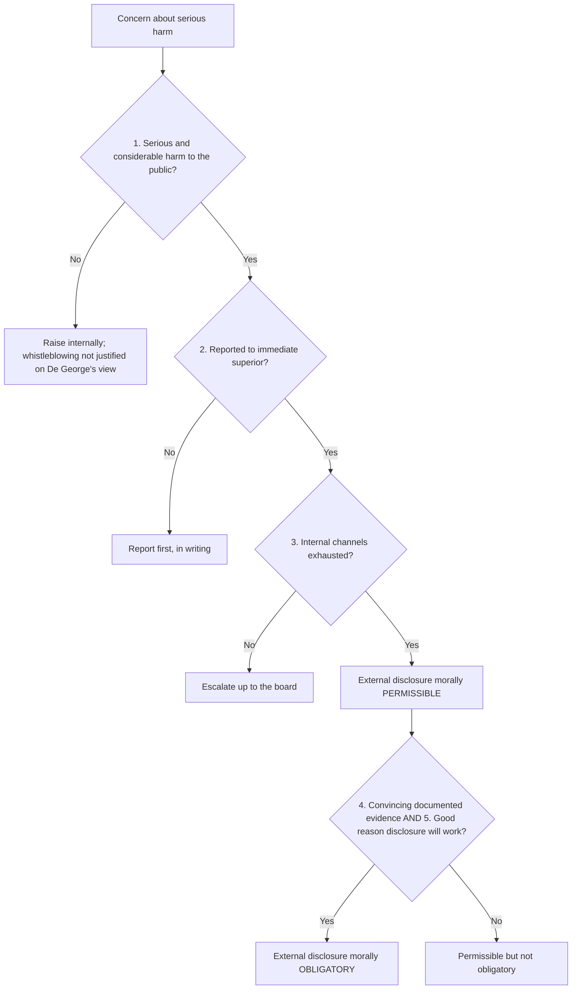

## Introduction

Two situations test an IT professional's integrity more severely than almost any other. The first is discovering that your organisation is doing something seriously harmful (shipping software with a known safety defect, concealing a data breach, misleading regulators) and that internal efforts to stop it have failed. Do you stay silent, resign quietly or disclose the wrongdoing to outsiders, at possible cost to your career? The second is being on the other side: a system you designed, tested or operated fails, and people suffer losses. Were you merely unlucky, or did you fall below the standard of care that a competent professional should meet?

This lesson addresses both questions. It first examines **whistleblowing**: what it is, why it is ethically contested, and how Richard De George's criteria help distinguish justified from unjustified disclosure. It then examines **professional negligence**: the legal and ethical idea that professionals owe a duty of care to those affected by their work, and that breaching it can create liability when it causes harm. Legal content is simplified and educational; it is not legal advice, and actual cases depend on the facts and the applicable law.

## Learning Objectives

- Define whistleblowing and distinguish internal from external disclosure.
- Apply De George's criteria to judge whether whistleblowing is morally permissible or morally obligatory in a given case.
- Evaluate the competing duties of loyalty, confidentiality and protection of the public in whistleblowing decisions.
- Explain the four elements of negligence (duty of care, breach, causation and harm) and apply them to IT failures.
- Recommend organisational practices that reduce both the need for external whistleblowing and the risk of negligent practice.

## Prerequisite Knowledge

- The previous lesson on workplace ethics, loyalty and conflicts of interest.
- Familiarity with the ACM Code of Ethics and with consequentialist and deontological reasoning.

## Key Terminology

- **Whistleblowing**: Disclosure by a current or former member of an organisation of information about wrongdoing, danger or illegality to people or bodies who may be able to act on it.
- **Internal whistleblowing**: Raising concerns through channels within the organisation, such as senior management, an ethics hotline or the board.
- **External whistleblowing**: Disclosing concerns outside the organisation, for example to a regulator, law-enforcement agency, the media or the public.
- **Retaliation**: Adverse action against a whistleblower, such as dismissal, demotion, harassment or blacklisting.
- **Negligence**: Failure to exercise the care that a reasonable person, or a reasonably competent professional, would exercise in the circumstances, causing foreseeable harm to someone owed a duty of care.
- **Duty of care**: A legal or ethical obligation to take reasonable care to avoid causing foreseeable harm to others.
- **Standard of care**: The level of skill and care expected of a reasonably competent member of the relevant profession.
- **Causation**: The requirement that the breach of duty actually caused, and was a sufficiently close cause of, the harm suffered.

## Detailed Explanation

### What whistleblowing involves

Whistleblowing typically has four features: a person with inside knowledge, a concern about serious wrongdoing or danger, a disclosure to someone who can act, and a context in which the disclosure is unwelcome to the organisation. In IT, concerns may involve safety-critical defects, concealed data breaches, unlawful surveillance, fraud facilitated by systems, discriminatory algorithms or misleading claims about a product's capabilities.

Whistleblowing is ethically difficult because it places genuine duties in conflict:

- **Loyalty** to an employer and colleagues;
- **Confidentiality** of business information and personal data;
- **Protection of the public** from harm;
- **Honesty** and the duty not to be complicit in deception;
- **Self-interest and family obligations**, since whistleblowers frequently suffer retaliation, career damage and stress.

Some writers argue that whistleblowing reflects organisational failure: in a healthy organisation, concerns raised internally are heard and addressed, so external disclosure should rarely be necessary. Others see whistleblowers as essential to accountability, especially where the harm is hidden and powerful interests benefit from concealment.

### Internal before external

Most ethical frameworks and many legal regimes favour raising concerns internally first, where this is safe and realistic. Internal routes give the organisation a chance to correct the problem, respect legitimate confidentiality, and allow the employee to check whether there is an innocent explanation. However, internal reporting is not always appropriate, for example, where senior management is implicated, where evidence may be destroyed, or where there is imminent danger.

### Ghana's Whistleblower Act

Ghana's Whistleblower Act, 2006 (Act 720) provides a legal framework for disclosure of wrongdoing (including impropriety in public and private institutions) and for the protection of whistleblowers against victimisation in specified circumstances, with provisions on the bodies to which disclosures can be made and on rewards in certain cases. Its precise scope, the procedure for making a protected disclosure and the conditions for protection should be checked in the current text of the Act and, where necessary, with a lawyer before making a disclosure. Employees should also be aware of any obligations under employment contracts and data protection law when handling information.

### Professional negligence

Negligence is a concept in the law of torts in common-law systems, including Ghana's, whose legal system draws on the English common-law tradition. Its modern foundation is usually traced to *Donoghue v Stevenson* [1932], in which the House of Lords recognised that a manufacturer owes a duty of care to the ultimate consumer: the "neighbour principle": we must take reasonable care to avoid acts or omissions that we can reasonably foresee would be likely to injure people closely and directly affected by them. Later cases developed the test for when a duty exists, including *Caparo Industries plc v Dickman* [1990], which considers foreseeability of harm, proximity between the parties and whether it is fair, just and reasonable to impose a duty.

To establish negligence, a claimant generally must show four elements:

1. **Duty of care.** The defendant owed the claimant a duty. IT professionals clearly owe duties to clients and employers, often through contract, and may owe duties to third parties who foreseeably rely on or are affected by their systems.
2. **Breach.** The defendant fell below the standard of a reasonably competent professional in that field. The standard is not perfection: professionals are judged against what a responsible body of competent practitioners would do, taking into account accepted practices, standards and the state of knowledge at the time.
3. **Causation.** The breach actually caused the harm ("but for" the breach, would the harm have occurred?), and the harm was not too remote.
4. **Harm (damage).** The claimant suffered recognised loss, such as physical injury, property damage or, in some circumstances, financial loss.

In software, typical breaches include failing to test adequately for foreseeable conditions, ignoring known vulnerabilities, failing to follow relevant standards, deploying without appropriate safeguards and failing to warn clients of known limitations. Liability may also arise in **contract** (failing to deliver what was promised with reasonable skill and care), and contracts often attempt to limit liability, though such limits may themselves be subject to legal controls.

Ethically, negligence connects with ACM principles **2.1 (strive to achieve high quality)**, **2.2 (maintain high standards of professional competence)**, **2.5 (give comprehensive and thorough evaluations of computer systems and their impacts, including analysis of possible risks)** and **2.6 (perform work only in areas of competence)**.

## Theories, Frameworks and Models

### De George's criteria for whistleblowing

Richard T. De George, in his work on business ethics, proposed criteria for judging when external whistleblowing is justified. They were developed with product-safety cases in mind, so they focus on serious harm to the public.

**Whistleblowing is morally permissible when:**

1. The organisation, through its product or policy, will do **serious and considerable harm** to the public (or to users or bystanders).
2. The employee has **reported the threat to their immediate superior**, making clear both the threat and their moral concern.
3. If the superior does nothing effective, the employee has **exhausted the internal procedures and possibilities** within the organisation, taking the matter up the managerial ladder, to the board if necessary.

**Whistleblowing becomes morally obligatory when, in addition:**

4. The employee has, or has accessible, **documented evidence** that would convince a reasonable, impartial observer that their view of the situation is correct.
5. The employee has **good reasons to believe that going public will bring about the necessary changes**, so that the risk to themselves is not taken in vain.

The criteria are influential but have been criticised:

- **Too demanding?** Requiring internal escalation may be dangerous or futile where management is complicit or evidence may be destroyed.
- **Too narrow?** They focus on physical harm to the public, whereas modern IT concerns include privacy violations, fraud and discrimination.
- **Obligation and sacrifice.** Critics question whether anyone can be morally *obliged* to accept severe personal costs; others reply that professionals accept special responsibilities with their roles.
- **Complicity theory.** An alternative view (associated with writers such as Michael Davis) holds that whistleblowing is required when one would otherwise be *complicit* in wrongdoing through one's own work, not merely because harm will occur.

### Ethical theories applied

- **Utilitarianism** supports disclosure when expected benefits (harm prevented) outweigh expected costs (to the organisation, the whistleblower and colleagues), which is why De George's conditions about evidence and likelihood of success matter.
- **Deontology** emphasises duties not to deceive and not to participate in harm, but also duties of confidentiality and fidelity; it requires careful weighing of conflicting duties, often resolved by asking which duty is more stringent in the context.
- **Virtue ethics** highlights courage, honesty and practical wisdom: knowing when and how to raise concerns, not only whether to.

### A whistleblowing decision process

1. Clarify the facts and gather evidence lawfully, without breaching data protection or taking material you are not entitled to.
2. Assess the seriousness and likelihood of harm.
3. Check whether there is an innocent explanation.
4. Raise the concern internally, in writing, unless this is unsafe or futile.
5. Escalate internally if the response is inadequate.
6. Seek confidential advice (for example, from a lawyer, professional body or trusted mentor) about legal protections.
7. If disclosure outside is justified, choose the most appropriate recipient, usually a regulator before the media.
8. Disclose only what is necessary, and keep records.

## Ghanaian Business Application

### Illustrative scenario: the hospital records system

*Illustrative scenario.* Efua is a software tester for "MedLink Ghana", which supplies electronic medical records software to private hospitals. She discovers that under certain conditions the system attaches laboratory results to the wrong patient. She reports this to her team lead, who says the release cannot be delayed and that "doctors will spot any mistakes". She escalates to the head of engineering, who promises a fix "next quarter". Meanwhile, the software is live in three hospitals.

**Whistleblowing analysis.** The potential harm, wrong treatment based on another patient's results, is serious and considerable (criterion 1). Efua has reported to her superior (2) and escalated, but has not yet gone to the managing director or board (3), so she should do so in writing, with evidence. If the company still refuses to act, she has documented test evidence (4), and disclosure to an appropriate body with authority over patient safety or to the hospitals' management would plausibly bring change (5). On De George's account, external disclosure would then be not merely permissible but obligatory. She should seek advice on protections under the Whistleblower Act, 2006 (Act 720) and disclose in a way that protects patient confidentiality.

**Negligence analysis.** If a patient were harmed: MedLink owed a duty of care to hospitals and foreseeably to patients; releasing and continuing to operate software with a known patient-matching defect, without warning users, is likely to fall below the standard of a competent supplier; if a clinician acted on a mismatched result and the patient was injured, causation could be argued; and personal injury is recognised harm. The team lead's assumption that "doctors will spot mistakes" would not normally excuse a known, unmitigated defect.

## International Case Study

### Therac-25 and the UK Post Office Horizon scandal

**Therac-25.** Between 1985 and 1987, the Therac-25 radiation therapy machine was involved in a series of accidents in which patients received massive radiation overdoses, some of them fatal. Nancy Leveson and Clark Turner's 1993 investigation identified causes including software race conditions, removal of hardware safety interlocks that earlier models had used, inadequate testing, overconfidence in software, and a poor response to early incident reports. Therac-25 is a classic illustration of professional negligence in safety-critical software: foreseeable harm, a duty to patients and practices that fell below what careful engineering required.

**Post Office Horizon.** In the United Kingdom, the Post Office prosecuted many sub-postmasters for theft, fraud and false accounting on the basis of shortfalls recorded by the Horizon accounting system, supplied by Fujitsu. In 2019, in the group litigation *Bates and Others v Post Office Ltd*, the High Court found that Horizon contained bugs, errors and defects capable of causing apparent shortfalls. Many convictions were subsequently quashed by the courts, and in 2024 Parliament passed legislation to quash further convictions; a statutory public inquiry examined what went wrong. The case shows the devastating human cost when organisations treat system outputs as infallible, ignore users' reports of anomalies and fail to disclose known problems, and it highlights the importance of people within organisations being able to raise concerns and be heard.

## Diagram

## Common Misconceptions

- "Whistleblowing is always disloyal." Loyalty is limited by duties to the public; responsible whistleblowing after internal efforts fail can reflect loyalty to the organisation's legitimate purpose.
- "Any disclosure of wrongdoing is protected by law." Legal protection usually depends on the type of information, the recipient and the procedure followed; legal advice should be sought.
- "Negligence means making any mistake." Negligence requires falling below the standard of a reasonably competent professional, causing harm to someone owed a duty; not every error is negligent.
- "If a contract limits liability, professionals have no ethical responsibility." Contractual limits affect legal remedies, not the ethical duty to work competently and avoid foreseeable harm.
- "De George's criteria say whistleblowing is always required when harm exists." Criteria 1-3 make it permissible; obligation also requires convincing evidence and a good chance of success.

## Common Examination Mistakes

- Listing De George's criteria without distinguishing those for permissibility (1-3) from those for obligation (4-5).
- Applying the criteria mechanically without noting their limitations or alternative views.
- Omitting one of the four negligence elements, especially causation.
- Stating specific provisions or penalties of Ghanaian law from memory without certainty.
- Failing to recommend preventive organisational measures, such as speak-up channels and quality assurance.

## Critical Thinking Questions

1. Should De George's criteria be extended to cover privacy harms and algorithmic discrimination? How would you reformulate them?
2. Is a professional ever morally obliged to blow the whistle if doing so will almost certainly end their career?
3. How should the standard of care evolve as AI coding assistants become common? Is a developer negligent for not reviewing AI-generated code?
4. What organisational features made the Post Office Horizon scandal possible, and which of them could exist in Ghanaian institutions?

## Practical Exercises

1. **Criteria application.** Apply each of De George's five criteria to the Efua scenario, stating whether it is satisfied and what further action is needed. Expected output: a five-row table and a conclusion of 150 words.
2. **Negligence analysis.** For an illustrative case in which a Ghanaian payroll system miscalculates staff tax deductions for six months, analyse the four elements of negligence. Expected output: a structured 300-word analysis with each element headed.
3. **Speak-up policy.** Draft a one-page internal speak-up (whistleblowing) policy for an IT company, including reporting routes, confidentiality, non-retaliation and feedback to the reporter. Expected output: a policy document with at least six provisions.

## Key Takeaways

- Whistleblowing balances loyalty and confidentiality against honesty and protection of the public.
- De George: serious harm, reporting to a superior and exhausting internal channels make disclosure permissible; convincing evidence and a good chance of success make it obligatory.
- The criteria are influential but contested as too demanding and too narrow for modern IT harms.
- Negligence requires a duty of care, breach of the professional standard, causation and harm.
- Organisations reduce both whistleblowing crises and negligence through speak-up cultures, rigorous testing and honest disclosure of defects.

## Further Reading

- De George, R. T. (2010). *Business ethics* (7th ed.). Pearson Prentice Hall.
- Leveson, N. G., & Turner, C. S. (1993). An investigation of the Therac-25 accidents. *Computer, 26*(7), 18-41.
- Quinn, M. J. (2020). *Ethics for the information age* (8th ed.). Pearson.
- Tavani, H. T. (2016). *Ethics and technology: Controversies, questions, and strategies for ethical computing* (5th ed.). Wiley.
- Republic of Ghana. (2006). *Whistleblower Act, 2006 (Act 720)*.

## Video Resources

- [ACM Code of Ethics: Case Studies](https://www.acm.org/code-of-ethics/case-studies): Association for Computing Machinery. Official case studies, including dilemmas about raising concerns and professional responsibility.
- [Post Office Horizon IT Inquiry](https://www.postofficehorizoninquiry.org.uk/): UK statutory public inquiry. Official site with hearings and evidence on the Horizon failures.

## Revision Summary

Whistleblowing is disclosure of serious wrongdoing by an insider to those able to act; it pits loyalty and confidentiality against honesty and public protection. De George holds that disclosure is permissible when there is serious harm to the public, the employee has reported it to a superior and internal channels are exhausted, and obligatory when there is also convincing documented evidence and good reason to expect change. Professional negligence requires a duty of care, breach of the competent professional's standard, causation and harm.

- Permissible: criteria 1-3. Obligatory: plus 4-5.
- Prefer internal, then regulator, then media, unless unsafe.
- Ghana: Whistleblower Act, 2006 (Act 720), check scope and procedure.
- Negligence: duty, breach, causation, harm (Donoghue v Stevenson; Caparo).
- Therac-25 and Horizon: overconfidence in software and ignored reports.
