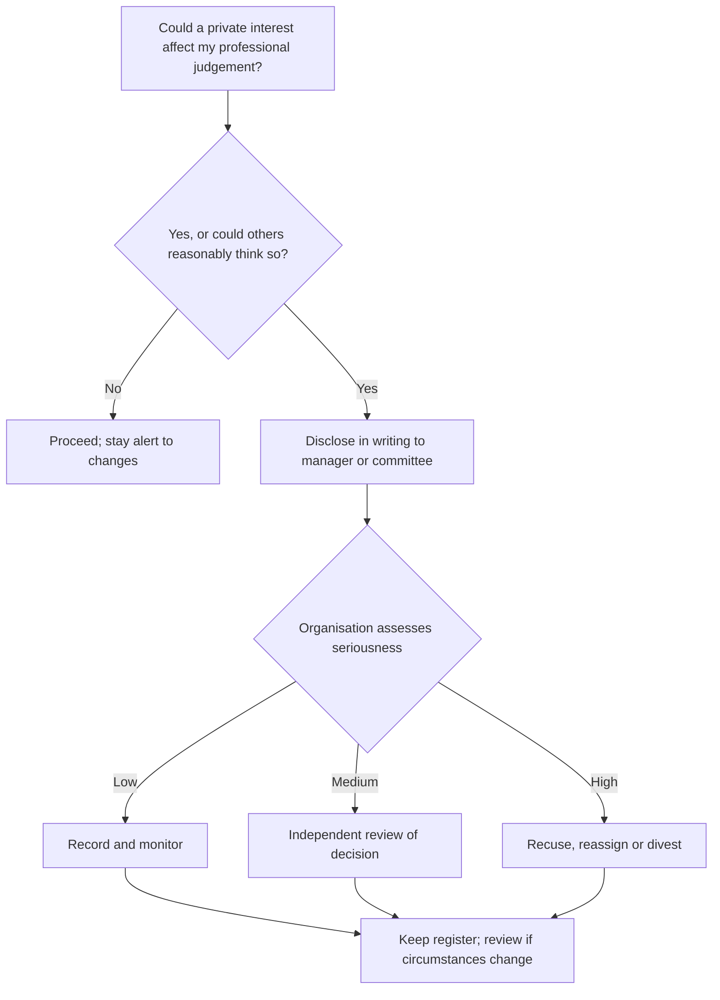

## Introduction

Most ethical failures in IT do not begin with dramatic choices. They begin with ordinary decisions taken under pressure: a project manager reports a schedule as "green" when it is clearly slipping; a systems administrator browses a colleague's mailbox out of curiosity; a procurement officer accepts an expensive "thank-you" gift from a vendor; a developer quietly reuses a former employer's code. Each act may seem minor in isolation, but together they erode trust, expose organisations to legal risk and can ultimately harm customers and the public.

IT professionals occupy positions of unusual trust. They hold privileged access to systems and data, often understand technical risks better than their managers or clients, and influence costly purchasing decisions. This lesson examines the ethical obligations that arise in the IT workplace (honesty, loyalty, confidentiality, fairness and competence) and then focuses on **conflicts of interest**, one of the most common and most misunderstood sources of professional misconduct. You will learn to recognise actual, potential and perceived conflicts and to manage them through disclosure, recusal and organisational controls.

## Learning Objectives

- Explain the core ethical obligations IT professionals owe to employers, clients, colleagues and the public.
- Distinguish actual, potential and perceived conflicts of interest and give IT-specific examples of each.
- Apply a structured process for disclosing and managing a conflict of interest.
- Evaluate the limits of loyalty to an employer when it conflicts with duties to the public.
- Analyse workplace dilemmas using ethical theories and the ACM Code of Ethics.

## Prerequisite Knowledge

- The lessons on professional identity, responsibility and codes of conduct in the IT Professionalism module.
- The structured ethical decision-making process from the Ethical Foundations module.

## Key Terminology

- **Workplace ethics**: The principles and standards that guide conduct in employment relationships, including honesty, fairness, loyalty, confidentiality and respect.
- **Conflict of interest**: A situation in which a person's private interests, or duties to another party, could improperly influence the performance of their professional duties.
- **Perceived conflict of interest**: A situation in which a reasonable observer could believe that judgement is compromised, even if it is not.
- **Disclosure**: Formally informing the appropriate person or body about an interest that could create a conflict.
- **Recusal**: Withdrawing from a decision or activity in which one has a conflict of interest.
- **Fiduciary duty**: A duty to act in the best interests of another party, such as an employer or client, who has placed trust in the professional.
- **Privileged access**: Elevated system permissions, such as administrator rights, that enable access to data or functions beyond those of ordinary users.
- **Moonlighting**: Taking paid work outside one's main employment.

## Detailed Explanation

### Obligations in the IT workplace

IT professionals owe overlapping duties to several parties.

**To employers and clients**

- **Honesty** in reporting progress, costs, risks and defects. Misreporting project status (sometimes called "watermelon reporting" (green outside, red inside)) denies decision-makers the information they need.
- **Competence**: undertaking only work one is competent to do, or being transparent about learning needs (ACM principle 2.6).
- **Confidentiality** of business information, customer data and trade secrets (ACM 1.7).
- **Diligence and loyalty**: acting in the organisation's legitimate interests rather than one's own.

**To colleagues**

- Fair treatment, respect, credit for others' work and freedom from harassment and discrimination (ACM 1.4).
- Constructive professional review of others' work (ACM 2.4).

**To users and the public**

- Avoiding harm (ACM 1.2), designing robustly and usably secure systems (ACM 2.9) and ensuring that the public good is the central concern (ACM 3.1).

### The ethics of privileged access

System administrators, database administrators and security staff often have access to emails, payroll records, customer accounts and logs. The ethical rule is simple to state and difficult to sustain: **access is granted for a purpose, and must be used only for that purpose**. ACM principle 2.8 asks professionals to access computing resources only when authorised or when compelled by the public good. Browsing a colleague's salary data, reading a manager's emails or looking up a celebrity customer's account is a breach of trust even if the system technically permits it. Good organisations support individuals with technical and procedural controls: least-privilege access, separation of duties, logging and periodic review.

### Loyalty and its limits

Loyalty to an employer is a genuine moral value: it sustains co-operative relationships and allows organisations to function. But loyalty is not unconditional. An employer cannot legitimately demand that an employee lie to customers, conceal a serious safety defect or break the law. Most professional codes resolve the tension by placing the **public interest** above employer interest when they genuinely conflict. Where internal routes fail, this may lead to whistleblowing, the subject of the next lesson.

### Conflicts of interest

A conflict of interest exists when a person's private interests (financial, personal, family or other professional commitments) could improperly influence their judgement in a role where others rely on them. The key insight is that a conflict is a **situation**, not a wrongdoing. Having a conflict is often unavoidable; the ethical failure lies in **concealing it or failing to manage it**.

Three categories are commonly distinguished:

| Type | Definition | IT example |
|---|---|---|
| Actual | Private interest and professional duty currently conflict | An IT manager evaluates bids from a company owned by her brother |
| Potential | A conflict could arise in future if circumstances change | A developer holds shares in a cloud provider his employer may later consider |
| Perceived (apparent) | A reasonable observer might believe judgement is compromised | A consultant who recommends a vendor after attending its all-expenses-paid conference |

Common sources of conflicts in IT include:

- **Procurement**: relationships with vendors, gifts, hospitality, kickbacks or promises of future employment.
- **Moonlighting**: freelance work for competitors or for clients of one's employer, or using employer resources for side projects.
- **Consulting independence**: recommending products from which the consultant receives commissions or referral fees.
- **Dual roles**: auditing a system one designed, or approving one's own changes.
- **Personal relationships**: supervising or assessing a family member or partner.
- **Insider information**: trading shares on the basis of confidential knowledge of a pending contract or a data breach.

### Gifts and hospitality

Gifts are a culturally sensitive area. In many Ghanaian business settings, gift-giving can express genuine goodwill and relationship-building, and a modest gift at a festive season is not necessarily improper. The ethical test is whether the gift could **influence, or appear to influence**, a business decision. Useful questions are: Is the giver currently bidding for, or likely to bid for, business I influence? Would I be comfortable if my manager, the other bidders or a newspaper knew about it? Is the value more than token? Is it offered openly, and would I record it in a gift register? Organisational policies typically set thresholds, require declarations and prohibit gifts during active procurement.

## Theories, Frameworks and Models

### Ethical analysis of conflicts of interest

- **Deontology.** Accepting a role in which others rely on your judgement implies a promise to exercise it impartially. Concealing a conflict breaks that implicit promise and deceives those who trust you.
- **Utilitarianism.** Undisclosed conflicts lead to poorer decisions (inferior systems, inflated prices) and erode trust, which raises costs across the organisation and society. Even if one decision turns out well, a rule permitting concealment would produce worse outcomes overall: a rule-utilitarian argument for disclosure.
- **Virtue ethics.** Integrity, fairness and practical wisdom lead a good professional to avoid compromising situations and to be transparent when they occur.
- **Agency theory.** In management studies, employees and consultants act as *agents* for *principals* (employers and clients). Conflicts of interest are a classic agency problem, addressed through monitoring, incentives and disclosure.

### The ACM Code of Ethics

ACM principle **1.3 (Be honest and trustworthy)** explicitly asks computing professionals to be forthright about any circumstances that might lead to real or perceived conflicts of interest. Principles **1.7 (Honour confidentiality)**, **2.8 (Access resources only when authorised)** and **3.4 (Articulate, apply and support policies that reflect the Code)** are also relevant to workplace ethics.

### A conflict-of-interest management process

1. **Recognise.** Ask regularly: Do I, or someone close to me, have an interest that could be affected by this decision?
2. **Disclose promptly and in writing** to the appropriate person, usually a line manager, compliance officer or procurement committee.
3. **Assess.** The organisation, not the conflicted person alone, judges how serious the conflict is.
4. **Manage.** Options include recusal from the decision, reassignment, additional independent review, divestment of the interest, or declining the gift or outside work.
5. **Record.** Keep a register of declarations and decisions.
6. **Review.** Revisit the arrangement when circumstances change.

## Ghanaian Business Application

### Illustrative scenario: the ERP procurement

*Illustrative scenario.* Kwame is head of IT at "Northern Agro Processors Ltd" in Tamale. The company is selecting an enterprise resource planning (ERP) vendor. One of the three shortlisted vendors is represented in Ghana by a firm in which Kwame's cousin is a director. During the evaluation, the vendor invites Kwame to an all-expenses-paid "product briefing" in Dubai.

Analysis using the process above:

- **Recognise**: there is an actual conflict (a family member's business interest) and a perceived conflict created by the trip.
- **Disclose**: Kwame should declare the relationship in writing to the managing director and the procurement committee immediately.
- **Manage**: the most defensible option is for Kwame to recuse himself from scoring that vendor's bid, or from the final decision, while still providing neutral technical input on requirements. He should decline the trip, or the company should pay for any genuinely necessary site visit itself.
- **Ghanaian legal context**: where the organisation is a public body, public procurement legislation and associated rules apply, and they impose formal requirements on conflicts and transparency; private organisations typically rely on their own codes and contracts. Students should consult the current legislation and their organisation's policies rather than relying on summaries.

The ethical point is that disclosure protects Kwame as well as the company: if the cousin's firm wins on merit, the decision will be defensible.

### Moonlighting in Ghana's tech sector

Many Ghanaian developers supplement salaries with freelance work. This is not inherently wrong, but conflicts arise when freelance clients compete with the employer, when work is done on employer time or equipment, or when the employer's confidential code or data are reused. Employment contracts often contain clauses on outside work and IP ownership. The ethical course is to read the contract, disclose outside work where required and keep employer and freelance resources strictly separate.

## International Case Study

### The Volkswagen emissions scandal

In 2015 the US Environmental Protection Agency issued a notice of violation alleging that Volkswagen had installed software in certain diesel vehicles that could detect when the car was being tested and change its emissions performance accordingly: a so-called "defeat device". In normal driving, the vehicles emitted nitrogen oxides at levels far above permitted limits. Volkswagen admitted the use of such software, and the scandal led to criminal and civil proceedings in several countries, very large financial penalties and vehicle recalls. Individual employees and executives were also prosecuted.

The case is primarily about fraud, but it is a powerful illustration of workplace ethics for technologists. Engineers wrote and maintained code whose purpose was deception. It raises questions examined throughout this lesson: How do organisational pressure and targets push employees towards misconduct? What is the limit of loyalty when an employer's instructions require deceiving regulators and the public? What should an engineer do when asked to implement a feature they believe is unlawful? The ACM Code's principles 1.2 (avoid harm), 1.3 (honesty) and 2.3 (know and respect rules) point clearly to refusal and escalation.

## Diagram

## Common Misconceptions

- "Having a conflict of interest means I have done something wrong." Conflicts are situations that often cannot be avoided; wrongdoing lies in concealing or failing to manage them.
- "If my judgement is not actually affected, there is no problem." Perceived conflicts damage trust and decision legitimacy, so they must also be disclosed.
- "Administrator access means I am entitled to look at any data." Access is granted for specific purposes; using it beyond them is a breach of trust and may be unlawful.
- "Loyalty to my employer means doing whatever I am told." Loyalty is limited by law and duties to the public; employees should not deceive or endanger others on instruction.
- "Gifts are always bribes." Token gifts may be acceptable under policy; the test is whether a gift could influence or appear to influence decisions.

## Common Examination Mistakes

- Identifying a conflict but failing to recommend specific management steps such as disclosure, recusal or divestment.
- Ignoring perceived conflicts and focusing only on actual ones.
- Treating all cultural gift-giving as corruption, or ignoring cultural context altogether, instead of applying a clear influence test.
- Inventing legal provisions or penalties instead of referring generally to applicable law and organisational policy.
- Not linking analysis to specific ACM principles, especially 1.3.

## Critical Thinking Questions

1. Is a perceived conflict of interest ethically as serious as an actual one? Explain your reasoning with reference to trust and legitimacy.
2. Should IT professionals in small markets, where everyone knows everyone, be held to the same recusal standards as those in large markets?
3. Where is the line between legitimate relationship-building with vendors and improper influence?
4. Can an organisation's incentive structure, such as bonuses tied to project delivery dates, itself create conflicts of interest? How should it respond?

## Practical Exercises

1. **Conflict register.** Create a conflict-of-interest declaration form for an IT department, including fields for type of interest, parties involved, decisions affected and proposed management. Expected output: a one-page form with guidance notes.
2. **Gift policy test.** Classify five gift or hospitality scenarios (for example, a calendar at Christmas, a smartphone during a tender, a vendor-paid international trip) as acceptable, declare-and-accept or decline, with reasons. Expected output: a five-row decision table.
3. **Role-play memo.** Write the email Kwame (from the illustrative scenario) should send to the managing director disclosing his conflict and proposing how to manage it. Expected output: a professional 200-word email.

## Key Takeaways

- IT professionals owe duties of honesty, competence, confidentiality and loyalty to employers, fairness to colleagues and harm avoidance to the public.
- Privileged access must be used only for its authorised purpose.
- Conflicts of interest can be actual, potential or perceived; concealment, not existence, is the core wrong.
- The management process is: recognise, disclose, assess, manage (recuse, review, divest), record and review.
- ACM principle 1.3 explicitly requires being forthright about real or perceived conflicts of interest.

## Further Reading

- Association for Computing Machinery. (2018). *ACM code of ethics and professional conduct*. <https://www.acm.org/code-of-ethics>
- Quinn, M. J. (2020). *Ethics for the information age* (8th ed.). Pearson.
- Tavani, H. T. (2016). *Ethics and technology: Controversies, questions, and strategies for ethical computing* (5th ed.). Wiley.
- Johnson, D. G. (2009). *Computer ethics* (4th ed.). Pearson.

## Video Resources

- [ACM Code of Ethics and Professional Conduct](https://www.acm.org/code-of-ethics): Association for Computing Machinery. Official Code with guidance, including principle 1.3 on honesty and conflicts of interest.
- [ACM Code of Ethics: Case Studies](https://www.acm.org/code-of-ethics/case-studies): Association for Computing Machinery. Official case studies applying the Code to realistic workplace dilemmas.

## Revision Summary

Workplace ethics in IT centres on honesty in reporting, competence, confidentiality, appropriate use of privileged access, fair treatment of colleagues and protection of the public. Loyalty to employers is real but limited by law and the public interest. A conflict of interest arises when private interests could improperly influence professional judgement; conflicts may be actual, potential or perceived. Managing them requires prompt written disclosure, organisational assessment, recusal or other controls, and recording.

- Access for a purpose, used only for that purpose (ACM 2.8).
- Conflicts are situations; concealment is the wrong.
- Actual, potential, perceived: all require attention.
- Recognise → disclose → assess → manage → record → review.
- Gift test: could it influence, or appear to influence, a decision?
- ACM 1.3: be forthright about real or perceived conflicts.
