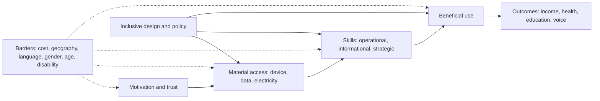

## Introduction

Digital technology promises to widen opportunity: a farmer can check market prices on a phone, a student can attend a lecture remotely, a trader can receive payment instantly through mobile money. Yet the same technologies can deepen inequality. When a government service moves online, a bank closes branches in favour of an app, or a job application requires an email address and a CV upload, people without devices, connectivity, skills or accessible interfaces can find themselves shut out of things they previously accessed without difficulty.

This lesson examines **digital inclusion**: the idea that all people should have the access, skills and confidence to use digital technology in ways that benefit them. It explains the concept of the digital divide at three levels, identifies its causes in Ghana and globally, introduces **accessibility** for persons with disabilities as a central ethical and design obligation, and analyses the social implications of digitalisation. The lesson uses qualitative descriptions rather than statistics; when you need figures for an assignment, consult current official sources such as national statistical services and international agencies, and cite them carefully.

## Learning Objectives

- Explain the first-, second- and third-level digital divides and the factors that produce them.
- Analyse the main dimensions of digital exclusion in Ghana, including geography, income, gender, age, language, literacy and disability.
- Apply accessibility principles, including the POUR principles of WCAG, to evaluate a digital service.
- Evaluate the ethical arguments for treating digital inclusion as a matter of justice rather than charity.
- Recommend practical measures that organisations can take to make IT systems more inclusive.

## Prerequisite Knowledge

- Ethical theories, especially utilitarianism and Rawls's veil of ignorance (Ethical Foundations module).
- General familiarity with mobile and web applications.

## Key Terminology

- **Digital inclusion**: The condition in which individuals and communities have the access, affordability, skills, confidence and relevant content needed to use digital technologies to participate fully in society.
- **Digital divide**: Systematic differences between groups in access to, use of, or benefits from digital technologies.
- **First-level divide**: Differences in physical and material access to devices and connectivity.
- **Second-level divide**: Differences in digital skills and patterns of use among those who have access.
- **Third-level divide**: Differences in the outcomes and benefits people obtain from using digital technologies.
- **Accessibility**: The design of products, services and environments so that people with disabilities can perceive, understand, navigate and interact with them.
- **Assistive technology**: Tools such as screen readers, magnifiers, switch devices and voice control that enable people with disabilities to use digital systems.
- **Universal design**: Designing products to be usable by the widest possible range of people without the need for adaptation.
- **Digital-by-default**: A policy of delivering services primarily through digital channels, which can exclude those unable to use them unless alternatives are maintained.

## Detailed Explanation

### From "haves and have-nots" to multiple divides

Early discussion of the digital divide focused on a simple question: who has a computer and an internet connection? This **first-level divide** remains important, but researchers such as Jan van Dijk argued that access is only the beginning. Van Dijk's work describes a sequence of access: *motivational* access (wanting to use technology), *material* access (devices and connections), *skills* access (operational, informational and strategic skills) and *usage* access (actually using technology in beneficial ways). People can fall behind at any stage.

This led to the recognition of a **second-level divide** in skills and use. Two people with identical smartphones may use them very differently: one only for calls and social media, the other for online learning, banking, job searching and running a business. A **third-level divide** concerns outcomes: even where use looks similar, some groups convert digital activity into tangible benefits (income, health, education, political voice) more effectively than others, often because of existing advantages.

### Causes of digital exclusion

Digital exclusion rarely has a single cause. Common, interacting factors include:

1. **Infrastructure and geography**: network coverage and quality are generally better in cities than in many rural and remote areas; electricity reliability also affects device use.
2. **Affordability**: the costs of devices, data bundles and electricity can be significant relative to income, especially for low-income households.
3. **Skills and literacy**: digital skills depend partly on general literacy, education and opportunities to practise.
4. **Language**: much digital content and many interfaces are available mainly in English or other global languages, disadvantaging speakers of local languages.
5. **Gender and social norms**: in many countries, women and girls have less access to devices and less time or encouragement to develop digital skills.
6. **Age**: older people may have less exposure to digital tools and may face physical or cognitive barriers.
7. **Disability**: inaccessible design excludes people who are blind, deaf, have motor impairments or cognitive disabilities.
8. **Trust and safety**: fear of fraud, harassment or surveillance can deter use, a form of motivational exclusion.

These factors **intersect**: an older, rural woman with a visual impairment who mainly speaks a local language may face several barriers at once.

### Social implications of digitalisation

Digitalisation reshapes social life, often in ways that are not neutral:

- **Access to services**: as public and private services move online, digital exclusion becomes exclusion from welfare, education, healthcare and finance.
- **Economic opportunity**: digital platforms create new forms of work and markets but may concentrate gains among those already skilled and connected.
- **Civic participation**: political information, debate and organisation increasingly happen online, so exclusion can reduce democratic voice.
- **Displacement of human contact**: replacing staff with apps can remove the help that vulnerable users relied upon.
- **Data invisibility**: people who generate little digital data, such as those in the informal economy without digital transaction histories, may be invisible to data-driven systems, for example credit scoring, and thereby disadvantaged.

## Theories, Frameworks and Models

### Why digital inclusion is an ethical issue

Several ethical arguments support treating inclusion as an obligation rather than an optional extra:

- **Rawlsian justice**: behind a veil of ignorance, people would not accept a society in which essential services are available only to the digitally advantaged. The difference principle suggests that digital innovations should be arranged to benefit the least advantaged.
- **Capabilities approach**: Amartya Sen and Martha Nussbaum argue that justice concerns what people are actually able to do and be. Digital access, skills and accessible design expand capabilities such as education, employment and political participation.
- **Utilitarian reasoning**: excluding large groups wastes potential social and economic benefits and can increase costs elsewhere, for example when excluded people cannot access health information.
- **Kantian respect**: designing services that some people cannot use, when inclusive alternatives are feasible, fails to treat them as equal members of the moral community.
- **Professional codes**: the ACM Code (2018) asks computing professionals to contribute to human well-being recognising all people as stakeholders and to be fair and avoid discrimination; the IEEE Code requires fair treatment regardless of characteristics such as disability.

### Accessibility and the POUR principles

The **Web Content Accessibility Guidelines (WCAG)**, published by the World Wide Web Consortium (W3C), are the most widely used technical standard for digital accessibility; version 2.2 was published in 2023. WCAG organises its success criteria under four principles, often remembered as **POUR**:

| Principle | Meaning | Examples of good practice |
|---|---|---|
| Perceivable | Information must be presentable in ways users can perceive | Text alternatives for images; captions for videos; sufficient colour contrast |
| Operable | Interface components must be usable by all | Full keyboard access; enough time to complete tasks; no content that flashes in ways that can cause seizures |
| Understandable | Information and operation must be understandable | Clear language; predictable navigation; helpful error messages |
| Robust | Content must work with current and future user agents, including assistive technologies | Valid, semantic markup; correct labelling of form fields for screen readers |

WCAG defines conformance levels A, AA and AAA. Many organisations and public procurement rules internationally treat Level AA as the practical target.

The **United Nations Convention on the Rights of Persons with Disabilities** (2006), which Ghana has ratified, includes obligations on states to promote access for persons with disabilities to information and communications technologies. In Ghana, the **Persons with Disability Act, 2006 (Act 715)** provides a national framework for the rights of persons with disabilities. Students should consult the official texts for specific obligations; this lesson is educational and is not legal advice.

### Inclusive design practices

Practical inclusive design includes: involving diverse users, including persons with disabilities, in research and testing; designing for low-bandwidth conditions and lower-specification devices; providing local-language and voice interfaces where appropriate; offering USSD or SMS channels alongside smartphone apps; maintaining assisted and offline channels when moving services online; and testing with assistive technologies.

## Ghanaian Business Application

### Mobile money as an inclusion success, and its limits

Mobile money is widely regarded as one of the most significant drivers of financial inclusion in Ghana. A key reason is that it works over **USSD** on basic feature phones, does not require a bank account, and is supported by large networks of agents who provide face-to-face help. The introduction of mobile money interoperability, allowing transfers across networks and between mobile wallets and bank accounts, further increased its usefulness.

Yet the mobile money experience also shows the limits of inclusion. Users with limited literacy may depend on agents or relatives to complete transactions, sometimes sharing PINs, which exposes them to fraud. Fraudsters target less experienced users through social engineering. Changes in transaction charges and taxes can affect low-income users disproportionately. Inclusion therefore requires attention not only to access but to skills, protection and fair pricing.

### Illustrative scenario: a digital-by-default insurance claim process

*Illustrative scenario.* Asante Shield Insurance, a fictional company, plans to close its claims counters and require all claims to be submitted through a smartphone app with photo uploads. A stakeholder analysis would show that elderly policyholders, rural clients with poor connectivity, customers with visual impairments and those with limited literacy would be disadvantaged. An inclusive alternative would keep the app, but also offer a USSD claim initiation, a call-centre option with local-language support, an accessible app tested with screen readers, and assisted submission through partner agents. The cost of these alternatives should be weighed against the ethical and reputational costs of exclusion and the possibility that excluded customers will simply stop claiming legitimate benefits.

## International Case Study

### Digital-by-default public services in the United Kingdom

The UK Government Digital Service, established in 2011, promoted a "digital by default" approach to public services alongside a strong emphasis on user-centred design. Its published Service Standard and design principles require teams to understand users and their needs and to make services that everyone who needs them can use, including people with access needs. The UK also adopted accessibility regulations for public sector websites and apps in 2018.

The UK experience shows both the benefits and the risks of digitalisation. Well-designed digital services can be faster and cheaper for many users, but critics and civil society organisations have warned that moving essential services online can exclude people without skills or access, and that "assisted digital" support and non-digital alternatives are needed. The lesson for Ghana and other countries is that digital transformation must be designed with inclusion as a requirement from the start, not as an afterthought.

## Diagram

## Common Misconceptions

- **"The digital divide is solved once everyone has a phone."** Access is only the first level; skills, meaningful use and outcomes also differ systematically between groups.
- **"Accessibility only matters for a small number of users."** Accessibility benefits many people, including older users, people with temporary impairments and users in difficult conditions such as bright sunlight or slow networks.
- **"Digital services are always more inclusive because they are available 24 hours a day."** They are more convenient for those with access and skills but can exclude others unless alternative channels are retained.
- **"Inclusion is a matter of charity."** Ethical theories such as Rawlsian justice and the capabilities approach treat inclusion as a requirement of fairness.
- **"Accessible design is too expensive."** Building accessibility in from the start is generally far cheaper than retrofitting, and inaccessible design carries legal and reputational risks.

## Common Examination Mistakes

- Defining the digital divide only in terms of access to devices.
- Citing invented or unsourced statistics about internet penetration.
- Discussing disability without referring to concrete accessibility principles such as WCAG's POUR.
- Treating "Ghana" as uniform, ignoring differences between urban and rural areas, regions, genders and age groups.
- Recommending "more internet access" without addressing skills, affordability, language and design.
- Failing to link inclusion to ethical theory and professional obligations.

## Critical Thinking Questions

1. Should a bank in Ghana be permitted to close physical branches in rural areas if it offers a mobile app? What conditions, if any, would make this ethically acceptable?
2. How does the third-level digital divide challenge the assumption that technology automatically reduces inequality?
3. Which ethical theory provides the strongest justification for accessibility requirements, and why?
4. Who should bear the cost of digital inclusion: government, technology firms, telecommunications operators or users?
5. How could AI-based voice interfaces in Ghanaian languages both reduce and create new forms of exclusion?

## Practical Exercises

1. **Accessibility audit.** Choose a public website or app used in Ghana. Using the W3C's introductory materials, check at least six aspects (for example image alternatives, colour contrast, keyboard navigation, form labels, captions, clear language). *Expected output:* a table recording each check, the result, the relevant POUR principle and a recommended fix.
2. **Exclusion mapping.** For a digital service of your choice, identify who might be excluded at each level of van Dijk's access sequence. *Expected output:* a diagram or table covering motivational, material, skills and usage access, with at least two groups at each stage.
3. **Inclusion business case.** Write a one-page recommendation for the Asante Shield illustrative scenario. *Expected output:* a memo presenting at least four inclusive channels or design features, their costs and benefits in qualitative terms, and the ethical justification.

## Key Takeaways

- Digital divides exist at three levels: access, skills and use, and outcomes.
- Exclusion results from interacting factors including geography, cost, skills, language, gender, age, disability and trust.
- Digitalisation reshapes access to services, work, civic life and data visibility; it is not socially neutral.
- WCAG's POUR principles provide a practical basis for accessible design; UN CRPD and Ghana's Act 715 frame disability rights.
- Inclusion is an ethical requirement supported by Rawlsian justice, the capabilities approach and professional codes.

## Further Reading

- van Dijk, J. A. G. M. (2005). *The deepening divide: Inequality in the information society*. Sage.
- World Wide Web Consortium. (2023). *Web content accessibility guidelines (WCAG) 2.2*. <https://www.w3.org/TR/WCAG22/>
- United Nations. (2006). *Convention on the rights of persons with disabilities*. <https://www.un.org/development/desa/disabilities/convention-on-the-rights-of-persons-with-disabilities.html>
- Sen, A. (1999). *Development as freedom*. Oxford University Press.
- Quinn, M. J. (2020). *Ethics for the information age* (8th ed.). Pearson.

## Video Resources

- [Web Accessibility Perspectives](https://www.w3.org/WAI/perspective-videos/) — W3C Web Accessibility Initiative. Short official videos showing how accessibility features help people with and without disabilities.
- [W3C Web Accessibility Initiative](https://www.w3.org/WAI/) — W3C. Official portal for WCAG, introductory guides and accessibility learning resources.

## Revision Summary

Digital inclusion means having the access, affordability, skills, confidence and relevant content to benefit from technology. Divides operate at three levels (access, skills and use, outcomes) and arise from intersecting factors. Digitalisation changes access to services, work and civic life, so exclusion carries serious consequences. Accessibility, guided by WCAG's POUR principles and disability rights frameworks, is a core design duty, and inclusion is a matter of justice.

- Three levels: access, skills/use, outcomes (van Dijk's access sequence).
- Intersecting barriers: geography, cost, literacy, language, gender, age, disability, trust.
- Mobile money shows inclusion through USSD and agents, but also fraud and cost risks.
- POUR: perceivable, operable, understandable, robust; Level AA is the common target.
- Justify inclusion with Rawls, capabilities, utility, Kantian respect and codes.
- Keep non-digital and assisted channels when moving services online.
