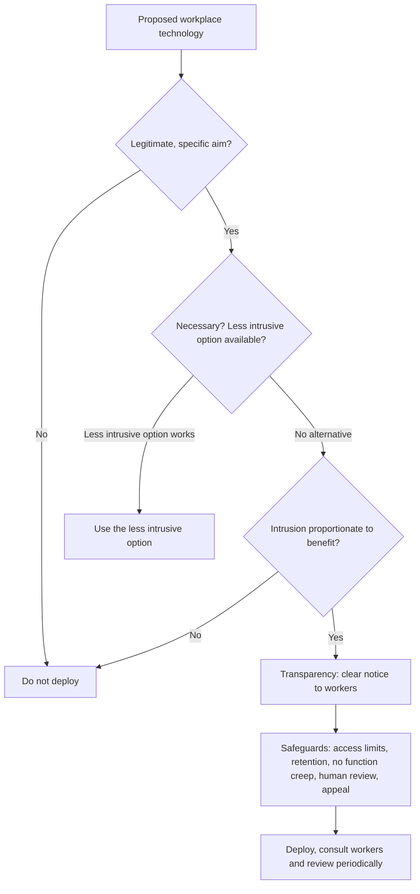

## Introduction

Human rights such as freedom of expression, privacy, association and equality were articulated long before the internet existed. Today, much of the exercise of those rights happens through digital systems: people speak on social media, organise through messaging apps, access information through search engines and earn their living on digital platforms. When those systems are shut down, censored, surveilled or designed unfairly, rights are affected. The concept of **digital rights** captures the idea that human rights apply in digital environments and that new technologies may require new protections.

The workplace is one of the most important settings in which digital rights are tested. Employers increasingly use technology to recruit, schedule, monitor, evaluate and sometimes dismiss workers. Some of these tools improve safety and efficiency; others intensify control, erode privacy and shift power further towards employers. This lesson first outlines digital rights and their foundations, then analyses the ethics of **workplace technology**, including monitoring, algorithmic management, platform work and automation, with applications to Ghana. Legal references are educational, not legal advice.

## Learning Objectives

- Explain the concept of digital rights and its grounding in international human rights.
- Describe key digital rights, including expression, access to information, privacy, association and freedom from discrimination.
- Analyse the ethical issues raised by internet shutdowns and content moderation.
- Evaluate workplace monitoring, algorithmic management and platform work using ethical theories and the principle of proportionality.
- Recommend fair workplace technology policies for a Ghanaian organisation.

## Prerequisite Knowledge

- Ethical theories and structured decision-making (Ethical Foundations module).
- Digital inclusion concepts from the previous lesson.

## Key Terminology

- **Digital rights**: Human rights as they apply to the use of digital technologies and networks, together with protections specific to digital environments.
- **Freedom of expression**: The right to seek, receive and impart information and ideas, subject only to limitations that are lawful, necessary and proportionate.
- **Internet shutdown**: The intentional disruption of internet or mobile communications, rendering them inaccessible or unusable for a population or area.
- **Proportionality**: The principle that an intrusion on rights must pursue a legitimate aim, be necessary to achieve it, and not be excessive relative to the benefit.
- **Workplace monitoring**: The collection of information about employees' activities, communications, location or performance using technology.
- **Algorithmic management**: The use of algorithms and data to assign, direct, evaluate and discipline workers, often with limited human involvement.
- **Platform work (gig work)**: Paid work arranged through digital platforms that match workers with customers, often classified as self-employment.
- **Function creep**: The gradual use of data or technology for purposes beyond those for which it was originally introduced.

## Detailed Explanation

### The foundations of digital rights

The **Universal Declaration of Human Rights** (1948) and the **International Covenant on Civil and Political Rights** (1966) protect, among other rights, privacy (Article 12 of the Declaration, Article 17 of the Covenant) and freedom of expression (Article 19 of both). These provisions were drafted in technology-neutral terms, protecting expression "through any media" and "regardless of frontiers". In 2012 the UN Human Rights Council adopted a resolution affirming that the same rights people have offline must also be protected online, in particular freedom of expression. At regional level, the **African Charter on Human and Peoples' Rights** protects the right to receive information and to express and disseminate opinions within the law, and the African Commission on Human and Peoples' Rights adopted a revised Declaration of Principles on Freedom of Expression and Access to Information in Africa in 2019 that addresses internet-related issues.

In Ghana, the **1992 Constitution** protects fundamental human rights and freedoms, including freedom of speech and expression, freedom of the press and privacy of the home, correspondence and communication, subject to limitations provided by law. The **Right to Information Act, 2019 (Act 989)** gives a right of access to information held by public institutions.

### Key digital rights

| Right | Digital dimension | Typical threats |
|---|---|---|
| Expression and information | Speaking, publishing and accessing content online | Censorship, internet shutdowns, over-broad content removal, intimidation |
| Privacy and data protection | Control over personal information and communications | Surveillance, data breaches, excessive data collection |
| Association and assembly | Organising through online groups and messaging | Monitoring of activists, blocking of platforms |
| Equality and non-discrimination | Fair treatment by digital systems | Biased algorithms, inaccessible design |
| Access | Meaningful connectivity as an enabler of other rights | Cost, lack of infrastructure, exclusion |
| Due process | Ability to understand and contest decisions | Opaque automated decision-making |

Whether internet access is itself a human right is debated. Many scholars argue that it is best seen as an *enabling* condition for exercising recognised rights rather than a free-standing right; others argue for recognising it directly. Either way, deliberately cutting off access affects many rights at once.

### Internet shutdowns and content moderation

Governments in many countries have imposed internet shutdowns or blocked social media platforms, often during elections, protests or examinations, citing security or the prevention of misinformation. Human rights bodies have repeatedly criticised blanket shutdowns as disproportionate because they affect entire populations, disrupt commerce, emergency services and mobile money, and prevent journalists from reporting. A proportionality analysis asks whether the aim is legitimate, whether the measure is necessary and whether less intrusive alternatives exist.

Private platforms also shape digital rights through **content moderation**. Removing harmful content such as incitement or harassment protects users, but over-removal can silence legitimate speech, especially in languages and contexts the platform understands poorly. Ethically defensible moderation requires clear rules, consistent enforcement, cultural and linguistic competence, transparency reporting and accessible appeals.

## Theories, Frameworks and Models

### Workplace technology: the power asymmetry

The employment relationship involves an imbalance of power: the employer controls pay, promotion and dismissal, so employees may feel unable to refuse intrusive technology. Consent obtained under such conditions may not be freely given. This is why many data protection regimes, including the GDPR, caution against relying on employee consent as the basis for processing and instead require employers to justify processing by other legitimate grounds and to respect proportionality. Ghana's Data Protection Act, 2012 (Act 843) also applies to employers as data controllers processing employees' personal data.

### A proportionality framework for workplace monitoring

Employers have legitimate interests: protecting security, preventing fraud, ensuring health and safety, complying with regulations and managing performance. Employees have legitimate interests in privacy, dignity, autonomy and fair treatment. A proportionality framework balances them through five questions:

1. **Legitimate aim**: What specific problem is the monitoring meant to address?
2. **Necessity**: Is monitoring needed, or could the aim be achieved by less intrusive means such as training, better processes or targeted controls?
3. **Proportionality**: Is the intrusion (scope, duration, sensitivity of data) reasonable relative to the benefit?
4. **Transparency**: Have workers been told clearly what is monitored, why, how data are used and who sees them?
5. **Safeguards**: Are there limits on access, retention periods, prohibitions on function creep, human review of decisions and channels for challenge?

| Monitoring practice | Typical aim | Intrusiveness | Likely assessment |
|---|---|---|---|
| Logging access to customer financial records | Fraud prevention, regulatory compliance | Low to moderate | Generally proportionate with transparency |
| GPS tracking of company vehicles during working hours | Safety, logistics | Moderate | Often proportionate if limited to working hours |
| Continuous webcam monitoring of remote staff | Productivity | High | Hard to justify; less intrusive options exist |
| Keystroke logging and screenshots | Productivity | High | Usually disproportionate except for narrow security investigations |
| Reading personal messages on employees' own phones | Various | Very high | Very difficult to justify |

### Algorithmic management and platform work

Algorithmic management uses data and automated systems to allocate tasks, set targets, rate performance and sometimes deactivate workers. It is prominent on ride-hailing and delivery platforms but is spreading to warehouses, call centres and retail. Ethical concerns include:

- **Opacity**: workers may not know why they received fewer jobs or were deactivated.
- **Intensification**: constant measurement can push workers to unsafe speeds or hours.
- **Bias**: customer ratings can encode discrimination, and the algorithm may amplify it.
- **Lack of voice**: decisions are hard to contest when there is no accessible human decision-maker.
- **Misclassification**: classifying workers as independent contractors can deny them employment protections, an issue litigated in several countries.

From a Kantian perspective, treating workers as data points to be optimised risks treating them merely as means. From a utilitarian perspective, efficiency gains must be weighed against harms to health, income stability and dignity. Virtue ethics asks whether management practices express fairness and care. Rawls directs attention to the least advantaged workers, who often have the least bargaining power.

### Automation and the future of work

Automation and AI can remove dangerous or repetitive tasks and create new kinds of jobs, but they can also displace workers, deskill roles and concentrate gains among owners of technology. Ethical responses include early consultation with workers, investment in retraining, sharing productivity gains and designing systems that augment rather than replace human judgement where appropriate.

## Ghanaian Business Application

### Ride-hailing and delivery platforms in Ghanaian cities

International and local ride-hailing and delivery platforms operate in Accra, Kumasi and other Ghanaian cities, offering flexible income opportunities to many drivers and riders. Drivers have at times organised and publicly protested over issues such as commission levels, fares and working conditions. These disputes illustrate classic algorithmic management issues: pricing and job allocation are set by software, drivers often have limited insight into how decisions are made, and their employment status shapes the protections they receive. Ghana's Labour Act, 2003 (Act 651) governs employment relationships, and whether and how it applies to platform workers is a question for legal analysis beyond the scope of this lesson.

### Illustrative scenario: monitoring at a call centre

*Illustrative scenario.* Harbour Contact Centre, a fictional business-process outsourcing company in Tema, plans to introduce software that records all calls, analyses agents' tone using AI, logs keystrokes and takes random screenshots, with automatic warnings issued when productivity scores fall below a threshold.

Applying the proportionality framework:

- **Aim**: call recording for quality and client compliance is a legitimate and widely understood aim. Keystroke logging and random screenshots for productivity are weaker aims.
- **Necessity**: supervisor coaching and sample-based quality review may achieve quality goals with less intrusion.
- **Proportionality**: AI tone analysis raises accuracy and bias concerns, especially across accents; automatic warnings without human review are disproportionate.
- **Transparency and safeguards**: staff should receive clear notice, there should be limits on retention and access, and any disciplinary action should involve human review and a right to respond.

A defensible policy would retain call recording with notice, use sample-based quality review, pilot any AI tool with accuracy testing across Ghanaian accents and worker consultation, exclude keystroke logging except for targeted security investigations, and require human decisions on discipline.

## International Case Study

### The Amsterdam rulings on ride-hailing drivers' data rights

In 2021, the District Court of Amsterdam, which had jurisdiction because the companies' relevant European entities were based in the Netherlands, ruled on cases brought by drivers seeking access to their personal data and information about automated decisions under the GDPR. The drivers, supported by worker advocacy groups, argued that they needed this information to understand how they were assessed and, in some cases, deactivated. The courts ordered the companies to provide certain data and information about some automated decisions, while rejecting other claims. Subsequent appeals refined these findings.

The cases show how **data protection rights can function as workers' rights** in the platform economy: rights of access and protections around automated decision-making give workers tools to challenge opaque algorithmic management. They also show the limits of individual rights when information asymmetries are large, which is why collective approaches such as worker consultation and transparency obligations are increasingly discussed.

## Diagram

## Common Misconceptions

- **"Employees consent to monitoring by signing their contract, so any monitoring is ethical."** Consent under unequal power is often not freely given; monitoring must also be necessary, proportionate and transparent.
- **"Digital rights are new rights invented for the internet."** Most digital rights are existing human rights, such as expression and privacy, applied to digital contexts.
- **"Internet shutdowns only affect social media."** Shutdowns disrupt commerce, mobile money, emergency communication, education and journalism, affecting many rights at once.
- **"Algorithms are objective, so algorithmic management is fairer than human managers."** Algorithms embed the choices and data of their designers and can encode bias, while being harder to question.
- **"Gig workers are entrepreneurs, so labour ethics do not apply."** Ethical obligations of fairness, safety and dignity apply regardless of legal classification.

## Common Examination Mistakes

- Discussing digital rights without grounding them in human rights instruments or constitutional protections.
- Treating all workplace monitoring as either acceptable or unacceptable without a proportionality analysis.
- Ignoring the power asymmetry in employment when discussing consent.
- Making unsupported claims about specific Ghanaian laws; describe them generally and accurately.
- Failing to propose concrete safeguards such as retention limits, access controls and human review.
- Overlooking the perspective of workers and other affected stakeholders in recommendations.

## Critical Thinking Questions

1. Is meaningful internet access a human right in itself, or a precondition for other rights? What difference does the answer make for policy in Ghana?
2. Can a government ever justify a nationwide internet shutdown? Apply the proportionality test to a hypothetical example.
3. How should content moderation account for Ghanaian languages, humour and political context?
4. Is algorithmic management inherently disrespectful to workers, or can it be designed to empower them?
5. What responsibilities do IT professionals who build monitoring tools have towards the workers who will be monitored?

## Practical Exercises

1. **Monitoring policy review.** Obtain or draft a workplace IT acceptable-use and monitoring policy. *Expected output:* an evaluation of the policy against the five proportionality questions, with at least five specific improvements.
2. **Rights mapping.** Choose a digital platform widely used in Ghana. *Expected output:* a table mapping six digital rights to features or practices of the platform that support or threaten each right, with a recommendation for each threat.
3. **Algorithmic management charter.** Draft a one-page charter of principles for a fictional delivery platform operating in Accra. *Expected output:* at least six principles covering transparency, explanation, human review, safety, data access and worker consultation, each with a short justification.

## Key Takeaways

- Digital rights are human rights, such as expression, privacy, association and equality, applied to digital contexts, with access as a key enabler.
- Shutdowns and content moderation must be assessed by legality, necessity and proportionality.
- Employment involves power asymmetry, so employee consent alone rarely justifies monitoring.
- The proportionality framework asks about aim, necessity, proportionality, transparency and safeguards.
- Algorithmic management raises opacity, intensification, bias and voice concerns; data protection rights can serve as workers' rights.

## Further Reading

- United Nations. (1948). *Universal declaration of human rights*. <https://www.un.org/en/about-us/universal-declaration-of-human-rights>
- Zuboff, S. (2019). *The age of surveillance capitalism: The fight for a human future at the new frontier of power*. PublicAffairs.
- Johnson, D. G. (2009). *Computer ethics* (4th ed.). Pearson.
- Quinn, M. J. (2020). *Ethics for the information age* (8th ed.). Pearson.
- Tavani, H. T. (2016). *Ethics and technology: Controversies, questions, and strategies for ethical computing* (5th ed.). Wiley.

## Video Resources

- [Markkula Center for Applied Ethics](https://www.scu.edu/ethics/): Santa Clara University. Official portal with resources on technology ethics, including workplace and internet ethics.
- [UNESCO Recommendation on the Ethics of Artificial Intelligence](https://www.unesco.org/en/artificial-intelligence/recommendation-ethics): UNESCO. Official page on the global AI ethics standard, which addresses human rights and labour impacts.

## Revision Summary

Digital rights extend established human rights, notably expression, privacy, association, equality and due process, into digital environments, supported by the UDHR, ICCPR, the African Charter and Ghana's Constitution. Shutdowns and content moderation must satisfy legality, necessity and proportionality. In workplaces, power asymmetry undermines consent, so monitoring and algorithmic management must be justified by a legitimate aim, necessity, proportionality, transparency and safeguards.

- 2012 UN resolution: the same rights apply online as offline.
- Shutdowns affect many rights at once and are rarely proportionate.
- Five proportionality questions: aim, necessity, proportionality, transparency, safeguards.
- Algorithmic management concerns: opacity, intensification, bias, no voice, misclassification.
- Data protection rights can function as workers' rights (Amsterdam cases).
- Recommend human review, retention limits and worker consultation.
