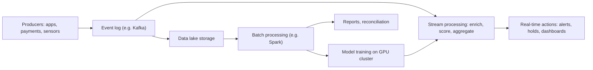

## Introduction

Many of the most valuable business analytics problems are simply too large or too fast for a single computer. A national weather forecast, a fraud-detection system that must score every mobile money transaction in milliseconds, a bank's overnight risk calculation, or the training of a large machine-learning model all require computing power and data-handling techniques beyond the ordinary desktop or single server.

High-performance computing (HPC) and advanced data processing address this challenge from two complementary directions. HPC focuses on *computation*: splitting heavy calculations across many processors so they finish quickly. Big data and stream processing focus on *data*: storing, moving and analysing datasets that are very large, arrive continuously or come in many formats. Modern cloud platforms have blurred the boundary between the two, making capabilities once confined to national laboratories available on demand. This lesson explains the core concepts, the main architectural patterns and how a business should decide which approach fits its needs.

## Learning Objectives

- Explain the principles of parallel computing, including data and task parallelism, and the limits described by Amdahl's law.
- Compare HPC clusters, GPUs and cloud-based HPC as ways of delivering high performance.
- Distinguish batch processing from stream processing and describe the characteristics of big data.
- Apply a worked speed-up calculation to judge whether parallelising a workload is worthwhile.
- Evaluate business use cases and design a suitable data-processing architecture for a Ghanaian organisation.

## Prerequisite Knowledge

- Familiarity with basic computer components (CPU, memory, storage) and with cloud computing models from earlier modules.
- A general understanding of databases and analytics.
- Comfort with simple arithmetic involving fractions and percentages.

## Key Terminology

- **High-performance computing (HPC)**: The use of aggregated computing power, typically many processors working in parallel, to solve problems far faster than a single machine could.
- **Parallelism**: Executing parts of a computation simultaneously on multiple processing units.
- **Cluster**: A group of interconnected computers (nodes) that work together, usually coordinated by a scheduler and linked by a fast network.
- **GPU (graphics processing unit)**: A processor with thousands of simple cores optimised for performing the same operation on many data elements at once; widely used for machine learning and simulation.
- **Amdahl's law**: A formula showing that the speed-up from parallelisation is limited by the fraction of a program that must run sequentially.
- **Batch processing**: Processing a large, bounded set of data collected over time, typically on a schedule.
- **Stream processing**: Continuously processing unbounded data as events arrive, producing results with low latency.
- **Data lake**: A repository that stores large volumes of raw data in its native formats for later processing.
- **Event**: A record that something happened at a point in time, such as a payment, a sensor reading or a click.
- **Windowing**: Grouping streaming events into finite chunks (for example, per minute) so that aggregates can be computed.

## Detailed Explanation

### Why parallelism?

For decades, processors became faster mainly by increasing clock speed. Physical limits on heat and power ended that trend in the mid-2000s, so performance gains now come chiefly from *more* processing units rather than faster ones. Exploiting many cores, many machines or many GPU threads requires software designed for parallel execution.

Two broad forms exist. **Data parallelism** applies the same operation to different pieces of data at the same time, for example calculating credit scores for one million customers by giving each of 100 workers 10,000 customers. **Task parallelism** runs different operations at the same time, for example one process cleans data while another trains a model and a third generates reports. Problems that divide into fully independent pieces are called "embarrassingly parallel" and scale very well; problems in which pieces must constantly exchange information, such as weather simulation where each grid cell depends on its neighbours, need fast interconnects and careful programming.

### HPC clusters

A traditional HPC system is a cluster of many compute nodes connected by a low-latency, high-bandwidth network, sharing a parallel file system and controlled by a job scheduler. Users submit jobs that request a number of nodes for a period of time. Programs often use the Message Passing Interface (MPI) to coordinate work between nodes. The largest such systems are ranked twice yearly in the TOP500 list using a standard linear-algebra benchmark. Typical HPC workloads include climate and weather modelling, computational fluid dynamics in engineering, genomics, seismic analysis for oil and gas exploration, and financial risk simulation.

### GPUs and accelerators

GPUs were designed to render graphics, which involves the same calculation on millions of pixels. That design suits any workload dominated by large matrix and vector operations, especially training and running neural networks. A GPU contains thousands of simpler cores and very high memory bandwidth, so for suitable workloads it can be dramatically faster and more energy-efficient than a CPU. Other accelerators, including tensor processing units and field-programmable gate arrays, target specific workloads. The business implication is that the cost and availability of accelerators, increasingly accessed through cloud providers, now shapes what AI projects are feasible.

### Cloud HPC

Cloud providers offer HPC-style instances, GPU clusters and managed batch services on a pay-per-use basis. This allows an organisation to run a large simulation for a few days without owning a supercomputer. The trade-offs include data transfer time and cost, possible data-sovereignty concerns, and the fact that sustained, continuous workloads can become more expensive in the cloud than on owned infrastructure.

### Big data characteristics

Big data is often described with the "Vs": **volume** (scale), **velocity** (speed of arrival), **variety** (structured tables, text, images, logs, sensor data), and frequently **veracity** (quality and trustworthiness) and **value**. Traditional relational databases on a single server struggle when all of these grow together. Distributed approaches therefore store data across many machines and move the computation to the data rather than the data to the computation.

### Batch processing: MapReduce to Spark

Google's MapReduce model, described by Dean and Ghemawat, showed how to process enormous datasets on clusters of commodity machines: a *map* step processes chunks of data independently, and a *reduce* step combines intermediate results. The open-source Hadoop ecosystem popularised the idea. Apache Spark later improved performance for many workloads by keeping intermediate data in memory and offering a unified engine for SQL, machine learning and graph processing. Batch processing suits tasks such as end-of-day reconciliation, monthly customer segmentation and model training on historical data.

### Stream processing

Many decisions lose value if they are made late. Detecting a fraudulent transaction after the money has left, or discovering a failing pump after it has broken, is much less useful than acting immediately. Stream processing treats data as an unbounded sequence of events. A typical architecture has:

1. **Producers** that emit events (payment systems, apps, sensors).
2. A **durable event log or message broker**, such as Apache Kafka, that stores events in order and lets many consumers read them.
3. A **stream processing engine**, such as Apache Flink, Spark Structured Streaming or Kafka Streams, that filters, joins, enriches and aggregates events, often within time windows.
4. **Sinks** that receive results: alerting systems, dashboards, databases or downstream applications.

Important concepts include the difference between *event time* (when something happened) and *processing time* (when the system saw it), handling late-arriving data, and processing guarantees such as "at-least-once" and "exactly-once" semantics. The dataflow model described by Akidau and colleagues at Google formalised many of these ideas.

## Theories, Frameworks and Models

### Amdahl's law

Amdahl's law states that if a fraction `p` of a program can be parallelised and the remainder `(1 − p)` must run sequentially, the maximum speed-up on `N` processors is:

`Speed-up = 1 / ((1 − p) + p / N)`

As `N` grows very large, the speed-up approaches `1 / (1 − p)`. The sequential part becomes the bottleneck. Gustafson's law offers a complementary view: in practice, people often use extra processors to solve *bigger* problems in the same time, so the parallel portion grows with the resources.

### Lambda and Kappa architectures

Two well-known patterns combine batch and stream processing. The **Lambda architecture** runs a batch layer (accurate, comprehensive, slow) alongside a speed layer (fast, approximate) and merges their outputs in a serving layer. Its weakness is maintaining the same logic in two systems. The **Kappa architecture** treats everything as a stream: historical results are produced by replaying the event log through the same streaming code. Many modern organisations prefer Kappa-style designs or "lakehouse" platforms that unify storage for both.

### Choosing an approach

| Need | Suitable approach |
|---|---|
| Heavy numerical simulation with tightly coupled calculations | HPC cluster with fast interconnect and MPI |
| Training or running deep learning models | GPU clusters, on-premises or cloud |
| Large historical analysis, periodic reports | Batch processing (for example Spark on a data lake) |
| Decisions within seconds or milliseconds | Stream processing on an event log |
| Occasional peaks of large computation | Cloud HPC or managed batch services |

## Worked Example

**Illustrative scenario.** An analytics team runs a nightly credit-risk simulation that takes 10 hours on one server. Profiling shows that 90% of the run time (`p = 0.9`) consists of independent simulations that can be parallelised, while 10% (data loading, final aggregation) is sequential.

Step 1: Speed-up on 16 servers.
`Speed-up = 1 / (0.1 + 0.9 / 16) = 1 / (0.1 + 0.05625) = 1 / 0.15625 = 6.4`
New run time = `10 / 6.4 ≈ 1.56 hours`.

Step 2: Speed-up on 64 servers.
`Speed-up = 1 / (0.1 + 0.9 / 64) = 1 / (0.1 + 0.0140625) = 1 / 0.1140625 ≈ 8.77`
New run time = `10 / 8.77 ≈ 1.14 hours`.

Step 3: Maximum possible speed-up.
`1 / (1 − 0.9) = 10`, so the job can never finish in less than 1 hour however many servers are added.

Step 4: Business interpretation. Quadrupling servers from 16 to 64 saves only about 25 minutes. If the business only needs the result before 6 a.m., 16 servers are sufficient; the better investment may be to reduce the sequential portion, for example by parallelising data loading, which would raise the ceiling. This shows why managers should ask "what is the sequential bottleneck?" before buying more hardware.

## Ghanaian Business Application

**Illustrative scenario.** *Kente Pay* (a fictional Ghanaian mobile money and payments provider) processes a high volume of wallet transfers, merchant payments and cash-out transactions daily, with sharp peaks around month-end salary payments and festive seasons. It faces three challenges: detecting fraud such as SIM-swap-linked account takeovers in near real time; reconciling transactions with partner banks every night; and producing regulatory reports.

A suitable architecture combines both processing styles:

- Every transaction is published as an event to a replicated event log.
- A stream processing job enriches each event with customer risk features (recent SIM change, device fingerprint, unusual location, velocity of transfers in the last ten minutes) and scores it with a fraud model. High-risk transactions are held for step-up verification within seconds.
- The same events are written to a data lake. Nightly batch jobs reconcile with bank records, retrain fraud models on GPU instances, and generate reports for management and regulators.
- Burst capacity for model retraining is rented from a cloud provider, while customer data handling is designed to respect Ghana's Data Protection Act, 2012 (Act 843) and any data-residency requirements applicable to the firm.

Managerial issues include the cost of always-on streaming infrastructure, scarcity of engineers skilled in distributed systems, the need for explainable fraud decisions to handle customer complaints, and resilience when connectivity or power is interrupted.

## International Case Study

### CERN and the Worldwide LHC Computing Grid

The Large Hadron Collider at CERN, the European particle physics laboratory near Geneva, generates far more raw data than any single data centre could store or analyse. CERN's response combines two strategies examined in this lesson. First, real-time "trigger" systems filter collision events as they happen, discarding the vast majority and keeping only potentially interesting ones, a form of extreme stream processing. Second, the retained data is distributed for storage and analysis across the Worldwide LHC Computing Grid, a federation of computing centres in many countries organised in tiers, with CERN's own data centre at the core.

Lessons for business:

- Filtering early (at the edge or at ingestion) is often more practical than storing everything.
- Federated, distributed computing can pool resources owned by many organisations under common standards.
- Software, data management and governance are as critical as raw hardware.
- Technologies developed for scientific HPC, such as distributed storage and workload scheduling, often diffuse into business computing.

## Diagram

## Common Misconceptions

- **Misconception:** Adding more processors always makes a job proportionally faster. **Correction:** Amdahl's law shows that the sequential portion caps the speed-up; communication overhead can even slow jobs down.
- **Misconception:** GPUs are only for graphics and games. **Correction:** GPUs are general-purpose parallel processors that now dominate machine-learning training and many scientific workloads.
- **Misconception:** Stream processing makes batch processing obsolete. **Correction:** Batch remains efficient for large historical analysis, model training and periodic reporting; most organisations use both.
- **Misconception:** Big data simply means a lot of data. **Correction:** Velocity, variety and veracity often create the real difficulty, and value depends on asking the right questions.
- **Misconception:** HPC is only for scientists and governments. **Correction:** Cloud HPC makes high-performance resources available to businesses on demand for risk modelling, design, analytics and AI.

## Common Examination Mistakes

- Applying Amdahl's law incorrectly, for example dividing the whole run time by the number of processors.
- Describing stream processing without mentioning events, low latency or windowing.
- Listing the "Vs" of big data without linking them to a business problem.
- Recommending a supercomputer when the scenario actually requires real-time stream processing, or vice versa.
- Ignoring costs, skills and governance when proposing an architecture.

## Critical Thinking Questions

1. When would a Ghanaian bank be better served by owning a GPU cluster rather than renting cloud GPUs? What factors would tip the decision?
2. A firm claims its fraud system is "real time" but scores transactions every 15 minutes. Is that adequate? For which fraud types?
3. How do event time and processing time differ, and why does the distinction matter when mobile connectivity is intermittent?
4. Is the Lambda architecture's duplication of logic a price worth paying for accuracy? When would you choose Kappa instead?
5. What ethical issues arise when stream processing is used to make automated decisions about customers in milliseconds?

## Practical Exercises

1. **Amdahl calculation.** A report-generation job takes 6 hours; 75% is parallelisable. Calculate the run time on 4, 8 and 32 processors and the theoretical maximum speed-up. *Expected output:* a short table of run times and a recommendation on the number of processors.
2. **Batch or stream?** For eight business tasks (payroll, card fraud detection, monthly churn analysis, warehouse temperature alerts, social media sentiment monitoring, annual audit, ride-hailing pricing, inventory replenishment), decide whether batch, stream or both is appropriate. *Expected output:* a table with a justification referring to latency needs.
3. **Architecture sketch.** Design a data-processing architecture for a Ghanaian agro-processor that collects moisture and temperature readings from warehouses and wants both alerts and quarterly quality reports. *Expected output:* a labelled diagram and a 200-word explanation.

## Key Takeaways

- Performance growth now comes from parallelism across cores, nodes and GPUs.
- Amdahl's law limits speed-up; find and reduce the sequential bottleneck before buying hardware.
- HPC clusters suit tightly coupled simulation; GPUs suit machine learning and vectorised workloads.
- Batch processing handles large historical datasets; stream processing handles unbounded events with low latency.
- Event logs, windowing and processing guarantees are core stream-processing concepts.
- Cloud HPC broadens access, but cost, data transfer, sovereignty and skills must be evaluated.

## Further Reading

- Dean, J., & Ghemawat, S. (2008). MapReduce: Simplified data processing on large clusters. *Communications of the ACM, 51*(1), 107–113.
- Zaharia, M., et al. (2016). Apache Spark: A unified engine for big data processing. *Communications of the ACM, 59*(11), 56–65.
- Akidau, T., et al. (2015). The dataflow model: A practical approach to balancing correctness, latency, and cost in massive-scale, unbounded, out-of-order data processing. *Proceedings of the VLDB Endowment, 8*(12), 1792–1803.
- Kleppmann, M. (2017). *Designing data-intensive applications*. O'Reilly Media.

## Video Resources

- [TOP500](https://www.top500.org/) — TOP500 project. Official site of the twice-yearly ranking of the world's most powerful supercomputers, with explanatory material on HPC trends.
- [Apache Spark](https://spark.apache.org/) — Apache Software Foundation. Official project site with documentation and introductory material on large-scale batch and streaming processing.
- [Apache Kafka](https://kafka.apache.org/) — Apache Software Foundation. Official project site explaining event streaming concepts and use cases.

## Revision Summary

High-performance computing uses parallelism across many cores, cluster nodes and GPUs to solve heavy computational problems; Amdahl's law shows that the sequential fraction limits speed-up. Advanced data processing handles volume, velocity and variety through distributed batch processing (MapReduce, Spark) and continuous stream processing (event logs, stream engines, windowing). Most businesses combine batch and stream approaches and increasingly rent HPC and GPU capacity from the cloud.

- Speed-up = 1 / ((1 − p) + p / N); maximum = 1 / (1 − p).
- Data parallelism versus task parallelism; embarrassingly parallel problems scale best.
- Clusters + MPI for coupled simulation; GPUs for AI.
- Batch = bounded, periodic; stream = unbounded, low latency.
- Lambda (batch + speed layers) versus Kappa (stream only, replay the log).
- Evaluate cost, skills, data transfer and governance, not just speed.
