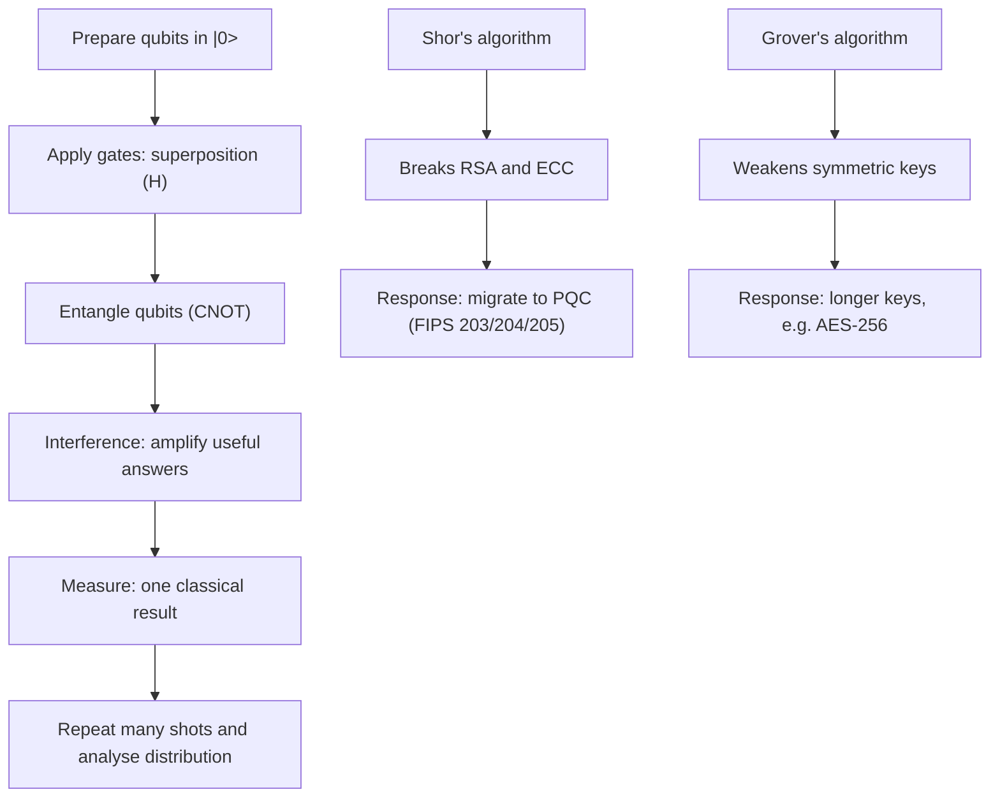

## Introduction

Quantum computing attracts more hype and more confusion than almost any other emerging technology. Press coverage often suggests that quantum computers "try every answer at once" and will soon replace today's servers. Neither claim is accurate. Quantum computers are a fundamentally different kind of machine that exploits the rules of quantum mechanics to solve a narrow, but strategically important, set of problems far more efficiently than any known classical method. For most everyday business computing they offer no advantage at all.

For an IT-for-business manager the most urgent quantum issue is not buying a quantum computer. It is cryptography. A sufficiently large, error-corrected quantum computer running Shor's algorithm would break the public-key cryptography (RSA and elliptic-curve schemes) that protects online banking, mobile money, VPNs and digital signatures. Because encrypted data can be stolen today and decrypted later, organisations must start planning a migration to post-quantum cryptography long before such a machine exists. This lesson gives you the conceptual foundations needed to separate fact from hype and to lead that planning.

## Learning Objectives

- Explain the concepts of qubits, superposition, entanglement and measurement without relying on misleading metaphors.
- Describe, at an intuitive level, how quantum gates and interference allow quantum algorithms to work.
- Distinguish the problem types for which quantum computers are and are not expected to offer an advantage.
- Explain conceptually what Shor's and Grover's algorithms do and why they matter for cryptography.
- Evaluate the implications of the NISQ era and the "harvest now, decrypt later" threat for business risk.
- Apply a structured approach to planning migration to post-quantum cryptography, referring to NIST's 2024 standards.

## Prerequisite Knowledge

- A basic understanding of binary data (bits) and how computers store information.
- General awareness of encryption, passwords and digital certificates from everyday IT use.
- No physics or advanced mathematics is assumed; concepts are explained intuitively.

## Key Terminology

- **Qubit**: The basic unit of quantum information; a two-level quantum system whose state can be a weighted combination (superposition) of the states labelled 0 and 1.
- **Superposition**: A quantum state that is a combination of basis states, described by complex numbers called amplitudes that determine the probabilities of each measurement outcome.
- **Entanglement**: A correlation between qubits so strong that the joint state cannot be described as separate states of each qubit; measuring one constrains the outcomes of the others.
- **Measurement**: The act of reading a qubit, which yields a definite classical result (0 or 1) with probabilities set by the amplitudes and disturbs the superposition.
- **Quantum gate**: A reversible operation that transforms the state of one or more qubits; sequences of gates form a quantum circuit.
- **Interference**: The adding or cancelling of amplitudes, used by quantum algorithms to amplify correct answers and suppress wrong ones.
- **Decoherence**: The loss of quantum behaviour caused by unwanted interaction with the environment, introducing errors.
- **NISQ**: Noisy Intermediate-Scale Quantum; a term introduced by John Preskill for the current era of quantum devices with tens to a few thousand noisy qubits and no full error correction.
- **Post-quantum cryptography (PQC)**: Classical cryptographic algorithms designed to resist attack by both classical and quantum computers.
- **Harvest now, decrypt later**: An attack strategy in which adversaries collect encrypted data today in order to decrypt it once a capable quantum computer becomes available.

## Detailed Explanation

### From bits to qubits

A classical bit is always either 0 or 1. A qubit is a physical system with two distinguishable states, conventionally written |0⟩ and |1⟩, but it can also exist in a superposition of both. Mathematically, a single-qubit state is written as `a|0⟩ + b|1⟩`, where `a` and `b` are amplitudes. Amplitudes are complex numbers, and the probability of observing 0 when the qubit is measured is `|a|²`, while the probability of observing 1 is `|b|²`; these probabilities sum to 1.

The important point is that amplitudes are not probabilities. Probabilities are always positive and simply add. Amplitudes can be positive, negative or complex, so they can reinforce or cancel one another. This is the property that gives quantum computing its power, and it is why the popular claim that a qubit is "both 0 and 1 at the same time" is at best incomplete.

Physical qubits are built in several ways: superconducting circuits cooled close to absolute zero, trapped ions held by electromagnetic fields, neutral atoms manipulated with lasers, photons, and other approaches. Each technology involves trade-offs in speed, error rates, connectivity and scalability, and no single approach has yet clearly won.

### Many qubits and exponential state spaces

A register of `n` classical bits holds exactly one of `2^n` possible values at a time. A register of `n` qubits is described by `2^n` amplitudes simultaneously. Fifty qubits require roughly a thousand million million amplitudes to describe, which is why simulating even modest quantum systems on classical computers becomes infeasible. However, this does not mean that a quantum computer gives you `2^n` answers. When you measure the register you obtain only one `n`-bit result. The art of quantum algorithm design is to choreograph interference so that, by the time you measure, the amplitude of the correct or useful answer is large and the amplitudes of wrong answers are small.

### Entanglement

When qubits interact through certain gates they can become entangled. In the simplest example, two qubits are prepared in a state in which measuring both always gives either 00 or 11, each with probability one half, but never 01 or 10. Before measurement neither qubit has its own definite value; the information resides in the correlation between them. Entanglement is a resource that quantum algorithms, quantum communication and quantum error correction all rely on. It does not allow faster-than-light communication: the outcome of each individual measurement is random, so no message can be sent by entanglement alone.

### Measurement

Measurement converts quantum information into classical information. It is probabilistic and irreversible: once a qubit in superposition is measured, the superposition is lost and the qubit is left in the state corresponding to the observed result. Because outcomes are probabilistic, quantum programs are typically run many times ("shots") and the distribution of results is analysed. Unwanted interaction with the environment acts like an accidental, partial measurement, which is why decoherence is such a serious engineering problem.

### Quantum gates at an intuitive level

Quantum gates are the quantum equivalent of logic gates, with one key difference: they are reversible. A few gates illustrate the idea:

- The **X gate** flips |0⟩ to |1⟩ and vice versa, like a classical NOT.
- The **Hadamard (H) gate** turns |0⟩ into an equal superposition of |0⟩ and |1⟩. Applying it twice returns the original state, because the amplitudes interfere and cancel. This simple fact demonstrates interference in action.
- **Phase gates** change the relative sign or phase of amplitudes without changing measurement probabilities directly; phases matter because they decide how amplitudes interfere later.
- The **CNOT gate** flips a target qubit only if a control qubit is 1. Applied after a Hadamard, it creates entanglement.

A quantum algorithm is therefore a circuit: prepare qubits, apply a carefully designed sequence of gates that creates superposition, entanglement and interference, then measure.

### Error correction and the gap between physical and logical qubits

Today's physical qubits make errors far more often than classical transistors. Quantum error correction encodes one reliable **logical qubit** in many physical qubits, continuously detecting and correcting errors without directly measuring the protected information. Estimates of how many physical qubits are needed per logical qubit vary with hardware quality and code choice, but the overhead is large. The machines that would threaten RSA require thousands of high-quality logical qubits running very long circuits, which is far beyond present devices. Headline qubit counts therefore say little on their own; error rates, connectivity and the ability to run deep circuits matter at least as much.

## Theories, Frameworks and Models

### What quantum computers are and are not expected to be good at

A useful managerial framework is to classify problems by the expected quantum benefit.

| Category | Examples | Expected quantum benefit |
|---|---|---|
| Strong, proven speed-up | Factoring and discrete logarithms (Shor) | Exponential speed-up over best known classical methods; breaks RSA and elliptic-curve cryptography |
| Natural fit | Simulating molecules, materials and chemical reactions | Potentially large; quantum systems are naturally described by quantum computers |
| Modest, proven speed-up | Unstructured search (Grover) | Quadratic: roughly √N steps instead of N |
| Uncertain, actively researched | Optimisation, some machine learning, finance (portfolio and risk) | Unclear; heuristic algorithms may or may not beat strong classical methods |
| No expected benefit | Email, web servers, databases, spreadsheets, ERP, most analytics | None; classical computers remain cheaper, faster and more reliable |

Two further cautions apply. First, loading large classical datasets into a quantum computer is slow, which undermines many proposed "quantum big data" applications. Second, classical algorithms keep improving; several early claims of quantum advantage have later been matched by better classical simulation techniques.

### Shor's algorithm, conceptually

Peter Shor's algorithm (published in the mid-1990s) factors large integers and computes discrete logarithms efficiently on a fault-tolerant quantum computer. The security of RSA rests on the difficulty of factoring the product of two large primes; Diffie-Hellman and elliptic-curve cryptography rest on the difficulty of discrete logarithms. Shor's insight was to convert factoring into a problem of finding the period of a repeating mathematical function and then to use the quantum Fourier transform, an interference-based procedure, to reveal that period. Classically, finding the period takes an impractically long time for numbers of cryptographic size; quantumly it becomes feasible. The consequence is stark: once a large enough error-corrected machine exists, today's public-key encryption and digital signatures can be broken.

### Grover's algorithm, conceptually

Lov Grover's algorithm searches an unstructured space of `N` possibilities for a marked item in about `√N` steps, compared with about `N/2` on average classically. It works by repeatedly amplifying the amplitude of the correct answer through interference. For cryptography, Grover effectively halves the security level of symmetric keys and hash preimages: brute-forcing a 128-bit key would need on the order of `2^64` quantum steps. The standard response is simply to use longer keys, such as AES-256, which is why symmetric cryptography is considered far less threatened than public-key cryptography.

### The NISQ era

Preskill (2018) argued that near-term devices with tens to hundreds of noisy qubits would be valuable research tools but that their practical business value was uncertain. NISQ devices can run only shallow circuits before noise overwhelms the result. Research focuses on hybrid quantum-classical algorithms, such as variational methods, and on error mitigation. In 2019 Google researchers reported in *Nature* that their Sycamore processor performed a specific sampling task that they estimated would take a classical supercomputer an impractically long time; IBM publicly disputed the size of that gap. The episode illustrates both real progress and the importance of scrutinising "quantum advantage" claims, which often concern contrived benchmark tasks rather than business problems.

### Post-quantum cryptography and NIST's standards

The threat to public-key cryptography is addressed not by quantum technology but by new classical algorithms based on mathematical problems believed hard for quantum computers too, such as problems on lattices and hash-based constructions. After a multi-year public competition, the US National Institute of Standards and Technology (NIST) published its first three PQC standards in August 2024:

- **FIPS 203 (ML-KEM)**: a module-lattice-based key-encapsulation mechanism, derived from CRYSTALS-Kyber, for establishing shared secret keys.
- **FIPS 204 (ML-DSA)**: a module-lattice-based digital signature algorithm, derived from CRYSTALS-Dilithium.
- **FIPS 205 (SLH-DSA)**: a stateless hash-based digital signature algorithm, derived from SPHINCS+, offering a design based on different mathematical assumptions as a hedge.

These are US federal standards, but they are widely referenced internationally by vendors, browser developers and regulators. Many organisations are adopting **hybrid** approaches that combine a classical and a post-quantum algorithm during the transition, so that security holds as long as either remains unbroken.

### Harvest now, decrypt later and Mosca's inequality

Adversaries can record encrypted traffic or steal encrypted archives today and store them until decryption becomes possible. Data with a long confidentiality life, such as health records, land registries, state secrets, intellectual property and long-term financial contracts, is therefore already at risk. The cryptographer Michele Mosca popularised a simple test: if `x` is how long data must remain confidential, `y` is how long migration will take, and `z` is how long until a cryptographically relevant quantum computer exists, then an organisation has a problem whenever `x + y > z`. Because `z` is uncertain and `y` for a large organisation can be many years, the rational response is to start now.

## Ghanaian Business Application

**Illustrative scenario.** *Adwenpa Savings and Loans* (a fictional Ghanaian financial institution) offers mobile banking integrated with mobile money wallets. Its systems use TLS for its app and web services, RSA-based certificates, elliptic-curve signatures on transaction messages and an encrypted archive of customer identity documents that must be retained for many years.

The IT risk committee asks whether quantum computing is a real concern. Applying Mosca's inequality, the team estimates that customer identity data must remain confidential for well over a decade (`x`), and that replacing cryptography across core banking, card systems, the mobile app, partner APIs and hardware security modules could take several years (`y`). Even under optimistic assumptions about `z`, the sum is uncomfortable.

The committee therefore adopts a staged response:

1. **Cryptographic inventory**: catalogue every system, protocol, library, certificate and vendor product that uses public-key cryptography.
2. **Data classification by confidentiality lifetime**: prioritise long-lived sensitive data.
3. **Crypto-agility**: require new systems to make algorithms configurable rather than hard-coded.
4. **Vendor engagement**: ask core-banking, HSM and payment-switch suppliers for their PQC roadmaps aligned with FIPS 203, 204 and 205.
5. **Pilot hybrid key exchange** on internal services before customer-facing ones.
6. **Governance**: report progress to the board as part of operational risk, and monitor guidance from the Bank of Ghana and the Cyber Security Authority as it develops.

Notice that the business decision is about risk management and migration, not about buying quantum hardware. A smaller organisation might rely largely on its cloud and software vendors but should still ask the right questions in procurement.

## International Case Study

### Early adopters of post-quantum protection in messaging

Two widely reported deployments show how PQC is entering mainstream products. In 2023 the Signal messaging protocol introduced PQXDH, which adds a post-quantum key-encapsulation mechanism to its existing elliptic-curve key agreement. In 2024 Apple announced PQ3 for iMessage, likewise combining classical and post-quantum cryptography. Both designs are hybrid, both explicitly cite the harvest-now-decrypt-later threat as their motivation, and both were introduced years before any quantum computer capable of breaking elliptic-curve cryptography is publicly known to exist.

Lessons for managers:

- Leading technology firms treat the quantum threat as a present-day risk to long-lived confidentiality.
- Hybrid designs reduce the risk that a new, less battle-tested algorithm contains an undiscovered weakness.
- Migration is easier for organisations that control their own software stack; firms dependent on many vendors must manage the transition through procurement and contracts.

## Diagram

## Common Misconceptions

- **Misconception:** A quantum computer tries every possible answer in parallel and picks the right one. **Correction:** Measurement returns only one result; speed-ups come from carefully engineered interference, which works only for problems with suitable structure.
- **Misconception:** Quantum computers will replace classical computers for business IT. **Correction:** They are specialised accelerators for narrow problem classes and will operate alongside classical systems, typically accessed through the cloud.
- **Misconception:** Post-quantum cryptography requires quantum hardware. **Correction:** PQC algorithms are classical algorithms that run on ordinary computers; quantum key distribution is a separate, hardware-based approach.
- **Misconception:** Because no large quantum computer exists, there is nothing to do yet. **Correction:** Harvest-now-decrypt-later attacks and long migration times mean that planning must begin now.
- **Misconception:** Grover's algorithm breaks AES. **Correction:** Grover gives only a quadratic speed-up; doubling the key length, for example using AES-256, restores a comfortable security margin.
- **Misconception:** More qubits always means a more powerful computer. **Correction:** Error rates, coherence time, connectivity and error correction determine useful capability.

## Common Examination Mistakes

- Describing superposition as a qubit "being 0 and 1 simultaneously" without mentioning amplitudes, probabilities and measurement.
- Claiming entanglement allows faster-than-light communication.
- Stating that quantum computers break all encryption, rather than distinguishing public-key (badly affected by Shor) from symmetric cryptography (modestly affected by Grover).
- Confusing post-quantum cryptography with quantum key distribution.
- Giving a business recommendation to "buy a quantum computer" when the question concerns cryptographic risk.
- Ignoring timescales and uncertainty, or presenting speculative applications as proven.

## Critical Thinking Questions

1. Why is "quantum advantage" on a benchmark sampling task not the same as business value? What evidence would convince you that a quantum service offered real value to a logistics firm?
2. Apply Mosca's inequality to a Ghanaian land registry digitisation project. Which data has the longest confidentiality life, and how should that shape procurement?
3. Should a mid-sized Ghanaian retailer invest staff time in PQC now, or rely on its cloud and software vendors? Justify your position.
4. What are the risks of moving too quickly to new post-quantum algorithms, and how do hybrid schemes mitigate them?
5. How might quantum simulation of molecules change competition in pharmaceuticals, fertilisers or cocoa processing over the long term?

## Practical Exercises

1. **Quantum or not?** Classify ten business computing tasks (for example payroll, route optimisation, fraud detection, drug discovery, factoring, inventory search) as "strong", "natural fit", "modest", "uncertain" or "no expected benefit". *Expected output:* a table with a one-sentence justification per task.
2. **Cryptographic inventory starter.** For an organisation you know (or an illustrative one), list ten systems that use public-key cryptography and record the protocol, the data protected and its confidentiality lifetime. *Expected output:* a prioritised inventory with the top three migration candidates identified.
3. **Mosca calculation.** Choose plausible values for `x`, `y` and three scenarios for `z` (early, central, late) for a hospital records system. *Expected output:* a short memo stating in which scenarios action is urgent and why.
4. **Vendor questionnaire.** Draft six procurement questions about PQC readiness for a payment-switch supplier. *Expected output:* questions referring to crypto-agility, hybrid modes and alignment with FIPS 203, 204 and 205.

## Key Takeaways

- Qubits carry amplitudes; measurement yields one probabilistic result, and algorithms rely on interference.
- Entanglement creates correlations essential to quantum algorithms but does not enable faster-than-light signalling.
- Quantum computers are specialised; most business workloads will remain classical.
- Shor's algorithm threatens RSA and elliptic-curve cryptography; Grover's only weakens symmetric keys.
- We are in the NISQ era; fault-tolerant machines need many high-quality logical qubits.
- NIST's 2024 standards (FIPS 203, 204, 205) provide the basis for PQC migration, which should begin now because of harvest-now-decrypt-later.

## Further Reading

- Nielsen, M. A., & Chuang, I. L. (2010). *Quantum computation and quantum information* (10th anniversary ed.). Cambridge University Press.
- Preskill, J. (2018). Quantum computing in the NISQ era and beyond. *Quantum, 2*, 79. <https://doi.org/10.22331/q-2018-08-06-79>
- Shor, P. W. (1997). Polynomial-time algorithms for prime factorization and discrete logarithms on a quantum computer. *SIAM Journal on Computing, 26*(5), 1484-1509.
- Grover, L. K. (1996). A fast quantum mechanical algorithm for database search. In *Proceedings of the 28th Annual ACM Symposium on Theory of Computing* (pp. 212-219). ACM.
- Arute, F., et al. (2019). Quantum supremacy using a programmable superconducting processor. *Nature, 574*, 505-510.
- National Institute of Standards and Technology. (2024). *Module-lattice-based key-encapsulation mechanism standard* (FIPS 203). U.S. Department of Commerce.

## Video Resources

- [NIST Post-Quantum Cryptography Project](https://csrc.nist.gov/projects/post-quantum-cryptography): National Institute of Standards and Technology. Official project page with background, standards and presentations on the PQC programme.
- [IBM Quantum](https://www.ibm.com/quantum): IBM. Official portal with introductory learning material and explanations of quantum computing concepts.
- [MIT OpenCourseWare](https://ocw.mit.edu/): Massachusetts Institute of Technology. Open learning portal; search for quantum computation and quantum information lectures.

## Revision Summary

Qubits are two-level quantum systems described by amplitudes; superposition and entanglement allow quantum algorithms to use interference to amplify useful answers, but measurement returns only one probabilistic classical result. Quantum computers are specialised: strong speed-ups exist for factoring and discrete logarithms (Shor), modest speed-ups for search (Grover), natural applications in simulating quantum systems, and no expected benefit for routine business IT. Current devices are noisy (NISQ). The key business risk is cryptographic: plan migration to PQC now.

- Amplitudes can cancel; probabilities cannot. Interference is the engine.
- Shor breaks RSA/ECC; Grover halves symmetric key strength, so use AES-256.
- Logical qubits need many physical qubits; headline counts mislead.
- NIST FIPS 203 (ML-KEM), 204 (ML-DSA), 205 (SLH-DSA), published August 2024.
- Harvest now, decrypt later: if x + y > z, act now.
- Steps: inventory, prioritise, crypto-agility, vendor roadmaps, hybrid pilots, governance.
