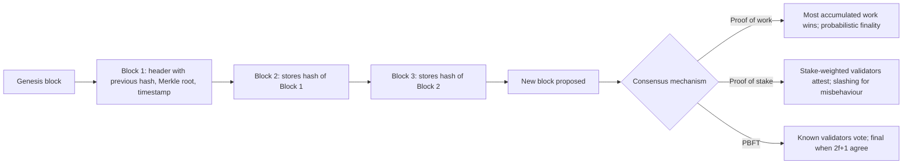

## Introduction

Most business records are kept by a trusted central party. A bank maintains account balances, a land registry maintains title records, and a cocoa buyer maintains its purchase ledger. Other parties accept these records because they trust the record-keeper, or because law and audit hold it to account. But what happens when several organisations that do not fully trust each other need to share one version of the truth, or when no central party is acceptable to everyone? Reconciliation between separate ledgers is slow and costly, and a single record-keeper can make mistakes, be corrupted or become a single point of failure.

Distributed ledger technology (DLT) offers a different approach: many participants hold copies of a ledger and follow a **consensus protocol** to agree which updates are valid and in what order. Blockchain is the best-known form, introduced in Satoshi Nakamoto's 2008 Bitcoin paper. This lesson explains how blockchains are structured, why consensus is a hard problem, how proof of work, proof of stake and practical Byzantine fault tolerance solve it in different ways, and how permissioned and permissionless designs suit different business contexts. The next lesson builds on these foundations to examine smart contracts and when blockchain should, and should not, be used.

## Learning Objectives

- Explain how a blockchain links blocks using cryptographic hashes and why this makes the ledger tamper-evident.
- Describe the Byzantine generals problem and the double-spending problem and why they require consensus mechanisms.
- Compare proof of work, proof of stake and PBFT-style consensus on security assumptions, finality, performance and energy use.
- Distinguish permissionless from permissioned ledgers and identify suitable business contexts for each.
- Evaluate claims about blockchain "immutability" and decentralisation critically.

## Prerequisite Knowledge

- Basic understanding of databases and networked systems.
- No prior cryptography is required; hash functions are explained in the lesson.

## Key Terminology

- **Distributed ledger**: A database replicated across multiple participants, who use a consensus protocol to agree on its contents without relying on a single central administrator.
- **Blockchain**: A distributed ledger that groups transactions into blocks, each containing the cryptographic hash of the previous block, forming a chain.
- **Cryptographic hash function**: A function that maps data of any size to a fixed-size output such that it is practically infeasible to find two inputs with the same output or to reverse the output; any change to the input changes the output unpredictably.
- **Consensus mechanism**: The rules by which nodes in a distributed network agree on which transactions are valid and in what order.
- **Proof of work (PoW)**: A consensus mechanism in which participants compete to solve a computationally expensive puzzle; the winner proposes the next block, and the chain with the most accumulated work is accepted.
- **Proof of stake (PoS)**: A consensus mechanism in which validators lock up (stake) cryptocurrency and are selected to propose and attest to blocks, with stakes at risk of penalty ("slashing") for misbehaviour.
- **Byzantine fault tolerance (BFT)**: The ability of a distributed system to reach correct agreement even when some participants fail or act maliciously.
- **Finality**: The point at which a transaction can no longer be reversed; it may be probabilistic (PoW) or deterministic (BFT-style protocols).

## Detailed Explanation

### From central ledgers to shared ledgers

A conventional database has an administrator who can add, change or delete records. In a distributed ledger, each participating **node** holds a copy and validates updates according to shared rules. No single participant can unilaterally rewrite history, and every participant can verify that the ledger follows the rules. The trade-off is that agreement among many nodes is slower and more complex than writing to a single database.

### How a blockchain is structured

Each block contains a set of transactions and a **header** that includes, among other fields, a time stamp, a summary of the block's transactions (often a Merkle root, a single hash that summarises all transactions in the block) and the **hash of the previous block**. Because each block points to its predecessor's hash, the blocks form a chain back to the first, or "genesis", block.

Hash functions make the chain **tamper-evident**. If someone alters a transaction in an old block, that block's hash changes. The next block's stored "previous hash" no longer matches, so the alteration is immediately detectable. To hide the change, the attacker would need to recompute every later block and persuade the network to accept the altered chain, which consensus mechanisms are designed to make prohibitively difficult.

### Two problems consensus must solve

**The Byzantine generals problem.** Lamport, Shostak and Pease (1982) described generals surrounding a city who must agree on a common plan by exchanging messages, while some generals may be traitors sending contradictory messages. The problem formalises how distributed systems can reach agreement when some components behave arbitrarily or maliciously. Their analysis showed that, with oral (unsigned) messages, agreement is possible only if fewer than one-third of participants are faulty.

**The double-spending problem.** Digital money is just data, and data can be copied. Without a central bank checking balances, what stops someone sending the same digital coin to two recipients? A distributed ledger must establish a single agreed order of transactions so that the second spend is recognised as invalid.

### Proof of work

Nakamoto (2008) solved both problems for an open network in which anyone can participate anonymously. Miners collect transactions into a candidate block and repeatedly change a number in the header (the nonce), hashing the header until the result falls below a target value set by the network's difficulty. Finding such a hash requires enormous numbers of attempts, but verifying it takes one hash calculation. The first miner to succeed broadcasts the block and receives a reward. Nodes accept the valid chain with the **most accumulated work**.

PoW's security rests on the assumption that honest participants control the majority of computing power. An attacker controlling more than half could, in principle, rewrite recent history, the so-called **51% attack**. Finality is **probabilistic**: each additional block built on top of a transaction makes reversal exponentially less likely, which is why recipients often wait for several confirmations. The key drawbacks are **energy consumption**, since security is literally purchased with computation, and limited throughput.

### Proof of stake

PoS replaces computational work with economic stake. Validators deposit cryptocurrency as collateral and are chosen, typically with randomness weighted by stake, to propose blocks, while others attest to their validity. Validators who act dishonestly, for example by signing conflicting blocks, can have part of their stake destroyed ("slashing"). Security assumes that a majority (often a supermajority) of stake is controlled by honest validators. PoS uses far less energy than PoW. Criticisms include concerns that it may concentrate influence among large stakeholders and that its security properties are more complex to analyse.

### Practical Byzantine fault tolerance

In settings where participants are known, such as a consortium of banks or shipping firms, voting-based protocols are practical. Castro and Liskov (1999) introduced **Practical Byzantine Fault Tolerance (PBFT)**. A leader proposes an order for requests, and nodes exchange several rounds of messages; once a quorum of nodes agrees, the decision is final. PBFT tolerates `f` faulty nodes if there are at least `3f + 1` nodes in total, with decisions requiring agreement from `2f + 1`. It provides **deterministic finality** and high throughput with modest energy use, but message volume grows rapidly with the number of nodes, so it suits tens of validators rather than thousands, and it requires known identities.

## Theories, Frameworks and Models

### Comparing consensus mechanisms

| Feature | Proof of work | Proof of stake | PBFT-style BFT |
|---|---|---|---|
| Participation | Open; anyone with hardware | Open; anyone with stake (in public chains) | Known, admitted validators |
| Security assumption | Honest majority of computing power | Honest majority or supermajority of stake | Fewer than one-third faulty nodes |
| Sybil resistance (preventing fake identities) | Cost of computation | Cost of capital at risk | Identity and admission control |
| Finality | Probabilistic | Economic or protocol-defined finality after checkpoints | Deterministic once quorum agrees |
| Energy use | Very high | Low | Low |
| Scalability in number of validators | Very large | Very large | Limited by message overhead |
| Typical example | Bitcoin | Ethereum (since 2022) | Enterprise and consortium platforms |

### Permissionless versus permissioned ledgers

- **Permissionless (public) ledgers** allow anyone to read, submit transactions and participate in consensus. They maximise openness and censorship resistance but expose transaction data publicly (even if pseudonymous) and depend on cryptoeconomic incentives such as mining or staking rewards.
- **Permissioned ledgers** restrict participation to approved organisations, often with different roles for reading, writing and validating. They offer privacy controls, known accountability and faster consensus, but reintroduce trust in the governance body that admits members. Hyperledger Fabric, an open-source enterprise platform hosted under the Linux Foundation's decentralised-trust initiative, is a widely used example.

The choice is not purely technical. It reflects **governance**: who decides the rules, who can join and how disputes are resolved.

## Worked Example

### Part A: demonstrating tamper-evidence

Consider a simplified three-block chain. Real hashes are long hexadecimal strings; here they are shortened for illustration.

| Block | Transactions | Previous hash | Block hash |
|---|---|---|---|
| 1 | Farmer group A sells 20 bags to Buyer X | 0000 | 7A3F |
| 2 | Buyer X transfers 20 bags to Warehouse W | 7A3F | C91B |
| 3 | Warehouse W ships 20 bags to Exporter E | C91B | 5D02 |

**Step 1.** Someone alters Block 1 to say 25 bags. Recomputing Block 1's hash gives a completely different value, say `E44C`.

**Step 2.** Block 2 still records `7A3F` as its previous hash, which no longer matches `E44C`. Every node checking the chain detects the inconsistency.

**Step 3.** To hide the change, the attacker would need to recompute Blocks 2 and 3 and, under PoW, redo the work faster than the honest network, or, under BFT, persuade a quorum of validators to accept the altered history.

**Interpretation.** The ledger is *tamper-evident* and tamper-resistant, but not literally immutable: a majority of computing power, stake or validators could still rewrite it. Moreover, if the original entry was *false* (Farmer group A actually sold 15 bags), the blockchain will faithfully preserve the false record. This is the "garbage in, garbage out" or **oracle problem**, which is crucial for supply chain applications.

### Part B: sizing a PBFT consortium

A consortium wants to tolerate up to 2 faulty or malicious validators.

- Required nodes: `n = 3f + 1 = 3 × 2 + 1 = 7`.
- Quorum for decisions: `2f + 1 = 5`.
- With only 6 nodes, the consortium could tolerate only `f = 1` fault, because `3 × 2 + 1 = 7 > 6`.

If two members are likely to be offline for maintenance at the same time as one may be compromised, the consortium needs `f = 3`, so `n = 10`. Adding validators improves fault tolerance but increases message overhead and coordination cost.

## Ghanaian Business Application

**Illustrative scenario.** A consortium of four licensed cocoa buying companies, two warehouse operators and an exporters' association in Ghana (all hypothetical) is exploring a shared ledger to record movements of cocoa bags from purchase points to warehouses and ports. Today each party keeps its own records, and reconciling discrepancies is slow.

**Design analysis.**

- **Permissionless or permissioned?** Commercial data such as volumes and prices is sensitive, participants are known organisations and regulators need clear accountability. A **permissioned** ledger is more appropriate.
- **Consensus.** With a small number of known validators, a BFT-style protocol provides deterministic finality and good performance. With seven validators, the network tolerates two faulty nodes.
- **Governance.** The consortium needs rules on membership, validator operation, data access, dispute resolution and cost sharing. Without these, technical consensus is meaningless.
- **Data entry and the oracle problem.** The ledger records what participants enter. Weighing scales, bag tags (for example QR codes or RFID), GPS-tagged farm records and field verification determine whether entries reflect reality.
- **Integration with national systems.** Any solution must work with the requirements and systems of the national cocoa regulator and with buyers' traceability demands, which have intensified as international markets, including the European Union, have introduced deforestation-related due-diligence rules.
- **Alternative.** The consortium should compare the ledger with a well-governed shared database operated by a trusted neutral party. The next lesson provides a decision tree for that comparison.

A broader Ghanaian context is the growth of digital financial infrastructure. The Bank of Ghana has publicly piloted a central bank digital currency, the eCedi. Students should note that a central bank digital currency is a form of central bank money issued and governed by the central bank; whether it uses blockchain technology at all is a design choice, which illustrates that "digital currency" and "blockchain" are not synonyms.

## International Case Study

### Ethereum's switch from proof of work to proof of stake

Ethereum, a public blockchain launched in 2015 that supports programmable smart contracts, originally used proof of work, as Bitcoin does. After years of research and testing, including a separate proof-of-stake chain known as the Beacon Chain launched in 2020, Ethereum completed a transition called "The Merge" in September 2022, after which the network's consensus has been provided by proof of stake. The Ethereum Foundation has stated that the change reduced the network's energy consumption by more than 99%.

**Analysis.**

- The case shows that consensus mechanisms are **design choices with major consequences**: the same network changed its security model, energy profile and economic incentives.
- Under PoS, validators must stake a significant amount of the network's cryptocurrency (ether) to participate directly, and misbehaviour can be penalised through slashing. Many holders stake through pools or services, which raises debate about concentration of influence.
- The transition demonstrated **governance** in a permissionless system: changes require coordination among developers, node operators, validators, exchanges and users, without a single owner who can impose them.
- For businesses evaluating public blockchains, energy use and environmental reporting obligations were important objections to PoW; the Merge changed that argument for Ethereum, though not for PoW networks such as Bitcoin.

## Diagram

## Common Misconceptions

- **"Blockchains are immutable."** They are tamper-evident and resistant; a controlling majority of work, stake or validators could rewrite history, and governance can choose to fork.
- **"Data on a blockchain is true."** The ledger preserves what was entered; inaccurate inputs remain inaccurate (the oracle problem).
- **"Blockchain and cryptocurrency are the same thing."** Cryptocurrencies are one application; permissioned ledgers for business often have no public cryptocurrency.
- **"Proof of stake is just proof of work without electricity."** PoS has different security assumptions, based on capital at risk and slashing, and different concentration risks.
- **"More validators always means better."** In BFT protocols more validators improve fault tolerance but increase message overhead and slow consensus.

## Common Examination Mistakes

- Describing hashing as encryption; hashing is one-way and is not designed to be decrypted.
- Stating that PoW prevents all attacks rather than explaining the honest-majority assumption and the 51% attack.
- Confusing permissioned/permissionless (who can participate) with public/private data visibility without explanation.
- Using the formula `3f + 1` incorrectly, for example claiming 4 nodes tolerate 2 faults.

## Critical Thinking Questions

1. If a permissioned ledger depends on a governance body to admit members, how is it different from a shared database run by that body? When does the difference matter?
2. Is the energy consumption of proof of work a fatal objection for business use, or a legitimate cost of security for certain applications? Justify your view.
3. How could the oracle problem undermine a cocoa traceability ledger in Ghana, and what non-blockchain controls would address it?

## Practical Exercises

1. Calculate the minimum number of validators needed to tolerate 1, 3 and 5 Byzantine faults, and the quorum size for each. Expected output: a table with `f`, `n` and quorum values.
2. Prepare a comparison table recommending a consensus mechanism for (a) a global public payment network, (b) a consortium of five Ghanaian banks sharing know-your-customer records and (c) a university's certificate verification service. Expected output: a table with the mechanism, permission model and justification for each.

## Key Takeaways

- Distributed ledgers replicate records across participants who agree on updates through consensus, removing reliance on a single record-keeper.
- Hash-linked blocks make tampering evident, but blockchains are not literally immutable and do not guarantee that inputs are true.
- PoW secures open networks through computational cost with probabilistic finality and high energy use; PoS secures them through capital at risk with much lower energy use.
- PBFT-style protocols suit known validators, tolerate `f` faults with `3f + 1` nodes and give deterministic finality.
- Permissioned versus permissionless is fundamentally a governance choice about who can participate and who is trusted.

## Further Reading

- Nakamoto, S. (2008). *Bitcoin: A peer-to-peer electronic cash system*. <https://bitcoin.org/bitcoin.pdf>
- Lamport, L., Shostak, R., & Pease, M. (1982). The Byzantine generals problem. *ACM Transactions on Programming Languages and Systems, 4*(3), 382-401.
- Castro, M., & Liskov, B. (1999). Practical Byzantine fault tolerance. In *Proceedings of the Third Symposium on Operating Systems Design and Implementation*. USENIX Association.
- Narayanan, A., Bonneau, J., Felten, E., Miller, A., & Goldfeder, S. (2016). *Bitcoin and cryptocurrency technologies: A comprehensive introduction*. Princeton University Press.

## Video Resources

- [Ethereum Developer Documentation](https://ethereum.org/developers/docs/): Ethereum.org. Official documentation explaining blocks, consensus, proof of stake and the Merge.
- [Hyperledger Foundation](https://www.lfdecentralizedtrust.org/): LF Decentralized Trust. Home of open-source enterprise ledger projects such as Hyperledger Fabric, with learning resources.
- [IBM Think](https://www.ibm.com/think): IBM. Explainers on blockchain and distributed ledger technology for business.

## Revision Summary

Distributed ledgers let many participants keep synchronised copies of a record and agree on updates through consensus. Blockchains link blocks by storing each predecessor's hash, making tampering evident, though not literally impossible, and preserving false inputs as faithfully as true ones. Consensus addresses the Byzantine generals and double-spending problems: proof of work uses computational cost with probabilistic finality and high energy use; proof of stake uses staked capital and slashing with low energy use; PBFT uses voting among known validators, tolerating `f` faults with `3f + 1` nodes and giving deterministic finality. Permissionless ledgers are open; permissioned ledgers restrict participation and rely on governance.

- Hash links make tampering evident, not impossible.
- Oracle problem: garbage in, garbage preserved.
- PoW: work, probabilistic finality, high energy.
- PoS: stake, slashing, low energy; Ethereum since 2022.
- PBFT: n = 3f + 1, quorum 2f + 1, deterministic finality.
- Permission model is a governance choice.
