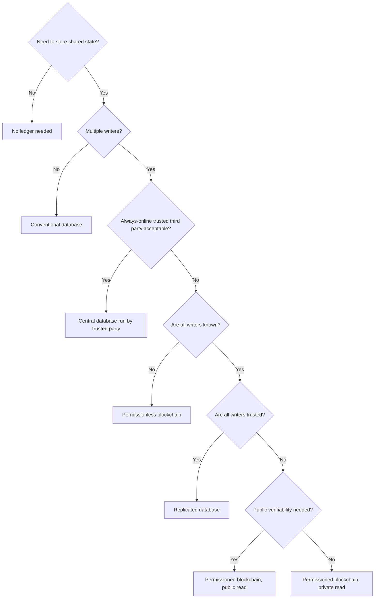

## Introduction

The previous lesson showed how distributed ledgers let mutually distrustful parties agree on a shared record. The next question for business is what that record can *do*. Smart contracts, programs stored on a blockchain that execute automatically when conditions are met, promise to automate agreements such as payments on delivery, insurance pay-outs or the release of trade documents, without relying on a single intermediary to enforce them. Enterprise blockchain platforms adapt these ideas for consortia of known organisations, promising faster reconciliation, better traceability and new forms of collaboration.

The reality has been mixed. Some applications have delivered genuine value; many pilots never reached production; and a number of high-profile platforms have closed. This lesson therefore balances explanation with critical evaluation. You will learn how smart contracts work, the technical and legal risks they carry, the main enterprise platform designs, and the business applications most often proposed. Most importantly, you will learn a structured decision tree for deciding when *not* to use blockchain, because recommending a conventional database when it is the better solution is a mark of professional judgement, not a lack of ambition.

## Learning Objectives

- Explain what smart contracts are, how they execute and why oracles are needed.
- Analyse the technical, legal and governance risks of smart contracts, using The DAO incident as an example.
- Compare enterprise blockchain designs, such as Hyperledger Fabric, with public smart-contract platforms.
- Apply a decision tree to determine whether a blockchain, and which kind, is appropriate for a business problem.
- Evaluate enterprise blockchain initiatives using documented successes and failures.

## Prerequisite Knowledge

- Distributed ledgers, consensus and permissioned versus permissionless designs from the previous lesson.
- Basic understanding of business processes such as procurement, payment and supply chains.

## Key Terminology

- **Smart contract**: A program stored on a blockchain that executes predefined logic automatically when specified conditions are met, with its execution verified by the network.
- **Oracle**: A service that supplies external, real-world data (such as prices, delivery confirmations or weather readings) to a smart contract.
- **Gas**: On Ethereum, the unit measuring the computational effort required to execute operations, paid for in the network's currency to compensate validators and limit abuse.
- **Chaincode**: The term used in Hyperledger Fabric for smart contract code.
- **Endorsement policy**: In Hyperledger Fabric, a rule specifying which organisations must approve (endorse) a transaction before it is valid.
- **Consortium blockchain**: A permissioned ledger governed jointly by a group of organisations, typically in the same industry or supply chain.
- **Tokenisation**: Representing an asset or right, such as a warehouse receipt or a share of property, as a digital token on a ledger.
- **Reentrancy vulnerability**: A smart contract flaw in which an external call allows an attacker to re-enter a function repeatedly before the contract updates its state, for example to withdraw funds multiple times.

## Detailed Explanation

### What smart contracts are

Nick Szabo described the idea of smart contracts in the 1990s, using the analogy of a vending machine: insert the right money, select an item, and the machine delivers the product and change automatically, without a shop assistant. On a blockchain, a smart contract is code deployed to the ledger. Transactions call its functions; every validating node executes the code and must reach the same result, so outcomes are verified by the network rather than by one party.

On Ethereum, contracts are commonly written in the Solidity language and run on the Ethereum Virtual Machine (EVM). Every operation consumes **gas**, which prevents infinite loops and compensates validators. On Hyperledger Fabric, smart contracts are called **chaincode** and can be written in general-purpose languages such as Go, Java or JavaScript.

### Properties that matter for business

- **Determinism.** All nodes must produce identical results, so contracts cannot directly call external websites or use local clocks freely. External data must come through oracles.
- **Automatic execution.** Once conditions are met, the code runs as written. This removes discretion, which is valuable for routine actions but problematic when exceptions arise.
- **Persistence.** Deployed code is difficult or impossible to change on public chains, so bugs can be permanent unless the contract was designed with controlled upgrade mechanisms, which themselves reintroduce trust in whoever controls upgrades.
- **Transparency.** On public chains, contract code and transactions are visible to everyone, which aids verification but may expose commercial information.

### The oracle problem revisited

A smart contract that pays a cocoa exporter when goods arrive at a port depends on *someone* reporting that arrival. If the oracle is a single company's system, the contract is only as trustworthy as that company. Approaches to reduce oracle risk include using several independent data sources, IoT devices with secure identities, and economic penalties for false reporting, but none removes the need for trust entirely. The oracle problem is the main reason many supply chain blockchain promises have been harder to fulfil than expected.

### Legal status

A smart contract is not automatically a legal contract. Whether code forms, evidences or performs a legally binding agreement depends on the law of the relevant jurisdiction and the surrounding documentation. Businesses typically pair smart contracts with conventional legal agreements that specify governing law, dispute resolution and what happens when code and intention diverge. This content is educational, not legal advice.

### Risks illustrated by The DAO

In 2016 an Ethereum-based investment organisation called The DAO raised a large amount of ether from participants. An attacker exploited a reentrancy vulnerability in its smart contract code to drain a substantial portion of the funds. The Ethereum community responded with a contentious "hard fork" that altered the chain's history to return funds to investors; a minority who rejected the change continued the original chain, which became known as Ethereum Classic. The episode demonstrated that code can contain costly bugs, that "code is law" can conflict with participants' expectations of fairness, and that so-called immutability can be overridden by social consensus.

### Enterprise blockchain platforms

Enterprise platforms are typically permissioned and designed for consortia.

| Feature | Public smart-contract platform (for example Ethereum) | Enterprise platform (for example Hyperledger Fabric) |
|---|---|---|
| Participation | Open to anyone | Admitted organisations with identities issued by membership services |
| Consensus | Proof of stake | Pluggable ordering service; endorsement by specified organisations |
| Privacy | Transactions publicly visible | Channels and private data collections restrict visibility |
| Transaction costs | Gas fees paid in cryptocurrency | No native cryptocurrency; infrastructure costs shared by members |
| Governance | Community and developer processes | Consortium agreements and administrators |
| Typical uses | Tokens, decentralised finance, public verification | Supply chains, trade finance, inter-company reconciliation |

Hyperledger Fabric uses an **execute-order-validate** model: endorsing peers simulate the transaction, an ordering service sequences transactions into blocks, and peers validate them against endorsement policies before committing. **Channels** allow subsets of members to share a ledger privately. These features address enterprise concerns about confidentiality and performance.

### Common business applications

- **Supply chain traceability**: recording custody and provenance of goods such as food, minerals or cocoa.
- **Trade finance**: sharing letters of credit, bills of lading and other documents among banks, exporters, importers and shippers.
- **Credentials and identity**: issuing verifiable academic certificates or professional licences.
- **Asset registries and tokenisation**: recording ownership of warehouse receipts, carbon credits or property interests.
- **Inter-company reconciliation and payments**: settling obligations among members of a consortium.

## Theories, Frameworks and Models

### When to use blockchain: a decision tree

Wüst and Gervais (2018) proposed a structured way of asking whether a blockchain is needed. The version below adapts their logic for business analysis.

1. **Do you need to store shared state?** If not, no ledger is needed.
2. **Are there multiple writers?** If only one organisation writes the data, a conventional database is sufficient.
3. **Can you use an always-online trusted third party?** If all writers are willing to trust an operator, such as a regulator, an industry body or a cloud-hosted service with audit, a centralised database is simpler, faster and cheaper.
4. **Are all writers known?** If not, a **permissionless** blockchain may be appropriate.
5. **Are all known writers trusted?** If yes, a conventional replicated database suffices.
6. **Is public verifiability needed?** If writers are known but not fully trusted, a **permissioned** blockchain fits, with public or private read access depending on whether outsiders must verify the data.

Additional business tests should follow: Is the problem really about **trust between parties**, or about poor data quality, process or incentives? Can the **oracle problem** be managed? Will enough participants **join** to create network value? Who will **govern and fund** the platform?

### Network effects and consortium economics

Enterprise blockchains are network goods: their value depends on how many relevant parties participate. Yet each participant may fear that the platform operator, often a powerful firm in the industry, will capture value or gain competitive information. This tension between **network value** and **neutral governance** explains many consortium failures. Successful consortia typically have a neutral governance structure, clear benefits for each participant and a credible path to industry-wide adoption.

## Worked Example

### Part A: a smart contract for payment on delivery

**Illustrative scenario.** An exporter and a European chocolate maker agree that payment will be released when a cocoa shipment's arrival is confirmed and a quality certificate is issued. The logic can be expressed in pseudo-code:

```
contract CocoaShipmentEscrow:
    state: AWAITING_DEPOSIT, FUNDED, DELIVERED, PAID, REFUNDED
    buyer, seller, portOracle, qualityOracle, amount, deadline

    deposit():           only buyer; require amount; state = FUNDED
    confirmArrival():    only portOracle; require state == FUNDED; arrived = true
    confirmQuality(ok):  only qualityOracle; require arrived
                         if ok: state = DELIVERED; transfer amount to seller; state = PAID
                         else: open dispute process
    refund():            only buyer; require now > deadline and state == FUNDED
                         transfer amount to buyer; state = REFUNDED
```

**Analysis of the design.**

1. **Trust shifts to oracles.** The port and quality oracles determine payment. If either is compromised or mistaken, the contract executes the wrong outcome automatically.
2. **Exceptions need off-chain processes.** A partial delivery or disputed quality grade is not handled by simple code; a dispute mechanism and a legal agreement are required.
3. **Security.** Funds should be transferred only after state is updated, to avoid reentrancy-type flaws, and the code should be independently audited.
4. **Currency.** Payment in a cryptocurrency introduces price volatility and regulatory questions; a consortium might instead use the contract to trigger a conventional bank payment.

### Part B: applying the decision tree to three proposals

| Proposal | Key answers | Recommendation |
|---|---|---|
| A supermarket chain's internal stock records | Single writer (the chain) | Conventional database |
| Verification of degree certificates issued by one university | Single issuer; outsiders need to verify | Digitally signed certificates with a verification portal; blockchain optional and unnecessary for trust |
| Trade documents shared among several banks, shippers, exporters and customs agencies across countries, with no party trusted by all to run the system | Multiple known writers, not fully trusted, no acceptable central operator | Permissioned blockchain is plausible, subject to governance, adoption and oracle tests |

The exercise shows that blockchain is justified only in a narrow set of conditions; many proposals fail at step 2 or step 3.

## Ghanaian Business Application

**Illustrative scenario.** A coalition of hypothetical organisations in Ghana, comprising several licensed cocoa buying companies, a warehouse operator, two banks and an exporters' group, wants to digitise warehouse receipts so that farmers' cooperatives can use stored cocoa as collateral for loans. Today, paper receipts can be lost, duplicated or forged, and banks are cautious about lending against them.

**Applying the decision tree.**

- *Shared state?* Yes: the receipt's ownership and status.
- *Multiple writers?* Yes: warehouses issue receipts, banks record liens, buyers record sales.
- *Trusted third party?* This is the critical question. If a regulator or a neutral warehouse-receipt registry is acceptable to all and can operate reliably, a **central registry database** with strong audit trails may be the best solution. If participants do not accept any single operator, a **permissioned ledger** among them is reasonable.
- *Oracle problem.* The ledger only helps if the physical cocoa matches the receipt. Independent warehouse inspection, tamper-evident storage and periodic audits are essential.
- *Smart contract use.* A contract could record a bank's lien automatically when a loan is issued and release it when repaid, preventing the same receipt from being pledged twice.
- *Inclusion.* Cooperatives need simple access, for example via USSD or agents, and must understand how their collateral is recorded.

The best recommendation may be a phased approach: start with a well-governed central digital registry, design data standards that could later be moved to a shared ledger, and revisit blockchain only if governance disputes make a central operator unworkable.

## International Case Study

### Contrasting outcomes: food traceability and TradeLens

**Food traceability at Walmart.** Walmart worked with IBM on a blockchain-based food traceability solution built on Hyperledger Fabric, which became part of the IBM Food Trust offering. In widely reported pilots, the time needed to trace the origin of a food product, mangoes in one well-known demonstration, fell from days to seconds. Walmart subsequently asked certain suppliers of leafy green vegetables to provide traceability data through the system. The case shows the value of a powerful buyer who can require participation, a clear problem (rapid response to food safety incidents) and standardised data.

**TradeLens.** In 2018 the shipping company Maersk and IBM launched TradeLens, a blockchain-enabled platform for sharing shipping and trade documents among carriers, ports, customs authorities and shippers. Despite attracting a number of participants, the partners announced in late 2022 that the platform would be discontinued, with Maersk stating that it had not reached the level of commercial viability needed and that full global industry collaboration had not been achieved.

**Comparative analysis.**

- Both cases used enterprise blockchain technology; their different outcomes reflect **governance and network economics** more than technology.
- In food traceability, Walmart's purchasing power created participation incentives. In TradeLens, competitors of Maersk may have been reluctant to join a platform led by a rival, illustrating the tension between network value and neutral governance.
- Neither case shows that blockchain was strictly necessary; similar traceability might be achieved with shared databases and data standards. A rigorous evaluation asks what the ledger added beyond digitisation and standardisation.

## Diagram



## Common Misconceptions

- **"Smart contracts are legally binding contracts."** Legal effect depends on jurisdiction and accompanying agreements; code may perform an agreement without being the agreement.
- **"Smart contracts remove the need for trust."** Trust shifts to code authors, auditors, oracles and whoever controls upgrades.
- **"Blockchain is needed for traceability."** Traceability requires data capture, standards and participation; a shared database may provide it more cheaply when a trusted operator exists.
- **"Enterprise blockchain failures were technical failures."** Many failed because of governance, incentives and insufficient participation.
- **"Code deployed on a blockchain can never be changed."** Upgrade patterns and, as The DAO showed, social consensus forks can change outcomes.

## Common Examination Mistakes

- Recommending blockchain without applying a structured test of whether a database would suffice.
- Ignoring the oracle problem in supply chain proposals.
- Describing smart contracts as "AI" or as self-enforcing legal documents.
- Citing case outcomes with invented figures; describe documented facts qualitatively if unsure of numbers.
- Overlooking governance, funding and participation incentives in consortium designs.

## Critical Thinking Questions

1. In the warehouse receipt scenario, what evidence would convince you that no central operator could be trusted, justifying a permissioned ledger?
2. "Code is law" conflicted with fairness in The DAO incident. Which should prevail in business smart contracts, and how should contracts be designed to reflect your answer?
3. Why might a dominant firm's sponsorship both help and hinder an industry blockchain platform?
4. Could tokenisation of farmland or cocoa receipts improve access to finance for Ghanaian farmers, or would it introduce new risks? Discuss.
5. If many blockchain benefits come from digitisation and data standards, why do organisations still choose blockchain? Evaluate the possible reasons.

## Practical Exercises

1. Apply the decision tree to a proposal of your choice in Ghana (for example land title registration, pharmaceutical authentication or university transcripts). Expected output: the answers at each node, the resulting recommendation and two additional business tests.
2. Extend the escrow pseudo-code to handle partial delivery and a dispute raised by the buyer. Expected output: revised pseudo-code and a paragraph identifying which decisions must remain off-chain.
3. Write a one-page governance charter for a consortium ledger among five organisations. Expected output: sections on membership, validator responsibilities, data access, cost sharing, dispute resolution and exit.

## Key Takeaways

- Smart contracts are programs on a ledger that execute automatically, but they depend on oracles, careful coding and supporting legal agreements.
- The DAO incident showed that smart contract bugs can be costly and that immutability can yield to social consensus.
- Enterprise platforms such as Hyperledger Fabric add identity, privacy channels and endorsement policies for consortia of known organisations.
- A decision tree, adapted from Wüst and Gervais (2018), shows that many proposals are better served by conventional databases.
- Governance, participation incentives and the oracle problem determine enterprise blockchain success more than technology does.

## Further Reading

- Szabo, N. (1997). Formalizing and securing relationships on public networks. *First Monday, 2*(9).
- Wüst, K., & Gervais, A. (2018). Do you need a blockchain? In *2018 Crypto Valley Conference on Blockchain Technology (CVCBT)*. IEEE.
- Iansiti, M., & Lakhani, K. R. (2017). The truth about blockchain. *Harvard Business Review, 95*(1), 118-127.
- Nakamoto, S. (2008). *Bitcoin: A peer-to-peer electronic cash system*. <https://bitcoin.org/bitcoin.pdf>

## Video Resources

- [Ethereum Developer Documentation](https://ethereum.org/developers/docs/): Ethereum.org. Official documentation on smart contracts, the EVM, gas and oracles.
- [Hyperledger Foundation](https://www.lfdecentralizedtrust.org/): LF Decentralized Trust. Information and learning resources for Hyperledger Fabric and other enterprise ledger projects.
- [IBM Think](https://www.ibm.com/think): IBM. Explainers on smart contracts and enterprise blockchain use cases.

## Revision Summary

Smart contracts are programs stored on a ledger that execute automatically and are verified by the network; they need oracles for real-world data, careful security engineering and supporting legal agreements, as The DAO incident of 2016 showed. Enterprise platforms such as Hyperledger Fabric provide permissioned membership, private channels and endorsement policies for consortia. Business applications include traceability, trade finance, credentials and asset registries, but a decision tree (Wüst & Gervais, 2018) shows that blockchain is justified only when multiple untrusted writers share state and no acceptable trusted operator exists. Walmart's food traceability and the closure of TradeLens show that governance and participation decide outcomes.

- Smart contract = code plus oracles plus legal wrapper.
- The DAO: reentrancy bug, hard fork, Ethereum Classic.
- Fabric: chaincode, channels, endorsement policies.
- Decision tree: shared state, multiple writers, no trusted third party.
- Oracle problem limits supply chain claims.
- Governance and network effects decide consortium success.
