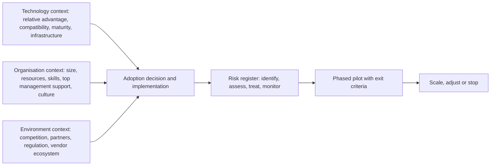

## Introduction

A technology can be mature, affordable and promising, and still fail inside a particular organisation. Projects collapse because staff were not trained, data was poor, leaders lost interest, processes were not redesigned, vendors overpromised, regulators objected, or a security breach destroyed trust. Most failures of emerging-technology adoption are not purely technical; they arise from a mismatch between the technology, the organisation and its environment.

Two disciplines help managers anticipate and prevent these failures. **Risk management** identifies what could go wrong (and right), assesses likelihood and impact, assigns owners and plans responses, typically documented in a risk register. **Readiness assessment** asks whether the organisation has the technological, organisational and environmental conditions needed for successful adoption. The most widely used organisational-level adoption framework in information systems research is the Technology-Organisation-Environment (TOE) framework of Tornatzky and Fleischer (1990). This lesson brings these disciplines together into a practical method you can apply in proposals, projects and examination case studies.

## Learning Objectives

- Classify the main categories of risk in emerging-technology adoption.
- Construct a risk register with likelihood, impact, scoring, ownership and responses.
- Explain the TOE framework and apply it to assess an organisation's readiness to adopt a technology.
- Compare TOE with individual-level adoption models such as TAM and with diffusion of innovations theory.
- Evaluate readiness gaps and recommend actions to close them before or during adoption.

## Prerequisite Knowledge

- The previous lesson on technology evaluation and cost-benefit analysis.
- Awareness of technology adoption and diffusion concepts from the first module of this course.

## Key Terminology

- **Risk**: The effect of uncertainty on objectives, which may be negative (a threat) or positive (an opportunity), as framed in ISO 31000.
- **Risk register**: A structured record of identified risks, their assessment, owners, responses and status.
- **Likelihood**: The probability or frequency that a risk event will occur.
- **Impact**: The consequence for objectives if the risk occurs, such as financial loss, delay or harm.
- **Inherent and residual risk**: Risk before any controls are applied, and risk remaining after controls.
- **Risk appetite**: The amount and type of risk an organisation is willing to pursue or retain to achieve its objectives.
- **Organisational readiness**: The extent to which an organisation is prepared, psychologically and structurally, to implement a change, including members' commitment and their confidence in their collective capability.
- **TOE framework**: A model proposing that an organisation's adoption of technological innovation is shaped by its technological, organisational and environmental contexts.
- **Vendor lock-in**: Dependence on a supplier that makes switching costly or impractical.
- **Change management**: Structured activities to help people and organisations move from current to desired ways of working.

## Detailed Explanation

### Categories of adoption risk

Emerging technologies carry several overlapping categories of risk.

| Category | Typical risks |
|---|---|
| Strategic | Technology does not support strategy; competitors choose a superior standard; investing too early or too late |
| Technical | Immaturity, poor performance at scale, integration failures, dependence on unstable standards |
| Data | Poor data quality, unavailable data, migration errors, bias in AI training data |
| Security and privacy | New attack surfaces (IoT devices, APIs), breaches, non-compliance with data protection law |
| Financial | Cost overruns, benefits not realised, foreign-exchange exposure, hidden operating costs |
| Vendor and supply chain | Vendor failure or acquisition, lock-in, weak local support, hardware supply delays |
| Operational | Disruption at go-live, dependence on unreliable power or connectivity, inadequate support |
| People and change | Resistance, skills gaps, loss of key staff, workload during transition |
| Legal and regulatory | Uncertain or changing regulation, licensing requirements, liability, contractual disputes |
| Ethical and reputational | Harm to customers, discrimination, surveillance, environmental criticism, public backlash |

### The risk management process

ISO 31000:2018 describes risk management as an iterative process. A practical version for technology adoption is:

1. **Establish context**: objectives, scope, stakeholders, risk appetite and criteria for assessing likelihood and impact.
2. **Identify risks**: through workshops, checklists (such as the categories above), lessons from similar projects, vendor references, and pre-mortem exercises ("imagine the project failed; why?").
3. **Analyse risks**: estimate likelihood and impact, typically on 1–5 scales, and multiply to obtain a risk score.
4. **Evaluate risks**: compare scores with appetite; prioritise high scores.
5. **Treat risks**: choose responses and controls.
6. **Monitor and review**: update the register regularly; record when risks materialise, close or change.
7. **Communicate and consult**: share risk information with sponsors, staff and partners.

### Risk responses

For threats, common responses are:

- **Avoid**: change the plan to remove the risk (for example, not using facial recognition).
- **Reduce (mitigate)**: lower likelihood or impact (for example, piloting, testing, training, redundancy).
- **Transfer (share)**: shift some consequences to another party (for example, insurance, contractual penalties, managed services).
- **Accept**: retain the risk consciously, often with a contingency plan, when it is within appetite or uneconomic to treat.

For opportunities, organisations may **exploit**, **enhance**, **share** or **accept**.

### Organisational readiness

Weiner (2009) proposed a theory of organisational readiness for change built on two elements: **change commitment** (members' shared resolve to implement the change) and **change efficacy** (their shared belief in their collective ability to do so). Both depend on how much people value the change and their appraisal of task demands, resources and situational factors. This complements the structural view of readiness (budgets, infrastructure, skills) with a psychological one: an organisation with money and hardware but sceptical, overstretched staff is not ready.

## Theories, Frameworks and Models

### The Technology-Organisation-Environment (TOE) framework

Tornatzky and Fleischer (1990), in *The Processes of Technological Innovation*, proposed that adoption and implementation of technological innovations by firms are influenced by three contexts.

**Technological context.** The technologies relevant to the firm, both those already in use and those available in the market. Considerations include the innovation's characteristics (relative advantage, compatibility, complexity), the firm's existing infrastructure and the maturity of the technology.

**Organisational context.** Characteristics of the firm itself, such as size and scope, managerial structure, communication processes, slack resources, and the availability of skills. Top management support is frequently identified as an important organisational factor in empirical studies.

**Environmental context.** The arena in which the firm conducts its business: industry structure, competitors and trading partners, access to resources supplied by others (such as vendors and skilled labour markets), and the regulatory environment.

The framework's strength is its breadth and flexibility; researchers have applied it to EDI, e-business, cloud computing, RFID, big data, AI and blockchain adoption, adding specific factors in each context. Its weakness is that, on its own, it specifies categories rather than a precise causal model, so studies must select and justify the factors within each context. Oliveira and Martins (2011) reviewed firm-level IT adoption models and noted that TOE is often combined with Rogers' diffusion of innovations theory, whose innovation attributes (relative advantage, compatibility, complexity, trialability and observability) fit naturally in the technological context.

### Comparing adoption models

| Model | Level | Focus | Typical use |
|---|---|---|---|
| TOE (Tornatzky & Fleischer, 1990) | Organisation | Technological, organisational and environmental contexts | Firm adoption of cloud, AI, blockchain, IoT |
| Diffusion of innovations (Rogers) | Individual and organisation | Innovation attributes, adopter categories, communication channels | Explaining the spread of an innovation over time |
| Technology Acceptance Model (Davis, 1989) | Individual | Perceived usefulness and perceived ease of use | Predicting user acceptance of a system |
| Organisational readiness for change (Weiner, 2009) | Organisation | Change commitment and change efficacy | Assessing preparedness for implementation |

An evaluation of a large adoption decision often combines these: TOE for the firm's decision, TAM for user acceptance, and readiness theory for implementation planning.

### A TOE readiness assessment tool

| Context | Readiness factor | Questions | Score (1–5) |
|---|---|---|---|
| Technology | Relative advantage | Does it clearly outperform current methods? | |
| Technology | Compatibility | Does it fit existing systems, data and processes? | |
| Technology | Maturity and complexity | Is it proven and manageable? | |
| Technology | Infrastructure | Are connectivity, power and security adequate? | |
| Organisation | Top management support | Is there an active, informed sponsor? | |
| Organisation | Skills and capacity | Do we have or can we obtain the needed skills? | |
| Organisation | Financial resources | Is funding secured for full TCO? | |
| Organisation | Culture and change commitment | Do staff understand and support the change? | |
| Environment | Competitive pressure | Are competitors or partners adopting? | |
| Environment | Regulatory clarity | Is the legal position clear and compliant? | |
| Environment | Vendor and partner ecosystem | Is reliable local support available? | |

Low scores identify gaps to close before scaling.

## Worked Example

**Illustrative scenario.** *Nkabom Insurance* (a fictional Ghanaian insurer) plans to adopt an AI-based claims triage system that reads claim documents and photographs, flags likely fraud and recommends settlement amounts for adjusters to review.

**Extract from the risk register** (likelihood L and impact I scored 1–5; score = L × I):

| ID | Risk | Category | L | I | Score | Owner | Response | Residual score |
|---|---|---|---|---|---|---|---|---|
| R1 | Model performs poorly on local document formats and handwritten forms | Technical/data | 4 | 4 | 16 | Head of Data | Reduce: train and test on local data; pilot with human review of all outputs | 8 |
| R2 | Customers' personal data processed without adequate legal basis or safeguards | Legal/privacy | 3 | 5 | 15 | Data Protection Officer | Reduce: data protection impact assessment, minimisation, contracts with vendor, compliance with Act 843 | 6 |
| R3 | Biased outcomes disadvantage certain customer groups | Ethical | 3 | 4 | 12 | Chief Risk Officer | Reduce: fairness testing, human final decision, complaint channel | 6 |
| R4 | Adjusters distrust or ignore recommendations | People/change | 4 | 3 | 12 | Claims Manager | Reduce: involve adjusters in design, training, explain recommendations | 6 |
| R5 | Vendor pricing in US dollars raises costs after cedi depreciation | Financial | 3 | 3 | 9 | CFO | Transfer/reduce: negotiate fixed or cedi pricing, budget contingency | 6 |
| R6 | Vendor exits the Ghanaian market | Vendor | 2 | 4 | 8 | CIO | Reduce: data export clauses, escrow, exit plan | 4 |
| R7 | Faster claims processing improves customer retention | Opportunity | 3 | 4 | 12 | Customer Director | Enhance: publicise faster settlement, measure satisfaction | — |

**Interpretation.** R1 and R2 are the highest inherent risks. The plan's central control is a phased pilot in which AI recommendations are advisory and every output is reviewed, which reduces several risks at once. R7 reminds the team that risk management also captures opportunities.

**TOE readiness summary.**

- *Technology*: relative advantage is plausible, but compatibility with the legacy claims system is uncertain and model performance on local documents is unproven (gap).
- *Organisation*: the CEO is a strong sponsor, but data science skills are thin and adjusters are sceptical (gaps in skills and change commitment).
- *Environment*: competitors are exploring digital claims; regulatory expectations on AI in insurance are still developing, so the insurer should engage proactively with the National Insurance Commission and observe data protection requirements.

**Recommendation.** Proceed with a limited pilot only after closing the data protection and data-quality gaps, with clear success and exit criteria.

## Ghanaian Business Application

Readiness factors in Ghana often differ from those emphasised in studies of large firms in high-income economies. Common environmental and organisational considerations include:

- **Infrastructure**: power reliability and the cost of backup generation, uneven broadband outside major cities, and dependence on international submarine cables.
- **Skills**: competition for experienced cloud, security and data professionals, and the migration of skilled staff abroad.
- **Finance**: high borrowing costs and exchange-rate volatility affect dollar-priced technology.
- **Regulation**: sector regulators such as the Bank of Ghana, the National Communications Authority and the National Insurance Commission, alongside the Data Protection Commission and Cyber Security Authority, shape what is permissible; regulatory guidance on newer technologies can be evolving.
- **Ecosystem**: availability of local implementation partners and support affects risk.
- **Strengths**: a widely used mobile money ecosystem, the Ghana Card identity system, digital addressing and a growing technology start-up community can lower barriers to digital adoption.

**Illustrative scenario.** A fictional mid-sized Accra distributor considering a cloud ERP finds high technological readiness (vendor maturity, mobile access) and environmental pressure (large customers require electronic invoicing), but low organisational readiness (no project manager, poor master data, reluctant warehouse supervisors). A TOE assessment directs it to fix master data and appoint a project lead before signing a contract.

## International Case Study

### Hershey's ERP implementation

In 1999 the US confectionery company Hershey went live with a major new enterprise resource planning, customer relationship management and supply-chain system. The implementation is widely cited in information systems teaching because the company experienced serious problems processing and shipping orders during its busiest season, around Halloween, and reported a resulting effect on sales and profits that year. Commentators have attributed the difficulties to a compressed implementation schedule, the decision to switch over several major systems at once, insufficient testing and training, and the timing of go-live close to the company's peak demand period.

Lessons for risk and readiness:

- Timing is a risk factor: avoid go-live during peak trading periods.
- "Big bang" cut-overs of multiple systems concentrate risk; phased approaches reduce it.
- Testing and training are readiness requirements, not optional extras to be cut when schedules slip.
- Organisational readiness must be assessed honestly, even when there is pressure to meet deadlines.

## Diagram

## Common Misconceptions

- **Misconception:** Risk management is about avoiding all risk. **Correction:** It is about taking risks consciously within appetite; opportunities are risks too.
- **Misconception:** A risk register is completed once at the start. **Correction:** It is a living document reviewed throughout the project.
- **Misconception:** Readiness means having enough money and hardware. **Correction:** Readiness also includes skills, leadership, culture, change commitment and environmental conditions.
- **Misconception:** TOE and TAM explain the same thing. **Correction:** TOE explains organisational adoption decisions; TAM explains individual user acceptance.
- **Misconception:** Transferring risk to a vendor removes it. **Correction:** Contracts shift some financial consequences, but reputational, regulatory and operational impacts usually remain with the organisation.

## Common Examination Mistakes

- Listing risks without likelihood, impact, owner and response.
- Describing TOE contexts in general terms without applying specific factors to the case.
- Attributing TOE to the wrong authors or confusing it with TAM or UTAUT.
- Proposing only technical mitigations for people and change risks.
- Ignoring Ghana-specific environmental factors such as power, regulation and foreign exchange.

## Critical Thinking Questions

1. Is the multiplication of likelihood and impact scores a sound way to prioritise risks? What are its weaknesses?
2. How would you assess change commitment among staff without simply asking managers?
3. Which TOE context is likely to dominate blockchain adoption decisions in Ghanaian agriculture, and why?
4. When, if ever, should an organisation accept a high-impact, low-likelihood risk without mitigation?
5. How should a regulator's evolving position on a technology be treated in a risk register?

## Practical Exercises

1. **Risk register.** For an illustrative Ghanaian hospital adopting IoT patient monitoring, build a risk register of at least ten risks across six categories. *Expected output:* a table with IDs, descriptions, L, I, scores, owners, responses and residual scores.
2. **TOE assessment.** Apply the TOE readiness tool to an organisation you know for one emerging technology. *Expected output:* a completed scoring table, the three biggest gaps and actions to close them.
3. **Pre-mortem.** Imagine a cloud migration at a university has failed after one year. *Expected output:* ten plausible reasons, each mapped to a risk category and a preventive control.
4. **Model comparison.** Write 300 words explaining when you would use TOE, TAM and readiness theory together in a dissertation on AI adoption by Ghanaian banks. *Expected output:* a justified research framework.

## Key Takeaways

- Adoption failures are usually socio-technical, not purely technical.
- Risk management identifies, analyses, evaluates, treats and monitors risks; ISO 31000 frames risk as the effect of uncertainty on objectives.
- A good risk register records likelihood, impact, score, owner, response and residual risk.
- Readiness combines structural resources with psychological change commitment and efficacy.
- TOE (Tornatzky & Fleischer, 1990) structures organisational readiness into technology, organisation and environment.
- Ghanaian readiness assessments must consider power, connectivity, skills, finance, regulation and ecosystem strengths.

## Further Reading

- Tornatzky, L. G., & Fleischer, M. (1990). *The processes of technological innovation*. Lexington Books.
- Oliveira, T., & Martins, M. F. (2011). Literature review of information technology adoption models at firm level. *Electronic Journal of Information Systems Evaluation, 14*(1), 110–121.
- Weiner, B. J. (2009). A theory of organizational readiness for change. *Implementation Science, 4*, 67. <https://doi.org/10.1186/1748-5908-4-67>
- Davis, F. D. (1989). Perceived usefulness, perceived ease of use, and user acceptance of information technology. *MIS Quarterly, 13*(3), 319–340.
- Rogers, E. M. (2003). *Diffusion of innovations* (5th ed.). Free Press.
- International Organization for Standardization. (2018). *Risk management – Guidelines* (ISO 31000:2018).

## Video Resources

- [ISO 31000 Risk management](https://www.iso.org/iso-31000-risk-management.html) — International Organization for Standardization. Official page describing the ISO 31000 risk management standard.
- [MIT OpenCourseWare](https://ocw.mit.edu/) — Massachusetts Institute of Technology. Open learning portal; search for technology strategy and innovation management course materials.

## Revision Summary

Emerging-technology adoption carries strategic, technical, data, security, financial, vendor, operational, people, legal and ethical risks. A risk register makes these explicit with likelihood, impact, owners, responses (avoid, reduce, transfer, accept) and residual scores, reviewed continuously. Readiness combines resources with change commitment and efficacy (Weiner, 2009). The TOE framework (Tornatzky & Fleischer, 1990) organises adoption factors into technological, organisational and environmental contexts and is often combined with diffusion of innovations and TAM.

- Score = likelihood × impact; record inherent and residual risk.
- Responses: avoid, reduce, transfer, accept; for opportunities, exploit or enhance.
- TOE = Technology + Organisation + Environment; firm-level.
- TAM = individual usefulness and ease of use.
- Ghana: power, connectivity, skills, FX, sector regulators, mobile money strengths.
- Hershey 1999: compressed timeline, big-bang cut-over and peak-season go-live.
