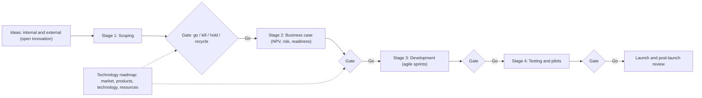

## Introduction

The previous lessons asked whether a specific technology is worth adopting and whether the organisation is ready. This lesson steps back to the strategic level. Organisations face a continuous stream of emerging technologies, and they cannot pursue them all. They need a repeatable way to generate, select, develop and scale innovations, and a technology strategy that decides where to lead, where to follow, what to build, what to buy and what to ignore.

Innovation management provides the processes: funnels and gates that turn ideas into launched products and services, portfolio methods that balance safe improvements with risky bets, and open innovation practices that draw on ideas from outside the firm. Technology strategy provides the direction: how technology choices support competitive advantage over time, documented in technology roadmaps that align markets, products, technologies and resources. The history of business is full of firms such as Kodak that possessed a technology but failed to build a strategy around it. This lesson equips you to avoid that trap.

## Learning Objectives

- Explain the main types of innovation and the distinction between incremental, radical, sustaining and disruptive innovation.
- Apply the Stage-Gate model to manage an emerging-technology project from idea to launch.
- Compare closed and open innovation and evaluate when open innovation is appropriate.
- Design an innovation portfolio balancing core, adjacent and transformational initiatives.
- Construct a technology roadmap that links business goals, products and services, technologies and resources.
- Evaluate technology strategy choices such as leader versus follower and build, buy or partner.

## Prerequisite Knowledge

- Earlier lessons on emerging technology, adoption, disruption, technology evaluation and readiness.
- General understanding of business strategy concepts such as competitive advantage.

## Key Terminology

- **Innovation**: The implementation of a new or significantly improved product, service, process or business model that creates value.
- **Incremental innovation**: Small improvements to existing offerings or processes.
- **Radical innovation**: Fundamental changes that create new products, markets or ways of working.
- **Disruptive innovation**: In Christensen's sense, an innovation that initially serves overlooked or low-end customers with a simpler, cheaper offering and later moves upmarket to displace incumbents.
- **Stage-Gate**: A process model, developed by Robert G. Cooper, that divides innovation projects into stages separated by gates where go, kill, hold or recycle decisions are made.
- **Open innovation**: Chesbrough's concept of using purposive inflows and outflows of knowledge to accelerate internal innovation and expand markets for external use of innovation.
- **Innovation portfolio**: The set of innovation initiatives an organisation pursues, managed to balance risk, return and time horizon.
- **Technology roadmap**: A time-based plan that aligns market drivers, products and services, technologies and resources.
- **Organisational ambidexterity**: The ability to exploit existing businesses efficiently while exploring new opportunities.
- **Technology strategy**: The set of decisions about which technologies to develop, acquire or use, and how, in order to achieve competitive advantage.

## Detailed Explanation

### Types of innovation

Tidd and Bessant describe four broad targets of innovation, often called the "4Ps": **product** (what an organisation offers), **process** (how it creates and delivers it), **position** (the context in which offerings are introduced, such as new market segments) and **paradigm** (the underlying mental model of what the organisation does, including its business model). A Ghanaian bank's new mobile loan app is a product innovation; automating loan processing with AI is a process innovation; offering the app to informal traders previously unserved is a position innovation; shifting from branch-based to platform-based banking is a paradigm innovation.

Innovations also vary in degree. **Incremental** innovation improves what exists and carries lower risk. **Radical** innovation creates something fundamentally new. Christensen's distinction between **sustaining** innovations (which improve performance for existing mainstream customers) and **disruptive** innovations (which start in overlooked segments with "good enough" offerings) explains why well-managed incumbents can fail: rational resource allocation favours sustaining innovations for their best customers, while disruptors grow unnoticed.

### Managing the innovation process

Most innovation processes follow a funnel: many ideas enter, they are screened, a smaller number are developed, and few are launched and scaled. The challenge is to kill weak ideas early and cheaply while giving promising ones the resources they need, without killing genuinely novel ideas simply because their benefits are hard to quantify.

### The Stage-Gate model

Cooper (1990) described Stage-Gate systems as a "conceptual and operational road map" for moving new products from idea to launch. A typical modern version includes:

| Stage | Activities | Gate decision afterwards |
|---|---|---|
| Discovery | Generate ideas from customers, staff, partners, technology scanning | Gate 1: idea screen |
| Scoping | Quick, low-cost assessment of market, technical feasibility and fit | Gate 2: second screen |
| Build the business case | Detailed investigation: customer needs, technical solution, financial analysis (NPV), risks | Gate 3: go to development |
| Development | Design and build the product, service or system; plan operations and launch | Gate 4: go to testing |
| Testing and validation | Pilots, user testing, field trials, security and compliance checks | Gate 5: go to launch |
| Launch | Full roll-out, marketing, operations, support | Post-launch review |

At each gate, a cross-functional group of decision-makers ("gatekeepers") reviews **deliverables** against **criteria** (strategic fit, market attractiveness, technical feasibility, financial return, risk) and decides to **go**, **kill**, **hold** or **recycle**. Gates are the quality-control and resource-allocation points.

**Strengths**: discipline, early killing of weak projects, cross-functional involvement, clear accountability and better use of scarce resources.

**Criticisms**: when applied rigidly, Stage-Gate can become bureaucratic, slow and biased against radical ideas whose markets cannot yet be measured. In response, many organisations combine Stage-Gate with **agile** development within stages, use flexible, lighter gates for small projects, and run fast learning experiments (prototypes, minimum viable products) in the early stages. Cooper himself has written about such hybrid "Agile–Stage-Gate" approaches.

### Open innovation

Chesbrough (2003) contrasted **closed innovation**, in which firms rely on their own research and development and keep ideas inside, with **open innovation**, in which valuable ideas can come from inside or outside the firm and can go to market through internal or external paths. Three modes are commonly distinguished:

- **Outside-in**: bringing external ideas and technologies into the firm (licensing, partnering with universities and start-ups, crowdsourcing, hackathons, corporate venture capital).
- **Inside-out**: taking unused internal ideas to market through others (licensing patents, spin-offs, opening APIs).
- **Coupled**: co-creation with partners in alliances, joint ventures and ecosystems.

A well-documented example is Procter & Gamble's "Connect + Develop" programme, described by Huston and Sakkab (2006), through which the company systematically sourced innovations from external inventors, suppliers and partners rather than relying only on internal laboratories.

Open innovation is attractive when knowledge is widely distributed, when speed matters and when internal capability is limited. Its risks include loss of intellectual property, dependence on partners, integration difficulties and the "not invented here" syndrome inside the firm.

### Innovation portfolios and ambidexterity

Organisations need a balanced portfolio. A widely used model, associated with Baghai, Coley and White's "three horizons", distinguishes:

- **Horizon 1**: defending and extending the core business (mostly incremental).
- **Horizon 2**: building emerging businesses adjacent to the core.
- **Horizon 3**: creating options for future, transformational businesses.

Funding all three is difficult because horizon 1 produces today's profits and therefore wins internal arguments. O'Reilly and Tushman (2004) argued that **ambidextrous organisations** succeed by separating exploratory units from established operations while integrating them at senior leadership level, so that new ventures are protected from the processes and metrics of the core business while still benefiting from its resources.

## Theories, Frameworks and Models

### Technology strategy choices

| Choice | Options | Considerations |
|---|---|---|
| Timing | First mover (leader) or fast follower | Leaders may gain learning, reputation and standards influence but bear the cost of immature technology; followers learn from leaders' mistakes but may face entrenched competitors |
| Sourcing | Build, buy or partner | Build for differentiating capabilities; buy for commodities; partner to share risk or access skills |
| Scope | Focus on core technologies or diversify | Core competences versus exposure to new opportunities |
| Openness | Proprietary or open platforms and standards | Control versus ecosystem growth |
| Capability | Develop internal skills or rely on vendors | Long-term independence versus speed and cost |

A useful test is to classify each technology as **differentiating** (a source of competitive advantage, worth investing in and possibly building), **enabling** (necessary but not distinctive, often bought or outsourced) or **experimental** (monitored and piloted to build options).

### Technology roadmapping

Phaal, Farrukh and Probert (2004) describe the technology roadmap as a flexible planning framework. The classic form is a time-based chart with multiple layers:

1. **Market and business layer**: customer needs, competitor moves, regulation, strategic goals ("why").
2. **Product and service layer**: offerings and capabilities the organisation will deliver ("what").
3. **Technology layer**: technologies required, their maturity and development paths ("how").
4. **Resources layer**: skills, funding, partnerships and infrastructure ("with what").

Linkages between layers show how technology choices serve business goals. Roadmapping is valuable less for the chart itself than for the cross-functional conversation it forces, the dependencies it reveals and the shared commitment it builds. Roadmaps should be revisited regularly as technologies and markets change.

**Steps to create a roadmap**

1. Define the scope, time horizon and strategic goals.
2. Analyse market and business drivers.
3. Identify the products, services and capabilities needed to meet them.
4. Map the technologies required, their maturity and options (develop, buy, partner).
5. Identify resource requirements and gaps.
6. Draw linkages and sequence initiatives over time, noting decision points and dependencies.
7. Review with stakeholders, agree owners and update periodically.

## Ghanaian Business Application

**Illustrative scenario.** *Akoma Bank* (a fictional Ghanaian bank) wants to become the leading digital bank for small and medium-sized enterprises within five years.

**Innovation portfolio.**

- *Horizon 1*: improve the mobile app, automate account opening using Ghana Card verification, and integrate mobile money wallets more seamlessly.
- *Horizon 2*: AI-based cash-flow lending using transaction data, cloud-based core banking modernisation and open APIs for accounting software partners.
- *Horizon 3*: experiments with tokenised trade finance on a permissioned ledger and post-quantum cryptography readiness.

**Open innovation.** The bank runs an annual challenge with Accra's technology hubs and start-up community, offering sandbox access to anonymised or synthetic data and its APIs; selected fintechs become partners rather than competitors. Intellectual property terms and data protection obligations under the Data Protection Act, 2012 (Act 843) are settled in advance, and new products are discussed with the Bank of Ghana where regulatory approval may be required.

**Stage-Gate.** Each initiative passes through lightweight gates. The AI lending project passes Gate 3 only after a business case shows positive NPV under central assumptions and a fairness and explainability plan is approved; development proceeds in agile sprints within the stage.

**Roadmap (simplified).**

| Layer | Year 1 | Years 2–3 | Years 4–5 |
|---|---|---|---|
| Market and business | SME digital onboarding demand; competition from fintechs | Demand for working capital credit | Regional trade growth |
| Products and services | Digital account opening; improved app | Cash-flow-based loans; accounting integrations | Digital trade finance |
| Technology | Identity verification APIs; cloud analytics | AI credit models; open API platform; core modernisation | Permissioned ledger pilots; PQC migration |
| Resources | Data engineers; cloud partner | Data scientists; model risk team; fintech partners | Trade-finance partners; security specialists |

## International Case Study

### Kodak and the digital camera

Kodak dominated photographic film for most of the twentieth century. In 1975 a Kodak engineer, Steven Sasson, built one of the earliest digital camera prototypes. Kodak continued to invest in digital imaging over the following decades and held important digital imaging patents, yet its business model and profits remained centred on film, processing and paper. As digital cameras and later smartphone cameras displaced film, Kodak's core market collapsed. The company filed for Chapter 11 bankruptcy protection in the United States in January 2012, later emerging as a much smaller company focused on other imaging businesses.

Lessons for innovation management and technology strategy:

- Possessing a technology is not enough; strategy, business model and organisation must change with it.
- Profitable core businesses can starve or slow disruptive initiatives, which is the problem ambidexterity aims to solve.
- Technology roadmaps must include market and business-model layers, not only technical milestones.
- Incumbents should monitor where "good enough" alternatives are improving fastest, consistent with Christensen's disruption theory.

## Diagram

## Common Misconceptions

- **Misconception:** Innovation means invention. **Correction:** Innovation requires implementation and value creation; many inventions never become innovations.
- **Misconception:** Stage-Gate is a rigid, waterfall process unsuitable for digital projects. **Correction:** It is a governance framework for investment decisions; agile methods can operate within its stages.
- **Misconception:** Open innovation means giving away intellectual property. **Correction:** It means managing purposive knowledge flows in both directions, with deliberate IP and partnership terms.
- **Misconception:** Being first to adopt an emerging technology always gives competitive advantage. **Correction:** First movers bear immaturity costs; fast followers can win if they learn and execute better.
- **Misconception:** A technology roadmap is a fixed technical schedule. **Correction:** It is a living strategic tool linking business goals, offerings, technologies and resources, updated as conditions change.

## Common Examination Mistakes

- Describing Stage-Gate stages without explaining what happens at gates and the go/kill/hold/recycle decisions.
- Confusing disruptive innovation with any radical or high-technology innovation.
- Citing open innovation without distinguishing outside-in, inside-out and coupled modes or discussing risks.
- Drawing a roadmap with only a technology layer.
- Making technology strategy recommendations that ignore capabilities, timing and build/buy/partner choices.

## Critical Thinking Questions

1. How can a Stage-Gate process avoid killing radical ideas whose markets cannot yet be measured?
2. Should a Ghanaian bank treat fintech start-ups as competitors, partners or acquisition targets? Under what conditions?
3. Was Kodak's failure a failure of technology, strategy, organisation or business model? Justify your answer.
4. What proportion of an organisation's innovation budget should go to horizon 3? What factors determine the answer?
5. How should a technology roadmap handle highly uncertain technologies such as quantum computing?

## Practical Exercises

1. **Stage-Gate design.** Design a five-gate process for evaluating emerging-technology projects at an illustrative Ghanaian telecom company. *Expected output:* stages, deliverables and at least four criteria for each gate.
2. **Portfolio mapping.** List ten innovation initiatives for an organisation you know and assign them to horizons 1, 2 and 3. *Expected output:* a portfolio chart and a 200-word judgement on its balance.
3. **Technology roadmap.** Build a four-layer, five-year technology roadmap for an illustrative hospital group in Ghana. *Expected output:* a roadmap table with linkages and three key decision points.
4. **Open innovation plan.** Propose an open innovation programme for an illustrative cocoa exporter. *Expected output:* chosen modes, partners, IP approach, governance and success measures.

## Key Takeaways

- Innovation spans product, process, position and paradigm, and ranges from incremental to radical.
- Stage-Gate uses gates with explicit criteria to make go/kill/hold/recycle decisions; agile can operate within stages.
- Open innovation (Chesbrough, 2003) uses inflows and outflows of knowledge, with deliberate IP management.
- Balance the portfolio across three horizons; ambidexterity protects exploration from core-business pressures.
- Technology strategy covers timing, sourcing, scope, openness and capability.
- Roadmaps link market, product, technology and resource layers over time and must be kept current.

## Further Reading

- Cooper, R. G. (1990). Stage-gate systems: A new tool for managing new products. *Business Horizons, 33*(3), 44–54.
- Chesbrough, H. W. (2003). *Open innovation: The new imperative for creating and profiting from technology*. Harvard Business School Press.
- Huston, L., & Sakkab, N. (2006). Connect and develop: Inside Procter & Gamble's new model for innovation. *Harvard Business Review, 84*(3), 58–66.
- Phaal, R., Farrukh, C. J. P., & Probert, D. R. (2004). Technology roadmapping: A planning framework for evolution and revolution. *Technological Forecasting and Social Change, 71*(1–2), 5–26.
- O'Reilly, C. A., & Tushman, M. L. (2004). The ambidextrous organization. *Harvard Business Review, 82*(4), 74–81.
- Christensen, C. M. (1997). *The innovator's dilemma: When new technologies cause great firms to fail*. Harvard Business School Press.
- Tidd, J., & Bessant, J. (2018). *Managing innovation: Integrating technological, market and organizational change* (6th ed.). Wiley.

## Video Resources

- [Stage-Gate International](https://www.stage-gate.com/) — Stage-Gate International. Official site of the organisation associated with the Stage-Gate model, with explanatory resources.
- [MIT OpenCourseWare](https://ocw.mit.edu/) — Massachusetts Institute of Technology. Open learning portal; search for technology strategy and innovation management course materials.
- [Institute for Manufacturing, University of Cambridge](https://www.ifm.eng.cam.ac.uk/) — University of Cambridge. Official site of the institute known for technology roadmapping research and resources.

## Revision Summary

Innovation management turns ideas into value through disciplined processes, portfolios and partnerships, while technology strategy sets direction. Stage-Gate structures projects into stages and gates with go/kill/hold/recycle decisions, increasingly combined with agile development. Open innovation brings ideas in and takes ideas out through partners. Portfolios balance three horizons, and ambidexterity protects exploration. Technology strategy chooses timing, sourcing and capability, and roadmaps align market, product, technology and resource layers. Kodak shows that owning a technology without changing strategy and business model is not enough.

- 4Ps: product, process, position, paradigm.
- Sustaining versus disruptive (Christensen).
- Stage-Gate (Cooper, 1990): stages, gates, criteria, go/kill/hold/recycle.
- Open innovation (Chesbrough, 2003): outside-in, inside-out, coupled.
- Three horizons; ambidexterity (O'Reilly & Tushman, 2004).
- Roadmap layers: market/business, products/services, technology, resources.
