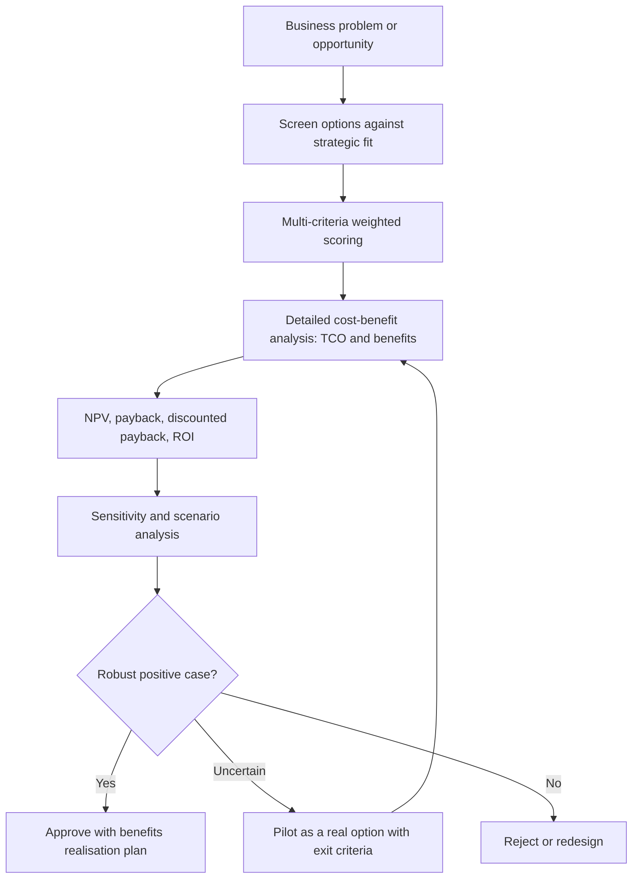

## Introduction

Every module in this course has introduced technologies with impressive potential: cloud and edge computing, IoT, blockchain, immersive technologies, quantum and high-performance computing, robotics, 5G, AI and green IT. Yet potential is not the same as value. Organisations have limited budgets, skills and management attention, and many emerging-technology projects fail to deliver because they were chosen for novelty, vendor enthusiasm or fear of missing out rather than for a clear business case.

This lesson provides a disciplined approach to the question "Should we invest in this technology, and if so, in what form?" It begins with structured evaluation criteria that look beyond financial returns to strategic fit, technical maturity, risk and organisational capability. It then develops cost-benefit analysis, including a complete worked calculation of net present value (NPV), payback period, discounted payback and return on investment (ROI), and shows how sensitivity analysis reveals whether a decision is robust. These tools are essential for writing investment proposals and answering examination case questions that ask you to "justify" or "recommend".

## Learning Objectives

- Apply a multi-criteria framework to evaluate an emerging technology for a specific organisation.
- Identify and classify the costs and benefits of a technology investment, including intangible and hidden items.
- Calculate NPV, simple payback, discounted payback and ROI for a technology project.
- Analyse the sensitivity of an investment decision to key assumptions such as the discount rate and benefit realisation.
- Evaluate the strengths and limitations of financial techniques for emerging-technology decisions.

## Prerequisite Knowledge

- Familiarity with the technologies covered earlier in this course.
- Basic arithmetic, percentages and the idea that money today is worth more than money in the future.
- No prior finance course is assumed; each calculation is explained step by step.

## Key Terminology

- **Cost-benefit analysis (CBA)**: A systematic comparison of the costs and benefits of an investment over its life to determine whether, and by how much, benefits exceed costs.
- **Total cost of ownership (TCO)**: All costs of acquiring, implementing, operating, supporting and eventually retiring a technology, not only its purchase price.
- **Time value of money**: The principle that money received today is worth more than the same amount received later, because it can be invested and because of risk and inflation.
- **Discount rate**: The rate used to convert future cash flows into present values, reflecting the organisation's cost of capital and the project's risk.
- **Net present value (NPV)**: The sum of the present values of all future net cash flows minus the initial investment; a positive NPV indicates that the project is expected to create value at the chosen discount rate.
- **Payback period**: The time taken for cumulative net cash flows to recover the initial investment.
- **Discounted payback period**: The time taken for cumulative discounted cash flows to recover the initial investment.
- **Return on investment (ROI)**: Net gain from an investment expressed as a percentage of its cost.
- **Sensitivity analysis**: Testing how results change when key assumptions vary, to identify which assumptions matter most.
- **Real option**: The right, but not the obligation, to make a future investment decision, such as expanding a successful pilot.

## Detailed Explanation

### Why emerging technologies are hard to evaluate

Established technologies have known costs, proven benefits and many reference customers. Emerging technologies have uncertain performance, immature vendors, shifting standards, scarce skills and benefits that depend heavily on organisational change. Their value often lies partly in learning and in options for future moves, which conventional financial analysis struggles to capture. Hype, discussed in the first module of this course, compounds the problem: early claims of benefits are frequently optimistic.

The response is not to abandon analysis but to combine **qualitative evaluation criteria** with **quantitative financial analysis**, to make assumptions explicit, and to test how sensitive decisions are to those assumptions.

### Multi-criteria evaluation

A balanced evaluation considers at least the following criteria.

| Criterion | Key questions |
|---|---|
| Strategic fit | Does the technology support the organisation's strategy and solve a real, important problem? |
| Business value | What measurable benefits (revenue, cost, risk reduction, customer experience) are expected? |
| Technical maturity | Is the technology proven in comparable settings? Are standards stable? Where is it on the hype cycle? |
| Integration and compatibility | Can it work with existing systems, data and processes? |
| Total cost of ownership | What are all costs over the life of the investment? |
| Risk | Technical, security, regulatory, vendor, operational and reputational risks? |
| Organisational readiness | Are skills, leadership support, culture and change capacity in place? |
| Vendor and ecosystem | Is the vendor financially stable? Are local partners and support available? |
| Legal, ethical and sustainability factors | Data protection, ethics, environmental impact? |
| Reversibility and options | Can we pilot, scale or exit without excessive cost? |

A **weighted scoring model** turns this into a decision aid. The evaluation team agrees weights reflecting the organisation's priorities, scores each option on each criterion (for example 1 to 5), multiplies scores by weights and sums them. Weighted scoring makes reasoning transparent, but its results depend on subjective weights and scores, so it should support rather than replace judgement.

### Identifying costs

Costs of emerging technology are frequently underestimated. Typical categories include:

- **Acquisition**: hardware, software licences or subscriptions, devices.
- **Implementation**: integration, data migration, configuration, consultants, testing.
- **People**: training, recruitment of scarce skills, change management, temporary productivity loss.
- **Operation**: cloud consumption, connectivity, energy, maintenance, support contracts, security monitoring.
- **Governance and compliance**: audits, data protection assessments, legal advice.
- **Retirement**: decommissioning, data extraction, contract exit costs.
- **Opportunity cost**: other projects not pursued.

In Ghana, foreign-exchange exposure is an important consideration, because many technology costs (cloud subscriptions, imported hardware, foreign software licences) are priced in US dollars while revenues may be in cedis.

### Identifying benefits

Benefits may be:

- **Tangible and financial**: cost savings, additional revenue, reduced losses from fraud or spoilage.
- **Tangible but non-financial**: faster processing, fewer errors, higher availability, which can often be converted into money with stated assumptions.
- **Intangible**: improved customer satisfaction, brand reputation, staff morale, learning, strategic positioning, regulatory goodwill.

Good practice is to quantify what can reasonably be quantified, describe the rest explicitly, assign an owner to each benefit and plan how it will be measured after implementation (**benefits realisation management**).

## Theories, Frameworks and Models

### Financial appraisal techniques

**Net present value.** Each future net cash flow `CF_t` in year `t` is discounted using the discount rate `r`:

`PV = CF_t / (1 + r)^t`

`NPV = Σ PV of future net cash flows − initial investment`

Decision rule: accept projects with positive NPV, and prefer higher NPV among mutually exclusive options, other things being equal.

**Simple payback.** The time until cumulative undiscounted net cash flows equal the initial investment. It is easy to understand and highlights liquidity risk, but ignores the time value of money and any cash flows after payback.

**Discounted payback.** As payback, but using discounted cash flows; it corrects the first weakness but still ignores later cash flows.

**Return on investment.** A simple version is:

`ROI = (Total benefits − Total costs) / Total costs × 100%`

ROI is widely used in business cases but, in this simple form, ignores timing and therefore should be reported together with NPV.

**Internal rate of return (IRR)** is the discount rate at which NPV equals zero; it is useful for comparison but can mislead with unusual cash-flow patterns.

### Sensitivity and scenario analysis

Because emerging-technology forecasts are uncertain, a single NPV figure gives false precision. Sensitivity analysis changes one assumption at a time (discount rate, adoption rate, benefit level, cost overrun) to see which variables drive the result. Scenario analysis combines assumptions into optimistic, central and pessimistic cases. **Break-even analysis** asks how far an assumption can move before NPV becomes zero.

### Real options thinking

A pilot project that has a negative NPV on its own may still be worth undertaking if it creates the option to scale up a successful technology later, or to abandon it cheaply if it fails. Real options reasoning supports staged investment: small, reversible commitments first, with larger investments only when uncertainty is reduced. This is particularly relevant for emerging technologies.

## Worked Example

**Illustrative scenario.** *Obuasi Agro Processors* (a fictional Ghanaian company) is evaluating an IoT-based predictive maintenance system for its processing plant. The initial investment, including sensors, gateways, cloud platform set-up, integration and training, is **GHS 1,200,000**. The project team estimates the following net annual benefits (avoided downtime and repair costs minus subscription, connectivity and support costs) over a five-year life:

| Year | Net benefit (GHS) |
|---|---|
| 1 | 300,000 |
| 2 | 400,000 |
| 3 | 450,000 |
| 4 | 450,000 |
| 5 | 400,000 |

The finance director specifies a discount rate of 15% for projects of this risk. All figures are illustrative.

**Step 1: Discount factors at 15%.** Discount factor = `1 / (1.15)^t`.

| Year | Discount factor | Net benefit | Present value | Cumulative PV |
|---|---|---|---|---|
| 1 | 0.8696 | 300,000 | 260,870 | 260,870 |
| 2 | 0.7561 | 400,000 | 302,457 | 563,327 |
| 3 | 0.6575 | 450,000 | 295,882 | 859,209 |
| 4 | 0.5718 | 450,000 | 257,289 | 1,116,498 |
| 5 | 0.4972 | 400,000 | 198,871 | 1,315,369 |

**Step 2: NPV.**
`NPV = 1,315,369 − 1,200,000 = GHS 115,369`
The NPV is positive, so at 15% the project is expected to create value.

**Step 3: Simple payback.** Cumulative undiscounted benefits are 300,000 (year 1), 700,000 (year 2), 1,150,000 (year 3) and 1,600,000 (year 4). After year 3, GHS 50,000 remains to be recovered from year 4's GHS 450,000.
`Payback = 3 + 50,000 / 450,000 = 3 + 0.11 ≈ 3.1 years`

**Step 4: Discounted payback.** After year 4 the cumulative PV is 1,116,498, leaving 83,502 to recover from year 5's PV of 198,871.
`Discounted payback = 4 + 83,502 / 198,871 = 4 + 0.42 ≈ 4.4 years`

**Step 5: Simple ROI over five years.**
Total net benefits = `300,000 + 400,000 + 450,000 + 450,000 + 400,000 = 2,000,000`
`ROI = (2,000,000 − 1,200,000) / 1,200,000 × 100% ≈ 66.7%` over five years (undiscounted).

**Step 6: Sensitivity to the discount rate.** Repeat the calculation at 20%, which might reflect a higher cost of borrowing or higher project risk. Discount factors are 0.8333, 0.6944, 0.5787, 0.4823 and 0.4019, giving present values of 250,000, 277,778, 260,417, 217,014 and 160,751, a total of 1,165,959.
`NPV at 20% = 1,165,959 − 1,200,000 = −GHS 34,041`

**Step 7: Interpretation.** The decision is sensitive: the project is attractive at 15% but marginally value-destroying at 20%. Discounted payback of 4.4 years in a five-year life leaves little margin if benefits arrive late. Management should therefore (a) examine the reliability of the benefit estimates, particularly avoided downtime; (b) consider a smaller pilot on the most critical machines to validate benefits before full investment (a real option); (c) negotiate costs denominated in cedis where possible to reduce exchange-rate risk; and (d) include intangible benefits such as improved safety and data for future process optimisation in the recommendation, clearly labelled as unquantified.

## Ghanaian Business Application

**Illustrative scenario.** *Bono Health Network* (a fictional group of private clinics in Sunyani and Techiman) is choosing between three options to improve patient records: (A) a cloud-based electronic medical records (EMR) subscription; (B) an on-premises EMR system; (C) a blockchain-based records-sharing platform proposed by a start-up.

The evaluation team uses weighted scoring:

| Criterion (weight) | A: Cloud EMR | B: On-premises EMR | C: Blockchain platform |
|---|---|---|---|
| Strategic fit (25%) | 5 | 4 | 3 |
| Technical maturity (20%) | 5 | 4 | 2 |
| Total cost of ownership (20%) | 4 | 2 | 3 |
| Risk, including data protection (15%) | 3 | 4 | 2 |
| Organisational readiness (10%) | 4 | 3 | 2 |
| Vendor and local support (10%) | 4 | 3 | 2 |

Weighted scores (score × weight, summed):

- A: `5(0.25) + 5(0.20) + 4(0.20) + 3(0.15) + 4(0.10) + 4(0.10) = 1.25 + 1.00 + 0.80 + 0.45 + 0.40 + 0.40 = 4.30`
- B: `4(0.25) + 4(0.20) + 2(0.20) + 4(0.15) + 3(0.10) + 3(0.10) = 1.00 + 0.80 + 0.40 + 0.60 + 0.30 + 0.30 = 3.40`
- C: `3(0.25) + 2(0.20) + 3(0.20) + 2(0.15) + 2(0.10) + 2(0.10) = 0.75 + 0.40 + 0.60 + 0.30 + 0.20 + 0.20 = 2.45`

Option A leads. The team then prepares an NPV for A, examines data protection obligations under the Data Protection Act, 2012 (Act 843) and connectivity resilience at rural clinics, and proposes keeping offline capability for outages. The blockchain option scores low not because blockchain is "bad" but because a shared, multi-party ledger offers little advantage when one organisation controls the records, which echoes the blockchain suitability analysis earlier in the course.

## International Case Study

### TradeLens: a well-funded emerging-technology venture that was discontinued

In 2018 the shipping company Maersk and IBM launched TradeLens, a blockchain-enabled platform intended to digitise global shipping documentation and give supply-chain participants shared visibility of container shipments. The platform attracted participation from a number of carriers, ports and other organisations. However, in November 2022 Maersk and IBM announced that TradeLens would be discontinued, explaining that it had not achieved the level of commercial viability and full global industry collaboration needed to continue as an independent business.

Lessons for technology evaluation:

- Technical feasibility does not guarantee commercial viability; network-based platforms need broad participation, and competitors may hesitate to join a platform led by a rival.
- Benefits that depend on ecosystem adoption should be modelled under pessimistic adoption scenarios.
- Governance and incentives for participants are as important as technology.
- Staged investment and clear exit criteria limit losses when adoption assumptions are not met.

## Diagram

## Common Misconceptions

- **Misconception:** The cheapest option is the best value. **Correction:** Total cost of ownership and benefits over the full life matter; a cheap licence with high integration and support costs may be the most expensive option.
- **Misconception:** A short payback period proves a project is worthwhile. **Correction:** Payback ignores the time value of money and cash flows after payback; it should be used alongside NPV.
- **Misconception:** NPV calculations are objective facts. **Correction:** NPV is only as reliable as its assumptions; sensitivity analysis is essential.
- **Misconception:** Intangible benefits should be ignored because they cannot be measured. **Correction:** They should be described explicitly and, where reasonable, proxied, but not inflated to rescue a weak case.
- **Misconception:** A negative NPV pilot should always be rejected. **Correction:** Pilots may have option value by reducing uncertainty for a larger decision.

## Common Examination Mistakes

- Discounting year 1 cash flows by `(1 + r)^0` or forgetting to subtract the initial investment.
- Calculating payback with discounted cash flows but calling it simple payback, or vice versa.
- Reporting ROI without stating the time period or whether it is discounted.
- Presenting a single NPV without sensitivity analysis or discussion of assumptions.
- Recommending a technology based only on financial figures, ignoring strategic fit, risk and readiness.
- Inventing market statistics or vendor claims to support a business case.

## Critical Thinking Questions

1. How should a Ghanaian firm choose a discount rate when interest rates and inflation are volatile? What happens to long-horizon technology projects when rates rise?
2. When is it legitimate to proceed with a project whose NPV is negative?
3. How can evaluation teams prevent weighted scoring from being manipulated to justify a predetermined choice?
4. What lessons from TradeLens apply to proposals for shared industry platforms in Ghana, such as for agricultural supply chains?
5. How should foreign-exchange risk be incorporated into a cost-benefit analysis for a dollar-priced cloud service?

## Practical Exercises

1. **NPV calculation.** A chatbot project costs GHS 500,000 and yields net benefits of GHS 150,000, 200,000, 200,000 and 150,000 in years 1 to 4. At a 12% discount rate, calculate NPV, simple payback and simple ROI. *Expected output:* discount factors 0.8929, 0.7972, 0.7118 and 0.6355; NPV of approximately GHS 31,050; payback of about 2.75 years; ROI of 40% over four years.
2. **Weighted scoring.** Choose three emerging technologies for an organisation you know. *Expected output:* a weighted scoring table with justified weights and a recommendation.
3. **Cost inventory.** List every cost category for adopting a private 5G network at an illustrative factory. *Expected output:* a TCO table with at least twelve items grouped by acquisition, implementation, people, operation, governance and retirement.
4. **Sensitivity.** Using the worked example, find the year-1 to year-5 uniform reduction in benefits (as a percentage) at which NPV at 15% becomes zero. *Expected output:* about 8.8% (because 115,369 / 1,315,369 ≈ 0.088), with explanation.

## Key Takeaways

- Evaluate emerging technologies with both qualitative criteria and financial analysis.
- Total cost of ownership includes implementation, people, operation, governance and exit costs.
- NPV accounts for the time value of money; payback and ROI are useful but incomplete.
- Sensitivity and scenario analysis reveal whether a decision is robust.
- Real options thinking justifies staged pilots with clear exit criteria.
- Ecosystem-dependent benefits, as TradeLens showed, require pessimistic adoption scenarios.

## Further Reading

- Brealey, R. A., Myers, S. C., & Allen, F. (2020). *Principles of corporate finance* (13th ed.). McGraw-Hill Education.
- Ward, J., & Daniel, E. (2012). *Benefits management: How to increase the business value of your IT projects* (2nd ed.). Wiley.
- Dixit, A. K., & Pindyck, R. S. (1994). *Investment under uncertainty*. Princeton University Press.
- Fenn, J., & Raskino, M. (2008). *Mastering the hype cycle: How to choose the right innovation at the right time*. Harvard Business Press.

## Video Resources

- [MIT OpenCourseWare](https://ocw.mit.edu/) — Massachusetts Institute of Technology. Open learning portal; search for finance theory and capital budgeting course materials covering NPV.
- [Khan Academy](https://www.khanacademy.org/) — Khan Academy. Free learning platform; search for present value and the time value of money.
- [Gartner Hype Cycle methodology](https://www.gartner.com/en/research/methodologies/gartner-hype-cycle) — Gartner. Official explanation of the hype cycle used to judge technology maturity.

## Revision Summary

Emerging-technology decisions should combine multi-criteria evaluation (strategic fit, value, maturity, TCO, risk, readiness, vendor, ethics, reversibility) with rigorous cost-benefit analysis. NPV discounts future net benefits and subtracts the investment; payback and discounted payback show recovery time; ROI summarises total gain; sensitivity analysis tests robustness. Real options reasoning supports pilots and staged investment. The worked example shows NPV of GHS 115,369 at 15% but −GHS 34,041 at 20%, demonstrating why assumptions must be tested.

- PV = CF / (1 + r)^t; NPV = Σ PV − investment.
- Payback ignores timing; discounted payback ignores later flows.
- ROI = (benefits − costs) / costs; state the period.
- Weighted scoring is transparent but subjective.
- Include FX risk, hidden costs and benefits ownership.
- TradeLens: technical success, commercial failure from weak ecosystem adoption.
