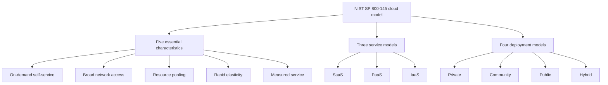

## Introduction

Cloud computing is now the default way many organisations acquire computing capability. Start-ups in Accra can launch services without owning a single server, banks run analytics on rented infrastructure, and public bodies use cloud-hosted email and collaboration suites. Yet "the cloud" is one of the most loosely used terms in business. Vendors label almost any internet-delivered service as cloud, and managers sometimes assume cloud is automatically cheaper, more secure or less work than running their own systems.

This lesson replaces the slogan with a precise model. It uses the definition published by the United States National Institute of Standards and Technology (NIST) in Special Publication 800-145 (Mell & Grance, 2011), which has become the most widely cited reference definition. You will learn the five essential characteristics that distinguish a genuine cloud service from simple hosting, the three service models in outline (examined in depth in the next lesson), and the four deployment models. The lesson ends with a worked comparison of capital and operating expenditure, because the economic logic of cloud is where many business cases succeed or fail.

## Learning Objectives

- Explain the five essential characteristics of cloud computing in the NIST definition.
- Compare public, private, community and hybrid deployment models in terms of control, cost, scalability and compliance.
- Distinguish genuine cloud services from traditional hosting or outsourcing using the NIST criteria.
- Apply a capital-versus-operating-expenditure comparison to a cloud migration decision.
- Evaluate deployment options for a Ghanaian organisation, considering data protection, connectivity and currency risk.

## Prerequisite Knowledge

- Basic understanding of servers, networks, storage and the internet.
- The idea of fixed and variable costs from introductory accounting or economics.

## Key Terminology

- **Cloud computing**: A model for enabling ubiquitous, convenient, on-demand network access to a shared pool of configurable computing resources that can be rapidly provisioned and released with minimal management effort or service provider interaction (Mell & Grance, 2011).
- **Resource pooling**: The provider's resources serve multiple consumers through a multi-tenant model, with physical and virtual resources dynamically assigned according to demand.
- **Rapid elasticity**: The ability to scale capabilities outward and inward quickly, sometimes automatically, so that capacity appears unlimited to the consumer.
- **Measured service**: Automatic metering of resource use (storage, processing, bandwidth, active user accounts) so that usage can be monitored, controlled, reported and billed.
- **Deployment model**: The arrangement describing who the cloud infrastructure is provisioned for and who owns, manages and operates it: private, community, public or hybrid.
- **Capital expenditure (capex)**: Upfront spending on long-lived assets, such as servers and data centre equipment, that is depreciated over time.
- **Operating expenditure (opex)**: Recurring spending on services and running costs, such as monthly cloud subscriptions, that is expensed in the period incurred.
- **Multi-tenancy**: An architecture in which one instance of infrastructure or software serves multiple customers whose data and configurations are logically isolated.

## Detailed Explanation

### The NIST definition

NIST SP 800-145 defines cloud computing through **five essential characteristics**, **three service models** and **four deployment models**. The value of the definition is that it gives analysts a test: a service that lacks the essential characteristics is not cloud in the NIST sense, whatever the marketing says.

### The five essential characteristics

1. **On-demand self-service.** A consumer can provision computing capabilities, such as server time or storage, automatically without requiring human interaction with each provider. In practice this means a web console or an application programming interface (API) rather than a purchase order and a phone call.
2. **Broad network access.** Capabilities are available over the network and accessed through standard mechanisms that work across diverse client platforms, such as phones, tablets, laptops and workstations.
3. **Resource pooling.** The provider's resources are pooled to serve many consumers. There is a sense of *location independence*: the customer generally has no control or knowledge over the exact location of resources, though it may be able to specify location at a higher level, such as country, region or data centre. This point matters greatly for data protection.
4. **Rapid elasticity.** Capabilities can be provisioned and released elastically, in some cases automatically, to scale rapidly with demand. To the consumer, capacity often appears unlimited.
5. **Measured service.** Systems automatically control and optimise resource use through metering. Usage is transparent to both provider and consumer, enabling pay-per-use billing.

A useful exercise is to test familiar arrangements. A company that rents a dedicated physical server from a local data centre, ordered by email and installed manually over several days, lacks on-demand self-service and rapid elasticity; it is **hosting**, not cloud. A virtualised environment inside a company's own data centre that lets departments provision virtual machines through a self-service portal, with metering and chargeback, may qualify as a **private cloud**.

### Service models in outline

NIST defines three service models, distinguished by how much of the technology stack the consumer controls:

- **Software as a Service (SaaS):** the consumer uses the provider's applications, such as hosted email or customer relationship management.
- **Platform as a Service (PaaS):** the consumer deploys its own applications onto provider-managed runtimes, databases and tools.
- **Infrastructure as a Service (IaaS):** the consumer provisions processing, storage and networks and controls operating systems and applications.

These are analysed in detail in the next lesson.

### The four deployment models

- **Private cloud.** Infrastructure is provisioned for exclusive use by a single organisation. It may be owned and operated by the organisation, a third party or a combination, and may be on or off premises.
- **Community cloud.** Infrastructure is provisioned for exclusive use by a specific community of organisations with shared concerns, such as mission, security requirements, policy or compliance. It may be managed by one or more members or a third party.
- **Public cloud.** Infrastructure is provisioned for open use by the general public and exists on the premises of the provider, which may be a business, academic or government organisation.
- **Hybrid cloud.** A composition of two or more distinct infrastructures (private, community or public) that remain unique entities but are bound together by technology that enables data and application portability, for example bursting to a public cloud when private capacity is exhausted.

Note that NIST's definition of "private" concerns *exclusive use*, not location. A private cloud can be hosted by a third party off premises. Conversely, a public cloud provider may place equipment in a customer's building and still operate it as part of its public service.

## Theories, Frameworks and Models

### Comparing deployment models

| Criterion | Public | Private | Community | Hybrid |
|---|---|---|---|---|
| Control over infrastructure | Low | High | Shared | Mixed, by workload |
| Upfront cost | Very low | High if self-built | Shared among members | Moderate |
| Elasticity | Very high | Limited by owned capacity | Moderate | High for burst workloads |
| Compliance and data location | Depends on provider regions and contracts | Easiest to demonstrate | Designed around shared requirements | Sensitive data can stay private |
| Skills required | Cloud architecture and cost management | Full data centre and virtualisation skills | Governance across members | Integration and orchestration skills |
| Typical use | Start-ups, web services, analytics, burst demand | Highly regulated or very steady workloads | Sector platforms, such as shared health or education systems | Gradual migration, mixed sensitivity data |

### The economic logic of cloud

Cloud economics rest on three mechanisms. **Economies of scale**: large providers buy hardware, power and network capacity more cheaply than most individual firms. **Statistical multiplexing**: because customers' peaks occur at different times, a pooled provider needs less total capacity than the sum of every customer's peak. **Conversion of fixed to variable cost**: customers pay for what they use instead of buying for the peak.

The implication is that cloud is most compelling when demand is **variable, uncertain or growing**, and least compelling when demand is **steady and predictable** and the organisation already has efficient facilities and skills. Cloud also changes risk: capex risk (buying the wrong capacity) is replaced by opex risk (uncontrolled consumption, price changes and, for Ghanaian firms, exchange-rate movements when bills are in foreign currency).

## Worked Example

### Capex versus opex for a retail analytics platform

**Illustrative scenario.** *Adom Supermarkets* (hypothetical) needs a platform for sales analytics and its e-commerce site. Demand is moderate for nine months of the year and roughly double during three peak months (Easter and the end-of-year festive season). All figures are invented for teaching.

**Option A: on-premises servers sized for peak.**

- Hardware, storage and installation (capex): GHS 600,000, expected life five years.
- Annual running costs (power and backup generation, maintenance contracts, data centre space, a share of staff time): GHS 150,000.
- Five-year total: `600,000 + (5 × 150,000) = GHS 1,350,000`.

**Option B: public cloud with a fixed size equal to peak.**

- Monthly charge: GHS 22,000.
- Five-year total: `22,000 × 12 × 5 = GHS 1,320,000`.

At this point the options look almost identical, which is a common and important finding: simply moving the same peak-sized system to the cloud ("lift and shift") may not save money.

**Option C: public cloud with elastic scaling.**

- Baseline for nine months: GHS 15,000 per month. Peak for three months: GHS 35,000 per month.
- Annual cost: `(9 × 15,000) + (3 × 35,000) = 135,000 + 105,000 = GHS 240,000`.
- Five-year total: `5 × 240,000 = GHS 1,200,000`.

**Interpretation.**

1. Elasticity, not cloud hosting as such, produces the saving of `1,350,000 − 1,200,000 = GHS 150,000` over five years compared with Option A.
2. Option A requires GHS 600,000 at the start; Options B and C spread spending over time, which preserves cash and avoids the risk of buying the wrong capacity.
3. Additional factors must be added before deciding: data transfer (egress) charges, internet bandwidth and redundancy for the cloud options, staff retraining, migration effort, and currency exposure if cloud charges are denominated in US dollars.
4. A sensitivity test should ask what happens if the cedi depreciates against the dollar by a given percentage, or if peak demand grows faster than expected (which favours the elastic option).

## Ghanaian Business Application

**Illustrative scenario.** *Volta Health Partners* (hypothetical) operates a group of private clinics in the Volta and Greater Accra regions. It wants a new electronic medical records (EMR) system, an online appointment booking service and a staff email and collaboration suite.

A deployment-model analysis would separate workloads by sensitivity and variability:

- **Staff email and collaboration**: a public cloud SaaS suite is appropriate. It is standardised, easy to scale and the provider manages availability.
- **Appointment booking website**: public cloud PaaS or SaaS suits variable traffic and needs little sensitive data beyond contact details.
- **EMR**: patient records are highly sensitive personal data. Ghana's Data Protection Act, 2012 (Act 843) establishes obligations for data controllers processing personal data, and the Data Protection Commission oversees compliance. The group must understand where data will be stored and processed, what contractual safeguards the provider offers, and how security will be assured. Options include a public cloud region with strong contractual and technical controls, a **community cloud** shared with other healthcare providers if one exists, or a **hybrid** design that keeps the core records database in a private environment while using public cloud for less sensitive services.

Local practicalities also matter. Clinics in some districts may experience unreliable connectivity, so an EMR that depends entirely on a distant data centre could halt clinical work during outages. The design should include redundant internet links, offline capability or local caching. These concerns lead directly to the edge computing discussion later in this module.

## International Case Study

### Netflix's migration to the public cloud

Netflix has publicly described its move from its own data centres to Amazon Web Services (AWS). The company has explained that the decision followed a major database corruption incident in 2008 that disrupted DVD shipping for several days and exposed the risks of relying on vertically scaled systems in its own facilities. Netflix chose to move to a public cloud and to re-architect its systems as many smaller, horizontally scalable services rather than simply copying existing applications. It announced in 2016 that it had completed the migration of its streaming service to the cloud.

**Analysis.**

- The case illustrates **rapid elasticity** and **resource pooling** at scale: streaming demand varies by time of day and grows with subscriber numbers and new markets, which suits elastic capacity.
- Netflix emphasised re-architecture rather than lift-and-shift, consistent with the worked example's finding that savings and resilience come from redesigning for elasticity and failure.
- The company also invested heavily in engineering practices for resilience, such as deliberately testing how systems behave when components fail. Cloud did not remove the need for skills; it changed which skills mattered.
- The case is not a template for every firm. Netflix had the scale and engineering capability to manage a complex distributed architecture. A smaller organisation may achieve more by adopting SaaS and PaaS services than by building its own cloud-native platform.

## Diagram

## Common Misconceptions

- **"Any service delivered over the internet is cloud computing."** A service must show the NIST essential characteristics; manually provisioned dedicated hosting lacks self-service and elasticity.
- **"A private cloud must be in the organisation's own building."** NIST defines private cloud by exclusive use; it may be operated by a third party and located off premises.
- **"Cloud is always cheaper."** A peak-sized lift-and-shift can cost as much as on-premises; savings usually come from elasticity, managed services and redesign.
- **"Moving to the cloud transfers all security responsibility to the provider."** Responsibility is shared and depends on the service model; customers remain responsible for their data, identities and configurations.
- **"Hybrid cloud just means using more than one supplier."** Hybrid requires distinct infrastructures bound together by technology enabling portability; using several unconnected SaaS products is not, by itself, hybrid cloud.

## Common Examination Mistakes

- Listing four or six essential characteristics, or confusing them with service models.
- Describing deployment models only by location rather than by who the infrastructure is provisioned for.
- Presenting a cost comparison without stating assumptions, time horizon or additional costs such as bandwidth and egress.
- Ignoring data protection law, connectivity and currency risk when advising a Ghanaian organisation.
- Citing the NIST definition without the authors and year (Mell & Grance, 2011).

## Critical Thinking Questions

1. Resource pooling implies location independence. How should a Ghanaian bank reconcile this characteristic with its obligations to protect customer data?
2. Under what conditions would a private cloud be more economical than public cloud for a large organisation?
3. Does the conversion of capex to opex always improve a firm's financial position? Consider cash flow, budgeting processes and exchange-rate exposure.
4. Why might a community cloud be attractive for a group of Ghanaian universities or hospitals, and what governance problems might it create?
5. Is the NIST definition, published in 2011, still adequate for today's services, such as serverless computing and AI platforms? Justify your view.

## Practical Exercises

1. Take three services your organisation or university uses (for example email, a learning management system and a payroll system). Test each against the five NIST characteristics. Expected output: a table marking each characteristic as present, partial or absent, with a conclusion on whether each is cloud in the NIST sense.
2. Rebuild the worked example in a spreadsheet and add two factors: annual bandwidth costs of GHS 30,000 for cloud options, and a 20% increase in cloud prices in local-currency terms from year three. Expected output: revised five-year totals and a paragraph on how the recommendation changes.
3. Recommend a deployment model for each of five workloads in a Ghanaian microfinance institution (website, core loan ledger, staff email, analytics, mobile app back end). Expected output: a table with the chosen model and a one-sentence justification for each.

## Key Takeaways

- NIST SP 800-145 defines cloud computing through five essential characteristics, three service models and four deployment models.
- The essential characteristics (self-service, network access, pooling, elasticity, measured service) distinguish cloud from traditional hosting.
- Deployment models are defined by who the infrastructure is provisioned for, not simply by location.
- Cloud economics depend on scale, pooling and converting fixed costs to variable costs; elasticity is where most savings arise.
- Ghanaian decisions must weigh data protection obligations, connectivity resilience and currency exposure alongside cost.

## Further Reading

- Mell, P., & Grance, T. (2011). *The NIST definition of cloud computing* (NIST Special Publication 800-145). National Institute of Standards and Technology. <https://csrc.nist.gov/pubs/sp/800/145/final>
- Armbrust, M., Fox, A., Griffith, R., Joseph, A. D., Katz, R., Konwinski, A., Lee, G., Patterson, D., Rabkin, A., Stoica, I., & Zaharia, M. (2010). A view of cloud computing. *Communications of the ACM, 53*(4), 50–58.
- Erl, T., Mahmood, Z., & Puttini, R. (2013). *Cloud computing: Concepts, technology and architecture*. Prentice Hall.

## Video Resources

- [Google Cloud Learn](https://cloud.google.com/learn) — Google Cloud. Explainers on cloud computing concepts, deployment models and cloud economics.
- [Microsoft Learn](https://learn.microsoft.com/) — Microsoft. Free learning paths including introductory cloud concepts modules.
- [AWS Skill Builder](https://skillbuilder.aws/) — Amazon Web Services. Official training portal with introductory cloud practitioner courses.

## Revision Summary

NIST SP 800-145 (Mell & Grance, 2011) defines cloud computing as on-demand network access to a shared pool of configurable resources that can be rapidly provisioned and released with minimal management effort. Its five essential characteristics are on-demand self-service, broad network access, resource pooling, rapid elasticity and measured service; its service models are SaaS, PaaS and IaaS; and its deployment models are private, community, public and hybrid. Cloud converts capex to opex, but savings depend on elasticity and redesign rather than simple relocation, and Ghanaian organisations must also weigh data protection, connectivity and currency risk.

- Five characteristics: self-service, network access, pooling, elasticity, measured.
- Four deployment models: private, community, public, hybrid.
- Private means exclusive use, not necessarily on premises.
- Lift-and-shift at peak size rarely saves money.
- Add egress, bandwidth, skills and currency to any cost case.
- Act 843 governs personal data processing in Ghana.
