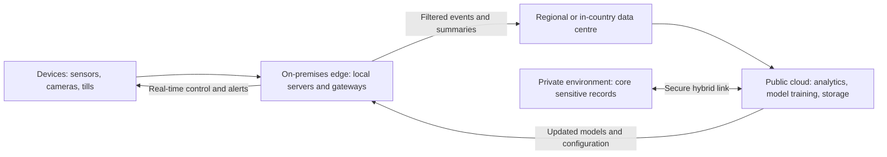

## Introduction

The first wave of cloud adoption centralised computing in very large data centres. Centralisation brings economies of scale, but it also introduces distance. Every request from a factory sensor, a supermarket till or a mobile app must travel across networks to a distant facility and back. For many applications that delay is invisible. For others, such as machine safety systems, real-time video analytics or payment terminals that must keep working when the internet fails, it is unacceptable. At the same time, laws and customer expectations increasingly constrain *where* data may be stored and processed.

Two architectural responses have emerged. **Edge computing** moves processing closer to where data is produced and used. **Hybrid and multi-cloud** architectures combine private infrastructure, one or more public clouds and edge locations into a single managed estate. This lesson explains both, quantifies latency using simple physics, examines data sovereignty with reference to Ghanaian and international law, and provides a framework for deciding where each workload should run.

## Learning Objectives

- Define edge computing, fog computing, hybrid cloud and multi-cloud and explain how they differ.
- Calculate the minimum network latency imposed by physical distance and interpret its business significance.
- Explain data sovereignty and data residency and their implications for cloud architecture in Ghana.
- Analyse a set of workloads and decide whether each should run at the edge, in a private environment or in a public cloud.
- Evaluate the benefits and costs of hybrid and multi-cloud strategies, including complexity and skills.

## Prerequisite Knowledge

- The NIST deployment models and service models from earlier lessons in this module.
- Basic understanding of network concepts such as bandwidth and response time.

## Key Terminology

- **Edge computing**: Placing computation and data storage close to the sources and consumers of data, such as devices, premises or local network sites, rather than relying solely on centralised data centres.
- **Fog computing**: An intermediate layer of computing nodes between devices and the cloud, such as local gateways or regional micro-data centres, that perform filtering, aggregation and local control.
- **Latency**: The time taken for data to travel from source to destination and, when measured as round-trip time, back again.
- **Bandwidth**: The volume of data a network link can carry per unit of time; distinct from latency.
- **Data sovereignty**: The principle that data is subject to the laws and governance of the jurisdiction in which it is collected, stored or processed.
- **Data residency**: A requirement or choice that data be stored in a particular geographic location.
- **Hybrid cloud**: An architecture that binds together two or more distinct infrastructures, typically private and public, so that data and applications can move between them.
- **Multi-cloud**: The use of services from more than one public cloud provider, whether or not they are integrated.

## Detailed Explanation

### Why the edge?

Four forces push computing towards the edge.

1. **Latency.** Some decisions must be made within milliseconds. A conveyor safety system that detects a worker's hand must stop the machine almost instantly; it cannot wait for a round trip to a remote data centre.
2. **Bandwidth and cost.** High-volume data, such as continuous high-definition video from many cameras, is expensive to transmit. Processing it locally and sending only events or summaries ("forklift entered restricted area at 14:02") reduces network costs dramatically.
3. **Resilience and autonomy.** Operations must continue during connectivity outages. A supermarket that cannot sell because its link to a distant cloud is down loses revenue and customer goodwill.
4. **Privacy and sovereignty.** Processing sensitive data locally, and sending only anonymised or aggregated results, can reduce legal and reputational risk.

### Layers of the edge

The "edge" is not one place. It is useful to distinguish:

- **Device edge**: processing on the sensor, camera, phone or machine itself, such as a camera that runs an image-recognition model on its own chip.
- **On-premises edge**: small servers or gateways in a factory, shop, clinic or mine.
- **Network or regional edge**: computing in telecom facilities, local data centres or content delivery network sites within the same country or city.
- **Central cloud**: hyperscale data centres used for heavy analytics, model training, long-term storage and global coordination.

Fog computing is commonly used to describe the intermediate layers that sit between devices and the central cloud.

Edge does not replace the cloud. A typical pattern is **"act locally, learn centrally"**: edge nodes take time-critical decisions and filter data, while the cloud aggregates data across sites, trains analytical models and pushes updated models and configurations back to the edge.

### Hybrid and multi-cloud

Most established organisations end up with a mixture of environments. A **hybrid cloud** integrates private infrastructure with public cloud, for example keeping a core banking database in a private data centre while running mobile app services and analytics in public cloud, with secure connections and common management between them. **Multi-cloud** uses two or more public providers, perhaps one for productivity SaaS, another for analytics and a third for AI services.

Motivations include: placing each workload where it fits best; meeting regulatory or contractual data location requirements; using specialist services from different providers; negotiating leverage; and resilience against a single provider's outage. The costs include integration effort, more complex security (several identity systems, policies and monitoring tools), duplicated skills, and data transfer charges between environments. Many organisations are "multi-cloud by accident" rather than by design, which magnifies these costs.

Major providers now offer products that extend their public cloud management to customer premises and edge sites, such as hardware racks operated by the provider in a customer's facility, and management planes that govern servers across private and public environments. These blur the line between private, public and edge, which is why workload placement decisions should be based on requirements rather than labels.

## Theories, Frameworks and Models

### Data sovereignty and residency

Data protection law determines what an organisation may do with personal data and often influences where data can go.

- **Ghana**: The Data Protection Act, 2012 (Act 843) sets principles for processing personal data, including accountability, purpose specification, security safeguards and data subject rights, and establishes the Data Protection Commission. The Cybersecurity Act, 2020 (Act 1038) established the Cyber Security Authority and provides for the protection of critical information infrastructure. Sector regulators, such as the Bank of Ghana for financial institutions, may issue additional guidance on outsourcing and cloud services. Organisations should consult current official guidance and legal advice rather than assume what is or is not permitted.
- **European Union**: The General Data Protection Regulation (Regulation (EU) 2016/679) restricts transfers of personal data outside the European Economic Area unless adequate protection is ensured. This matters for Ghanaian firms that process data about EU residents, such as exporters, tourism businesses and outsourcing providers.

Architecturally, sovereignty and residency requirements can be met by selecting provider regions in permitted jurisdictions, using local or community clouds, keeping sensitive data in private environments within a hybrid design, encrypting data with keys the customer controls, and processing data at the edge so that only anonymised results leave the country.

### A workload placement framework

| Question | If yes, lean towards |
|---|---|
| Must the response occur within a few milliseconds, or continue during connectivity loss? | Device or on-premises edge |
| Is raw data very high volume but only summaries are needed centrally? | Edge filtering with cloud aggregation |
| Is the data subject to strict residency or sector rules? | In-country region, private environment or hybrid design |
| Is demand highly variable or rapidly growing? | Public cloud |
| Does the workload need specialist services (large-scale analytics, AI training)? | Public cloud, possibly multi-cloud |
| Is demand stable, predictable and already well served by efficient facilities? | Private environment may remain economical |

## Worked Example

### How much latency does distance impose?

Light travels through optical fibre at roughly two-thirds of its speed in a vacuum, about 200,000 kilometres per second, which is `200 km per millisecond`. This sets a **physical minimum** on latency that no amount of investment in servers can remove.

**Illustrative assumptions.** A Ghanaian business in Accra is choosing between a cloud region roughly 5,000 km away by fibre path and a local data centre in Accra 20 km away. (Real cable routes are longer than straight-line distances, and figures here are illustrative.)

**Step 1: One-way propagation delay to the distant region.**
`5,000 km ÷ 200 km/ms = 25 ms`.

**Step 2: Round-trip propagation delay.**
`2 × 25 ms = 50 ms`. Real-world round-trip times will be higher because of routing, switching, queuing and server processing.

**Step 3: Round-trip delay to the local data centre.**
`2 × (20 ÷ 200) = 0.2 ms` of propagation delay.

**Step 4: Effect on a chatty application.** Suppose a poorly designed point-of-sale application makes 12 sequential calls to the server for each sale. With the distant region, propagation alone adds `12 × 50 ms = 600 ms`, plus processing delays, before the receipt prints. With the local site, propagation adds `12 × 0.2 = 2.4 ms`.

**Step 5: Interpret.** For a nightly sales report, 50 ms is irrelevant. For checkout at a busy supermarket, over half a second of avoidable delay per transaction, before any processing, degrades the customer experience and reduces throughput. The remedies are architectural: redesign the application to reduce sequential calls, run the transaction service at the edge or in-country, and synchronise with the central cloud asynchronously.

## Ghanaian Business Application

**Illustrative scenario.** *Ankobra Gold Mining Ltd* (hypothetical) operates an open-pit gold mine in the Western Region. It wants to improve safety, reduce equipment downtime and report operational data to its parent company.

| Workload | Placement | Reasoning |
|---|---|---|
| Collision-avoidance alerts for haul trucks | Device and on-premises edge | Millisecond responses required; must work without internet |
| Video analytics for personal protective equipment compliance | On-premises edge | High video volume; only alerts and statistics sent onward; reduces privacy exposure |
| Equipment vibration data for predictive maintenance | Edge filtering, cloud model training | Edge detects anomalies in real time; cloud trains models across the fleet |
| Payroll and human resources records | SaaS in a provider region meeting data protection requirements | Standard process; contractual safeguards under Act 843 |
| Group-wide analytics and reporting | Public cloud | Elastic compute and specialist analytics services |

The mine's connectivity may depend on microwave or satellite links that are slower, more expensive and less reliable than urban fibre, which strengthens the case for local processing. The design also needs local skills to maintain edge equipment, ruggedised hardware suited to dust and heat, reliable power with backup generation and a plan for updating software securely across many edge devices.

A second application concerns **retail resilience**. A supermarket chain operating across several Ghanaian cities can run its point-of-sale and inventory services on small on-premises servers in each store, synchronising with a central cloud when connectivity allows. If a fibre link is cut, stores continue trading, accepting card and mobile money payments where those networks remain available, and the data reconciles later.

## International Case Study

### Chick-fil-A: Kubernetes clusters in restaurants

The US fast-food chain Chick-fil-A has described publicly, through its technology team's blog posts and conference presentations, an edge computing architecture in which each restaurant runs a small cluster of commodity computers managed with the Kubernetes container orchestration platform. Connected kitchen equipment and other devices in the restaurant send data to this local cluster, which runs applications that support restaurant operations. The local cluster continues to operate if the connection to the central cloud is interrupted, while central cloud services are used for management, analytics and deploying software updates across the fleet of restaurants.

**Analysis.**

- The case illustrates **act locally, learn centrally**: time-sensitive operational logic runs in the restaurant, while fleet-wide intelligence and software management are centralised.
- It shows the importance of **fleet management**: running computing in thousands of locations is only feasible with automated deployment, monitoring and recovery, because staff in each restaurant are not IT specialists.
- The design choice of commodity hardware and standard container tooling reflects a trade-off between cost, resilience and the complexity of operating distributed systems.
- For Ghanaian retailers, fuel stations or pharmacy chains, the transferable lesson is not the specific technology but the pattern: autonomy at each site combined with centralised orchestration and analytics.

## Diagram

## Common Misconceptions

- **"Edge computing will replace the cloud."** Edge complements the cloud; time-critical processing happens locally while aggregation, training and management remain central.
- **"More bandwidth solves latency."** Bandwidth is capacity; latency is delay. Distance imposes a physical minimum delay regardless of bandwidth.
- **"Hybrid cloud and multi-cloud are the same."** Hybrid integrates distinct infrastructures, typically private and public; multi-cloud means using more than one public provider.
- **"Storing data in-country automatically ensures compliance."** Residency is only one aspect; data protection law also requires lawful processing, security safeguards and respect for data subject rights.
- **"Multi-cloud always improves resilience."** Without deliberate design, multi-cloud often adds complexity and new failure points rather than redundancy.

## Common Examination Mistakes

- Defining edge computing vaguely as "computing at the edge" without explaining the drivers of latency, bandwidth, resilience and privacy.
- Confusing latency with bandwidth in calculations or explanations.
- Discussing data sovereignty without naming relevant law, such as Ghana's Act 843 or the EU GDPR.
- Recommending multi-cloud without weighing integration, security and skills costs.
- Failing to place each workload separately; organisations rarely put everything in one location.

## Critical Thinking Questions

1. How might hyperscale providers opening data centres on the African continent change the case for edge and in-country hosting in Ghana?
2. Should a Ghanaian bank prefer a hybrid architecture or a single public cloud region outside Ghana? What evidence would you need to decide?
3. Edge processing can enhance privacy by keeping raw data local. Can it also create new privacy or security risks? Explain.
4. Under what circumstances is multi-cloud a sensible strategy rather than an expensive complication?
5. Is data sovereignty primarily a technical, legal or political issue? Defend your answer.

## Practical Exercises

1. Using the latency method from the worked example, calculate minimum round-trip propagation delays from Accra to data centres approximately 50 km, 2,000 km and 8,000 km away by fibre path. Expected output: a table of results and one sentence on which business applications each delay would suit.
2. Apply the workload placement framework to a Ghanaian hospital with five workloads: patient monitoring alarms, radiology image storage, appointment booking, payroll and research analytics. Expected output: a placement table with justification for each workload.
3. Write a one-page briefing for a company board explaining the difference between data sovereignty and data residency, with two implications for its cloud strategy. Expected output: a concise briefing in plain business language.

## Key Takeaways

- Edge computing addresses latency, bandwidth cost, resilience and privacy by processing data near its source.
- Physical distance sets a minimum latency of roughly 1 ms of round-trip time per 100 km of fibre path, before any processing delay.
- Hybrid cloud integrates private and public infrastructures; multi-cloud uses several public providers; both add complexity.
- Data sovereignty and residency requirements, including Ghana's Act 843 and the EU GDPR, shape where data may be processed.
- Workloads should be placed individually using explicit criteria rather than labels.

## Further Reading

- Shi, W., Cao, J., Zhang, Q., Li, Y., & Xu, L. (2016). Edge computing: Vision and challenges. *IEEE Internet of Things Journal, 3*(5), 637-646.
- Satyanarayanan, M. (2017). The emergence of edge computing. *Computer, 50*(1), 30-39.
- Mell, P., & Grance, T. (2011). *The NIST definition of cloud computing* (NIST Special Publication 800-145). National Institute of Standards and Technology. <https://csrc.nist.gov/pubs/sp/800/145/final>

## Video Resources

- [Microsoft Learn](https://learn.microsoft.com/): Microsoft. Learning paths on hybrid cloud management and edge deployments.
- [IBM Think](https://www.ibm.com/think): IBM. Explainers on edge computing, hybrid cloud and data sovereignty.
- [Google Cloud Learn](https://cloud.google.com/learn): Google Cloud. Introductions to hybrid, multi-cloud and edge concepts.

## Revision Summary

Edge computing moves processing to devices, premises or local network sites to reduce latency, cut bandwidth costs, maintain operation during outages and keep sensitive data local, while the central cloud handles aggregation, model training and fleet management. Distance imposes unavoidable latency (about 200 km of fibre per millisecond one way). Hybrid cloud integrates distinct infrastructures; multi-cloud uses several public providers. Data sovereignty and residency, governed in Ghana by the Data Protection Act, 2012 (Act 843) and relevant sector rules, shape where workloads may run.

- Edge drivers: latency, bandwidth, resilience, privacy.
- Pattern: act locally, learn centrally.
- Latency is not bandwidth.
- Hybrid = integrated private plus public; multi-cloud = several public providers.
- Residency is not the whole of compliance.
- Place each workload using explicit criteria.
