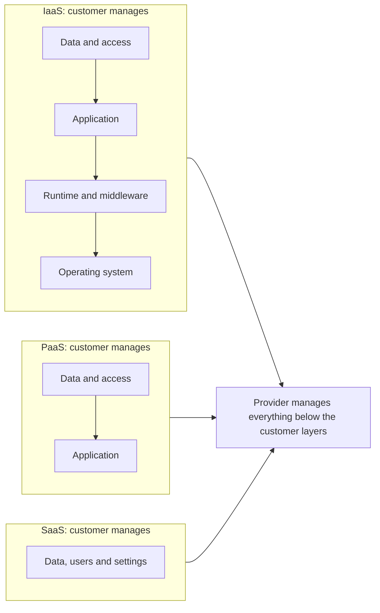

## Introduction

When an organisation says it is "moving to the cloud", the most important follow-up question is: *which layer of the technology stack is it handing over?* Renting virtual machines, deploying code onto a managed platform and subscribing to a finished application are very different decisions. They differ in how much flexibility the organisation keeps, how many specialist staff it needs, how quickly it can deliver new features, how locked-in it becomes to one supplier and, crucially, who is responsible for each aspect of security.

The NIST definition (Mell & Grance, 2011) identifies three service models: Infrastructure as a Service (IaaS), Platform as a Service (PaaS) and Software as a Service (SaaS). This lesson examines each model, introduces the shared responsibility model used by major providers, considers newer variants such as containers and serverless functions, and offers a structured way of choosing the right model for a workload. A well-documented security breach shows what happens when the customer's side of the responsibility line is neglected.

## Learning Objectives

- Explain the NIST definitions of IaaS, PaaS and SaaS and the layers each model leaves under consumer control.
- Compare the models on control, speed, skills, cost structure and lock-in risk.
- Apply the shared responsibility model to identify customer security obligations for each service model.
- Analyse a business workload and recommend an appropriate service model with justification.
- Evaluate vendor lock-in and exit risks in cloud service contracts.

## Prerequisite Knowledge

- The NIST essential characteristics and deployment models from the previous lesson.
- A general idea of what operating systems, databases and application code are.

## Key Terminology

- **Infrastructure as a Service (IaaS)**: A service model in which the consumer provisions processing, storage, networks and other fundamental resources and can deploy and run arbitrary software, including operating systems, while the provider manages the underlying physical infrastructure.
- **Platform as a Service (PaaS)**: A service model in which the consumer deploys its own or acquired applications onto provider-managed runtimes, libraries, services and tools, controlling the applications and some configuration but not the operating systems or servers.
- **Software as a Service (SaaS)**: A service model in which the consumer uses the provider's applications running on cloud infrastructure, typically through a browser or app, controlling at most limited user-specific settings.
- **Shared responsibility model**: The division of security and operational duties between the cloud provider and the customer, which shifts towards the provider as one moves from IaaS to SaaS.
- **Serverless computing (Function as a Service)**: A model in which the provider runs small units of code in response to events and bills per execution, with no servers for the customer to manage.
- **Container**: A lightweight, portable package of an application and its dependencies that runs consistently across environments, often orchestrated with platforms such as Kubernetes.
- **Vendor lock-in**: Dependence on a provider's proprietary services, data formats or interfaces that makes switching costly or slow.
- **Misconfiguration**: An incorrect security or access setting by the customer, such as publicly readable storage, which is a frequent cause of cloud data exposure.

## Detailed Explanation

### The technology stack

A useful way to understand service models is to picture the layers of an IT system, from bottom to top: physical facilities and hardware; networking and storage; virtualisation; operating system; middleware and runtime (for example language runtimes and database engines); application code; and finally data, users and access. In a traditional on-premises system, the organisation manages every layer. Each cloud service model hands more of these layers to the provider.

### Infrastructure as a Service

With IaaS the provider operates data centres, physical servers, networking hardware and the virtualisation layer. The customer rents virtual machines, block or object storage and virtual networks and is responsible for everything above: installing and patching operating systems, configuring firewalls, deploying databases and applications, and managing identities and data.

IaaS offers the **greatest flexibility** of the three models. It suits organisations that need to run legacy or specialised software, want fine control over performance or configuration, or are migrating existing systems with minimal change. Its disadvantages are that it requires substantial skills (system administration, network security, backup) and that the customer can easily make costly or insecure configuration mistakes.

### Platform as a Service

With PaaS the provider also manages operating systems, runtimes and often databases, scaling and load balancing. Developers deploy application code and configure the service. Examples include managed application hosting platforms, managed relational databases and managed data-analytics services.

PaaS **accelerates development**: teams spend less time on patching and infrastructure and more on features. It enforces some standardisation and often improves reliability because the provider runs the platform at scale. The trade-offs are reduced control (you can only use supported languages, versions and configurations) and higher lock-in when applications depend on proprietary platform features.

### Software as a Service

With SaaS the provider delivers a complete application. The customer configures it, manages users and owns its data, but does not manage code or infrastructure. Email and collaboration suites, customer relationship management, human resources and accounting systems are common examples.

SaaS offers the **fastest time to value** and the lowest technical skill requirement. It suits standard business processes where differentiation is unimportant. Its limits are restricted customisation, dependence on the provider's roadmap, possible difficulties integrating with other systems and the need to manage data export if the organisation ever leaves.

### Newer variants

The three NIST categories remain useful, but the market has produced intermediate forms. **Containers as a service** and managed Kubernetes sit between IaaS and PaaS: customers package applications in containers while the provider manages much of the orchestration. **Serverless** or Function as a Service pushes further than PaaS: code runs only when triggered by events (a file upload, an API request) and is billed per invocation. Serverless can be extremely cost-effective for spiky, event-driven workloads but can become expensive or hard to debug for constant, heavy workloads. Analysts should map such services onto the stack to see what is actually being handed over.

## Theories, Frameworks and Models

### The shared responsibility model

Major providers describe security in terms of shared responsibility. The provider is responsible for security *of* the cloud (facilities, hardware, the virtualisation layer and, depending on the model, the platform or application). The customer is responsible for security *in* the cloud (its data, identities, access policies and whatever layers it manages).

| Layer | On-premises | IaaS | PaaS | SaaS |
|---|---|---|---|---|
| Data classification and accountability | Customer | Customer | Customer | Customer |
| Identity and access management (users, roles, keys) | Customer | Customer | Customer | Customer (provider supplies tools) |
| Application code and configuration | Customer | Customer | Customer | Provider (customer configures settings) |
| Runtime, middleware, database engine | Customer | Customer | Provider | Provider |
| Operating system and patching | Customer | Customer | Provider | Provider |
| Virtualisation layer | Customer | Provider | Provider | Provider |
| Physical servers, storage, network hardware | Customer | Provider | Provider | Provider |
| Data centre facilities, power, physical security | Customer | Provider | Provider | Provider |

Two rows never move to the provider: **data** and **identities**. Even with SaaS, the customer decides who has access, how strong authentication is, what data is uploaded and how long it is retained. Many cloud incidents arise not from provider failure but from customer misconfiguration, such as storage made publicly accessible or over-privileged access keys.

### Comparing the models

| Dimension | IaaS | PaaS | SaaS |
|---|---|---|---|
| Control and flexibility | Highest | Medium | Lowest |
| Speed to deliver | Slowest | Faster | Fastest |
| In-house skills required | High (infrastructure and security) | Medium (development and configuration) | Low (configuration, integration, administration) |
| Cost model | Pay for capacity provisioned | Pay for platform usage | Usually per user per month |
| Lock-in risk | Lower for compute; higher for proprietary add-ons | Medium to high | High for data and processes |
| Typical workloads | Legacy migration, custom configurations | Custom applications, APIs, analytics | Standard business functions |

### A simple selection logic

A practical heuristic is **"SaaS if you can, PaaS if you must build, IaaS if you must control"**. If a standard application meets the business need adequately, SaaS minimises effort. If the organisation needs a differentiated custom application, PaaS lets developers focus on code. IaaS is justified where specific control, legacy compatibility or performance requirements rule out the higher-level models. The heuristic should be tested against data protection, integration and exit requirements.

## Worked Example

### Selecting service models for a logistics company

**Illustrative scenario.** *Tema Freight Connect* (hypothetical) is a Ghanaian freight-forwarding company with offices at Tema port and Kotoka International Airport. It needs five capabilities. The analysis applies the selection logic step by step.

| Workload | Key requirement | Recommended model | Justification |
|---|---|---|---|
| Staff email and documents | Standard, reliable, low effort | SaaS | No differentiation; provider handles availability and patching |
| Accounting | Ghana tax compliance, standard processes | SaaS | Choose a product supporting local tax rules; check data export options |
| Customer shipment-tracking portal and API | Differentiating, frequent feature changes | PaaS | Developers focus on features; managed scaling for customer traffic |
| Legacy customs-declaration software (vendor supports only a specific operating system version) | Compatibility with an older system | IaaS | Requires control over the operating system that PaaS cannot provide |
| Event-driven document processing (scanned bills of lading uploaded at irregular times) | Spiky, unpredictable volume | Serverless functions | Pay per document processed; no idle servers |

**Step 2: Assign security responsibilities.** For the IaaS workload, Tema Freight must patch the operating system, configure network security groups and back up data. For the PaaS portal, it must secure code, manage secrets and configure access. For SaaS products, it must enforce multi-factor authentication, manage user accounts when staff leave and control data sharing settings.

**Step 3: Consider exit.** For each SaaS product the company should confirm that it can export data in a usable format. For the PaaS portal, using widely supported languages and databases limits lock-in.

## Ghanaian Business Application

Ghanaian small and medium-sized enterprises often face a skills constraint: experienced cloud security and infrastructure engineers are scarce and in high demand. This makes SaaS and PaaS especially attractive, because they shift routine operational tasks to the provider. However, several local factors deserve attention:

- **Payment and currency.** Many global cloud services bill in foreign currency by card, which can be difficult for some businesses and exposes them to exchange-rate movements. Some local resellers and partners invoice in cedis, which may simplify procurement.
- **Data protection.** Ghana's Data Protection Act, 2012 (Act 843) applies whichever service model is used. Under SaaS the business remains the data controller and must ensure the provider, as processor, offers adequate safeguards.
- **Connectivity.** SaaS depends entirely on internet access. A dual-link arrangement (for example fibre plus a mobile broadband backup) may be essential for business continuity.
- **Integration with mobile money.** Many local business processes depend on mobile money and local payment gateways. A SaaS product that cannot integrate with these may force manual workarounds that undermine its value.

**Illustrative scenario.** A fashion retailer in Kumasi adopting an e-commerce SaaS platform should check whether it supports local payment providers, whether customer data can be exported, and who receives alerts if the store is unavailable. These are business questions, not merely technical ones.

## International Case Study

### Capital One and customer-side misconfiguration

Capital One, a large US bank, was an early and prominent adopter of public cloud infrastructure from Amazon Web Services. In 2019 it disclosed that an outside individual had gained unauthorised access to customer data, including credit card application information, affecting a very large number of people in the United States and Canada. Public reporting and regulatory documents described how the intruder exploited a misconfigured web application firewall in Capital One's cloud environment to obtain credentials that gave access to data stored in cloud storage. A former employee of the cloud provider was later convicted in a US court in connection with the intrusion. US banking regulators subsequently imposed a significant civil money penalty on the bank, citing weaknesses in its risk management for the cloud migration.

**Analysis.**

- The breach is widely cited as an example of failure on the **customer side** of the shared responsibility model. The cloud infrastructure itself was not shown to be broken; the configuration and access permissions the customer controlled were exploited.
- It demonstrates that **identity and access management** is the critical control in IaaS environments: credentials obtained through one misconfigured component gave broad access because permissions were wider than necessary.
- It shows that regulators hold organisations accountable for **governance of cloud migrations**, not just technical controls.
- For students, the lesson is that moving to IaaS increases flexibility but leaves the customer with demanding security responsibilities that require skilled staff, automated configuration checking and the principle of least privilege.

## Diagram

The diagram shows which layers the customer manages in each model.

## Common Misconceptions

- **"With SaaS, the provider is responsible for our data security."** The customer remains responsible for its data, user accounts, access settings and authentication strength.
- **"IaaS is always cheapest because you pay only for raw resources."** IaaS requires staff time for patching, monitoring and security; total cost of ownership may exceed PaaS or SaaS.
- **"PaaS and SaaS are the same because both hide servers."** PaaS hosts the customer's own code; SaaS provides a finished application the customer only configures.
- **"Serverless means there are no servers."** Servers still exist; the provider manages them entirely and bills per execution.
- **"Lock-in only matters for large enterprises."** Small firms can be trapped by proprietary data formats or by losing access to data when a SaaS subscription lapses.

## Common Examination Mistakes

- Giving examples without explaining which layers the consumer controls in each model.
- Omitting the shared responsibility model when discussing cloud security.
- Recommending a single service model for every workload of an organisation.
- Ignoring exit strategy and data portability when evaluating SaaS.
- Confusing service models (what is delivered) with deployment models (who the infrastructure is provisioned for).

## Critical Thinking Questions

1. If most cloud breaches stem from customer misconfiguration, should providers bear more responsibility for secure defaults? Discuss with reference to the shared responsibility model.
2. For a Ghanaian university, which is the bigger risk: lack of in-house skills for IaaS, or lock-in to a SaaS learning management system? Justify your answer.
3. When might serverless computing be more expensive than running a virtual machine continuously?
4. How should a procurement contract for SaaS address data export, service availability and data location?
5. Is the IaaS/PaaS/SaaS classification still adequate when providers offer AI models and data platforms as services? Propose how you would classify such services.

## Practical Exercises

1. Complete a shared responsibility table for a hospital using a SaaS electronic medical records system. Expected output: a table listing at least eight responsibilities with the responsible party and one control the hospital must implement for each customer responsibility.
2. Select four applications used in a Ghanaian business you know and classify each as IaaS, PaaS, SaaS or on-premises. Expected output: a classification table with a one-sentence justification based on which layers the business controls.
3. Draft five exit-strategy questions to ask a SaaS vendor before signing a contract. Expected output: a numbered list with a short explanation of why each question matters.

## Key Takeaways

- IaaS, PaaS and SaaS differ in how much of the stack the provider manages and how much control the customer keeps.
- Moving up from IaaS to SaaS increases speed and reduces required skills but reduces flexibility and raises lock-in risk.
- Under the shared responsibility model, data and identity management always remain customer responsibilities.
- Different workloads in one organisation may warrant different service models, including serverless for event-driven tasks.
- Customer misconfiguration, as in the Capital One case, is a leading cause of cloud security failures.

## Further Reading

- Mell, P., & Grance, T. (2011). *The NIST definition of cloud computing* (NIST Special Publication 800-145). National Institute of Standards and Technology. <https://csrc.nist.gov/pubs/sp/800/145/final>
- Erl, T., Mahmood, Z., & Puttini, R. (2013). *Cloud computing: Concepts, technology and architecture*. Prentice Hall.
- Armbrust, M., Fox, A., Griffith, R., Joseph, A. D., Katz, R., Konwinski, A., Lee, G., Patterson, D., Rabkin, A., Stoica, I., & Zaharia, M. (2010). A view of cloud computing. *Communications of the ACM, 53*(4), 50-58.

## Video Resources

- [AWS Skill Builder](https://skillbuilder.aws/): Amazon Web Services. Official training including cloud practitioner material on service models and shared responsibility.
- [Microsoft Learn](https://learn.microsoft.com/): Microsoft. Learning paths describing IaaS, PaaS and SaaS and the shared responsibility model.
- [Google Cloud Learn](https://cloud.google.com/learn): Google Cloud. Explainers comparing cloud service models.

## Revision Summary

IaaS gives customers virtual infrastructure and leaves them responsible for operating systems, middleware, applications, data and access; PaaS adds provider management of operating systems and runtimes so developers deploy code; SaaS delivers a finished application that customers configure. Moving from IaaS to SaaS trades control for speed and lower skills requirements, and increases lock-in risk. The shared responsibility model allocates security of the cloud to the provider and security in the cloud to the customer, and data and identities always stay with the customer.

- IaaS: control the OS and above.
- PaaS: control code and configuration.
- SaaS: control data, users and settings.
- "SaaS if you can, PaaS if you must build, IaaS if you must control."
- Misconfiguration and excessive permissions cause many breaches.
- Always plan data export and exit.
