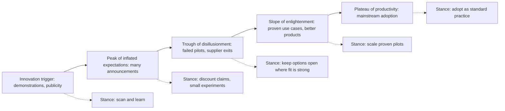

## Introduction

Business leaders are bombarded with claims that a particular technology is "the next big thing". Artificial intelligence, blockchain, drones, the metaverse and quantum computing have all been described in these terms, sometimes within the same year. Some of these technologies go on to reshape industries; others fade, re-emerge years later in a narrower form, or never deliver the value promised. An IT-for-business professional is expected to cut through this noise and give a reasoned view of what a technology is, how mature it is, and whether it matters for a specific organisation.

This lesson provides the conceptual toolkit for that task. It starts with a precise, research-based definition of an *emerging technology*, then introduces the main typologies of technological innovation, and finally examines the idea of hype cycles: the recurring pattern in which expectations about a technology rise faster than its real capability and then correct. Throughout, the emphasis is on analysis and judgement rather than memorising buzzwords. The ideas here underpin every later module of CSIT 621, from cloud computing to digital twins.

## Learning Objectives

- Define an emerging technology using the five attributes proposed by Rotolo, Hicks and Martin (2015).
- Distinguish incremental, radical, architectural and modular innovation, and product, process and business-model innovation.
- Explain the phases of a technology hype cycle and the forces that drive expectations up and down.
- Apply the emerging-technology attributes to assess a candidate technology for a Ghanaian organisation.
- Evaluate the strengths and limitations of hype-cycle thinking as a basis for investment decisions.

## Prerequisite Knowledge

- None beyond an undergraduate understanding of business functions and basic information systems.
- Helpful: general awareness of current technologies such as mobile money, cloud services and artificial intelligence.

## Key Terminology

- **Emerging technology**: A relatively fast-growing and radically novel technology whose potential impact is prominent but whose final form, uses and consequences remain uncertain and ambiguous.
- **Technology innovation**: The successful introduction of a new or significantly improved product, process or business model based on technological knowledge; invention alone is not innovation until it is adopted and creates value.
- **Incremental innovation**: Refinement of an existing design that reinforces current knowledge and capabilities.
- **Radical innovation**: A change based on substantially new scientific or engineering principles that often makes existing capabilities obsolete.
- **Architectural innovation**: Reconfiguration of the links between existing components into a new system design, while the components themselves change little (Henderson & Clark, 1990).
- **Modular innovation**: Replacement of a core component technology while the overall system architecture stays the same.
- **Hype cycle**: A model describing how expectations about a technology typically rise to an inflated peak, fall into disillusionment and then recover to a realistic level as practical value is demonstrated.

## Detailed Explanation

### Why "new" is not the same as "emerging"

Everyday usage treats any recent technology as emerging, but this is too loose for business analysis. A new smartphone model is new, yet it is an incremental refinement of a mature technology. Conversely, some technologies that have existed in laboratories for decades, such as virtual reality or neural networks, can be considered emerging again when a step change in capability or cost brings them into wider use. The useful question is therefore not "how recent is it?" but "what is the character of its development and its relationship to existing practice?"

### The five attributes of emergence

Rotolo, Hicks and Martin (2015) reviewed how the term had been used in academic and policy literature and proposed a definition built on five attributes. They are best treated as dimensions that a technology possesses to a greater or lesser degree, not as a checklist that is either passed or failed.

1. **Radical novelty.** The technology achieves a function in a new way, or achieves a new function. Novelty is relative: what is radical in one sector may be ordinary in another.
2. **Relatively fast growth.** Compared with other technologies, it shows rapid growth in indicators such as the number of actors involved, research publications, patents, funding, products or users.
3. **Coherence.** The technology has begun to "hang together" as an identifiable field, with shared terminology, communities, standards bodies and conferences, rather than being a loose collection of experiments.
4. **Prominent impact.** It has the potential to exert considerable influence over many domains, changing the composition of actors, institutions and patterns of interaction in an economy or society.
5. **Uncertainty and ambiguity.** Its final form, the most valuable applications, the business models that will succeed and the social consequences are all unclear. Different groups may attach very different meanings to it.

The authors emphasise that impact lies largely in the future, which is precisely why uncertainty is intrinsic. For a business, this has a practical implication: decisions about emerging technologies are decisions under deep uncertainty, so they call for options, pilots and staged commitments rather than one-off, all-or-nothing investments.

### From invention to innovation

A distinction that examiners frequently test is between invention and innovation. *Invention* is the creation of a new idea, device or method. *Innovation* occurs when that idea is turned into something that is adopted and generates economic or social value. Many inventions never become innovations because they lack a viable business model, complementary assets (distribution, skills, infrastructure), or regulatory acceptance. Mobile money in Ghana illustrates the point: the underlying technologies (SMS, USSD, basic mobile handsets) were not new, but combining them with agent networks, telecom distribution and regulatory permission created a highly significant business-model innovation.

## Theories, Frameworks and Models

### Typologies of innovation

Several complementary typologies help analysts describe *what kind* of change a technology represents.

| Typology | Categories | Analytical question |
|---|---|---|
| Degree of novelty | Incremental versus radical | How far does it depart from existing knowledge? |
| Henderson and Clark (1990) | Incremental, modular, architectural, radical | Does it change the core components, the links between them, or both? |
| Object of innovation | Product, process, service, business model | What is being changed: the offering, the way it is produced, or the way value is captured? |
| Effect on incumbents | Sustaining versus disruptive (Christensen, 1997) | Does it improve performance for existing customers or open a different, initially inferior, trajectory? |

Henderson and Clark's framework is particularly useful because it explains why established firms sometimes fail with apparently modest changes. In **architectural innovation**, the components look familiar, so incumbents underestimate the change, yet the knowledge about how components interact is embedded in their structures, communication channels and routines. Their organisation is designed around the old architecture, and that design becomes a barrier.

### The hype cycle concept

The research and advisory firm Gartner popularised a model, widely known as the Hype Cycle, describing the pattern of expectations that surrounds many technologies. Gartner publishes its own annual charts; this lesson describes only the general concept, which is explained in Fenn and Raskino (2008). The model has five phases:

- **Innovation trigger.** A breakthrough, demonstration or product launch generates publicity. Usable products are scarce and commercial viability is unproven.
- **Peak of inflated expectations.** Early publicity produces success stories, often alongside failures that receive less attention. Many firms announce initiatives; investment rises sharply.
- **Trough of disillusionment.** Interest falls as experiments fail to deliver. Some suppliers exit or consolidate. Investment continues only where early adopters see a path to value.
- **Slope of enlightenment.** Practical benefits become clearer and better understood. Second- and third-generation products appear and methodologies mature.
- **Plateau of productivity.** Mainstream adoption begins. Criteria for assessing suppliers are clear and the technology's relevance and market are established.

The underlying insight is that **expectations and capability evolve at different speeds**. Media attention, investor enthusiasm and supplier marketing can move very quickly; real capability depends on engineering, standards, skills, complementary infrastructure and organisational change, which move slowly.

### Critiques of hype-cycle thinking

A postgraduate analysis should not accept the model uncritically. Researchers and practitioners raise several objections:

- **Not every technology follows the curve.** Some move steadily to adoption without a dramatic peak; others peak and never recover.
- **Positioning is a judgement.** Where a technology sits on the curve is an expert assessment, not a measurement, and it may vary by industry and country.
- **Time-scales vary enormously.** The model says little about how long each phase lasts, which is exactly what an investor needs to know.
- **Context matters.** A technology may be on the plateau in one market and barely triggered in another because infrastructure, regulation or cost differs. Ghanaian adoption of a technology may follow a different path from adoption in Europe or North America.

The model is best used as a **sense-making device** that reminds decision-makers to discount early hype and to avoid abandoning promising technologies during the trough, not as a precise forecasting instrument.

## Worked Example

### Assessing commercial agricultural drones against the five attributes

The following structured assessment shows how to apply Rotolo, Hicks and Martin's attributes. Each attribute is rated Low, Medium or High with a justification. The ratings are illustrative judgements, not measured data.

| Attribute | Rating | Justification |
|---|---|---|
| Radical novelty | Medium | Aerial crop observation existed (aircraft, satellites), but low-cost, on-demand imagery and precision spraying by small drones is a new way of performing the function. |
| Relatively fast growth | High | The number of suppliers, service providers and regulatory frameworks has grown rapidly across many countries. |
| Coherence | Medium | Clear communities and standards are forming, but software, sensors and data formats are still fragmented. |
| Prominent impact | Medium to High | Potential to change crop monitoring, input use and insurance assessment, but impact depends on farm size, skills and cost. |
| Uncertainty and ambiguity | High | Business models (owning versus drone-as-a-service), regulation of spraying and data ownership remain unsettled. |

**Step 1: Interpret the profile.** High growth and uncertainty with medium coherence suggest a technology that is genuinely emerging rather than mature.

**Step 2: Locate it on the hype cycle for the context.** For a smallholder setting, the technology may still be near the peak or entering the trough: expectations are high, but many pilots struggle with cost, maintenance and skills.

**Step 3: Derive a decision stance.** The appropriate response is a bounded experiment: a pilot with a service provider rather than buying a fleet, with explicit learning goals and exit criteria.

## Ghanaian Business Application

**Illustrative scenario.** *Akuapem Cocoa Growers Cooperative* (a hypothetical organisation) supplies licensed buying companies and is under pressure from international buyers to demonstrate that its cocoa is not linked to deforestation and that farm practices are improving. Technology vendors have approached the cooperative with proposals for satellite monitoring, drones, blockchain traceability and an artificial-intelligence advisory chatbot delivered over WhatsApp.

The cooperative's board asks its IT adviser which of these are worth pursuing. A disciplined analysis would proceed as follows.

1. **Classify each proposal.** Satellite-based farm mapping combined with GPS polygons collected by field officers is largely an *architectural innovation*: existing components (smartphones, GPS, satellite imagery, cloud storage) are combined in a new way to meet traceability requirements. The chatbot is a *service innovation* built on rapidly changing AI capabilities. Blockchain traceability is a *radical* change to record-keeping whose value depends on whether buyers and regulators will accept and connect to it.
2. **Assess emergence and hype.** AI chatbots and blockchain traceability both show high uncertainty and strong media attention, suggesting they may be near the peak of expectations. Farm mapping is more mature and directly linked to buyer requirements.
3. **Consider local constraints.** Smartphone ownership among older farmers, network coverage in rural districts, local-language support (for example Twi) and the cost of data bundles will shape what works.
4. **Recommend a portfolio.** Commit to farm mapping (high relevance, moderate maturity), run a small, time-boxed pilot of the advisory chatbot with clear measures such as farmer usage and agronomic accuracy, and defer blockchain until buyers specify a platform they will actually use.

The key lesson is that the cooperative's decision rests not on whether a technology is fashionable, but on its fit with a concrete business need, local infrastructure and the maturity of the surrounding ecosystem.

## International Case Study

### Google Glass: peak, trough and a narrower plateau

Google Glass is a well-documented example of hype dynamics. Google publicly unveiled the head-mounted display in 2012 and offered an "Explorer Edition" to developers and early users in 2013. The product attracted intense media attention and was widely discussed as the future of personal computing. It also attracted criticism over privacy (because of its built-in camera), social acceptability, price and limited practical applications. In early 2015 Google ended the Explorer programme for consumers.

Rather than disappearing, the technology was repositioned. Google later released an Enterprise Edition aimed at workplaces such as manufacturing and logistics, where hands-free access to instructions and checklists offered clearer value and where social concerns were less important. Google announced in 2023 that it would stop selling Glass Enterprise Edition.

**Analysis.** The case illustrates several points from this lesson:

- Expectations for consumer smart glasses rose far faster than the technology's capability, price and social acceptance could support.
- The trough was not simply technical failure; it reflected a mismatch between the product and the context of use.
- Value appeared in a narrower industrial niche, consistent with the idea that the "plateau" may be reached in one segment but not another.
- Even an enterprise niche may not sustain a product if competitors or alternative devices meet the need, reminding analysts that hype-cycle recovery is not guaranteed.

## Diagram

The flowchart below summarises the hype-cycle phases and the managerial stance appropriate to each.

## Common Misconceptions

- **"An emerging technology is simply a recent one."** Emergence depends on novelty, growth, coherence, impact and uncertainty; a recent product can be an incremental refinement of a mature technology.
- **"Every technology passes through the hype cycle in the same way."** Many do not; some never recover from the trough, and the duration of each phase varies widely by technology, industry and country.
- **"Invention and innovation are the same thing."** Innovation requires adoption and value creation; many inventions never become innovations.
- **"Architectural innovations are minor because the parts are familiar."** Changing how components link can make an incumbent's structures and routines obsolete, which is why such innovations often catch established firms out.

## Common Examination Mistakes

- Listing buzzword technologies without defining what makes them emerging or applying a recognised framework.
- Reproducing a hype-cycle chart from memory with specific technologies placed on it, instead of explaining the concept and its limitations.
- Confusing radical innovation with disruptive innovation; radicalness concerns technological novelty, whereas disruption concerns the effect on incumbents and markets.
- Treating the hype cycle as a precise forecasting tool rather than a sense-making device.

## Critical Thinking Questions

1. Rotolo, Hicks and Martin describe uncertainty and ambiguity as intrinsic to emerging technologies. How should this change the way a Ghanaian bank's board evaluates an investment proposal compared with a routine IT upgrade?
2. Can a technology be "emerging" in Ghana while being "mature" in another country? What attributes would differ, and what are the implications for local firms?
3. Is mobile money in Ghana best described as a technological innovation, a business-model innovation or an architectural innovation? Justify your answer.
4. Under what conditions would it be rational for a firm to invest during the trough of disillusionment?

## Practical Exercises

1. Choose one technology (for example generative AI, drones, 3D printing or smart meters). Produce a one-page assessment table rating it against the five attributes of emergence, with a justification for each rating. Expected output: a completed table and a two-sentence conclusion on whether it is emerging in the Ghanaian context.
2. Classify five recent innovations you have encountered in Ghana (for example a fintech app, a ride-hailing service, a digital address system) using the Henderson and Clark framework and the product/process/business-model typology. Expected output: a classification table with a one-line justification per entry.

## Key Takeaways

- An emerging technology combines radical novelty, relatively fast growth, coherence, prominent impact, and uncertainty and ambiguity.
- Innovation requires adoption and value; invention alone is not enough.
- Typologies (incremental/radical, modular/architectural, product/process/business model) help analysts describe the nature of a change precisely.
- The hype cycle captures the gap between expectations and capability, but it is a sense-making device rather than a forecast.
- Good decisions about emerging technologies use staged, option-like commitments tied to a specific business need and context.

## Further Reading

- Rotolo, D., Hicks, D., & Martin, B. R. (2015). What is an emerging technology? *Research Policy, 44*(10), 1827–1843.
- Henderson, R. M., & Clark, K. B. (1990). Architectural innovation: The reconfiguration of existing product technologies and the failure of established firms. *Administrative Science Quarterly, 35*(1), 9–30.
- Fenn, J., & Raskino, M. (2008). *Mastering the hype cycle: How to choose the right innovation at the right time*. Harvard Business Press.
- Christensen, C. M. (1997). *The innovator's dilemma: When new technologies cause great firms to fail*. Harvard Business School Press.

## Video Resources

- [IBM Think](https://www.ibm.com/think) — IBM. Explainer articles and videos on emerging technologies such as AI, quantum computing and blockchain.
- [Google Cloud Learn](https://cloud.google.com/learn) — Google Cloud. Introductory explainers on cloud, data and AI technologies discussed throughout this course.

## Revision Summary

An emerging technology is not merely new: it is radically novel, growing relatively fast, increasingly coherent as a field, potentially high in impact, and surrounded by uncertainty and ambiguity (Rotolo, Hicks & Martin, 2015). Innovation is invention that is adopted and creates value, and it can be classified by degree (incremental/radical), by its effect on system components and links (modular/architectural) and by its object (product, process, business model). The hype cycle describes expectations rising to an inflated peak, falling into a trough and recovering to a plateau, but it is a judgement-based heuristic, not a forecast.

- Five attributes: novelty, growth, coherence, impact, uncertainty.
- Invention plus adoption and value equals innovation.
- Architectural innovation changes links between familiar components and can defeat incumbents.
- Hype-cycle phases: trigger, peak, trough, slope, plateau.
- Use pilots and staged commitments under uncertainty.
- Always tie analysis to a specific organisation and context.
