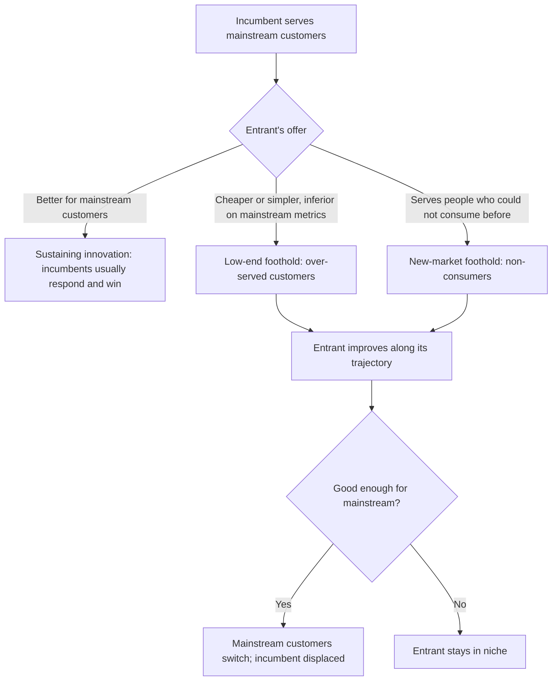

## Introduction

Knowing that a technology is emerging is only the first step. Managers must also estimate *how quickly* it will improve, *who* will adopt it and *when*, and *whose business* it threatens. Get these judgements wrong and a firm either wastes money on a technology that never takes off or, more dangerously, dismisses one that later destroys its market position.

This lesson brings together three bodies of thought. Technology forecasting offers structured methods, such as the Delphi technique, scenario planning, trend extrapolation and S-curve analysis, for reasoning about futures that cannot be known with certainty. Diffusion theory, especially Everett Rogers' work, explains how innovations spread through a social system and why adopters differ. Disruptive-innovation theory, developed by Clayton Christensen, explains why well-managed incumbent firms can lose to entrants offering products that are initially worse. Used together, these lenses let you move from "this technology is interesting" to a defensible view of timing, market response and strategic risk.

## Learning Objectives

- Compare qualitative and quantitative technology forecasting methods, including Delphi, scenario planning, trend extrapolation and S-curves.
- Explain Rogers' adopter categories and the five perceived attributes that influence the rate of adoption.
- Distinguish sustaining from disruptive innovation, and low-end from new-market disruption.
- Apply diffusion and disruption theory to analyse a technology's likely spread in a Ghanaian market.
- Evaluate the limitations of forecasting and of disruption theory when used to justify strategic decisions.

## Prerequisite Knowledge

- The definition of an emerging technology and the main innovation typologies from the previous lesson.
- Basic comfort with reading simple graphs and percentages.

## Key Terminology

- **Technology forecasting**: The systematic attempt to anticipate the direction, rate, characteristics and effects of technological change in order to inform decisions.
- **Delphi method**: A structured, iterative survey of experts in which anonymous responses are summarised and fed back over several rounds until views converge or stable disagreements are identified.
- **Scenario planning**: Construction of several plausible, internally consistent stories about the future, built around key uncertainties, used to test strategies rather than predict a single outcome.
- **Trend extrapolation**: Projection of a historical data series into the future on the assumption that the underlying pattern continues.
- **S-curve**: A pattern in which a technology's performance (or adoption) improves slowly at first, then rapidly, then slowly again as it approaches a natural limit.
- **Diffusion of innovations**: The process by which an innovation is communicated through certain channels over time among members of a social system (Rogers, 2003).
- **Disruptive innovation**: An innovation that begins in low-end or new-market footholds with performance that mainstream customers consider inferior, then improves until it attracts those customers and displaces incumbents.
- **Sustaining innovation**: An improvement that makes good products better for an incumbent's existing, demanding customers.

## Detailed Explanation

### Why forecast at all?

No method can predict technological change precisely. The purpose of forecasting is to **reduce surprise**, make assumptions explicit and prepare organisations to respond. A forecast that is wrong but transparent can still be valuable, because managers can see which assumption failed and adjust. A hidden assumption ("customers will never trust digital payments") is far more dangerous than an explicit one.

### Qualitative methods

**The Delphi method** was developed at the RAND Corporation in the 1950s and 1960s. A facilitator recruits a panel of experts, asks them to answer questions independently (for example "In what year will more than half of Ghanaian pharmacies use cloud-based inventory systems?"), summarises the responses statistically and circulates the summary, often with anonymised reasons. Experts then revise their answers. Anonymity reduces the influence of dominant personalities and seniority; iteration allows reasoning to spread. Weaknesses include dependence on panel selection, the risk of forced consensus, and the time required for several rounds.

**Scenario planning** does not try to predict. Analysts identify the driving forces affecting a decision, separate those that are relatively predictable (for example demographic trends) from those that are both highly uncertain and highly important, and select two critical uncertainties to form a two-by-two matrix. Each quadrant becomes a narrative future. Strategies are then "wind-tunnelled" against each scenario to see which are robust. Royal Dutch Shell's use of scenarios from the 1970s is widely cited in the strategy literature as a pioneering corporate application. The method is valuable precisely for emerging technologies, where uncertainty is intrinsic.

### Quantitative methods

**Trend extrapolation** fits a line or curve to historical data, such as cost per unit of storage or the number of registered mobile money accounts, and extends it. It is simple and transparent but assumes the future resembles the past. Exponential trends, such as the long-running improvement in transistor density often described as Moore's law, are especially risky to extrapolate indefinitely because physical, economic or market limits eventually intervene.

**S-curve analysis** addresses exactly that limitation. Foster (1986) argued that technologies improve along S-shaped curves: early effort produces little improvement while fundamentals are being worked out; then improvement accelerates; finally, returns diminish as the technology approaches physical limits. Successive technologies form a series of S-curves. The managerial danger lies at the top of the old curve, where an incumbent continues investing in a technology with diminishing returns while a new technology, still on the flat lower part of its own curve, looks unimpressive. When the new curve steepens it can overtake the old one rapidly.

A common S-curve model of adoption is the logistic function: `adoption(t) = L / (1 + e^(-k(t - t0)))`, where `L` is the saturation level, `k` is the growth rate and `t0` is the midpoint at which adoption reaches half of `L`.

### Combining methods

Good practice triangulates. A firm might use trend data to bound what is technically plausible, a Delphi panel to estimate adoption timing, and scenarios to test strategy against uncertainties the other methods cannot resolve.

## Theories, Frameworks and Models

### Rogers' diffusion of innovations

Rogers (2003) proposed that the rate of adoption of an innovation depends largely on five **perceived attributes**:

| Attribute | Meaning | Effect on adoption |
|---|---|---|
| Relative advantage | Degree to which it is seen as better than what it replaces | Higher advantage speeds adoption |
| Compatibility | Consistency with existing values, experience and needs | Higher compatibility speeds adoption |
| Complexity | Perceived difficulty of understanding and use | Higher complexity slows adoption |
| Trialability | Ability to experiment on a limited basis | Higher trialability speeds adoption |
| Observability | Visibility of results to others | Higher observability speeds adoption |

Rogers also classified adopters by their timing relative to the average, using the standard deviations of a normal distribution of adoption times: **innovators** (about 2.5%), **early adopters** (13.5%), **early majority** (34%), **late majority** (34%) and **laggards** (16%). Cumulatively, these produce the S-shaped adoption curve. Early adopters are especially important because they are often opinion leaders whose visible use persuades the early majority.

Moore (1991) argued that in high-technology markets there is a "chasm" between early adopters, who buy into a vision, and the early majority, who want proven, complete solutions and references from peers. Many technology ventures stall at this point.

At the individual level, the Technology Acceptance Model (Davis, 1989) proposes that perceived usefulness and perceived ease of use shape intention to use a system, which overlaps conceptually with Rogers' relative advantage and complexity.

### Christensen's disruptive innovation

Christensen (1997) observed that established firms often fail not because they are poorly managed but because they listen carefully to their best customers and invest in **sustaining innovations** that those customers value. Meanwhile, an entrant offers a product that is simpler, cheaper or more convenient but inferior on the performance dimensions mainstream customers care about. Incumbents rationally ignore it because margins are low and their customers do not want it. The entrant improves along its own trajectory until it is "good enough" for mainstream customers, at which point it takes the market.

Christensen and Raynor (2003) distinguished two footholds:

- **Low-end disruption** targets over-served customers at the bottom of an existing market with a cheaper, adequate offer.
- **New-market disruption** targets non-consumers, people who previously could not use the product at all because of cost, skill or access, and competes against non-consumption.

Christensen, Raynor and McDonald (2015) warned that the term is overused. Not every successful entrant is disruptive: a firm that enters with a product that is *better* for mainstream customers from the start is pursuing a sustaining strategy, however dramatic its growth.

## Worked Example

### Estimating adopter numbers and reading an S-curve

**Illustrative scenario.** A Ghanaian software firm, *SikaLedger* (hypothetical), sells a cloud accounting app to small retailers. It estimates a realistic addressable market of 40,000 retail businesses in its target regions.

**Step 1: Apply Rogers' categories to the addressable market.**

| Category | Share | Businesses |
|---|---|---|
| Innovators | 2.5% | 1,000 |
| Early adopters | 13.5% | 5,400 |
| Early majority | 34% | 13,600 |
| Late majority | 34% | 13,600 |
| Laggards | 16% | 6,400 |
| Total | 100% | 40,000 |

**Step 2: Identify the chasm.** After winning innovators and early adopters, the firm has 6,400 customers (16% of the market). To reach the early majority it must provide what pragmatists demand: integration with mobile money, local tax reporting, reliable support and references from similar shops.

**Step 3: Use a logistic model to explore timing.** Suppose the firm assumes saturation `L = 40,000`, midpoint `t0 = 5` years and growth rate `k = 0.9`. At year 3: `e^(-0.9 × (3 − 5)) = e^(1.8) ≈ 6.05`, so adoption ≈ `40,000 / (1 + 6.05) ≈ 5,670` businesses. At year 5, adoption is exactly half of `L`: 20,000. At year 7: `e^(-1.8) ≈ 0.165`, so adoption ≈ `40,000 / 1.165 ≈ 34,330`.

**Step 4: Interpret.** Growth between years 3 and 5 roughly 14,300 customers, is far steeper than in early years. Capacity for onboarding and support must be in place *before* the steep phase. The parameters are assumptions, so the firm should run alternative values (for example `k = 0.5`) as sensitivity tests rather than treat one curve as a prediction.

## Ghanaian Business Application

Mobile money in Ghana is a useful lens for diffusion and disruption analysis. Its relative advantage over cash for remote transfers was obvious; it was compatible with existing mobile phone use and with informal practices of sending money to family; basic USSD menus kept complexity low on feature phones; agents made trial easy; and transfers were observable within families and communities. These attributes help explain its wide diffusion.

From a disruption perspective, mobile money initially served many people who were outside formal banking, a pattern resembling **new-market disruption** that competed with non-consumption rather than head-on with banks. Over time, services such as savings, micro-loans and merchant payments moved upmarket, and banks responded with partnerships and their own digital channels. Students should debate how far the classic theory fits, because regulation, telecom ownership and interoperability policies shaped the outcome as much as technology trajectories did.

**Illustrative scenario.** *Kumasi Pharma Distributors* (hypothetical) is considering whether a new online pharmacy platform poses a threat. A disruption analysis would ask: Is the entrant targeting customers the distributor considers unattractive (small, remote pharmacies)? Is the offer cheaper and more convenient but weaker on features the distributor's largest clients value? Is the entrant improving quickly? If the answers are yes, the distributor should consider creating a separate unit with its own cost structure to compete in that segment, rather than evaluating the opportunity against the margins of its existing business.

## International Case Study

### Netflix and Blockbuster

Netflix was founded in 1997 and began by renting DVDs by post. Blockbuster, then the dominant video rental chain with a large network of stores, served customers who wanted new releases immediately and valued browsing in store. For those mainstream customers, a postal service with a delay of days was inferior. Netflix appealed initially to a niche of film enthusiasts and convenience-seekers who were less concerned about instant availability.

Christensen, Raynor and McDonald (2015) describe this as consistent with disruptive theory: Netflix's original offer did not appeal to Blockbuster's core customers, so the incumbent had little reason to respond strongly. As broadband improved, Netflix introduced streaming (from 2007), which eventually became attractive to mainstream customers on convenience, choice and price. Blockbuster filed for bankruptcy protection in 2010.

**Contrast: Kodak.** Kodak is often cited as a firm that ignored digital photography, yet a Kodak engineer, Steven Sasson, built one of the earliest digital camera prototypes in 1975. Kodak did invest in digital technology. Its difficulties, culminating in a bankruptcy filing in 2012, are often attributed to the shift of value away from film, chemicals and printing, where its profits lay, towards devices, smartphones and online sharing. The lesson is that recognising a technology is not enough; incumbents also need business models, cost structures and organisational units able to capture value from it.

## Diagram

The diagram contrasts sustaining and disruptive trajectories.

## Common Misconceptions

- **"Forecasting means predicting the future accurately."** Forecasting structures uncertainty and makes assumptions explicit; scenario planning explicitly rejects single-point prediction.
- **"Any successful start-up is disruptive."** Disruption has a specific pattern: an initially inferior offer in a low-end or new-market foothold. Entrants that are better from the outset are pursuing sustaining strategies.
- **"Laggards are irrational."** Late adopters may have good reasons, such as limited resources, high switching costs or justified scepticism.
- **"Trend lines can be extended indefinitely."** Most technologies follow S-curves that flatten as they approach limits.
- **"Rogers' percentages are measured facts about every market."** They are an idealised classification based on a normal distribution, useful for reasoning but not a description of any particular market.

## Common Examination Mistakes

- Describing Delphi as a "focus group"; Delphi is anonymous and iterative, without face-to-face discussion.
- Listing Rogers' five attributes without explaining how each would affect a specific technology's adoption.
- Using "disruptive" as a synonym for "important" or "radical".
- Presenting a single forecast figure without sensitivity analysis or a statement of assumptions.
- Ignoring regulation, infrastructure and business models when explaining diffusion in Ghana.

## Critical Thinking Questions

1. Mobile money served people outside formal banking. Does this make it a clear case of new-market disruption, or did regulation and telecom ownership create a different pattern? Defend your view.
2. Why might a Delphi panel of Ghanaian IT executives systematically over- or under-estimate the adoption speed of a technology?
3. How should an incumbent bank decide whether to respond to a low-end digital lender by matching its offer or by setting up an independent unit?
4. Is the "chasm" more or less severe in markets where word-of-mouth and community networks are strong? Explain.
5. What evidence would convince you that a technology has moved from the flat to the steep part of its S-curve?

## Practical Exercises

1. Design a two-round Delphi study to estimate the adoption of electric motorbikes for delivery services in Accra. Expected output: panel composition, four forecasting questions, the summary statistics you would feed back, and a stopping rule.
2. Build a two-by-two scenario matrix for a Ghanaian logistics firm considering drone deliveries, using regulatory permissiveness and customer trust as the two critical uncertainties. Expected output: four named scenarios with a short narrative each and one strategic implication per scenario.
3. Using a spreadsheet, plot the logistic adoption curve from the worked example for `k = 0.5`, `k = 0.9` and `k = 1.3`. Expected output: one chart with three curves and a paragraph explaining how the growth rate changes resourcing needs.

## Key Takeaways

- Forecasting reduces surprise and exposes assumptions; it does not deliver certainty.
- Delphi and scenarios handle expert judgement and deep uncertainty; extrapolation and S-curves handle quantitative trends but must respect limits.
- Rogers' five perceived attributes and adopter categories explain the shape and speed of diffusion.
- Disruption begins with an inferior offer in a low-end or new-market foothold and is distinct from simple competitive success.
- Incumbents fail less from ignorance than from business models and resource allocation processes tied to existing customers.

## Further Reading

- Rogers, E. M. (2003). *Diffusion of innovations* (5th ed.). Free Press.
- Christensen, C. M. (1997). *The innovator's dilemma: When new technologies cause great firms to fail*. Harvard Business School Press.
- Christensen, C. M., & Raynor, M. E. (2003). *The innovator's solution: Creating and sustaining successful growth*. Harvard Business School Press.
- Christensen, C. M., Raynor, M. E., & McDonald, R. (2015). What is disruptive innovation? *Harvard Business Review, 93*(12), 44-53.
- Moore, G. A. (1991). *Crossing the chasm: Marketing and selling technology products to mainstream customers*. HarperBusiness.
- Foster, R. N. (1986). *Innovation: The attacker's advantage*. Summit Books.
- Davis, F. D. (1989). Perceived usefulness, perceived ease of use, and user acceptance of information technology. *MIS Quarterly, 13*(3), 319-340.

## Video Resources

- [IBM Think](https://www.ibm.com/think): IBM. Articles and explainers on technology trends useful as raw material for forecasting exercises.
- [Microsoft Learn](https://learn.microsoft.com/): Microsoft. Free learning paths that illustrate how vendors package emerging technologies for adoption by organisations.

## Revision Summary

Forecasting methods help managers reason about uncertain technological futures: Delphi aggregates anonymous expert judgement over rounds; scenario planning builds several plausible futures around critical uncertainties; trend extrapolation projects historical data; and S-curves recognise that improvement slows as limits approach. Rogers explains diffusion through five perceived attributes and adopter categories, with Moore's chasm between early adopters and the early majority. Christensen's disruption theory explains how initially inferior offers in low-end or new-market footholds can improve and displace incumbents who rationally focus on their best customers.

- Delphi: anonymous, iterative expert panel.
- Scenarios: test strategies, do not predict.
- S-curve: slow, fast, slow; watch for the next curve.
- Rogers: advantage, compatibility, complexity, trialability, observability.
- Adopters: 2.5 / 13.5 / 34 / 34 / 16 per cent.
- Disruption: low-end or new-market foothold, then move upmarket.
