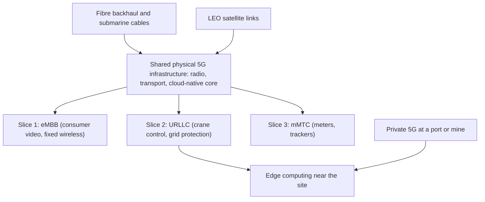

## Introduction

Each generation of mobile technology has enabled new business models. Second-generation (2G) networks brought digital voice and SMS, which in Ghana and across Africa became the foundation for mobile money. 3G and 4G brought mobile internet, smartphones, ride-hailing and social commerce. Fifth-generation (5G) networks are often described as the next leap, but their most distinctive promise is not simply faster phones. 5G was designed from the outset to serve machines as well as people: factories, ports, vehicles, utilities and millions of sensors with very different needs for speed, reliability and power consumption.

For managers, 5G raises practical questions. Which applications genuinely need 5G rather than good 4G, fibre or Wi-Fi? What is network slicing and why might a hospital, mine or port pay for it? When does a private 5G network make sense? And what lies beyond 5G, including satellite broadband and 6G research? This lesson provides the concepts needed to evaluate these choices critically rather than accepting marketing claims.

## Learning Objectives

- Explain the three ITU usage scenarios for 5G: eMBB, URLLC and mMTC.
- Describe the key enabling technologies of 5G, including new spectrum bands, massive MIMO, a cloud-native core and edge computing.
- Explain network slicing and private 5G and analyse when each is appropriate.
- Compare 5G with 4G, Wi-Fi, fibre, LPWAN and satellite connectivity for business use cases.
- Evaluate the business case and constraints for 5G and future connectivity in Ghana.

## Prerequisite Knowledge

- Basic understanding of networks, bandwidth and latency.
- Familiarity with IoT connectivity options (including LPWAN) and edge computing from earlier modules.

## Key Terminology

- **5G**: The fifth generation of cellular mobile technology, defined by the ITU's IMT-2020 requirements and specified technically by 3GPP as 5G New Radio (NR) and the 5G core.
- **eMBB (enhanced Mobile Broadband)**: The 5G usage scenario focused on high data rates and capacity for people and devices.
- **URLLC (Ultra-Reliable Low-Latency Communications)**: The usage scenario for applications needing very low latency and very high reliability, such as industrial control.
- **mMTC (massive Machine-Type Communications)**: The usage scenario for very large numbers of low-power, low-data-rate devices such as sensors.
- **Latency**: The time taken for data to travel from source to destination and back, usually measured in milliseconds.
- **Network slicing**: Creating multiple logical, isolated virtual networks with different performance characteristics on shared physical infrastructure.
- **Private 5G**: A 5G network dedicated to a single organisation or site, using licensed, shared or locally licensed spectrum.
- **Massive MIMO**: Antenna systems with many elements that send multiple data streams simultaneously and use beamforming to direct signals toward users.
- **Standalone (SA) and non-standalone (NSA) 5G**: NSA uses 5G radio anchored on a 4G core; SA uses a full 5G core, which is required for advanced features such as slicing.
- **Multi-access edge computing (MEC)**: Computing resources placed at or near the mobile network edge to reduce latency.

## Detailed Explanation

### The three usage scenarios

The International Telecommunication Union (ITU), in its IMT-2020 vision (Recommendation ITU-R M.2083), defined three broad usage scenarios that shaped 5G design.

**Enhanced mobile broadband (eMBB)** extends what 4G does: higher peak and average data rates, more capacity in crowded places, and better experiences for video, gaming and fixed wireless access (using 5G to deliver home or office broadband without fibre). Most consumer 5G today is eMBB.

**Ultra-reliable low-latency communications (URLLC)** targets applications where delay or packet loss is dangerous or costly: remote control of machinery, factory automation, power-grid protection, and some vehicle and medical applications. URLLC requires not only fast radio links but also processing close to the user (edge computing) and network designs that guarantee performance.

**Massive machine-type communications (mMTC)** targets enormous numbers of simple devices, such as smart meters, environmental sensors and asset trackers, which send small amounts of data infrequently and need long battery lives. In practice this space is served by cellular IoT technologies such as NB-IoT and LTE-M, which have been carried forward into the 5G family, alongside non-cellular LPWAN options.

No single connection delivers all three extremes at once. The point is that 5G networks can be configured to serve each.

### Enabling technologies

- **Spectrum**: 5G uses low bands (wide coverage, building penetration), mid bands (a balance of capacity and coverage, the workhorse of most deployments) and high millimetre-wave bands (very high capacity but short range and poor penetration). The choice of spectrum largely determines the cost and character of a network.
- **Massive MIMO and beamforming**: many-antenna arrays focus energy on users, increasing capacity and efficiency.
- **New radio design**: flexible frame structures support both long, efficient transmissions and very short, low-latency ones.
- **Cloud-native core**: the 5G core is designed as software services running on general-purpose cloud infrastructure, enabling programmability, automation and slicing.
- **Edge computing**: placing compute close to the radio network removes the delay of sending data to distant data centres, which is essential for low-latency applications.

### Non-standalone and standalone deployment

Many operators initially launched **non-standalone** 5G, adding 5G radio to existing 4G networks for faster speeds. This is cheaper and quicker but cannot deliver the full benefits. **Standalone** 5G with a new core enables network slicing, lower latency and better support for URLLC and mMTC. When an operator or vendor promises slicing, a manager should ask whether the network is standalone.

### Network slicing

Network slicing allows an operator to run several logical networks over the same physical infrastructure, each with its own guaranteed characteristics. A city might simultaneously run a high-bandwidth slice for consumer video, a high-reliability, low-latency slice for emergency services, and a low-power slice for utility meters. Slices are isolated, so congestion on one should not degrade another. For businesses, slicing creates the possibility of buying connectivity as a service with defined performance, rather than "best effort" mobile data. Its commercial adoption depends on standalone networks, operator capability and the willingness of enterprises to pay for guarantees.

### Private 5G

A private 5G network serves a single organisation, typically at a site such as a port, mine, factory, airport, campus or hospital. It may be built and run by the enterprise, by an operator on its behalf, or as a hybrid using a slice of the public network. Benefits include predictable performance, local control of data, coverage tailored to the site, mobility (unlike wired networks) and security through SIM-based authentication. Drawbacks include cost, spectrum access (which depends on the national regulator), scarce skills and device ecosystem maturity. For many sites, modern Wi-Fi remains cheaper and adequate; private 5G is strongest where many mobile devices or vehicles need reliable, low-latency connections over a large outdoor or industrial area.

### Beyond 5G

Future connectivity includes several strands:

- **5G-Advanced**: later 3GPP releases that improve efficiency, positioning, AI-assisted network operation and support for reduced-capability devices.
- **6G research**: the ITU has set out a framework for IMT-2030, and research explores higher frequencies, integrated sensing and communication, and AI-native networks; commercial 6G is not expected before around the end of this decade.
- **Low Earth orbit (LEO) satellite broadband**: constellations of satellites closer to Earth than traditional geostationary satellites, offering much lower latency and coverage of rural and remote areas, with regulatory and affordability questions.
- **Non-terrestrial networks**: integration of satellite links into mobile standards so ordinary devices can connect in areas without towers.
- **Fibre backbones and submarine cables**: all wireless generations depend on fibre for backhaul; submarine cable outages have shown how dependent West African connectivity is on a small number of cables.

## Theories, Frameworks and Models

### Matching connectivity to requirements

A disciplined approach starts with application requirements, not technology.

| Requirement | Questions to ask | Likely candidates |
|---|---|---|
| Data rate | How much data per device per second? | Fibre, Wi-Fi, 5G eMBB |
| Latency | What delay is tolerable end-to-end? | Fibre, 5G SA with edge computing, Wi-Fi |
| Reliability | What happens if packets are lost? | Wired, private 5G, URLLC slices |
| Mobility | Do devices move across a wide area? | Cellular (4G/5G), satellite |
| Device density and power | Thousands of battery sensors? | NB-IoT, LTE-M, LoRaWAN |
| Coverage | Urban, rural, indoor, remote? | Low-band cellular, satellite |
| Cost and control | Who owns, operates and pays? | Public network, private 5G, Wi-Fi |

### Comparison of options

| Option | Strengths | Weaknesses | Typical business use |
|---|---|---|---|
| 4G LTE | Mature, wide coverage, cheap devices | Limited capacity and latency guarantees | Most mobile apps, POS terminals, fleet tracking |
| 5G public (eMBB) | Higher capacity and speed | Coverage still limited in many places; device cost | Fixed wireless broadband, high-quality video, dense venues |
| 5G SA with slicing | Guaranteed performance slices | Requires SA core and mature operator offers | Emergency services, broadcasters, utilities |
| Private 5G | Control, reliability, mobility on site | Cost, spectrum, skills | Ports, mines, factories, large campuses |
| Wi-Fi 6/7 | Low cost, high speed indoors | Unlicensed interference; limited mobility over large areas | Offices, retail, warehouses |
| LPWAN / cellular IoT | Low power, long range, cheap | Very low data rates | Meters, agriculture sensors, asset tracking |
| LEO satellite | Coverage anywhere | Terminal and subscription cost; regulatory approval | Remote sites, backup links, rural schools |

### The "killer application" problem

Telecommunications history shows that infrastructure often precedes the applications that justify it. Operators invest heavily in spectrum and equipment, but consumer willingness to pay more for 5G has been limited where 4G already works well. The strongest business cases have tended to come from fixed wireless access and from enterprise and industrial uses that need capabilities 4G cannot provide. Managers should therefore be sceptical of claims that 5G alone will transform a business, and should instead ask which specific constraint 5G removes.

## Ghanaian Business Application

**Context.** Ghana's mobile ecosystem is mature for voice, data and mobile money, and 4G coverage has expanded significantly. The National Communications Authority (NCA) regulates spectrum and licensing; at the time of writing 5G deployment in Ghana is at an early stage, and students should consult NCA publications for the current status of 5G licensing and rollout rather than relying on secondary reports.

**Illustrative scenario: a private 5G business case at a port.** *Tema Gateway Terminals* (a fictional container terminal operator) wants to automate parts of its yard operations. Remote-controlled cranes need reliable, low-latency video and control links; hundreds of container handling vehicles move around a large outdoor area full of metal containers that interfere with Wi-Fi; and the firm wants real-time location of every container.

A structured analysis might proceed:

1. **Requirements**: low latency and high reliability for crane control (URLLC-like), high uplink capacity for video (eMBB), and many trackers (mMTC).
2. **Options**: upgrade Wi-Fi; buy a network slice from a mobile operator if available; deploy private 5G with a partner; or retain fibre for fixed cranes and use cellular IoT for trackers.
3. **Constraints**: spectrum availability and licensing by the NCA, equipment and device costs, power reliability, cyber security of operational technology, and specialist skills.
4. **Decision**: a hybrid may be most realistic, combining fibre for fixed equipment, private or operator-managed 5G for mobile machinery and LPWAN or cellular IoT for trackers, with edge computing on site.

**Illustrative scenario: fixed wireless access for SMEs.** In parts of Accra and Kumasi where fibre to the premises is unavailable, a fictional internet service provider could use 5G fixed wireless access to offer broadband to small businesses, competing on installation speed rather than laying new fibre. The business case depends on spectrum costs, device affordability and the number of subscribers in each cell.

## International Case Study

### South Korea's early commercial 5G launch

In April 2019 South Korea's three main mobile operators launched commercial 5G smartphone services, among the first nationwide launches in the world. The government and industry treated 5G as a strategic priority, supporting rapid deployment. Early adoption by consumers was fast, but widely reported complaints about patchy coverage, particularly indoors, and about the limited difference in everyday experience compared with good 4G, illustrated the gap between launch and maturity. Operators subsequently emphasised content, gaming, enterprise services and coverage expansion.

Lessons for managers:

- Being first brings visibility and learning but also the costs of immature equipment, devices and coverage.
- Consumer willingness to pay depends on visible benefits; enterprise and industrial cases may provide stronger long-term returns.
- Coverage, particularly indoors, determines user experience more than headline speed.
- National strategy, spectrum policy and co-ordinated industry investment shape the pace of rollout.

## Diagram

## Common Misconceptions

- **Misconception:** 5G is just faster 4G. **Correction:** 5G was designed for three distinct usage scenarios, including low-latency and massive IoT applications, and its core enables slicing and programmability.
- **Misconception:** Every 5G connection achieves very low latency. **Correction:** Low latency requires standalone networks, suitable configuration and edge computing; consumer 5G often has latency similar to good 4G.
- **Misconception:** Network slicing is available wherever 5G is advertised. **Correction:** Slicing requires a standalone 5G core and operator capability to sell and manage slices.
- **Misconception:** Private 5G replaces Wi-Fi. **Correction:** Wi-Fi is cheaper and adequate for many indoor uses; private 5G is justified mainly for large, mobile, mission-critical or interference-prone sites.
- **Misconception:** 5G will make fibre unnecessary. **Correction:** 5G depends on dense fibre backhaul; wireless and fibre are complements.

## Common Examination Mistakes

- Listing eMBB, URLLC and mMTC without giving a business example and requirement for each.
- Claiming that 5G simultaneously delivers maximum speed, minimum latency and maximum device density on every connection.
- Recommending 5G without comparing alternatives such as Wi-Fi, fibre, LPWAN or satellite.
- Stating unverified facts about national 5G rollout instead of referring to the regulator.
- Ignoring costs, spectrum, devices, skills and security in a business case.

## Critical Thinking Questions

1. For a Ghanaian cocoa cooperative monitoring warehouse humidity, is 5G the right choice? What would you recommend instead and why?
2. Who should own and operate a private 5G network at a mine: the mining company, a mobile operator or a specialist integrator? Analyse the trade-offs.
3. Could LEO satellite broadband leapfrog terrestrial 5G in rural Ghana? What regulatory, cost and sovereignty questions arise?
4. Why might operators struggle to earn a return on 5G investment, and how might network slicing change that?
5. How would a shared-infrastructure approach to 5G change competition among mobile operators compared with each operator building its own network?

## Practical Exercises

1. **Requirements mapping.** For six applications (mobile money app, remote surgery demonstration, smart water meters, live sports broadcasting from a stadium, autonomous yard vehicles, rural school internet), identify the dominant requirement and the most suitable connectivity option. *Expected output:* a table with requirement, option and justification.
2. **Slicing design.** Design three network slices for an illustrative hospital campus in Kumasi. *Expected output:* for each slice, the users, required data rate, latency, reliability and isolation needs.
3. **Business case outline.** Prepare a one-page outline evaluating private 5G versus upgraded Wi-Fi for a large warehouse in Tema. *Expected output:* requirements, options, costs (qualitative), risks and recommendation.

## Key Takeaways

- 5G serves three usage scenarios: eMBB, URLLC and mMTC.
- Its key enablers are new spectrum, massive MIMO, flexible radio, a cloud-native core and edge computing.
- Network slicing and advanced low-latency features need standalone 5G.
- Private 5G suits large, mobile, mission-critical sites; Wi-Fi and LPWAN remain better for many uses.
- Future connectivity includes 5G-Advanced, 6G research, LEO satellites and continued dependence on fibre.
- Start with application requirements and compare alternatives before choosing 5G.

## Further Reading

- International Telecommunication Union. (2015). *IMT vision – Framework and overall objectives of the future development of IMT for 2020 and beyond* (Recommendation ITU-R M.2083-0). ITU.
- Andrews, J. G., Buzzi, S., Choi, W., Hanly, S. V., Lozano, A., Soong, A. C. K., & Zhang, J. C. (2014). What will 5G be? *IEEE Journal on Selected Areas in Communications, 32*(6), 1065–1082.
- Dahlman, E., Parkvall, S., & Sköld, J. (2018). *5G NR: The next generation wireless access technology*. Academic Press.

## Video Resources

- [3GPP](https://www.3gpp.org/) — 3rd Generation Partnership Project. Official site of the body that develops 5G technical specifications, with explanatory articles on releases and features.
- [International Telecommunication Union](https://www.itu.int/) — ITU. Official site of the UN agency for ICTs, with material on IMT-2020 and IMT-2030.
- [National Communications Authority, Ghana](https://nca.org.gh/) — NCA. Official regulator site for current information on spectrum and licensing in Ghana.

## Revision Summary

5G is designed for people and machines, with three usage scenarios: eMBB (capacity and speed), URLLC (reliability and low latency) and mMTC (massive low-power devices). Its enablers include varied spectrum bands, massive MIMO, flexible radio, a cloud-native core and edge computing. Network slicing creates isolated logical networks with guaranteed performance, and private 5G serves single sites; both need careful business cases. Future connectivity includes 5G-Advanced, 6G research and LEO satellites, all relying on fibre.

- eMBB = speed; URLLC = reliability + latency; mMTC = device density + battery life.
- Slicing and URLLC need standalone 5G.
- Private 5G for ports, mines and factories; Wi-Fi for most offices.
- Compare 4G, 5G, Wi-Fi, fibre, LPWAN and satellite against requirements.
- Check national status with the NCA, not hearsay.
- Ask which specific constraint 5G removes.
