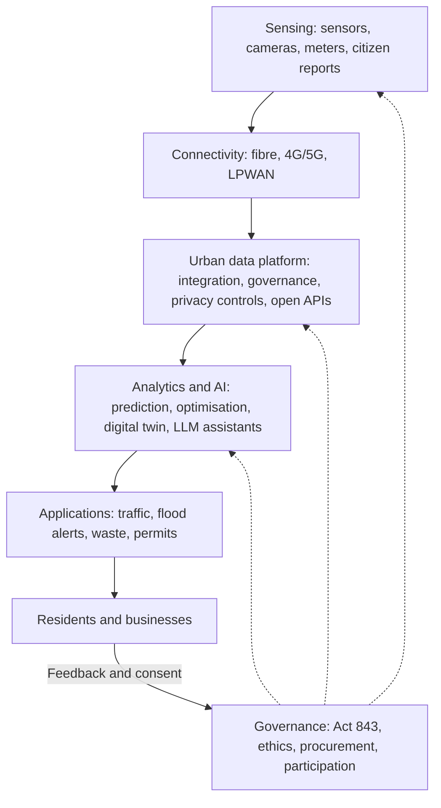

## Introduction

Artificial intelligence has moved rapidly from specialised prediction models to general-purpose systems that can write, summarise, translate, generate images, recognise speech and increasingly take actions through software tools. At the same time, cities around the world are deploying sensors, cameras, connected infrastructure and data platforms in the name of becoming "smart". These two trends meet in the smart city, where AI is used to manage traffic, predict flooding, route waste collection, detect crime, plan transport and deliver public services.

The potential benefits are significant, particularly for fast-growing cities such as Accra and Kumasi, which face congestion, flooding, informal settlement growth and pressure on public services. Yet smart city projects have also become cautionary tales about surveillance, vendor lock-in, exclusion and technology-led rather than citizen-led planning. This lesson develops a critical understanding of advanced AI capabilities, the architecture of smart cities, the role of urban data platforms, and the privacy and governance safeguards that determine whether a smart city serves its residents.

## Learning Objectives

- Explain the main developments in advanced AI, including foundation models, generative AI, computer vision and agentic systems, and their limitations.
- Describe the layered architecture of a smart city and the function of an urban data platform.
- Analyse smart city applications in transport, utilities, waste, safety and public services.
- Evaluate the privacy, surveillance, equity and vendor lock-in risks of smart cities, with reference to Ghana's data protection framework.
- Apply a governance framework to design a responsible smart city initiative for a Ghanaian city.

## Prerequisite Knowledge

- Conceptual understanding of machine learning and data analytics.
- Knowledge of IoT architectures, edge computing and 5G from earlier lessons.
- Awareness of data protection principles.

## Key Terminology

- **Foundation model**: A large AI model trained on broad data that can be adapted to many tasks, such as a large language model.
- **Generative AI**: AI systems that produce new content such as text, images, audio or code in response to prompts.
- **Large language model (LLM)**: A foundation model trained on large text corpora, typically using the transformer architecture, to predict and generate language.
- **Agentic AI**: AI systems that plan and execute multi-step tasks by calling tools, software or other systems with limited human direction.
- **Computer vision**: AI techniques that interpret images and video, used for example in traffic counting and licence-plate recognition.
- **Smart city**: An urban area that uses digital technologies and data to improve the efficiency, sustainability and quality of services, ideally in a way that is inclusive and accountable to residents.
- **Urban data platform**: Shared infrastructure that collects, integrates, governs and publishes data from many city systems through common standards and interfaces.
- **Function creep**: The gradual use of data or technology for purposes beyond those for which it was originally collected or approved.
- **Hallucination**: Output from a generative model that is fluent but factually false or unsupported.
- **Privacy by design**: Building data protection into systems from the outset, through data minimisation, purpose limitation and security.

## Detailed Explanation

### From narrow AI to foundation models

For many years business AI meant **narrow** models: a churn predictor, a credit score, an image classifier, each trained for one task on labelled data. The transformer architecture introduced by Vaswani and colleagues in 2017 enabled models to learn from vast amounts of unlabelled text by predicting missing or next words. Scaling these models and their training data produced **large language models** with surprisingly general abilities. Combined with fine-tuning and human feedback, they became the conversational assistants widely available since late 2022.

Key developments that managers should understand include:

- **Multimodality**: models that handle text, images, audio and video together, enabling, for example, analysis of a photograph of a damaged road alongside a citizen's complaint.
- **Retrieval-augmented generation (RAG)**: connecting a model to an organisation's own documents so that answers are grounded in specific, current sources rather than only the model's training data.
- **Agentic AI**: systems that break a goal into steps and call tools such as search, databases, calendars or payment systems. These increase productivity but raise new questions of control and accountability.
- **Edge AI**: smaller models running on cameras, phones or gateways, reducing latency, bandwidth and privacy exposure by processing data locally.

### Limitations that matter for business and government

Advanced AI is powerful but not reliable in the way traditional software is. Models can **hallucinate**, reproduce **biases** in their training data, perform worse on languages, accents and contexts under-represented in training (a real concern for Ghanaian languages such as Twi, Ewe, Ga and Dagbani), and be manipulated through malicious inputs such as prompt injection. Training and running large models consumes substantial energy and computing resources. Their reasoning is difficult to explain, which matters when decisions affect citizens' rights. Responsible deployment therefore requires human oversight, testing on local data, clear accountability and proportionate use.

### What makes a city "smart"?

There is no single definition, but most models share a **layered architecture**:

1. **Sensing layer**: sensors, cameras, smart meters, connected vehicles, mobile phones and citizen reports.
2. **Connectivity layer**: fibre, 4G/5G, Wi-Fi and LPWAN networks.
3. **Data platform layer**: ingestion, storage, integration, identity, metadata, access control and open-data publication.
4. **Analytics and AI layer**: dashboards, prediction, optimisation, simulation and digital twins.
5. **Application layer**: services such as traffic signal control, waste collection routing, flood alerts, parking, permits and payments.
6. **Governance layer**: policies, laws, ethics, procurement, standards and citizen participation, which cut across all the others.

Critics such as Kitchin (2014) and Townsend (2013) argue that a narrow, technology-led view of the smart city, often promoted by vendors, neglects the political and social questions of who benefits, who decides and who is watched. A more useful definition treats technology as a means to agreed civic ends.

### Urban data platforms

The data platform is the most strategically important and least visible element. Without it, a city accumulates disconnected "pilot" systems, each owned by a different vendor and department, each with its own data formats. A well-designed platform provides:

- **Common standards and open interfaces (APIs)** so that systems can share data and the city can change suppliers.
- **Data governance**: catalogues, ownership, quality rules, retention schedules and access controls.
- **Privacy controls**: anonymisation or aggregation of personal data, role-based access and audit trails.
- **Open data** publication where appropriate, allowing researchers, start-ups and citizens to build services.
- **Integration with identity and addressing systems**, which in Ghana include the Ghana Card national identity system and the GhanaPostGPS digital address system.

### Typical applications

| Domain | Example applications | Data and AI used |
|---|---|---|
| Transport | Adaptive traffic signals, congestion prediction, public transport tracking | Cameras, road sensors, GPS from buses and ride-hailing, computer vision, optimisation |
| Water and drainage | Flood early warning, leak detection | Rain gauges, river and drain level sensors, weather data, prediction models |
| Energy | Smart meters, outage detection, street-light control | Meter data, grid sensors, anomaly detection |
| Waste | Fill-level sensors in bins, route optimisation | IoT sensors, routing algorithms |
| Public safety | Emergency dispatch, CCTV analytics | Video analytics, incident data (high privacy risk) |
| Citizen services | Online permits, property rates, AI chat assistants for enquiries | Service records, LLMs with retrieval |

### Privacy and surveillance concerns

Smart cities collect data about people moving through public and private spaces, often without meaningful choice. Key concerns include:

- **Mass surveillance**: cameras with facial recognition and licence-plate readers can track individuals' movements.
- **Function creep**: data collected for traffic management being reused for policing, taxation or political monitoring without new consent or legal basis.
- **Re-identification**: "anonymous" location data can often be linked back to individuals.
- **Security**: centralised city data is an attractive target for attackers, and compromised infrastructure can endanger lives.
- **Exclusion and bias**: services designed around smartphones and digital literacy can exclude poorer or older residents; AI trained on unrepresentative data can misjudge some groups.
- **Vendor lock-in and sovereignty**: proprietary platforms can leave a city dependent on one supplier, sometimes with data stored abroad.

In Ghana, the **Data Protection Act, 2012 (Act 843)** establishes principles for processing personal data, including accountability, purpose specification, data minimisation, security safeguards and data subject rights, and it established the Data Protection Commission. Any smart city project processing personal data must comply with Act 843 and other applicable laws such as the Cybersecurity Act, 2020 (Act 1038).

## Theories, Frameworks and Models

### A responsible smart city governance framework

The following framework synthesises common principles from data protection law and smart city scholarship.

| Principle | Practical measures |
|---|---|
| Problem-led, citizen-centred | Start from documented resident needs; consult communities, including traders and informal workers |
| Proportionality | Use the least intrusive technology that achieves the goal; avoid facial recognition where counts suffice |
| Privacy by design | Edge processing, aggregation, anonymisation, short retention, data protection impact assessments |
| Transparency | Publish what is collected, why, by whom and for how long; register AI systems used in decisions |
| Accountability | Named data owners, independent oversight, complaint channels, audits of AI performance and bias |
| Interoperability and openness | Open standards and APIs written into contracts; city retains data ownership |
| Inclusion | Non-digital channels, local languages, affordability, accessibility |
| Security and resilience | Security by design for operational technology, incident response, manual fallbacks |

### Assessing AI use cases

A simple matrix helps prioritise AI applications by **public value** (benefit to residents) and **risk to rights** (privacy, discrimination, liberty). High-value, low-risk uses, such as predicting drain blockages from rainfall and sensor data, are good early candidates. High-risk uses, such as real-time facial recognition in public spaces, demand strict legal basis, necessity tests and oversight, and may not be justifiable at all.

## Ghanaian Business Application

### Illustrative scenario: flood early warning in Accra

Accra has a long history of damaging floods during heavy rains, linked to blocked drains, building in waterways and rapid urbanisation. In this **illustrative scenario**, a fictional *Accra Urban Resilience Partnership*, bringing together metropolitan assemblies, a university research group and a local technology start-up, proposes a flood early-warning system.

- **Sensing**: low-cost water-level sensors in major drains and the Odaw river channel, rain gauges, and citizen photo reports via a messaging app.
- **Connectivity**: LPWAN for sensors and mobile data for reports.
- **Data platform**: an open, city-owned platform integrating sensor data, weather forecasts and drainage maps, with personal data from citizen reports minimised and deleted after verification.
- **AI**: models predicting which areas will flood in the next few hours; an LLM-based assistant that sends alerts in English and local languages via SMS and voice, with human review of messages before mass dispatch.
- **Business value**: fewer losses for traders, transport operators and households; better targeting of drain-clearing crews.
- **Risks**: sensor theft or vandalism, power and connectivity failures, false alarms eroding trust, and maintenance funding after the pilot.

### Illustrative scenario: Kejetia market traffic and waste management in Kumasi

In a second **illustrative scenario**, the Kumasi Metropolitan Assembly considers AI-enabled cameras around the busy central market area to count vehicles and pedestrians, optimise traffic signals and schedule waste collection. A vendor offers to add facial recognition "for security" at no extra charge. Applying the governance framework, the assembly limits the system to on-camera counting with no storage of identifiable images, rejects facial recognition as disproportionate, requires the vendor to deliver data through open APIs into a city-owned platform, and consults market traders' associations on waste collection timing.

## International Case Study

### Sidewalk Toronto

In 2017 Waterfront Toronto, the public agency responsible for redeveloping Toronto's waterfront, selected Sidewalk Labs, a sister company of Google within Alphabet, to propose a plan for Quayside, a waterfront site. The vision included sensors throughout the neighbourhood, adaptive infrastructure and a data-driven approach to urban management. The project became highly controversial, chiefly over data governance: who would own and control data collected in public spaces, how privacy would be protected, and how much influence a private technology firm would gain over public infrastructure. Ann Cavoukian, the former Ontario privacy commissioner known for promoting "privacy by design", resigned from an advisory role in 2018, citing concerns that de-identification of data could not be guaranteed. In May 2020 Sidewalk Labs announced it was withdrawing from the project, citing economic uncertainty.

Lessons for managers and public officials:

- Data governance and public trust can determine the fate of a smart city project as much as technology.
- Citizens and civil society expect a say in how data in public spaces is collected and used.
- Clear public ownership of data and infrastructure should be settled before, not after, partnering with technology firms.
- Ambitious, technology-led visions can provoke resistance if public value is not clearly demonstrated.

## Diagram

## Common Misconceptions

- **Misconception:** A smart city is defined by how much technology it installs. **Correction:** A smart city is judged by whether technology improves outcomes for residents in an inclusive, accountable way.
- **Misconception:** Large language models know facts and are therefore reliable sources. **Correction:** They generate plausible text and can hallucinate; outputs must be grounded and verified, especially for public communication.
- **Misconception:** Anonymised location data poses no privacy risk. **Correction:** Location traces are often re-identifiable when combined with other data.
- **Misconception:** Free add-on features from vendors are harmless. **Correction:** Features such as facial recognition can create legal, ethical and reputational liabilities and function creep.
- **Misconception:** Smart city projects are only for wealthy cities. **Correction:** Targeted, low-cost applications such as flood sensors and SMS alerts can deliver high value in developing cities if well governed and maintained.

## Common Examination Mistakes

- Describing smart city applications without explaining the data platform and governance layers.
- Treating privacy as a single sentence at the end rather than a design requirement throughout.
- Ignoring Ghana's legal framework (Act 843, Data Protection Commission) when discussing personal data.
- Presenting illustrative Ghanaian scenarios as real projects.
- Overstating AI capabilities or ignoring hallucination, bias and language coverage.

## Critical Thinking Questions

1. Should a Ghanaian metropolitan assembly ever deploy live facial recognition in public spaces? What tests of necessity and proportionality would you apply?
2. How can a city avoid vendor lock-in when it lacks in-house technical capacity?
3. Who should own data generated by ride-hailing vehicles moving through Accra: the platform, the drivers, the passengers or the city?
4. How might generative AI assistants improve or worsen access to public services for residents with low literacy?
5. What lessons from Sidewalk Toronto apply to public-private smart city partnerships in Ghana?

## Practical Exercises

1. **Layer mapping.** Choose one smart city application (for example adaptive traffic signals on a major Accra road). *Expected output:* a diagram showing each of the six layers with specific components and data flows.
2. **Value-risk matrix.** Place eight proposed AI applications for Kumasi on a public value versus rights risk grid. *Expected output:* a completed matrix and a recommended sequence of three pilots.
3. **Data protection impact assessment outline.** For the flood early-warning scenario, list the personal data collected, purposes, legal basis, retention, risks and safeguards. *Expected output:* a one-page DPIA outline referencing Act 843 principles.
4. **Procurement clauses.** Draft five contract clauses for a smart city platform vendor. *Expected output:* clauses on data ownership, open APIs, security, exit and audit rights.

## Key Takeaways

- Advanced AI now includes foundation models, multimodal and agentic systems, but they hallucinate, can be biased and need oversight.
- Smart cities have sensing, connectivity, data platform, analytics, application and governance layers.
- The urban data platform, with open standards and city ownership of data, is the strategic core.
- Privacy, surveillance, exclusion, security and vendor lock-in are central risks, not afterthoughts.
- Ghanaian projects must comply with the Data Protection Act, 2012 (Act 843).
- Start with resident problems and proportionate, low-risk applications.

## Further Reading

- Vaswani, A., Shazeer, N., Parmar, N., Uszkoreit, J., Jones, L., Gomez, A. N., Kaiser, Ł., & Polosukhin, I. (2017). Attention is all you need. In *Advances in Neural Information Processing Systems 30*.
- Russell, S., & Norvig, P. (2021). *Artificial intelligence: A modern approach* (4th ed.). Pearson.
- Kitchin, R. (2014). The real-time city? Big data and smart urbanism. *GeoJournal, 79*(1), 1-14.
- Townsend, A. M. (2013). *Smart cities: Big data, civic hackers, and the quest for a new utopia*. W. W. Norton.
- Republic of Ghana. (2012). *Data Protection Act, 2012 (Act 843)*.

## Video Resources

- [OECD.AI Policy Observatory](https://oecd.ai/): OECD. Official portal on AI policy, principles and national strategies, including material on trustworthy AI.
- [Data Protection Commission, Ghana](https://dataprotection.org.gh/): Data Protection Commission. Official site with guidance on obligations under the Data Protection Act, 2012.
- [MIT OpenCourseWare](https://ocw.mit.edu/): Massachusetts Institute of Technology. Open learning portal; search for artificial intelligence and urban science course materials.

## Revision Summary

Advanced AI has moved from narrow models to foundation models, generative and agentic systems that are versatile but fallible. Smart cities combine sensing, connectivity, an urban data platform, analytics and applications, all under a governance layer. Their value depends on solving residents' problems while protecting privacy and avoiding surveillance, exclusion and lock-in. Ghanaian projects must comply with Act 843, and cases such as Sidewalk Toronto show that data governance and trust can make or break projects.

- Transformers (2017) underpin LLMs; RAG grounds outputs; agentic AI calls tools.
- AI limits: hallucination, bias, weak local-language coverage, energy use.
- Six layers: sensing, connectivity, platform, analytics, applications, governance.
- City-owned data, open APIs and privacy by design prevent lock-in and abuse.
- Value-risk matrix: start with high value, low rights-risk uses.
- Sidewalk Toronto: withdrew in 2020 after sustained data governance controversy.
