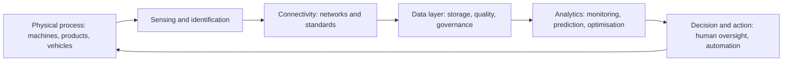

## Introduction

"Industry 4.0" has become one of the most used and least precisely defined phrases in business technology. Vendors use it to sell sensors, consultants use it to sell transformation programmes, and governments use it to describe industrial strategy. Behind the slogans is a coherent idea: when physical equipment, software, networks and data are tightly coupled, businesses can sense what is happening in operations, analyse it quickly and adjust automatically or with minimal human intervention.

This lesson gives you the vocabulary and analytical tools to discuss that idea critically. You will place Industry 4.0 in the history of industrial revolutions, examine cyber-physical systems, smart manufacturing and interoperability, and extend the discussion to smart business systems beyond the factory floor. You will then study readiness and maturity thinking, which asks what an organisation must have in place before technology can pay off, and finish with the limits of the concept, including where claims are speculative.

## Learning Objectives

- Explain the industrial revolutions framing and the origin of the term Industry 4.0.
- Describe cyber-physical systems and how sensing, connectivity, analytics and actuation form a closed loop.
- Analyse the role of interoperability and standards in smart manufacturing and smart business systems.
- Apply a readiness and maturity framework to assess an organisation's position and priorities.
- Evaluate claims about Industry 4.0 critically, separating established practice from hype.

## Prerequisite Knowledge

- Earlier lessons in this module on 5G and connectivity, robotics and automation, and advanced AI.
- Basic understanding of enterprise systems such as ERP and of data analytics.

## Key Terminology

- **Industry 4.0**: A term for the integration of cyber-physical systems, networked data and intelligent analytics into industrial production and related business processes, associated with a German strategic initiative from the early 2010s.
- **Cyber-physical system (CPS)**: A system in which physical processes are monitored and controlled by computational and networking components in a tight feedback loop.
- **Internet of Things (IoT)**: Networked physical devices with sensors and connectivity that exchange data.
- **Smart manufacturing**: Production in which data from machines, products and processes is used to monitor, optimise and adapt operations.
- **Digital twin**: A digital representation of a physical asset or process, kept up to date with data, used for monitoring, simulation and decision support.
- **Interoperability**: The ability of different systems, devices and organisations to exchange and use information consistently.
- **OPC UA**: A widely used industrial communication standard for secure, platform-independent exchange of machine and process data.
- **Predictive maintenance**: Using data and models to predict equipment failure so that maintenance is performed when needed.
- **Operational technology (OT)**: Hardware and software that monitors or controls physical equipment and processes, as distinct from information technology (IT).
- **Maturity model**: A staged framework describing capability levels, used to assess current state and plan progression.
- **Smart business system**: A business process or platform that combines connected data, analytics and automation to sense conditions and respond with minimal manual intervention.

## Detailed Explanation

### The industrial revolutions framing

A common narrative describes four industrial revolutions. The first used water and steam power to mechanise production. The second introduced electricity, the assembly line and mass production. The third, from the late twentieth century, applied electronics and information technology to automate production through programmable controllers and computers. The fourth, which the term Industry 4.0 labels, is described as the networking of physical and digital systems so that machines, products and processes communicate and adapt.

The label has a documented origin. The term "Industrie 4.0" was introduced in Germany around 2011 as part of a high-technology strategy and was developed in recommendations to the German government by a working group led by Kagermann, Wahlster and Helbig (2013). The World Economic Forum's founder, Klaus Schwab (2016), later popularised the related phrase "Fourth Industrial Revolution" in a broader sense that includes artificial intelligence, biotechnology and other fields. Students should note two cautions. The numbering is a convenient simplification, because change was gradual and uneven, and "Industry 4.0" is a concept and policy label, not a measurable event. Whether we are in a new revolution or a continuation of the third is genuinely debated.

### Cyber-physical systems

A cyber-physical system closes a loop between the physical and digital worlds. Sensors measure the physical process (temperature, vibration, position, flow), networks carry the data, software analyses it and decides, and actuators change the physical process. Lee, Bagheri and Kao (2015) proposed a widely cited architecture for CPS in manufacturing, with levels running from connection and data acquisition, through conversion of data into information and a cyber layer that models the machine, up to cognition and configuration, where the system supports decisions and can adapt itself. The architecture is useful because it shows that sensors alone do not make a smart system: value rises as data is converted to information, then to knowledge and decisions.

Two features distinguish CPS from older automation. First, they are **networked and data-rich**, so information can be used beyond the single machine, across plants and supply chains. Second, they can be **adaptive**, adjusting behaviour in response to data rather than following a fixed programme. This brings new risks: a failure or attack can have physical consequences, and decisions based on poor data can be amplified at machine speed.

### Smart manufacturing

Smart manufacturing applies these ideas to production. Typical use cases include:

- **Condition monitoring and predictive maintenance.** Vibration or temperature data indicates wear before failure, reducing unplanned downtime.
- **Quality control.** Sensors and vision systems detect defects early, allowing correction at source.
- **Flexible and customised production.** Connected equipment can be reconfigured for small batches, supporting mass customisation.
- **Traceability.** Products and materials carry identifiers, allowing tracking through the supply chain, which supports recalls and compliance.
- **Digital twins.** Models of assets or lines enable simulation of changes before they are made in the real plant.
- **Energy and resource optimisation.** Data reveals waste and supports better scheduling.

### Interoperability

Smart systems depend on the ability of diverse equipment and software to work together. In practice, factories contain machines from many vendors and decades, using different protocols. Interoperability needs agreed standards at several levels: communication (how devices exchange data), semantics (what the data means), and architecture (how layers relate). Industrial standards such as OPC UA support secure exchange of machine data, and the reference architecture model RAMI 4.0 offers a common way to place assets, layers and life cycles. The ISA-95 family of standards defines how enterprise systems such as ERP relate to manufacturing operations systems.

Interoperability also has a business dimension. Without it, organisations face **vendor lock-in**, because proprietary data formats make switching costly. Open standards and well-documented interfaces reduce this risk but require governance to maintain.

### Data-driven operations and smart business systems

Industry 4.0 is often described as a manufacturing topic, but its logic applies elsewhere. A **smart business system** applies sensing, connected data, analytics and automation to a business process. Examples include logistics operations in which vehicle telematics, warehouse scanners and demand forecasts feed dynamic routing; retail inventory systems in which sales data drives automatic replenishment; utilities with smart meters; agriculture with sensors and weather data guiding irrigation; and financial services using transaction data to detect fraud in near real time.

Three layers are needed. A **data layer** collects data reliably and assigns clear ownership, quality standards and security. An **analytics layer** turns data into insight, using methods from simple rules and dashboards to machine learning. An **action layer** converts insight into decisions and, where appropriate, automated actions, with defined human oversight. A system lacking the action layer is a reporting system; one lacking the data layer is a model trained on poor inputs.

### Readiness and maturity thinking

Many initiatives fail not because the technology is weak but because the organisation is not ready. Maturity models help to diagnose this. The acatech Industrie 4.0 Maturity Index (Schuh et al., 2017) describes development stages from basic computerisation and connectivity, through visibility and transparency, to the capability to predict and finally to adapt autonomously, and it stresses that structure and culture must develop with technology. A general readiness assessment can examine:

| Dimension | Questions to ask |
|---|---|
| Strategy | Which business problems are we solving, and how will value be measured? |
| Processes | Are core processes stable, documented and measured? |
| Data and systems | Is data accurate, accessible and governed? Are systems integrated? |
| Technology and connectivity | Are equipment, networks and power reliable enough? |
| People and culture | Do staff have skills, and is there support for change? |
| Security | Are IT and OT systems protected, and are third parties managed? |
| Finance and governance | Is there funding, a business case and clear ownership? |

A key principle follows: **digitise and stabilise before you automate and optimise**. Automating a chaotic process makes chaos faster. Moving up the maturity ladder in steps, with measurable benefits at each, is usually more successful than a single large programme.

### Limits, risks and hype

A critical student should keep several cautions in mind. **Hype and ambiguity**: the term is used loosely, and claims of dramatic productivity gains are often based on selected examples. **Legacy equipment and cost**: retrofitting old machines with sensors is possible but costly, and returns depend on the use case. **Security**: connecting operational equipment widens the attack surface, and OT environments often use components that are hard to patch. **Skills and change**: the shortage of people able to combine process knowledge with data and engineering skills often limits progress. **Data quality and integration**: analytics are only as good as the data. **Social impact**: automation may displace some jobs and create others, and the transition requires reskilling. **Context**: in settings with unreliable power, connectivity or capital, some Industry 4.0 approaches may be impractical, and simpler, low-cost digitisation may deliver better value first.

It is also important to distinguish **established practice** from **emerging or speculative** claims. Condition monitoring, barcode and RFID traceability, and integration of ERP with production systems are established. Fully autonomous, self-optimising factories, and sweeping claims about complete lights-out production, remain largely aspirational outside particular sectors.

## Theories, Frameworks and Models

**Closed-loop CPS architecture.** The Lee, Bagheri and Kao (2015) five-level architecture (connection, conversion, cyber, cognition, configuration) is a useful tool for classifying how intelligent a system really is.

**Reference architectures and standards.** RAMI 4.0 positions assets across layers, life-cycle stages and hierarchy levels, and ISA-95 clarifies the interface between enterprise and plant systems. They provide a shared vocabulary when integrating systems.

## Step-by-Step Guide

A practical path for an organisation exploring a smart business system is:

1. **Define the problem and metric.** Choose a specific problem, such as unplanned downtime or stock-outs, and a baseline measure.
2. **Assess readiness.** Review the dimensions in the table above and identify the weakest.
3. **Stabilise and digitise.** Document the process, fix obvious causes of variation and capture data reliably.
4. **Pilot a narrow use case.** Instrument one line or one process, with clear success criteria and a defined end date.
5. **Integrate and secure.** Connect pilot data to existing systems through standard interfaces, and secure IT and OT components.
6. **Evaluate honestly.** Compare results with the baseline, including costs, and decide whether to scale, adapt or stop.
7. **Scale in steps.** Roll out incrementally, update the maturity assessment, and build skills in parallel.

## Ghanaian Business Application

**Illustrative scenario.** *Volta Fresh Processing* (fictional) packs and exports fruit products from a facility near the Volta Region. Management has heard that "smart factory" tools could cut waste, but the plant relies on equipment of mixed ages, experiences occasional power interruptions, and keeps production records on paper and spreadsheets.

A readiness assessment places the company early on the maturity ladder: processes are only partly documented, data is manual, and connectivity is limited. The strategic recommendation is not to purchase a full smart-factory platform but to proceed in steps. First, standardise production records and capture them digitally with barcodes or tablets, linking batches to supplier lots to support traceability, which export buyers often value. Second, install low-cost sensors on the cold-storage rooms and a few critical machines, with local data storage that tolerates interruptions in connectivity, and an alert system for temperature excursions. Third, connect the data to the company's ERP or accounting system so that batch costs and yields can be analysed. Predictive maintenance and a digital twin of the line are deferred until the data layer proves reliable.

The same logic applies to Ghanaian logistics firms using vehicle tracking, retailers using point-of-sale data for replenishment, and agricultural businesses using sensor data for irrigation. In each case, reliable power and connectivity, trained staff, security of connected devices and clear data ownership determine whether the system pays off. The data collected may include personal data, such as driver locations, so legal and ethical obligations must be considered.

## International Case Study

**Siemens Electronic Works Amberg.** Siemens operates an electronics plant in Amberg, Germany, that is widely cited in industry literature as a showcase of Industry 4.0 principles. Public descriptions emphasise that products, in the form of printed circuit board assemblies, carry codes that tell machines what processing they require, that automation systems collect large volumes of production data, and that human staff work alongside highly automated lines. The plant is used by Siemens as a demonstration of the integration of product design data, production planning and shop-floor control.

The case illustrates several lessons from this course. Integration of product data, manufacturing execution and enterprise planning is central. A high degree of automation is feasible where processes are stable, high-volume and well documented, and where the organisation has invested over many years in automation and skills. The case should also be read critically: it is a company-promoted flagship in a high-wage, high-capability setting, with a product mix that suits automation. Published performance claims come largely from the company and should be treated as claims rather than independent audit findings, and the conditions may not transfer to firms with different scales, markets or infrastructure.

## Diagram

| Maturity stage | Typical capability | Example in a business |
|---|---|---|
| Basic digitisation | Core records and processes are computerised | Production records captured in a spreadsheet or ERP |
| Connectivity | Systems and equipment are linked | Machines report status to a central system |
| Visibility | Real-time view of operations | Dashboard of line output and downtime |
| Prediction | Models anticipate events | Maintenance scheduled from vibration trends |
| Adaptation | Systems adjust with limited human input | Production schedule re-optimised automatically |

## Common Misconceptions

- "Industry 4.0 is just robots." Robots are one element, but the core idea is networked data and feedback across systems, which can exist with little robotics.
- "Industry 4.0 applies only to large factories." The principles of sensing, data and feedback apply to small firms, services and agriculture, at a scale and cost suited to them.
- "More sensors automatically mean more value." Value arises when data leads to better decisions or actions; unused data is only cost.
- "Technology purchase equals transformation." Success depends on processes, skills, data governance and culture as well as equipment.

## Common Examination Mistakes

- Listing technologies (IoT, cloud, AI) without explaining how they form a closed loop in a cyber-physical system.
- Treating the industrial revolutions as sharply separated events rather than a simplified narrative.
- Ignoring readiness, maturity, skills and culture when recommending adoption.
- Overlooking security, especially the convergence of IT and OT.
- Failing to distinguish established applications from speculative claims.

## Critical Thinking Questions

1. Is Industry 4.0 a genuine revolution or a rebranding of continuing automation trends? What evidence would help you decide?
2. A firm has unreliable power and limited connectivity. Which smart business system capabilities are still realistic, and which are not?
3. Who should own the data produced by machines supplied by an external vendor, and what contractual protections are needed?
4. How should an organisation balance efficiency gains from automation with the social impact on workers?

## Practical Exercises

1. Choose a business you know and map one process onto the closed loop (sense, connect, analyse, act). Identify the weakest link. Expected output: a labelled diagram and a paragraph.
2. Score a fictional or real organisation (with permission or from public information) from 1 to 5 on each readiness dimension in the table, and justify each score in one sentence. Expected output: a scored table and a three-line summary of priorities.
3. Draft a pilot proposal for predictive maintenance or cold-chain monitoring, including the baseline metric, data required, success criterion and main risks. Expected output: a one-page proposal.

## Key Takeaways

- Industry 4.0 labels the integration of cyber-physical systems, networked data and analytics into production and business processes; its origin is a German strategic initiative from around 2011.
- A cyber-physical system closes a feedback loop between physical processes and digital analysis and action.
- Interoperability and standards such as OPC UA, RAMI 4.0 and ISA-95 enable integration and reduce lock-in.
- Smart business systems need data, analytics and action layers, and apply well beyond manufacturing.
- Readiness and maturity thinking says to digitise and stabilise before automating and optimising.
- Evaluate claims critically: security, skills, data quality, context and cost limit results, and many aspirations remain speculative.

## Further Reading

- Kagermann, H., Wahlster, W., & Helbig, J. (2013). *Recommendations for implementing the strategic initiative INDUSTRIE 4.0: Final report of the Industrie 4.0 Working Group*. acatech.
- Lee, J., Bagheri, B., & Kao, H.-A. (2015). A cyber-physical systems architecture for Industry 4.0-based manufacturing systems. *Manufacturing Letters, 3*, 18-23.
- Schuh, G., Anderl, R., Gausemeier, J., ten Hompel, M., & Wahlster, W. (Eds.). (2017). *Industrie 4.0 maturity index: Managing the digital transformation of companies* (acatech Study). Herbert Utz Verlag.
- Schwab, K. (2016). *The fourth industrial revolution*. World Economic Forum.

## Video Resources

- [World Economic Forum](https://www.weforum.org/): World Economic Forum. Official site with reports and talks on the Fourth Industrial Revolution and advanced manufacturing.
- [OPC Foundation](https://opcfoundation.org/): OPC Foundation. Official site for the OPC UA industrial interoperability standard.

## Revision Summary

Industry 4.0 describes the networking of physical and digital systems so that machines, products and processes sense, communicate and adapt, building on earlier industrial revolutions as a simplified narrative. Cyber-physical systems close a loop of sensing, connectivity, analytics and action. Smart manufacturing and wider smart business systems depend on interoperability, reliable data and clear governance, and succeed only when organisational readiness, skills and security keep pace with technology. Maturity models support stepwise progress, and critical evaluation separates established applications from hype.

- Four revolutions is a convenient simplification, not a precise history.
- CPS equals sensing, connectivity, analytics and actuation in a feedback loop.
- Standards (OPC UA, RAMI 4.0, ISA-95) enable interoperability.
- Digitise and stabilise before automating.
- IT and OT convergence widens the security risk.
- Treat vendor and flagship-case claims as claims, not audited facts.
