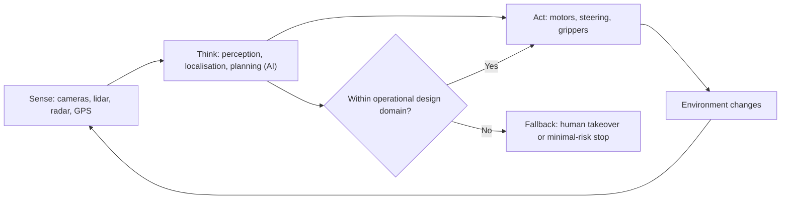

## Introduction

Automation is not new. Factories have used machines to replace manual labour for more than two centuries, and businesses have automated calculation since the first mainframes. What is new is the *scope* of tasks that machines can now perform and the degree of *independence* with which they perform them. Software "bots" process invoices without human keystrokes, warehouse robots move shelves to pickers, drones deliver medical supplies to rural clinics and vehicles steer themselves on public roads in a handful of cities.

For managers, the challenge is to see past the general label "automation" and ask precise questions. Is the automation digital or physical? How much judgement does the system exercise, and when must a human intervene? What happens when it fails? Who is accountable? This lesson provides the vocabulary and frameworks to answer these questions, including the distinction between robotic process automation (RPA) and physical robots, models of levels of automation, the SAE J3016 levels of driving automation, and the risk profile of autonomous systems.

## Learning Objectives

- Define robotics, automation and autonomy and explain how they differ.
- Compare robotic process automation with physical robotics in terms of technology, use cases and risks.
- Classify systems using levels-of-automation models, including SAE J3016 levels 0 to 5.
- Analyse the technical, safety, ethical, legal and workforce risks of autonomous systems.
- Evaluate a proposed automation project for a Ghanaian organisation using structured criteria.

## Prerequisite Knowledge

- General understanding of business processes and information systems.
- Awareness of artificial intelligence and machine learning at a conceptual level.
- Familiarity with IoT sensors and connectivity from the Internet of Things module is helpful.

## Key Terminology

- **Robot**: A programmable machine that senses its environment, processes information and acts physically on the world.
- **Automation**: The use of technology to perform tasks with reduced human intervention.
- **Autonomy**: The capacity of a system to make and execute decisions in pursuit of goals without real-time human direction, within a defined operating context.
- **Robotic process automation (RPA)**: Software bots that mimic human interactions with user interfaces and applications to execute rule-based digital tasks.
- **Cobot (collaborative robot)**: A robot designed to work safely alongside people in a shared workspace.
- **Operational design domain (ODD)**: The specific conditions (roads, speeds, weather, time of day) under which an automated driving system is designed to operate.
- **Dynamic driving task (DDT)**: The real-time operational and tactical functions needed to drive a vehicle, such as steering, braking and monitoring the environment.
- **Human-in-the-loop**: A design in which a human must approve or can override decisions made by an automated system.
- **Automation complacency**: The tendency of human supervisors to monitor automated systems less carefully over time, reducing their ability to intervene.

## Detailed Explanation

### Robotics, automation and autonomy

These three terms overlap but are not synonyms. **Automation** describes *what* is done: a task once performed by a person is performed by technology. **Robotics** describes one *means* of doing it in the physical world, through machines that combine sensors, controllers and actuators. **Autonomy** describes *how independently* a system acts. A traditional industrial welding robot is highly automated but has little autonomy: it repeats a programmed path inside a safety cage and stops if anything unexpected happens. An autonomous delivery robot on a pavement must perceive a changing environment, plan a route and respond to pedestrians without human guidance.

A physical robot typically follows a **sense-think-act** cycle. Sensors (cameras, lidar, radar, ultrasonic sensors, force sensors, GPS) gather data; software for perception, localisation and planning interprets it, increasingly using machine learning; actuators (motors, grippers, wheels, rotors) carry out decisions. Each stage can fail, and failures propagate.

### Types of physical robots in business

- **Industrial robots**: articulated arms used for welding, painting and assembly, especially in automotive and electronics manufacturing.
- **Collaborative robots (cobots)**: lighter, force-limited robots that share space with workers for tasks such as packing or machine tending.
- **Autonomous mobile robots (AMRs)**: wheeled robots that navigate warehouses, hospitals and factories.
- **Drones (uncrewed aerial vehicles)**: used for delivery, surveying, crop monitoring and infrastructure inspection.
- **Service robots**: cleaning, reception, hospitality and healthcare assistance.
- **Autonomous vehicles**: cars, trucks, buses and mining or agricultural vehicles with automated driving systems.

### Robotic process automation versus physical robots

RPA is software, not hardware. An RPA bot logs into applications, copies data between screens, fills forms, reads emails and follows rules, just as a clerk would. It is attractive because it can automate processes that span legacy systems without changing them, so it can be implemented quickly. Its weaknesses are that it is brittle (a changed screen layout can break a bot), it automates existing processes rather than redesigning them, and poorly governed bots can multiply into an unmanaged "shadow" workforce with excessive system privileges. Van der Aalst, Bichler and Heinzl (2018) characterise RPA as a pragmatic, "outside-in" approach suited to high-volume, rule-based tasks, contrasting with "inside-out" redesign of the underlying systems.

| Dimension | RPA (software bots) | Physical robots |
|---|---|---|
| Acts on | Digital interfaces and data | Physical objects and environments |
| Typical tasks | Invoice processing, data entry, reconciliations, report generation | Assembly, picking, transport, delivery, inspection |
| Investment | Licences and configuration; relatively low capital | Hardware, integration, facility changes; high capital |
| Speed of deployment | Weeks to months | Months to years |
| Main risks | Brittleness, access control, process lock-in, audit gaps | Physical safety, maintenance, downtime, liability |
| Role of AI | Increasingly combined with document AI and language models ("intelligent automation") | Perception, navigation, grasping and planning |

Both raise workforce questions, but RPA often affects clerical and back-office roles, while physical robots affect manual and logistics roles.

### Automation in a value chain

Automation decisions should start with process analysis rather than technology enthusiasm. Good candidates are high-volume, repetitive, rule-based, error-prone or hazardous tasks with stable inputs. Poor candidates involve frequent exceptions, unstructured judgement, high empathy or highly variable environments. Automating a broken process merely produces errors faster, so process improvement should usually precede automation.

## Theories, Frameworks and Models

### Levels of automation

Parasuraman, Sheridan and Wickens (2000) proposed a widely cited model in which automation can be applied to four types of function: **information acquisition**, **information analysis**, **decision and action selection**, and **action implementation**. Each can be automated to a different degree, from fully manual to fully automatic. A credit-scoring system might fully automate information analysis but leave the final loan decision to an officer. The framework helps designers decide *where* automation adds value and *where* human judgement must be retained.

A simplified managerial ladder is:

1. Manual: the human does everything.
2. Decision support: the system offers information or recommendations.
3. Conditional automation: the system acts, but the human approves or can veto.
4. Supervised autonomy: the system acts and informs the human, who monitors.
5. Full autonomy within a defined domain: the system acts without human involvement.

### SAE J3016 levels of driving automation

SAE International's standard J3016 defines six levels for on-road vehicles. It is widely used by regulators, manufacturers and the media.

| Level | Name | Who performs the driving task | Who monitors and is the fallback |
|---|---|---|---|
| 0 | No driving automation | Human driver (warnings and momentary assistance only) | Human |
| 1 | Driver assistance | Human, with the system controlling *either* steering *or* speed (e.g. adaptive cruise control) | Human |
| 2 | Partial driving automation | System controls steering *and* speed together, but the human must constantly supervise | Human |
| 3 | Conditional driving automation | System drives within its ODD; human need not monitor continuously but must take over when requested | Human, when requested ("fallback-ready user") |
| 4 | High driving automation | System drives and handles fallback within its ODD; no human takeover needed inside the ODD | System, within ODD |
| 5 | Full driving automation | System drives everywhere a human could, under all conditions | System |

The crucial boundary lies between levels 2 and 3. At levels 0 to 2 the features are *driver support*: the human is driving even if their hands and feet are off the controls. At levels 3 to 5 the automated system is driving when engaged. Many marketing names for driver-assistance features have been criticised for suggesting more autonomy than a level 2 system provides. Level 4 robotaxis operate today only within carefully mapped areas; level 5 does not exist commercially.

### A risk framework for autonomous systems

| Risk category | Examples | Typical mitigations |
|---|---|---|
| Technical | Sensor failure, perception errors in rain or dust, software bugs, adversarial inputs | Redundant sensors, testing in diverse conditions, safety cases, over-the-air updates |
| Human factors | Automation complacency, unclear handover, skill degradation | Driver monitoring, clear interfaces, training, limiting ODDs |
| Cyber security | Remote takeover, spoofed GPS, compromised updates | Secure-by-design, signed updates, network segmentation |
| Legal and liability | Who is liable in a crash: owner, operator, manufacturer, software supplier? | Clear contracts, insurance, regulatory approval, event data recorders |
| Ethical and social | Bias in perception, job displacement, surveillance by camera-equipped robots | Impact assessments, workforce transition plans, data minimisation |
| Operational | Maintenance capacity, spare parts, power and connectivity reliability | Local technical skills, service agreements, fallback procedures |

## Ghanaian Business Application

### Documented example: drone delivery of medical supplies

Zipline, a US-founded company, began delivering medical products by drone in Ghana in 2019 in partnership with the Government of Ghana, operating from distribution centres that serve health facilities, including rural ones. Its fixed-wing drones are launched from a catapult, fly autonomously along planned routes and drop packages by parachute before returning. This is a well-documented example of autonomous systems addressing a real logistics problem: road travel to remote facilities can be slow, and products such as blood, vaccines and essential medicines are time-sensitive. The case illustrates key managerial themes: a defined operating domain (planned routes and airspace coordination), regulatory engagement with aviation authorities, public-private partnership, and debate about cost-effectiveness compared with alternatives such as improving roads and storage.

### Illustrative scenario: RPA in a Ghanaian bank

*Asante Commercial Bank* (fictional) has a back-office team that re-keys data from loan application forms and Ghana Card verification results into its core banking system, and reconciles mobile money settlements each morning. Volumes are high, rules are stable and errors are costly. The bank pilots RPA bots combined with document-recognition software. Benefits include faster turnaround and fewer keying errors. Risks include bots holding privileged credentials, bots breaking when the core banking interface is upgraded, and staff anxiety. The bank establishes an automation centre of excellence, gives each bot a named business owner, logs every bot action for audit, and redeploys clerical staff to customer-facing exception handling and quality review.

## International Case Study

### The 2018 Tempe, Arizona, autonomous vehicle fatality

In March 2018 a test vehicle operated by Uber's Advanced Technologies Group, running in autonomous mode with a human safety operator on board, struck and killed a pedestrian, Elaine Herzberg, in Tempe, Arizona. It is widely reported as the first pedestrian death involving a self-driving test vehicle. The US National Transportation Safety Board (NTSB) investigated and in 2019 identified failures across several layers: the automated system did not correctly classify and predict the path of the pedestrian crossing outside a crosswalk; the vehicle's own automatic emergency braking had been disabled while under computer control; the safety operator was not watching the road; and the NTSB criticised the company's safety culture and oversight, as well as the state's limited regulation of testing.

Lessons for managers:

- Autonomous system failures are usually *socio-technical*: technology, human supervision, organisational culture and regulation fail together.
- Relying on a human safety driver to catch rare failures is undermined by automation complacency.
- Safety management systems, independent oversight and transparent incident investigation are essential before deployment at scale.
- Reputational and strategic consequences are severe; Uber subsequently sold its self-driving unit in 2020.

## Diagram

## Common Misconceptions

- **Misconception:** RPA involves physical robots. **Correction:** RPA is software that operates other software through its user interface; it has no physical component.
- **Misconception:** A car that steers and brakes itself on the motorway is "self-driving". **Correction:** Most such features are SAE level 2; the human is still the driver and must supervise constantly.
- **Misconception:** Level 4 means the vehicle can drive anywhere. **Correction:** Level 4 systems need no human fallback only within their operational design domain; outside it they cannot operate.
- **Misconception:** Automation always eliminates jobs. **Correction:** Automation usually changes the task mix within jobs, eliminating some tasks, creating others and shifting skill requirements, although displacement can be significant for specific roles.
- **Misconception:** A human safety operator guarantees safety. **Correction:** Human supervisors of reliable automation become complacent and are slow to take over, so system design must not rely on them alone.

## Common Examination Mistakes

- Confusing automation with autonomy, or treating all robots as autonomous.
- Listing SAE levels without explaining who monitors the environment and who is the fallback at each level.
- Recommending RPA for processes that are unstable, exception-heavy or due to be redesigned.
- Discussing autonomous vehicle risks only technically, ignoring human factors, liability and regulation.
- Using the Zipline example without noting its defined operating domain and partnership model.

## Critical Thinking Questions

1. Should a Ghanaian bank automate a broken loan process with RPA now or redesign the process first? What are the costs of each path?
2. Why might SAE level 3 be more dangerous in practice than level 2 or level 4?
3. Who should be liable when an autonomous delivery drone damages property: the operator, manufacturer, software provider or client?
4. How should a manufacturer in Tema evaluate whether cobots will complement or replace its workers?
5. What conditions in Ghanaian cities (road markings, mixed traffic, informal transport, weather) would challenge autonomous vehicles, and what does that imply for their operational design domain?

## Practical Exercises

1. **Automation candidate assessment.** Select five processes in an organisation you know. Score each from 1 to 5 on volume, rule-based nature, stability, exception rate and risk. *Expected output:* a ranked table identifying the best RPA candidate with justification.
2. **SAE classification.** Classify six vehicle features (lane-keeping assist, adaptive cruise control, traffic-jam pilot with takeover requests, driverless robotaxi in a mapped city, automatic emergency braking, motorway steering plus speed control) by SAE level. *Expected output:* a table with each level and the reason.
3. **Risk register.** Draft a risk register for a proposed autonomous mobile robot deployment in a Kumasi warehouse. *Expected output:* at least eight risks across the categories in this lesson, each with likelihood, impact, owner and mitigation.

## Key Takeaways

- Automation is what is done, robotics is one physical means, and autonomy is how independently it is done.
- RPA automates digital, rule-based tasks quickly but is brittle and needs governance.
- Levels-of-automation models help decide where to keep human judgement.
- SAE J3016: levels 0 to 2 support a human driver; levels 3 to 5 mean the system drives when engaged.
- Autonomous system risks are socio-technical: technology, human factors, security, liability and ethics.
- Good automation projects start with process analysis and include workforce transition plans.

## Further Reading

- SAE International. (2021). *Taxonomy and definitions for terms related to driving automation systems for on-road motor vehicles* (SAE Standard J3016_202104).
- Parasuraman, R., Sheridan, T. B., & Wickens, C. D. (2000). A model for types and levels of human interaction with automation. *IEEE Transactions on Systems, Man, and Cybernetics: Part A: Systems and Humans, 30*(3), 286-297.
- van der Aalst, W. M. P., Bichler, M., & Heinzl, A. (2018). Robotic process automation. *Business & Information Systems Engineering, 60*(4), 269-272.
- Siciliano, B., & Khatib, O. (Eds.). (2016). *Springer handbook of robotics* (2nd ed.). Springer.
- Brynjolfsson, E., & McAfee, A. (2014). *The second machine age: Work, progress, and prosperity in a time of brilliant technologies*. W. W. Norton.

## Video Resources

- [SAE International](https://www.sae.org/): SAE International. Official site of the standards body that publishes J3016, with explanatory material on driving automation levels.
- [International Federation of Robotics](https://ifr.org/): IFR. Official industry body site with reports and explanations of industrial and service robotics.
- [MIT OpenCourseWare](https://ocw.mit.edu/): Massachusetts Institute of Technology. Open learning portal; search for robotics and autonomous systems course materials.

## Revision Summary

Automation replaces human effort; robotics provides physical means through sense-think-act machines; autonomy measures independence within a defined domain. RPA automates rule-based digital tasks and differs sharply from physical robots in cost, speed and risk. Levels-of-automation models, including SAE J3016 for vehicles, clarify who acts, who monitors and who is the fallback. Autonomous systems carry technical, human-factor, security, legal and ethical risks that must be managed together.

- RPA = software bots on user interfaces; brittle; govern credentials and ownership.
- SAE 0-2: human drives and supervises; 3: takeover on request; 4: no takeover within ODD; 5: everywhere.
- Parasuraman et al.: automate acquisition, analysis, decision and action to different degrees.
- Automation complacency undermines human safety backups.
- Zipline in Ghana: autonomous drones in a defined domain via public-private partnership.
- Tempe 2018: socio-technical failure across technology, people, culture and regulation.
