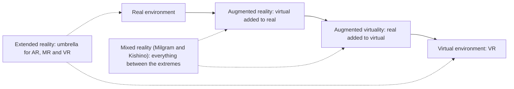

## Introduction

Immersive technologies change how people perceive and interact with information. Instead of reading a manual, a technician can see repair instructions overlaid on the machine in front of them. Instead of travelling to a training centre, a new mine worker can rehearse an emergency evacuation in a safe virtual environment. Instead of imagining whether a sofa will fit, a shopper can place a true-to-scale digital model in their living room using a phone. These experiences are grouped under the labels augmented reality (AR), virtual reality (VR), mixed reality (MR) and extended reality (XR), terms that vendors and the media often use loosely and interchangeably.

This lesson gives these terms precise meanings using the reality-virtuality continuum proposed by Milgram and Kishino (1994) and Azuma's (1997) widely cited definition of AR. It then examines the main business applications, the costs and limitations that frequently derail projects, and a structured way to evaluate an investment. Immersive technology is a good test of the analytical skills developed in Module 1: it has passed through several cycles of hype, and its value depends heavily on the specific task and context.

## Learning Objectives

- Explain Milgram and Kishino's reality-virtuality continuum and use it to define AR, augmented virtuality, VR, MR and XR.
- Describe Azuma's three characteristics of augmented reality and the concepts of immersion and presence in VR.
- Analyse business applications of immersive technologies in training, remote assistance, design, retail and healthcare.
- Apply a cost-benefit analysis to an immersive training proposal.
- Evaluate the technical, human, ethical and organisational barriers to adoption.

## Prerequisite Knowledge

- The concepts of emerging technology, hype cycles and adoption from Module 1.
- Basic familiarity with smartphones and mobile applications.

## Key Terminology

- **Reality-virtuality continuum**: A scale proposed by Milgram and Kishino (1994) running from a completely real environment to a completely virtual one, with mixed environments in between.
- **Augmented reality (AR)**: Technology that overlays computer-generated content onto a view of the real world, combining real and virtual content, interactive in real time and registered in three dimensions (Azuma, 1997).
- **Virtual reality (VR)**: A fully computer-generated environment that replaces the user's view of the physical world, typically experienced through a head-mounted display.
- **Mixed reality (MR)**: In Milgram and Kishino's sense, any environment between the fully real and fully virtual extremes; in current industry usage, often AR in which virtual objects are anchored to and interact with the physical environment.
- **Augmented virtuality**: A predominantly virtual environment into which elements of the real world, such as live video of the user's hands, are incorporated.
- **Extended reality (XR)**: An umbrella term covering AR, MR and VR.
- **Presence**: The subjective sense of "being there" in a virtual environment.
- **Cybersickness**: Discomfort such as nausea, disorientation or eye strain caused by immersive experiences, often linked to mismatches between visual motion and the body's sense of movement.

## Detailed Explanation

### The reality-virtuality continuum

Milgram and Kishino (1994) proposed that, rather than treating real and virtual as opposites, we should think of a continuum.

- At one end is the **real environment**, the physical world seen directly or through ordinary video.
- Moving towards the virtual end, **augmented reality** adds virtual objects to a predominantly real scene.
- Further along, **augmented virtuality** adds real elements to a predominantly virtual scene.
- At the far end is the **virtual environment**, entirely computer-generated.

Everything between the two extremes is **mixed reality** in their original definition. This is important because modern marketing often uses "mixed reality" more narrowly, to describe advanced AR headsets in which virtual objects appear anchored to tables and walls and can be occluded by real objects. Students should recognise both usages and state which they are using.

**Extended reality (XR)** is a more recent umbrella term used by industry to refer to the whole family of technologies across the continuum.

### Augmented reality

Azuma (1997) defined AR systems as having three characteristics: they **combine real and virtual** content; they are **interactive in real time**; and they are **registered in three dimensions**, meaning virtual objects are aligned with real-world positions so they appear to stay in place as the user moves. A static photograph with a cartoon added is not AR in this sense, because it is neither interactive in real time nor registered in 3D.

AR is delivered through three main device types:

- **Smartphones and tablets**, using the camera and screen. This is the most accessible form, supported by mobile platform toolkits, and requires no special hardware.
- **Head-mounted displays and smart glasses**, which leave the user's hands free and are valuable in industrial settings.
- **Projection-based systems**, which project information directly onto surfaces, such as assembly guides on a workbench.

### Virtual reality

VR replaces the user's surroundings. Its power lies in **immersion**, the objective capability of the system (field of view, tracking, display quality, spatial audio) and **presence**, the user's subjective sense of being in the virtual place. High presence allows people to rehearse dangerous or rare situations, such as a fire in a confined space, with emotional and physical responses closer to reality than a video can provide. VR is typically delivered through standalone headsets with built-in tracking, or headsets connected to a powerful computer for high-fidelity simulation.

### Business applications

| Application area | Typical technology | Value mechanism | Examples |
|---|---|---|---|
| Training for hazardous or rare tasks | VR | Safe, repeatable practice; consistent assessment | Emergency drills, equipment operation, customer-handling scenarios |
| Remote expert assistance | AR on phones or headsets | Expert guides a field worker by annotating their view, reducing travel | Equipment repair, medical device installation |
| Design and visualisation | VR and MR | Review full-scale designs before building | Architecture, factory layouts, product prototypes |
| Retail and marketing | Smartphone AR | Customers visualise products in context; engagement | Furniture placement, cosmetics try-on |
| Healthcare and education | VR and AR | Visualise anatomy, rehearse procedures, therapy | Medical education, rehabilitation |
| Tourism and real estate | VR and 360° video | Remote previews of places and properties | Virtual property tours, heritage sites |

### Barriers and limitations

- **Content cost.** High-quality 3D content and simulations are expensive to create and maintain; hardware is often the smaller cost.
- **Human factors.** Cybersickness, headset weight, eye strain and short comfortable session lengths limit use. Not everyone can use headsets, raising accessibility concerns.
- **Integration.** Value often depends on connecting immersive applications to enterprise data, such as maintenance records or product catalogues.
- **Device management.** Headsets must be charged, cleaned, updated and secured, which requires processes and staff.
- **Privacy and security.** Devices capture cameras, spatial maps of rooms and sometimes eye or hand movements, which may be personal data.
- **Evidence of value.** Many deployments remain pilots. Organisations should measure outcomes, such as training time, error rates or sales conversion, rather than novelty.

## Theories, Frameworks and Models

### Matching technology to task

A useful analytical approach is to start from the **task**, not the technology:

1. **Does the task require awareness of the real environment?** If the user must see and work on real objects, choose AR; if the real environment is irrelevant or dangerous, VR may be better.
2. **Is the task spatial and three-dimensional?** Immersive technology adds most value where spatial understanding matters, such as assembly, navigation or layout. For reading text or filling forms, conventional screens are usually superior.
3. **Is practice in the real world costly, dangerous or rare?** If so, VR simulation offers strong value.
4. **Do users need their hands free?** Head-mounted AR beats handheld devices for field technicians.
5. **What is the scale and frequency of use?** Content development costs are spread across users and repetitions; frequent, large-scale use improves the business case.

### Adoption lens

Rogers' perceived attributes from Module 1 apply directly. Immersive technologies often offer high **relative advantage** for specific tasks and strong **observability** (people readily see demonstrations), but may suffer from low **compatibility** with existing workflows, high **complexity** of content creation and device management, and limited **trialability** when headsets are scarce. Pilots that provide shared devices and clear task-specific benefits address these barriers.

## Worked Example

### Cost-benefit analysis of VR safety training

**Illustrative scenario.** *Birim Mining Services* (hypothetical) trains 400 new and existing workers each year in underground emergency procedures. All figures are invented for teaching.

**Current approach.** Each trainee attends a two-day practical course at a dedicated training site.

- Trainer and site costs: GHS 900 per trainee.
- Travel and accommodation: GHS 600 per trainee.
- Lost productive time: 2 days × GHS 400 per day = GHS 800 per trainee.
- Total per trainee: `900 + 600 + 800 = GHS 2,300`.
- Annual cost: `400 × 2,300 = GHS 920,000`.

**Proposed blended approach.** A one-day course combining VR scenarios at the mine with a shortened half-day practical session.

- One-off investment: 20 standalone headsets and accessories GHS 120,000; custom VR scenario development GHS 450,000. Total GHS 570,000.
- Annual running costs: content updates, device management and replacement GHS 110,000.
- Per-trainee costs: trainer and site GHS 450; travel GHS 0 (training on site); lost time 1 day × 400 = GHS 400. Total `GHS 850` per trainee.
- Annual cost: `(400 × 850) + 110,000 = 340,000 + 110,000 = GHS 450,000`.

**Annual saving:** `920,000 − 450,000 = GHS 470,000`.

**Simple payback:** `570,000 ÷ 470,000 ≈ 1.2 years`.

**Critical evaluation.**

1. The case assumes VR training is **at least as effective** as the practical course it partly replaces. The firm should pilot with a control group and compare assessment scores and observed performance in drills.
2. Regulatory or certification requirements may demand a minimum amount of practical training, which would limit the reduction.
3. Some workers may experience cybersickness; alternative formats must be available.
4. Intangible benefits, such as the ability to rehearse scenarios too dangerous to stage physically and consistent assessment records, may strengthen the case.
5. If trainee numbers fell to 100 a year, the annual saving would shrink substantially, showing that **scale and frequency** drive immersive business cases.

## Ghanaian Business Application

Immersive technologies have several plausible applications in Ghana, each of which should be evaluated against local constraints.

**Illustrative scenario: real estate.** *Airport Hills Developers* (hypothetical) sells apartments in Accra off-plan, including to Ghanaians living abroad who cannot visit the site. A VR or 360° virtual tour of show apartments, accessible on a phone or a low-cost headset, can help overseas buyers understand layouts and finishes. The value mechanism is reduced uncertainty for remote buyers; success depends on accurate representation, because over-polished renders can create disputes when the finished building differs.

**Illustrative scenario: technical training.** A technical and vocational education institution could use VR to give students practice on expensive equipment, such as industrial electrical panels or welding simulators, which it cannot afford to buy in quantity. Blended with hands-on practice, simulation can increase practice time per student.

**Illustrative scenario: heritage tourism.** Tour operators could offer AR or 360° experiences that reconstruct historical scenes at heritage sites, adding interpretation for visitors. Such content requires sensitive, accurate historical treatment developed with heritage authorities and communities.

**Local constraints.** Headset costs relative to incomes, limited local 3D content-creation skills, variable mobile data costs for downloading large applications and the need for multilingual content all shape adoption. Smartphone-based AR often offers the most accessible starting point.

## International Case Study

### IKEA Place and Walmart's VR training

**IKEA Place.** In 2017 the furniture retailer IKEA launched IKEA Place, a smartphone AR app built on Apple's ARKit framework that allowed customers to place true-to-scale 3D models of furniture in their homes. The application addressed a specific customer problem, uncertainty about whether items would fit and look right in a room, using devices customers already owned. It is frequently cited as an early mainstream example of retail AR.

**Walmart.** The US retailer Walmart has publicly described its use of VR headsets for employee training, beginning in its training academies and extending to stores. Training modules covered topics such as customer service, new technology in stores and preparation for busy trading periods such as Black Friday. Walmart's use was widely reported as one of the largest corporate VR training deployments.

**Comparative analysis.**

- Both cases start from a **clear task**: visualising furniture in context, and rehearsing workplace situations consistently at scale.
- IKEA chose **smartphone AR** to minimise adoption barriers for customers; Walmart chose **VR headsets** because immersion and presence suited training, and centralised device management was feasible within its organisation.
- Both benefit from **scale**: content costs are spread over very large numbers of users.
- The cases do not prove that immersive technology suits every retailer. Smaller firms without scale should consider off-the-shelf content, shared devices or smartphone-based approaches.

## Diagram

## Common Misconceptions

- **"AR, MR and VR are interchangeable terms."** They occupy different positions on the reality-virtuality continuum and suit different tasks.
- **"Any image with digital additions is AR."** Azuma's definition requires real-time interaction and 3D registration.
- **"Hardware is the main cost of immersive projects."** Content creation, integration and device management frequently cost more than headsets.
- **"Immersive training is always better than traditional training."** Effectiveness depends on the task and must be measured; some skills still require real practice.
- **"Mixed reality has a single agreed meaning."** Academic usage (Milgram and Kishino) and current industry usage differ, so definitions should be stated explicitly.

## Common Examination Mistakes

- Defining AR, VR and MR without reference to the reality-virtuality continuum or Azuma's characteristics.
- Listing applications without explaining the value mechanism (safety, travel reduction, spatial understanding, reduced uncertainty).
- Presenting cost-benefit figures without testing assumptions about training effectiveness or scale.
- Ignoring human factors such as cybersickness and accessibility.
- Treating immersive technology as suitable for every task, including text-heavy work better done on conventional screens.

## Critical Thinking Questions

1. For a Ghanaian bank, which customer or staff tasks, if any, would genuinely benefit from immersive technology? Justify using the task-matching framework.
2. How should an organisation measure whether VR training has improved real-world performance, not just trainee satisfaction?
3. What privacy issues arise when AR devices continuously map homes and workplaces, and how might the Data Protection Act, 2012 (Act 843) apply?
4. Have immersive technologies passed the peak of inflated expectations in business? Use evidence of adoption patterns to argue your position.
5. Could smartphone-based AR be more transformative for Ghanaian businesses than headsets? Why?

## Practical Exercises

1. Use a smartphone AR application from a retailer or a measurement tool on your own device. Expected output: a short evaluation (200 words) applying Azuma's three characteristics and noting one usability limitation.
2. Rework the worked example assuming 150 trainees a year and content development costs of GHS 600,000. Expected output: revised annual saving, payback period and a recommendation.
3. Select three tasks in a Ghanaian hospital and apply the five task-matching questions to each. Expected output: a table recommending AR, VR or no immersive technology for each task, with reasons.

## Key Takeaways

- Milgram and Kishino's continuum runs from real to virtual environments; mixed reality originally covered everything in between.
- Azuma defines AR by combining real and virtual, real-time interaction and 3D registration; VR replaces the real environment and relies on immersion and presence.
- Business value arises from safe practice, reduced travel, better spatial understanding and reduced customer uncertainty.
- Content, integration, device management and human factors often determine success more than hardware.
- Cost-benefit cases depend on scale, frequency of use and measured effectiveness.

## Further Reading

- Milgram, P., & Kishino, F. (1994). A taxonomy of mixed reality visual displays. *IEICE Transactions on Information and Systems, E77-D*(12), 1321-1329.
- Azuma, R. T. (1997). A survey of augmented reality. *Presence: Teleoperators and Virtual Environments, 6*(4), 355-385.
- Porter, M. E., & Heppelmann, J. E. (2017). Why every organization needs an augmented reality strategy. *Harvard Business Review, 95*(6), 46-57.
- Slater, M., & Wilbur, S. (1997). A framework for immersive virtual environments (FIVE): Speculations on the role of presence in virtual environments. *Presence: Teleoperators and Virtual Environments, 6*(6), 603-616.

## Video Resources

- [Microsoft Learn](https://learn.microsoft.com/): Microsoft. Learning paths and documentation on mixed reality concepts and development.
- [Google Cloud Learn](https://cloud.google.com/learn): Google Cloud. Explainers on emerging technologies, including the cloud services that support immersive applications.
- [IBM Think](https://www.ibm.com/think): IBM. Articles and videos on augmented and virtual reality in business.

## Revision Summary

Milgram and Kishino's (1994) reality-virtuality continuum runs from the real environment through augmented reality and augmented virtuality to fully virtual environments, with mixed reality originally meaning everything between the extremes; XR is an umbrella term. Azuma (1997) defined AR by three characteristics: combining real and virtual, real-time interactivity and 3D registration. VR replaces the physical environment and depends on immersion and presence. Business uses include training, remote assistance, design review, retail visualisation and healthcare, but content cost, integration, device management, human factors and privacy often limit value, so business cases must be tested for effectiveness and scale.

- Continuum: real, AR, AV, virtual.
- Azuma: real plus virtual, real-time, registered in 3D.
- VR value: safe, repeatable practice with presence.
- Start from the task, not the technology.
- Content and integration often cost more than headsets.
- Scale and measured effectiveness drive the business case.
