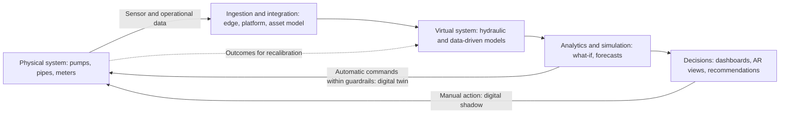

## Introduction

A digital twin is a virtual representation of a physical asset, process or system that is kept up to date with data from its real counterpart and used to understand, predict and improve its behaviour. The idea brings together several technologies studied earlier in this course: IoT sensors supply real-time data, cloud and edge platforms store and process it, analytics and simulation models interpret it, and immersive technologies can make it visible to people. Digital twins have been applied to jet engines, wind turbines, factories, buildings, ports, hospitals and entire cities.

Because the term is fashionable, it is often applied to things that are merely 3D models or dashboards. This lesson provides precise definitions rooted in the work of Michael Grieves, who is widely credited with originating the digital twin concept in the context of product lifecycle management, and the classification by Kritzinger et al. (2018) that distinguishes digital models, digital shadows and digital twins by how data flows between the physical and virtual. It then examines levels and maturity of twins, the data architecture they require, and how to construct and critically evaluate a business case.

## Learning Objectives

- Explain the three core components of a digital twin as described by Grieves.
- Distinguish digital models, digital shadows and digital twins by the automation of data flows.
- Classify digital twins by scope (component, asset, system, process) and by maturity (descriptive to autonomous).
- Apply a business case method to a digital twin proposal, including costs, benefits and sensitivity analysis.
- Evaluate the data, organisational, security and governance challenges of digital twin programmes.

## Prerequisite Knowledge

- IoT architecture and Industrial IoT from Module 3, including predictive maintenance.
- Cloud and edge computing from Module 2.
- The AR/VR lesson in this module, for visualisation concepts.

## Key Terminology

- **Digital twin**: A virtual representation of a physical entity or system that is connected to it by automated, bidirectional data flows and used for monitoring, analysis, simulation and decision support.
- **Physical entity**: The real-world asset, process or system that the twin represents, such as a pump, a production line or a water network.
- **Virtual entity**: The digital representation, which may include geometry, physics-based models, data-driven models and business rules.
- **Digital model**: A digital representation with no automated data exchange with the physical object; updates in either direction are manual.
- **Digital shadow**: A representation automatically updated with data from the physical object, while changes flow back to the physical object only manually.
- **Simulation**: Use of a model to explore how a system would behave under different conditions or decisions.
- **What-if analysis**: Testing alternative scenarios in the virtual environment before acting in the physical world.
- **Building information modelling (BIM)**: A process for creating and managing digital information about a built asset across its lifecycle, often a foundation for building and infrastructure twins.

## Detailed Explanation

### Origins and core components

Grieves introduced the concept in the early 2000s in the context of product lifecycle management, and later articulated it with Vickers (Grieves & Vickers, 2017). The model has three components:

1. **The physical product or system** in real space.
2. **The virtual product or system** in virtual space.
3. **The connections of data and information** that tie the two together: data flowing from physical to virtual, and information and decisions flowing from virtual to physical.

### Models, shadows and twins

Kritzinger et al. (2018) reviewed the manufacturing literature and proposed a classification based on **data integration**:

| Type | Physical → virtual | Virtual → physical | Example |
|---|---|---|---|
| Digital model | Manual | Manual | A 3D design file or a spreadsheet model of a pump, updated by engineers occasionally |
| Digital shadow | Automatic | Manual | A live dashboard fed by sensors; engineers decide and act by hand |
| Digital twin | Automatic | Automatic | The virtual system automatically adjusts set points or schedules on the physical system, within defined limits |

This classification is a valuable analytical tool because many systems marketed as "digital twins" are, strictly, digital shadows. That is not a criticism: a well-designed shadow may deliver most of the value with less risk. But precise terminology clarifies what is being bought and what risks automated control introduces.

### Levels of scope

Twins can be built at different levels, each building on those below:

- **Component twin**: an individual part, such as a bearing or valve.
- **Asset twin**: a complete piece of equipment, such as a pump, turbine or vehicle, combining component data.
- **System twin**: a set of assets working together, such as a production line, a building or a water distribution network.
- **Process or organisation twin**: an end-to-end process or enterprise, such as a supply chain or hospital patient flow, combining operational and business data.

Scope drives complexity. A component twin may need a handful of sensors and one model; a system twin requires integration of many data sources, consistent identifiers and models of interactions among assets.

### Levels of maturity

A second dimension describes what the twin can do, echoing the analytics maturity ladder:

1. **Descriptive**: shows what is happening now (live status and visualisation).
2. **Diagnostic**: explains why something happened (root-cause analysis using historical data).
3. **Predictive**: forecasts what will happen (remaining useful life, demand, failure risk).
4. **Prescriptive**: recommends what to do (optimised schedules or set points) through simulation and optimisation.
5. **Autonomous**: acts automatically within guardrails, closing the loop to the physical system.

Organisations usually progress through these levels gradually, gaining trust in data and models before allowing automated action.

### Data flows and architecture

A digital twin's value depends on a reliable data pipeline:

1. **Sensing and capture**: IoT sensors, control systems, inspection records, maintenance logs, geographic data and business systems.
2. **Connectivity and ingestion**: edge gateways and networks bring data into a platform, often using protocols such as MQTT or OPC UA.
3. **Integration and context**: data is cleaned, time-aligned and linked to a consistent asset model, so that "pump P-104" means the same thing in the sensor feed, the maintenance system and the finance system.
4. **Modelling**: physics-based models (for example hydraulic or thermal models), data-driven models (machine learning) or hybrids represent behaviour.
5. **Analytics and simulation**: the twin evaluates current state, forecasts and what-if scenarios.
6. **Decision and action**: insights are presented to people through dashboards or immersive interfaces, or translated into commands to control systems.
7. **Feedback and learning**: outcomes are compared with predictions to recalibrate models.

Weakness at any stage, such as poor data quality or missing asset identifiers, undermines the whole twin, mirroring the IoT value-chain idea from Module 3.

## Theories, Frameworks and Models

### A digital twin business case framework

A structured business case asks:

- **Decision focus**: Which specific, recurring decisions will the twin improve? (for example, maintenance timing, energy set points, layout changes, network pressure)
- **Value levers**: Reduced downtime, lower energy or material use, avoided capital expenditure through better utilisation, faster design cycles, improved safety, reduced losses.
- **Fidelity required**: How accurate must the model be to support those decisions? Higher fidelity costs more; "good enough" fidelity is often sufficient.
- **Data readiness**: Are sensors, historical data and consistent asset registers available?
- **Costs**: Sensors and connectivity, platform and software licences, model development, integration, skills, change management and ongoing calibration.
- **Risks**: Model error, cyber security of connected control paths, vendor lock-in and organisational resistance.

### Governance and security

Twins that write back to physical systems create a new attack path: compromising the twin could allow manipulation of the real asset. Security principles from the IoT lesson, including segmentation, least privilege, authentication of commands and human approval for high-impact actions, apply with greater force. Data governance must also address ownership of operational data, particularly when a vendor operates the twin platform.

## Worked Example

### Business case for a water distribution network twin

**Illustrative scenario.** *Densu Valley Water Company* (hypothetical) supplies treated water to a growing urban area. A significant share of the water it produces is lost through leaks, bursts, metering inaccuracies and illegal connections, known collectively as non-revenue water. All figures are invented for teaching.

**Baseline assumptions.**

- Production: 100,000 m³ per day.
- Non-revenue water: 40% of production, so 40,000 m³ lost per day.
- Marginal production cost (treatment chemicals, pumping energy): GHS 2 per m³.
- Annual cost of losses at marginal cost: `40,000 × 2 × 365 = GHS 29,200,000`.

**Proposal.** Build a system twin of the distribution network combining a hydraulic model, pressure and flow sensors at district meter areas, smart bulk meters, the asset register and customer billing data. Planned uses: detect leaks faster by comparing measured and modelled flows, simulate pressure-management strategies before implementation, and prioritise pipe replacement.

**Costs.**

- One-off: sensors, installation, modelling, integration and training GHS 8,000,000.
- Annual: platform licences, connectivity, model calibration, analysts and sensor maintenance GHS 1,500,000.

**Benefit estimate.** Reducing non-revenue water from 40% to 35% saves 5,000 m³ per day.

- Annual saving at marginal cost: `5,000 × 2 × 365 = GHS 3,650,000`.
- Net annual benefit: `3,650,000 − 1,500,000 = GHS 2,150,000`.
- Simple payback: `8,000,000 ÷ 2,150,000 ≈ 3.7 years`.

**Sensitivity and critique.**

1. If recovered water can be **sold** to customers with unmet demand at a tariff higher than the marginal production cost, benefits rise considerably; if the utility cannot sell more water, the marginal-cost view is appropriate.
2. If the reduction is only 2 percentage points (2,000 m³ per day), annual saving is `2,000 × 2 × 365 = GHS 1,460,000`, which is *below* the annual running cost, so the twin would not pay back. The business case is highly sensitive to performance.
3. Non-revenue water includes commercial losses, such as illegal connections and billing errors, which a hydraulic twin can help locate but cannot resolve without field teams, enforcement and customer engagement.
4. Additional benefits, such as fewer bursts from better pressure management and deferred capital investment in new production capacity, may strengthen the case but should be quantified separately.
5. A phased approach, starting with a digital shadow in a few district meter areas to prove leak-detection performance, reduces risk before network-wide rollout.

### Classifying three proposals

| Proposal | Data flows | Classification | Comment |
|---|---|---|---|
| A 3D BIM model of a new hospital used during construction | Manual both ways | Digital model | Valuable for design coordination; not yet connected to operations |
| A live dashboard of cold-room temperatures with alarms to staff | Automatic in, manual out | Digital shadow | Most of the value with limited risk |
| A building system that adjusts air conditioning automatically based on simulated occupancy and tariff forecasts | Automatic both ways | Digital twin (prescriptive to autonomous) | Needs guardrails, override controls and cyber security for control paths |

## Ghanaian Business Application

**Illustrative scenario.** *Tema Gateway Logistics* (hypothetical) operates a container terminal and associated inland depot. Congestion at the gate, uneven crane productivity and unpredictable truck arrivals cause delays and demurrage costs for importers and exporters.

**A staged digital twin programme.**

1. **Digital shadow of terminal operations.** Combine data from the terminal operating system, crane telemetry, gate cameras and truck appointment records into a live view of yard occupancy and equipment status (descriptive and diagnostic).
2. **Predictive capability.** Forecast gate queues and yard congestion several hours ahead from vessel schedules and appointment data.
3. **Prescriptive simulation.** Test what-if scenarios, such as changing appointment windows, reallocating cranes or opening an additional gate lane, before implementing them.
4. **Selective automation.** Automatically adjust truck appointment slots offered to hauliers within limits set by managers.

**Context-specific considerations.**

- **Stakeholders.** Value depends on participation by shipping lines, hauliers, customs and port authorities. Data-sharing agreements and clear benefits for each party are essential.
- **Data quality.** Container identifiers, time stamps and equipment codes must be consistent across systems; paper-based or late data entry would undermine the twin.
- **Connectivity and power.** Edge processing at the terminal maintains core functions during outages.
- **Skills.** Operations research, data engineering and simulation skills may need to be developed with universities or partners.
- **Security and data protection.** Integrations with control systems require segmentation, and personal data about drivers is subject to the Data Protection Act, 2012 (Act 843).

Similar staged approaches could apply to a hospital twin of patient flow, a cocoa processing plant twin linking IIoT data to production planning, or a utility's electricity network twin.

## International Case Study

### Virtual Singapore

Virtual Singapore is a national initiative led by Singapore's National Research Foundation together with government agencies, publicly announced in 2014, to build a dynamic three-dimensional digital model of the city-state. The platform combines geometric and semantic data about buildings, terrain and infrastructure with other data sources, and has been described by the Singapore government as a collaborative platform for urban planning, simulation and research, for example to analyse the effects of new developments on their surroundings or to support planning of infrastructure and services.

**Analysis.**

- In Kritzinger et al.'s terms, much of a city-scale platform functions as a **digital model or digital shadow**, with data-rich representation and simulation supporting human decisions rather than automatic control of the city. This illustrates that the label "digital twin" is often applied to system-level representations focused on planning.
- The case shows the importance of **government coordination and data standards**: integrating data from many agencies requires shared formats, identifiers and governance.
- It highlights **privacy and security** concerns: detailed city models and sensor data must be protected and governed carefully.
- For Ghana, lessons include starting with well-defined planning questions (such as flood risk, traffic or infrastructure siting), building on existing geographic data assets such as digital addressing and mapping, and investing in data governance before high-fidelity visualisation.

## Diagram

## Common Misconceptions

- **"A 3D model is a digital twin."** Without automated data flows from the physical system, it is a digital model; a twin requires automated bidirectional connection.
- **"Digital twins must be visually realistic."** Many valuable twins are mathematical models with simple dashboards; fidelity should match the decision, not aesthetics.
- **"Higher fidelity is always better."** Greater fidelity increases cost and complexity; models only need to be accurate enough for the decisions they support.
- **"A digital twin is a product you buy."** It is a capability combining data, models, processes and people, built and maintained over time.
- **"Automating the virtual-to-physical link is always the goal."** Automated control introduces safety and cyber risks; many organisations rightly stop at a digital shadow with human decisions.

## Common Examination Mistakes

- Using "digital twin" for any dashboard without applying the model/shadow/twin distinction.
- Describing technology layers without linking them to specific decisions and value levers.
- Presenting a business case without sensitivity analysis on performance assumptions.
- Ignoring data readiness, asset identifiers and integration effort.
- Overlooking security risks when the twin can command physical assets.

## Critical Thinking Questions

1. At what point should an organisation allow its digital twin to act automatically on physical assets? What guardrails are required?
2. In the water utility example, why might the business case be stronger or weaker depending on whether recovered water can be sold?
3. Is a city-scale "digital twin" for Accra feasible? What data, governance and institutional arrangements would be prerequisites?
4. How does the digital twin concept change the relationship between equipment manufacturers and their customers?
5. Who should own the data and models in a twin operated by a vendor on behalf of a Ghanaian public utility?

## Practical Exercises

1. Classify five systems you know (for example a mobile banking app's monitoring dashboard, a building's BIM file, a ride-hailing dispatch system, a smart thermostat, a production planning spreadsheet) as digital model, shadow or twin. Expected output: a table with the classification and justification based on data flows.
2. Recalculate the worked example assuming the recovered water can be sold at GHS 6 per m³ and that only a 3-percentage-point reduction is achieved. Expected output: annual benefit, net benefit, payback and a one-paragraph recommendation.
3. Design a staged roadmap for a hospital patient-flow twin covering the five maturity levels. Expected output: a table showing, for each level, the data required, the capability gained and one risk.

## Key Takeaways

- Grieves' digital twin model comprises a physical entity, a virtual entity and the data and information connections between them.
- Kritzinger et al. distinguish digital models (manual flows), digital shadows (automatic in, manual out) and digital twins (automatic both ways).
- Twins vary in scope (component, asset, system, process) and maturity (descriptive to autonomous).
- Value depends on improving specific, recurring decisions; data readiness and integration are frequently the hardest parts.
- Business cases are highly sensitive to performance assumptions, and automated control introduces safety and cyber risks that require guardrails.

## Further Reading

- Grieves, M., & Vickers, J. (2017). Digital twin: Mitigating unpredictable, undesirable emergent behavior in complex systems. In F.-J. Kahlen, S. Flumerfelt, & A. Alves (Eds.), *Transdisciplinary perspectives on complex systems* (pp. 85–113). Springer.
- Kritzinger, W., Karner, M., Traar, G., Henjes, J., & Sihn, W. (2018). Digital twin in manufacturing: A categorical literature review and classification. *IFAC-PapersOnLine, 51*(11), 1016–1022.
- Tao, F., Zhang, H., Liu, A., & Nee, A. Y. C. (2019). Digital twin in industry: State-of-the-art. *IEEE Transactions on Industrial Informatics, 15*(4), 2405–2415.

## Video Resources

- [IBM Think](https://www.ibm.com/think) — IBM. Explainers on digital twins, asset management and simulation.
- [Microsoft Learn](https://learn.microsoft.com/) — Microsoft. Documentation and learning paths on building digital twin solutions with cloud services.
- [Google Cloud Learn](https://cloud.google.com/learn) — Google Cloud. Introductions to data integration and analytics underpinning digital twins.

## Revision Summary

A digital twin is a virtual representation connected to a physical entity by automated, bidirectional data flows and used for monitoring, prediction, simulation and decision support (Grieves & Vickers, 2017). Kritzinger et al. (2018) distinguish digital models (manual flows both ways), digital shadows (automatic physical-to-virtual, manual back) and digital twins (automatic both ways). Twins range in scope from components to whole processes and in maturity from descriptive to autonomous. Their value depends on improving specific decisions, and business cases, such as reducing non-revenue water, must be tested for sensitivity to performance, data readiness and the risks of automated control.

- Three components: physical, virtual, data connections.
- Model, shadow, twin: classify by automation of data flows.
- Scope: component, asset, system, process.
- Maturity: descriptive, diagnostic, predictive, prescriptive, autonomous.
- Fidelity should match the decision.
- Guardrails and security for virtual-to-physical control.
