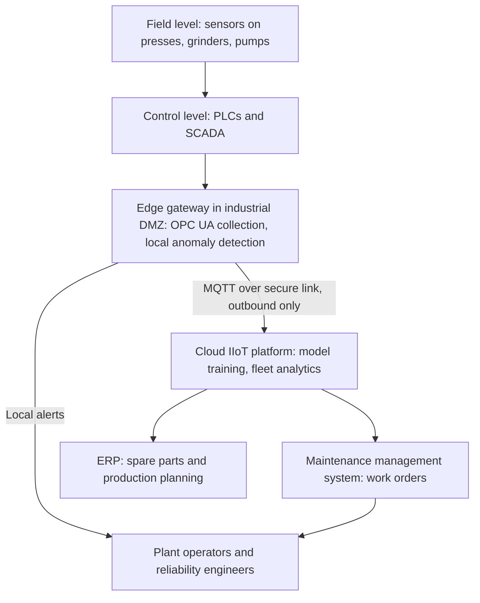

## Introduction

When IoT moves from homes and offices into factories, mines, power networks and ports, the stakes change. A failed smart speaker is an inconvenience; a failed compressor in a cocoa-processing plant can halt production for days, spoil inventory and endanger workers. Industrial IoT (IIoT) applies sensing, connectivity and analytics to industrial assets and processes in order to improve uptime, quality, safety and energy efficiency. It sits at the heart of what is often called Industry 4.0, a term that originated in Germany in the early 2010s to describe the digitalisation of manufacturing.

This lesson explains what makes IIoT distinctive, particularly the convergence of information technology (IT) with operational technology (OT). It then focuses on predictive maintenance, one of the most widely cited sources of IIoT value, with a worked business case. Finally, it broadens the view to "smart systems" such as smart grids, smart agriculture and smart logistics, where many connected assets are coordinated to optimise a whole system rather than individual machines. The Rolls-Royce aero-engine case illustrates how IIoT data can underpin a different business model.

## Learning Objectives

- Explain the differences between consumer IoT and Industrial IoT, including IT/OT convergence.
- Compare reactive, preventive, condition-based and predictive maintenance strategies.
- Apply a cost comparison to justify or reject a predictive maintenance investment.
- Analyse how smart systems in utilities, agriculture and logistics create value through coordination.
- Evaluate the organisational, data and security challenges of IIoT adoption in Ghanaian industry.

## Prerequisite Knowledge

- IoT architecture, connectivity and security from the earlier lessons in this module.
- Edge computing concepts from Module 2.

## Key Terminology

- **Industrial IoT (IIoT)**: The application of connected sensors, actuators, analytics and networks to industrial equipment and processes in sectors such as manufacturing, energy, mining, transport and utilities.
- **Operational technology (OT)**: Hardware and software that monitors and controls physical devices and processes, such as programmable logic controllers (PLCs) and SCADA systems.
- **SCADA**: Supervisory control and data acquisition systems that collect data from and send control commands to geographically dispersed industrial assets.
- **Industry 4.0**: A term for the digital transformation of manufacturing through cyber-physical systems, IIoT, data analytics and automation.
- **Predictive maintenance**: Maintenance scheduled on the basis of data-driven forecasts of when an asset is likely to fail, so that intervention occurs just before failure.
- **Condition-based maintenance**: Maintenance triggered when monitored indicators, such as vibration or temperature, cross defined thresholds.
- **Overall equipment effectiveness (OEE)**: A manufacturing metric combining availability, performance and quality to show how effectively equipment is used.
- **Smart system**: A system in which many connected components are monitored and coordinated using data and automation to optimise outcomes for the whole system.

## Detailed Explanation

### How IIoT differs from consumer IoT

| Dimension | Consumer IoT | Industrial IoT |
|---|---|---|
| Primary goal | Convenience, entertainment, lifestyle | Uptime, safety, quality, efficiency |
| Consequence of failure | Inconvenience, privacy harm | Production loss, injury, environmental damage |
| Asset lifetime | A few years | Often decades |
| Environment | Homes, offices | Heat, dust, vibration, moisture, electromagnetic interference |
| Priority in security | Confidentiality and privacy | Availability and safety first, then integrity |
| Typical protocols | Wi-Fi, Bluetooth, cloud APIs | Industrial protocols such as Modbus and OPC UA, plus MQTT and LPWAN |
| Integration | Mobile apps | Control systems, ERP, maintenance management systems |

### IT/OT convergence

Historically, OT systems in factories and utilities were isolated from corporate IT networks. They used specialised protocols, were managed by engineers rather than IT staff and prioritised continuous operation; patching a controller could mean stopping a production line. IIoT connects these systems to IT networks and the cloud so that operational data can feed analytics and business systems. This brings major benefits but also risks: OT devices designed for isolated networks may lack authentication or encryption, and the cultures of engineering and IT teams differ.

A common reference for organising industrial networks is the layered model associated with the ISA-95 standard and the Purdue model, which separates field devices and controllers at lower levels from supervisory systems, manufacturing operations and enterprise IT at higher levels, with controlled boundaries between them. IIoT designs often add an industrial "demilitarised zone" and edge gateways that collect data from OT systems and pass it upward without allowing inbound connections from the internet to controllers.

### Protocols and data

Older industrial protocols such as Modbus were designed for reliability on closed networks, not security. **OPC UA** (Open Platform Communications Unified Architecture) is a widely adopted standard that provides structured information models and built-in security features, enabling equipment from different vendors to share data in a consistent way. **MQTT** is frequently used to move data from edge gateways to cloud platforms. Data quality is a recurrent challenge: sensor time stamps must be synchronised, units consistent and context (which machine, which product batch) recorded.

### Maintenance strategies

Maintenance is a major cost in asset-intensive industries, which is why predictive maintenance is so often the first IIoT use case.

1. **Reactive (run-to-failure).** Repair only after breakdown. Cheap to plan, but failures are unplanned, often costly and may cause secondary damage.
2. **Preventive (time-based).** Service at fixed intervals or operating hours. Reduces failures but can replace parts that still have useful life and may not prevent random failures.
3. **Condition-based.** Monitor indicators and act when a threshold is crossed, such as vibration amplitude exceeding a limit.
4. **Predictive.** Use historical and real-time data, often with statistical or machine-learning models, to estimate remaining useful life and schedule intervention just before failure.

A useful concept is the **P-F interval**: the time between the point at which a potential failure becomes detectable (P) and functional failure (F). Sensors that detect early signs, such as subtle vibration changes in a bearing, lengthen the usable P-F interval and give planners time to order parts and schedule work during planned downtime.

Predictive maintenance is not always justified. For cheap, non-critical assets with no safety implications, run-to-failure can be the rational choice. The decision depends on failure consequences, detectability and the cost of monitoring.

## Theories, Frameworks and Models

### Smart systems and systems thinking

A smart system goes beyond monitoring single assets. It coordinates many components to optimise the whole.

- **Smart grids** use smart meters, sensors on transformers and lines, and automated controls to balance supply and demand, detect faults and outages quickly, reduce technical and commercial losses and integrate distributed generation such as solar.
- **Smart agriculture** combines soil and weather sensors, satellite or drone imagery and decision tools to optimise irrigation, fertiliser and pest control at field level and to provide traceability for buyers.
- **Smart logistics** uses GPS trackers, temperature loggers and analytics to optimise routes, monitor cold chains and predict arrival times across fleets and warehouses.
- **Smart buildings** coordinate lighting, air conditioning, access control and energy systems based on occupancy and tariffs.

Porter and Heppelmann (2014) described how smart, connected products evolve through four capabilities: **monitoring**, **control**, **optimisation** and **autonomy**, each building on the previous one. Their framework helps managers see that IIoT may change not only operations but competition, enabling new services, data-based business models and different relationships with customers.

### From products to services

IIoT data allows manufacturers to sell **outcomes** rather than products, for example charging per hour of equipment availability rather than for the machine itself. This "servitisation" shifts risk to the supplier, who is then motivated to maximise reliability, and depends on continuous data from the asset.

## Worked Example

### Business case for predictive maintenance

**Illustrative scenario.** *Kasoa Beverages Ltd* (hypothetical) runs a bottling plant with 10 critical pumps and motors. All figures are invented for teaching.

**Assumptions:**

- An unplanned failure costs GHS 80,000 (lost production, overtime, emergency parts, spoiled product).
- A planned repair when a problem is detected early costs GHS 15,000.

**Option 1: Reactive.** 12 failures a year. Annual cost: `12 × 80,000 = GHS 960,000`.

**Option 2: Preventive.** Scheduled servicing costs GHS 150,000 a year and reduces failures to 6. Annual cost: `150,000 + (6 × 80,000) = GHS 630,000`.

**Option 3: Predictive.** One-off investment of GHS 300,000 for vibration and temperature sensors, edge gateways and integration. Annual running cost of GHS 200,000 (platform subscription, connectivity, a reliability analyst's time, sensor maintenance). Models detect 8 developing faults early (planned repairs) and 2 failures still occur unexpectedly. Annual cost: `200,000 + (2 × 80,000) + (8 × 15,000) = 200,000 + 160,000 + 120,000 = GHS 480,000`.

**Comparison.**

| Strategy | Annual cost (GHS) | Saving vs preventive (GHS) |
|---|---|---|
| Reactive | 960,000 | −330,000 |
| Preventive | 630,000 | 0 |
| Predictive | 480,000 | 150,000 |

**Payback on the one-off investment, compared with preventive maintenance:** `300,000 ÷ 150,000 = 2 years`.

**Critical evaluation.**

1. The case is highly sensitive to the **detection rate**. If models detect only 4 faults early, unexpected failures rise and the saving shrinks; the business case should be tested across a range of assumptions.
2. Predictive maintenance needs **historical failure data** to train models. A plant without maintenance records may need a period of condition-based monitoring first.
3. Benefits beyond the table, such as improved safety, better OEE and reduced spare-parts inventory, may strengthen the case; costs such as change management and OT security controls may weaken it.
4. A sensible path is a **pilot on the most critical assets**, measuring actual detection performance before plant-wide rollout.

## Ghanaian Business Application

**Illustrative scenario.** *Ashanti Cocoa Processing Company* (hypothetical) grinds cocoa beans into liquor, butter and powder for export. Its roasting, grinding and pressing lines run continuously during the main crop season, and an unplanned stoppage can disrupt export shipments.

**IIoT opportunities.**

- **Predictive maintenance** on presses and grinders using vibration, temperature and motor-current sensors, with edge analytics on site and cloud-based model training.
- **Energy monitoring** to identify which lines consume most electricity and to schedule energy-intensive operations efficiently; given the cost and reliability of power supply, data on generator use and power quality can be especially valuable.
- **Quality and traceability**: linking roasting temperature profiles and batch data to bean lots, supporting buyers' demands for traceability back to farming communities, which connects to wider cocoa supply chain initiatives.

**Challenges in the Ghanaian context.**

- **Legacy equipment**: older machines may lack digital interfaces, requiring retrofit sensors.
- **Skills**: reliability engineers with data analytics skills are scarce; partnerships with technical universities or vendors may be needed.
- **Power quality**: voltage fluctuations can damage sensitive electronics and corrupt data; protected power supplies are required.
- **Security**: connecting OT to the cloud requires segmentation and careful remote-access controls, consistent with the IoT security lesson.
- **Change management**: maintenance teams must trust and act on alerts; involving them in pilot design improves adoption.

Smart systems also apply to Ghanaian utilities. Electricity distribution companies face technical and commercial losses; smart metering and network sensors can help locate losses, detect tampering and speed up outage response, though success depends on billing integration, customer engagement and governance.

## International Case Study

### Rolls-Royce: engine health monitoring and power by the hour

Rolls-Royce, the British aero-engine manufacturer, is widely cited for its long-standing approach of selling engine availability as a service. Under arrangements often described by the phrase "Power by the Hour", and later through its TotalCare service agreements, airlines pay according to the hours an engine flies rather than buying maintenance on a time-and-materials basis. Rolls-Royce has described how data from sensors on its engines is transmitted and analysed to monitor engine health, helping it to plan maintenance, detect developing problems and manage engines across its customers' fleets.

**Analysis.**

- The case illustrates **servitisation**: data from connected assets makes it possible to sell an outcome (flying hours) rather than a product.
- Incentives change. Because the manufacturer bears more of the cost of unreliability, it has strong reasons to invest in predictive maintenance and design improvements.
- It shows the **monitoring, control, optimisation and autonomy** progression described by Porter and Heppelmann: health monitoring enables optimised maintenance planning across a fleet.
- Data governance becomes central: contracts must clarify who owns and can use operational data and how it is protected.
- For Ghanaian firms the transferable lesson is that suppliers of generators, pumps, cold rooms or agricultural machinery could offer availability-based contracts supported by IIoT, while buyers should negotiate data access and service-level terms carefully.

## Diagram

## Common Misconceptions

- **"IIoT is consumer IoT in a factory."** IIoT prioritises safety and availability, integrates with control systems, uses industrial protocols and must survive harsh environments and long asset lives.
- **"Predictive maintenance is always better than preventive maintenance."** It pays only where failure consequences are significant, failures are detectable and data supports reliable models.
- **"Connecting OT to the internet is harmless if data only flows out."** Poorly designed connections can create inbound paths to controllers; segmentation and outbound-only designs need deliberate engineering.
- **"Smart systems are about installing many sensors."** Smart systems create value through coordination and decisions across the whole system, not sensor counts.
- **"Machine learning removes the need for maintenance expertise."** Domain experts are needed to interpret alerts, label failure data and decide on interventions.

## Common Examination Mistakes

- Describing predictive maintenance without comparing it to alternative strategies or quantifying the business case.
- Omitting IT/OT convergence and its security implications when discussing IIoT.
- Presenting assumed figures without sensitivity analysis.
- Treating "smart city" or "smart grid" as slogans without explaining what is coordinated and how value is created.
- Ignoring local constraints such as legacy equipment, power quality and skills in Ghanaian applications.

## Critical Thinking Questions

1. For a Ghanaian manufacturer with limited maintenance records, should the first step be predictive maintenance or condition-based monitoring? Justify your answer.
2. Who should own the operational data generated by a machine leased from a foreign supplier under an availability contract?
3. How does IT/OT convergence change the role of the IT department in a manufacturing firm?
4. Can smart metering reduce electricity distribution losses in Ghana without addressing governance and billing processes? Explain.
5. Porter and Heppelmann describe a progression towards autonomy. What risks arise when industrial systems take autonomous actions?

## Practical Exercises

1. Recalculate the worked example assuming the predictive system detects only 5 faults early and 5 failures still occur unexpectedly. Expected output: revised annual cost, saving against preventive maintenance, payback period and a recommendation.
2. For a hospital's critical equipment (oxygen plant, generators, cold-chain refrigerators, lifts), choose a maintenance strategy for each. Expected output: a table with the strategy and a justification based on failure consequences and detectability.
3. Map a smart-logistics system for a Ghanaian fresh-produce exporter from farm collection to port. Expected output: a diagram showing sensors, connectivity, platform and decisions, and a list of three performance indicators.

## Key Takeaways

- IIoT applies IoT to industrial assets, prioritising availability and safety and requiring integration with operational technology.
- IT/OT convergence unlocks data value but introduces security and cultural challenges that require segmentation and joint governance.
- Maintenance strategies range from reactive to predictive; predictive maintenance is justified when failure consequences are high and failures are detectable.
- Business cases for IIoT must be tested for sensitivity to detection rates, data availability and change-management costs.
- Smart systems create value by coordinating many components, and IIoT data enables service-based business models such as paying for availability.

## Further Reading

- Porter, M. E., & Heppelmann, J. E. (2014). How smart, connected products are transforming competition. *Harvard Business Review, 92*(11), 64-88.
- Boyes, H., Hallaq, B., Cunningham, J., & Watson, T. (2018). The industrial internet of things (IIoT): An analysis framework. *Computers in Industry, 101*, 1-12.
- Kagermann, H., Wahlster, W., & Helbig, J. (2013). *Recommendations for implementing the strategic initiative INDUSTRIE 4.0*. acatech: National Academy of Science and Engineering.

## Video Resources

- [Microsoft Learn](https://learn.microsoft.com/): Microsoft. Learning paths on industrial IoT, edge and predictive maintenance solutions.
- [IBM Think](https://www.ibm.com/think): IBM. Explainers on predictive maintenance, asset management and Industry 4.0.
- [Google Cloud Learn](https://cloud.google.com/learn): Google Cloud. Introductions to IoT data processing and analytics.

## Revision Summary

Industrial IoT applies sensing, connectivity and analytics to industrial assets, prioritising safety and availability and requiring convergence of IT with operational technology such as PLCs and SCADA, with layered, segmented networks and secure edge gateways. Maintenance strategies progress from reactive through preventive and condition-based to predictive, and predictive maintenance is justified when failure costs are high, failures are detectable and data supports reliable models. Smart systems coordinate many connected components in grids, agriculture, logistics and buildings, and IIoT data enables outcome-based business models, as in Rolls-Royce's flying-hours approach.

- IIoT priorities: safety, availability, integrity.
- IT/OT convergence needs segmentation and joint governance.
- Reactive, preventive, condition-based, predictive.
- Test business cases for detection-rate sensitivity.
- Smart systems: monitoring, control, optimisation, autonomy.
- Servitisation: sell outcomes, not products.
