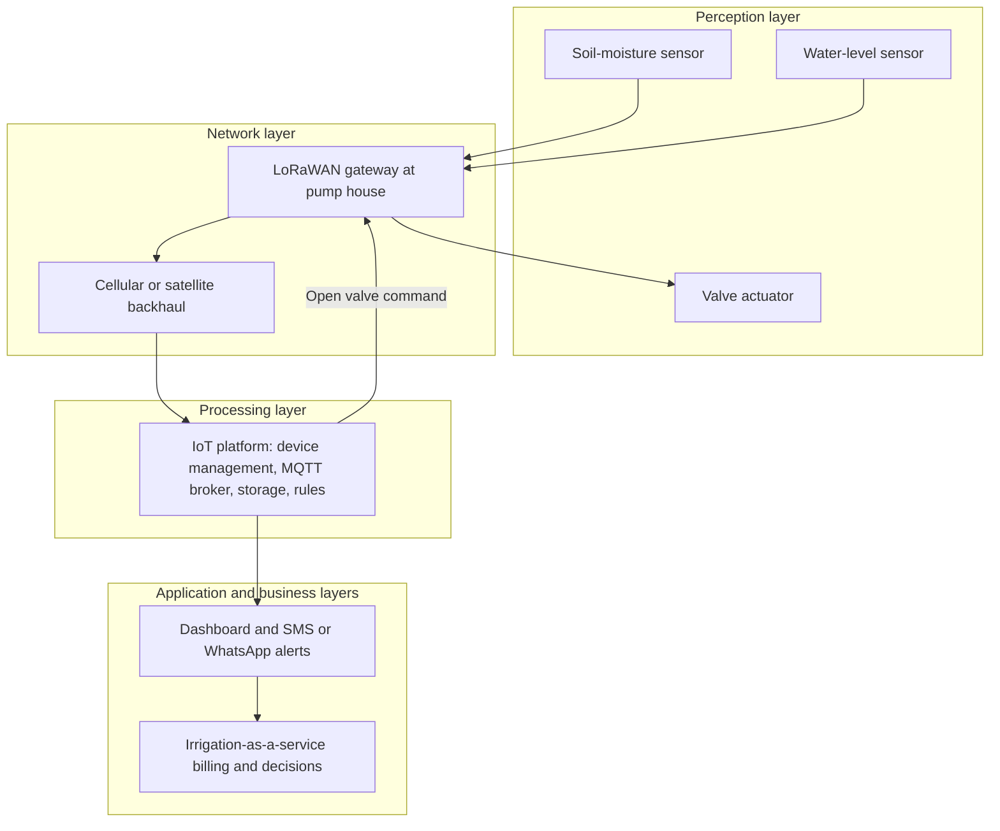

## Introduction

The Internet of Things (IoT) extends information systems beyond computers and phones into the physical world. Soil-moisture probes in a farm, temperature loggers in a vaccine refrigerator, smart electricity meters, GPS trackers on delivery trucks and vibration sensors on factory motors all generate data that can be analysed and acted upon. The phrase "Internet of Things" is commonly attributed to Kevin Ashton, who used it in 1999 when describing the use of radio-frequency identification (RFID) in supply chains. Since then, falling costs of sensors, microcontrollers and wireless connectivity have made it economically viable to instrument almost anything.

For business analysts, the challenge is not to understand electronics in detail but to design or evaluate IoT solutions that are fit for purpose. That requires a clear mental model of how IoT systems are structured, what devices can sense and do, and which communication technology suits a given combination of range, data volume, power supply and cost. This lesson builds that model, with particular attention to low-power wide-area networks (LPWAN) that are well suited to agriculture, utilities and logistics in Ghana.

## Learning Objectives

- Explain the three-layer IoT architecture (perception, network, application) and extended five-layer variants.
- Distinguish sensors, actuators, gateways and platforms and describe their roles.
- Compare Wi-Fi, Bluetooth Low Energy, Zigbee, LoRaWAN, NB-IoT, LTE-M and cellular broadband on range, data rate, power, cost and licensing.
- Apply a structured selection process to choose connectivity for a business IoT deployment.
- Evaluate the trade-offs of an IoT design in terms of battery life, data volume and total cost of ownership.

## Prerequisite Knowledge

- Cloud service models and edge computing from Module 2.
- Basic understanding of networks, bandwidth and latency.

## Key Terminology

- **Internet of Things (IoT)**: A network of physical objects embedded with sensors, actuators, processing and connectivity that collect and exchange data with other devices and systems.
- **Sensor**: A device that detects a physical quantity, such as temperature, humidity, motion, location or vibration, and converts it into a signal or data.
- **Actuator**: A device that acts on the physical world in response to a command, such as a valve, motor, relay, lock or alarm.
- **Gateway**: A device that aggregates data from local IoT devices, translates between protocols and forwards data to a network or cloud platform.
- **Low-power wide-area network (LPWAN)**: A class of wireless technologies designed for long-range, low-data-rate, low-power communication, such as LoRaWAN, NB-IoT and LTE-M.
- **MQTT**: A lightweight publish/subscribe messaging protocol widely used to send IoT data from devices to brokers and applications.
- **Duty cycle**: The proportion of time a device is active (sensing or transmitting) rather than sleeping; a key determinant of battery life.
- **Licensed spectrum**: Radio frequencies allocated to a specific operator by a regulator, as used by cellular networks; contrasted with unlicensed bands that anyone may use within technical rules.

## Detailed Explanation

### The three-layer architecture

The most widely taught model divides an IoT system into three layers.

1. **Perception layer (device or sensing layer).** The physical devices that sense and act: sensors, actuators, RFID tags, cameras and the microcontrollers that read them. This layer identifies objects and collects data about the physical environment.
2. **Network layer (transport layer).** The communication technologies and devices that carry data from the perception layer to processing systems: short-range radios, gateways, LPWAN, cellular networks, the internet and associated protocols.
3. **Application layer.** The services that deliver value to users: dashboards, alerts, analytics, integration with business systems such as enterprise resource planning (ERP), and domain applications such as smart agriculture or fleet management.

Many authors extend this to **five layers** by inserting a **processing (middleware) layer** between the network and application layers, covering data storage, device management, stream processing and analytics, and adding a **business layer** on top that covers business models, governance and decision-making. The five-layer view is valuable for business students because it reminds designers that data only creates value when it changes decisions and processes.

### Sensors and actuators

Sensors measure; actuators act. A smart irrigation system uses soil-moisture sensors (perception), sends readings over a radio network (network), applies a rule or model ("if moisture below threshold and no rain forecast, irrigate for 20 minutes") in an IoT platform (processing) and commands a valve actuator to open (perception again). The loop from sensing to acting is the essence of IoT value.

Important sensor properties for business design include **accuracy** (closeness to the true value), **precision** (consistency of repeated readings), **resolution**, **sampling frequency**, **calibration needs** and **environmental robustness**. A cheap sensor that drifts out of calibration in heat and dust may produce misleading data that is worse than none, because managers trust it.

### Gateways, platforms and protocols

Many low-power devices cannot connect directly to the internet. A **gateway** collects their transmissions, converts protocols and forwards data. **IoT platforms**, offered by major cloud providers and specialist vendors, provide device registration, secure identity, over-the-air updates, message brokering, storage and analytics. Lightweight protocols such as **MQTT** (publish/subscribe through a broker) and **CoAP** (a web-like request/response protocol for constrained devices) reduce overhead compared with full web protocols.

### Connectivity options

The choice of connectivity is often the most consequential design decision, because it determines battery life, coverage, running costs and what data can be sent.

| Technology | Typical range | Data rate | Power use | Spectrum and network | Typical business uses |
|---|---|---|---|---|---|
| Wi-Fi (IEEE 802.11) | Tens of metres indoors | High | High | Unlicensed; private access points | Cameras, in-building devices with mains power |
| Bluetooth Low Energy | Short, typically tens of metres | Low to moderate | Very low | Unlicensed; phone or gateway as hub | Wearables, asset tags, beacons, retail proximity |
| Zigbee (IEEE 802.15.4) | Short per hop; extended by mesh | Low | Low | Unlicensed; mesh network with coordinator | Building automation, smart lighting, home sensors |
| LoRaWAN | Several kilometres, longer in open rural areas | Very low | Very low | Unlicensed sub-GHz; private or community gateways | Agriculture, water meters, environmental monitoring |
| NB-IoT | Kilometres, with good indoor penetration | Very low | Very low | Licensed; operated by mobile network operators | Utility meters, fixed sensors in buildings or underground |
| LTE-M | Kilometres | Low to moderate | Low | Licensed; mobile operators; supports mobility | Trackers, wearables, mobile assets |
| 4G/5G cellular broadband | Kilometres | High | High | Licensed; mobile operators | Video, vehicles, high-data mobile equipment |

The table shows a fundamental trade-off: **range, data rate and battery life cannot all be maximised at once**. LPWAN technologies achieve long range and long battery life by sending small amounts of data infrequently. Wi-Fi and cellular broadband offer high data rates but consume more power. Licensed technologies (NB-IoT, LTE-M) depend on operator coverage and subscription fees but offer managed quality of service; unlicensed LoRaWAN lets an organisation build its own network where coverage does not exist, at the cost of owning gateways.

## Theories, Frameworks and Models

### A connectivity selection framework

A structured selection process asks six questions in order:

1. **What must be sent, and how often?** A temperature reading every 15 minutes is a few bytes; a video stream is megabits per second.
2. **How is the device powered?** Mains power makes Wi-Fi or cellular feasible; battery or solar power favours LPWAN or BLE.
3. **Where are the devices, and do they move?** Indoor, rural, underground or mobile assets imply different coverage and mobility needs.
4. **What coverage already exists?** Is there operator NB-IoT or LTE-M coverage, Wi-Fi on site or a community LoRaWAN network?
5. **What latency and reliability are required?** Alarm signals may need confirmation and fast delivery; periodic readings may tolerate delay or occasional loss.
6. **What is the total cost of ownership over the device lifetime?** Include hardware, gateways, subscriptions, installation, battery replacement visits and device management.

### Value-chain view

A complementary business framework treats IoT as a value chain: **sense → transmit → store and process → analyse → decide → act**. Value leaks at every weak link. Excellent sensors are wasted if connectivity is unreliable, and perfect data is wasted if no one changes a decision because of it. Analysts should ask where in the chain the weakest link lies.

## Worked Example

### Battery life and data volume for a farm sensor

**Illustrative scenario.** A sensor node measures soil moisture every 15 minutes and transmits a 20-byte reading. It runs on a battery pack with a usable capacity of 2,500 milliamp-hours (mAh). All electrical figures are simplified, illustrative assumptions.

**Step 1: Data volume.**
Readings per day: `24 × 4 = 96`. Data per day: `96 × 20 bytes = 1,920 bytes`, roughly 2 kilobytes. This tiny volume suits LPWAN.

**Step 2: LPWAN energy use.** Assume sleep current of 0.01 mA, and each transmission draws 40 mA for 1 second.

- Transmission charge per hour: `4 transmissions × 40 mA × 1 s = 160 mA·s`. Converting to mAh: `160 ÷ 3,600 ≈ 0.044 mAh`.
- Sleep charge per hour: `0.01 mA × 1 h = 0.01 mAh`.
- Total per hour: `≈ 0.054 mAh`.
- Battery life: `2,500 ÷ 0.054 ≈ 46,000 hours ≈ 5.3 years`.

**Step 3: Wi-Fi energy use.** Assume each transmission (including joining the network) draws 200 mA for 5 seconds.

- Transmission charge per hour: `4 × 200 × 5 = 4,000 mA·s ≈ 1.11 mAh`.
- Total with sleep: `≈ 1.12 mAh` per hour.
- Battery life: `2,500 ÷ 1.12 ≈ 2,230 hours ≈ 93 days`.

**Step 4: Business interpretation.** With 500 sensors spread across farms, Wi-Fi would mean around four battery-replacement visits per sensor per year, which is roughly 2,000 field visits annually, whereas LPWAN would need replacement only once in about five years. The labour and transport cost of visits, not the hardware, dominates total cost of ownership. LPWAN is the clear choice unless data needs grow substantially.

## Ghanaian Business Application

**Illustrative scenario.** *Afram Plains Irrigation Services* (hypothetical) manages irrigation for commercial vegetable and maize farmers near the Volta Lake. Farms are spread over a wide area with patchy mobile coverage, no Wi-Fi and limited grid power. Water pumping costs (fuel or electricity) are a major expense, and over-watering wastes both water and fertiliser.

**Design using the selection framework.**

- **Data:** small, periodic soil-moisture and water-level readings; occasional valve commands.
- **Power:** battery and small solar panels for sensors; mains or generator power at the pump house.
- **Location:** fixed devices across open farmland several kilometres from the pump house.
- **Coverage:** mobile coverage is unreliable away from main roads, so an operator-dependent technology is risky.
- **Choice:** a private **LoRaWAN** network with one or two gateways mounted on a tall structure at the pump house, which has power and a cellular or satellite backhaul link to an IoT cloud platform.
- **Application layer:** an SMS and WhatsApp alert service for farm managers, a web dashboard for the company and rules that schedule pumping when moisture falls below crop-specific thresholds.

**Business layer.** The company can sell "irrigation as a service" priced per hectare, with savings from reduced pumping shared with farmers. Success depends on non-technical factors: training farm staff to trust and respond to alerts, local technicians to maintain sensors, theft prevention for equipment, and clear agreements about who owns farm data.

## International Case Study

### The Things Network: community-built LoRaWAN

The Things Network is a community initiative that began in Amsterdam in 2015, when its founders and volunteers set out to provide city-wide LoRaWAN coverage using a small number of gateways contributed by members. The model spread to many cities worldwide, with individuals, universities, companies and municipalities installing gateways that anyone can use under a fair-use policy. The initiative is associated with a company, The Things Industries, which offers commercial LoRaWAN network services.

**Analysis.**

- The case shows how **unlicensed LPWAN** allows organisations and communities to build their own wide-area IoT coverage without waiting for operators, which is particularly relevant where commercial IoT coverage is limited.
- It illustrates the economics of LPWAN: a single gateway can serve many low-power devices over several kilometres, so infrastructure cost per device can be low.
- It also reveals limitations. Community networks offer no service-level guarantees, coverage depends on volunteer gateways, and unlicensed spectrum can suffer interference. Businesses with critical applications may prefer private gateways or operator-managed NB-IoT.
- For Ghana, the transferable insight is that universities, municipal assemblies, agricultural development programmes or industry associations could co-invest in shared LPWAN infrastructure, lowering the barrier for small firms to adopt IoT.

## Diagram

## Common Misconceptions

- **"IoT is just sensors connected to the internet."** Value requires the full chain from sensing to action, including processing, applications and changed business decisions.
- **"The fastest connectivity is always the best."** High data rates consume more power; for small periodic readings, LPWAN usually gives far lower total cost of ownership.
- **"LoRaWAN and NB-IoT are the same."** LoRaWAN uses unlicensed spectrum and can be privately deployed; NB-IoT uses licensed spectrum and is operated by mobile network operators.
- **"Bluetooth cannot be used for business IoT."** Bluetooth Low Energy is widely used for asset tags, beacons and wearables, often with phones or gateways as hubs.
- **"Once installed, sensors can be left alone."** Sensors require calibration, battery management, firmware updates and physical maintenance throughout their lifecycle.

## Common Examination Mistakes

- Naming the layers without explaining what happens in each or giving an example flow.
- Comparing connectivity options only by range, ignoring power, data rate, licensing and cost.
- Recommending Wi-Fi for remote battery-powered sensors without considering battery life.
- Ignoring the business layer: who pays, who acts on data and how value is captured.
- Presenting precise range figures as fixed facts; actual range depends on terrain, antennas and interference.

## Critical Thinking Questions

1. In rural Ghana, should an agribusiness build a private LoRaWAN network or wait for operator NB-IoT coverage? What factors would change your answer?
2. Why might adding more sensors reduce the value of an IoT system rather than increase it?
3. Who should own data collected by sensors on a farmer's land when the system is provided by a service company?
4. How does the five-layer IoT model help managers avoid "technology looking for a problem"?
5. What are the risks of designing an IoT system around a single proprietary platform?

## Practical Exercises

1. Repeat the worked example for a sensor that reports every 5 minutes. Expected output: recalculated battery life for LPWAN and Wi-Fi and a sentence on how reporting frequency affects design.
2. Choose a connectivity technology for each of four scenarios: vaccine refrigerators in district clinics, GPS trackers on inter-city buses, water meters in an apartment block and smart lighting in an office. Expected output: a table with the technology chosen and a justification using the six-question framework.
3. Draw a three-layer architecture diagram for a cold-chain monitoring system for fish distribution from Tema. Expected output: a labelled diagram showing devices, connectivity, platform and application, with one business decision the data supports.

## Key Takeaways

- IoT systems are commonly described in three layers (perception, network, application) or five (adding processing and business).
- Sensors measure, actuators act, gateways translate and forward, and platforms manage devices and data.
- Connectivity trades off range, data rate, power and cost; no technology maximises all four.
- LPWAN technologies such as LoRaWAN and NB-IoT suit small, infrequent data from battery-powered devices over long distances.
- Total cost of ownership, including maintenance visits, usually matters more than device price.

## Further Reading

- Atzori, L., Iera, A., & Morabito, G. (2010). The Internet of Things: A survey. *Computer Networks, 54*(15), 2787-2805.
- Al-Fuqaha, A., Guizani, M., Mohammadi, M., Aledhari, M., & Ayyash, M. (2015). Internet of Things: A survey on enabling technologies, protocols, and applications. *IEEE Communications Surveys & Tutorials, 17*(4), 2347-2376.
- Raza, U., Kulkarni, P., & Sooriyabandara, M. (2017). Low power wide area networks: An overview. *IEEE Communications Surveys & Tutorials, 19*(2), 855-873.

## Video Resources

- [ITU](https://www.itu.int/): International Telecommunication Union. The UN agency for information and communication technologies, with material on IoT standards and spectrum.
- [Microsoft Learn](https://learn.microsoft.com/): Microsoft. Learning paths introducing IoT solution architecture and device connectivity.
- [IBM Think](https://www.ibm.com/think): IBM. Explainers on the Internet of Things and its business uses.

## Revision Summary

IoT systems connect physical objects to information systems. The three-layer architecture comprises perception (sensors and actuators), network (connectivity and gateways) and application (services for users); five-layer models add processing and business layers. Connectivity selection balances range, data rate, power, licensing and cost: Wi-Fi and cellular broadband offer high data rates at high power; BLE and Zigbee offer short-range low power; LPWAN technologies such as LoRaWAN (unlicensed, privately deployable) and NB-IoT and LTE-M (licensed, operator-run) offer long range and long battery life for small data. Battery life and maintenance visits often dominate total cost of ownership.

- Perception, network, application (plus processing and business).
- Sensors measure; actuators act; gateways translate.
- No technology maximises range, data rate and battery life together.
- LoRaWAN unlicensed; NB-IoT and LTE-M licensed.
- Duty cycle drives battery life.
- Value requires decisions and actions, not just data.
