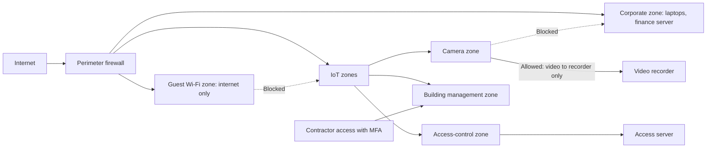

## Introduction

Every connected device is a computer, and every computer can be attacked. IoT devices are often cheap, numerous, physically exposed and left unattended for years. Many are designed by manufacturers who compete mainly on price and features, ship with weak default settings and offer limited or no software updates. Once deployed, they are frequently forgotten by the IT department because they were bought by facilities, operations or marketing teams. The result is a large and growing attack surface that can be used to steal data, disrupt operations, harm people or launch attacks against others.

This lesson examines why IoT security is distinctive, introduces the concept of **device lifecycle security** from design to decommissioning, and presents practical controls: unique credentials, secure updates, network segmentation, monitoring and supplier governance. The Mirai botnet of 2016, one of the most thoroughly documented IoT security incidents, shows how simple weaknesses in millions of devices can disrupt major internet services. Throughout, remember the ethical rule of this course: security testing must only be performed on systems you own or are explicitly authorised to test.

## Learning Objectives

- Explain why IoT devices are more vulnerable than conventional IT assets and identify the main threat types.
- Describe the stages of the IoT device lifecycle and the security controls appropriate at each stage.
- Apply network segmentation, credential management and patching principles to secure an IoT deployment.
- Analyse the Mirai botnet case to identify root causes and lessons for organisations and manufacturers.
- Evaluate an organisation's IoT security posture against recognised baselines such as ETSI EN 303 645 and NIST guidance.

## Prerequisite Knowledge

- IoT architecture and connectivity from the previous lesson.
- Basic security concepts: confidentiality, integrity, availability, authentication and malware.

## Key Terminology

- **Attack surface**: The total set of points at which an attacker could try to enter or extract data from a system, including devices, interfaces, networks and supply chains.
- **Default credentials**: Factory-set usernames and passwords, often identical across all units of a product, that attackers can find in manuals or online lists.
- **Botnet**: A network of compromised devices controlled remotely by an attacker, typically used for distributed denial-of-service attacks, spam or further compromise.
- **Distributed denial-of-service (DDoS)**: An attack that overwhelms a target with traffic from many sources so that legitimate users cannot reach it.
- **Network segmentation**: Dividing a network into separate zones, using mechanisms such as VLANs and firewalls, so that devices can only communicate with what they need.
- **Over-the-air (OTA) update**: Remote delivery of firmware or software updates to devices, ideally cryptographically signed so that only authentic updates are installed.
- **Device lifecycle**: The stages a device passes through: design, manufacture, procurement, provisioning, operation and maintenance, and decommissioning.
- **Vulnerability disclosure policy**: A published process through which security researchers and others can report vulnerabilities to a manufacturer or organisation.

## Detailed Explanation

### Why IoT security is different

Several characteristics make IoT devices harder to secure than laptops or servers.

1. **Constrained resources.** Many devices have limited processing power, memory and battery, which restricts the use of strong encryption, security agents or frequent updates.
2. **Scale and heterogeneity.** An organisation may operate thousands of devices from many manufacturers, with different operating systems and update mechanisms.
3. **Long lifetimes.** Meters, cameras and industrial controllers may remain in service for a decade or more, long after the manufacturer stops issuing updates.
4. **Physical exposure.** Devices are installed in fields, streets, shops and homes, where attackers can tamper with them, extract keys or connect to debug ports.
5. **Weak defaults and market incentives.** Buyers rarely reward security they cannot see, so low-cost manufacturers may ship devices with open services and shared default passwords.
6. **Shadow IoT.** Devices bought outside IT governance (smart televisions in meeting rooms, building management systems, personal wearables) connect to corporate networks without assessment.
7. **Cyber-physical consequences.** Compromise can affect the physical world: unlocking doors, disabling refrigeration, tampering with medical devices or interrupting industrial processes.

### Threat types

- **Device compromise and recruitment into botnets**, using the device's bandwidth to attack others.
- **Lateral movement**, where a compromised device becomes a foothold to attack more valuable systems on the same network.
- **Data theft and privacy breaches**, such as video from cameras or location data from trackers.
- **Data manipulation**, such as falsified meter readings or sensor values that trigger wrong decisions.
- **Denial of service and sabotage**, such as disabling devices or sending harmful actuator commands.
- **Supply chain attacks**, through compromised firmware, components or update servers.

### Device lifecycle security

Security must be considered at every stage, not only after installation.

| Lifecycle stage | Key risks | Example controls |
|---|---|---|
| Design and manufacture | Hard-coded passwords, debug ports, insecure protocols | Secure-by-design requirements, unique per-device credentials, secure boot, signed firmware |
| Procurement | Buying insecure or unsupported products | Security requirements in tenders, evidence against baselines, guaranteed update support period, vulnerability disclosure policy |
| Provisioning and deployment | Default credentials left unchanged, devices on flat networks | Change or verify unique credentials, register in asset inventory, place in a segmented zone, disable unused services |
| Operation and maintenance | Unpatched vulnerabilities, undetected compromise | Signed OTA updates, patch schedule, monitoring for abnormal traffic, certificate management |
| Decommissioning | Residual data and credentials on discarded devices | Revoke credentials and certificates, wipe data, update inventory, dispose of hardware securely |

### Core controls in practice

**Unique credentials.** Every device should have a unique password or, better, a cryptographic identity such as a certificate. Universal default passwords are the single most exploited IoT weakness.

**Patching and updates.** Organisations should buy devices that receive security updates for a stated period, apply updates promptly and plan to replace devices that reach end of support.

**Network segmentation.** IoT devices should be placed in separate network zones with firewall rules allowing only the specific communication each device needs, such as a camera sending video to a recorder. Segmentation limits lateral movement: if a camera is compromised, the attacker should not be able to reach the finance server. A widely reported example is the 2013 breach at the US retailer Target, where attackers reportedly gained initial access using credentials stolen from a heating, ventilation and air-conditioning contractor before reaching payment systems; the case is often cited to show the danger of insufficient separation between third-party access and sensitive systems.

**Monitoring.** Because many devices cannot run security software, organisations rely on network monitoring to detect unusual behaviour, such as a sensor suddenly contacting thousands of internet addresses.

**Asset inventory.** You cannot protect devices you do not know about. An up-to-date inventory recording device type, location, owner, firmware version and support status is foundational.

## Theories, Frameworks and Models

### Recognised baselines

Several authoritative documents set out baseline expectations for IoT security:

- **ETSI EN 303 645**, a European standard for consumer IoT cyber security, sets out provisions that include no universal default passwords, implementing a means to manage reports of vulnerabilities, and keeping software updated, along with provisions on secure communication, minimising exposed attack surfaces and protecting personal data.
- **NIST IR 8259** (2020) describes foundational cyber security activities for IoT device manufacturers, encouraging them to identify customers' expected use and to build device capabilities, such as identification, configuration, data protection and update support, that customers need.
- **The OWASP IoT Top 10** (2018) lists common weaknesses, beginning with weak, guessable or hard-coded passwords and including insecure network services, insecure update mechanisms and lack of device management.
- Some governments have begun to legislate; for example, the United Kingdom's product security regime under the Product Security and Telecommunications Infrastructure Act 2022 bans universal default passwords on relevant consumer connectable products.

In Ghana, the Cybersecurity Act, 2020 (Act 1038) and the Cyber Security Authority establish a national framework that includes protection of critical information infrastructure. Organisations operating IoT in sectors such as energy, health or finance should check current requirements and guidance from the Authority and their sector regulator.

### Defence in depth

No single control is sufficient. **Defence in depth** layers controls so that the failure of one does not lead to compromise: secure devices, segmented networks, strong identity, monitoring, incident response and supplier governance together. In IoT this matters especially because the device itself is often the weakest layer.

## Worked Example

### Securing a building's IoT estate step by step

**Illustrative scenario.** *Ridge Towers* (hypothetical) is an office building in Accra. An audit finds 120 IP cameras, 40 smart access-control readers, a building management system (BMS) controlling air conditioning and generators, 15 smart televisions in meeting rooms and a guest Wi-Fi network, all on the same flat network as staff laptops and the finance server.

**Step 1: Build an inventory.** List every device with type, manufacturer, firmware version, location, business owner and whether the vendor still issues updates. The audit finds that 30 cameras are an older model no longer supported.

**Step 2: Assess risk.** Use a simple likelihood × impact scoring (1 to 5 each).

| Asset group | Likelihood | Impact | Score | Reasoning |
|---|---|---|---|---|
| Unsupported cameras | 5 | 3 | 15 | Known vulnerabilities, default passwords likely; video privacy exposure |
| Access-control readers | 3 | 5 | 15 | Compromise could unlock doors |
| BMS | 3 | 5 | 15 | Could disrupt cooling and generators; often remotely accessed by contractors |
| Smart televisions | 3 | 2 | 6 | Mainly a foothold risk |

**Step 3: Segment the network.** Create separate zones: cameras with their video recorder; access control with its server; BMS with a tightly controlled contractor remote-access path using multi-factor authentication; meeting-room devices; guest Wi-Fi isolated from everything internal; and the corporate zone. Firewall rules permit only required flows, for example cameras to the recorder on specified ports only.

**Step 4: Fix credentials and updates.** Replace default passwords with unique, strong credentials stored in a password manager; apply available firmware updates; schedule replacement of the 30 unsupported cameras within the next budget cycle, prioritising those covering sensitive areas.

**Step 5: Monitor and govern.** Enable logging and alerts for unusual outbound traffic from IoT zones, add IoT security requirements to future procurement, and assign each device group an accountable owner.

The result does not make the building perfectly secure, but it converts a single-compromise-compromises-everything network into one where incidents can be contained.

## Ghanaian Business Application

**Illustrative scenario.** *Densu Water and Power Services* (hypothetical) is a utility contractor deploying smart prepaid electricity meters and water-flow sensors across several municipalities. The meters communicate over a cellular IoT network to a head-end system, which integrates with mobile money for top-ups.

Key security considerations include:

- **Fraud and tampering.** Customers or criminals may attempt to bypass or manipulate meters to obtain free electricity. Tamper detection, signed firmware and anomaly analytics on consumption patterns are essential.
- **Payment integrity.** The link between mobile money top-ups and meter credit is a high-value target. Transactions must be authenticated end to end, and the head-end must be strongly protected and segmented.
- **Mass remote disconnection.** If an attacker compromised the head-end, they might disconnect large numbers of customers simultaneously. Commands affecting many meters should require additional authorisation and rate limits.
- **Update management.** With many meters in the field, the contractor needs a secure OTA update capability and a plan for devices that cannot be updated.
- **Regulatory context.** As part of the energy and water sectors, the system may be relevant to critical information infrastructure provisions under the Cybersecurity Act, 2020 (Act 1038), and customer data processing falls under the Data Protection Act, 2012 (Act 843).
- **Procurement.** Tenders should require unique device credentials, a vulnerability disclosure process, a defined security update period and evidence of conformity with a recognised baseline.

## International Case Study

### The Mirai botnet (2016)

Mirai was malware that infected IoT devices such as IP cameras, digital video recorders and home routers. It was analysed in detail by Antonakakis et al. (2017). The malware scanned the internet for devices with Telnet services exposed and attempted to log in using a short list of common factory default usernames and passwords. Once a device was infected, it joined a botnet controlled by the attackers and helped scan for further victims. Because so many devices shared unchanged default credentials, the botnet grew to a very large size quickly.

In September 2016 Mirai-based botnets were used in very large DDoS attacks, including one against the security journalist Brian Krebs's website and others against the French hosting company OVH. Shortly afterwards the source code was published online, allowing other attackers to create variants. On 21 October 2016 a Mirai-based attack targeted Dyn, a provider of Domain Name System (DNS) services, causing widespread disruption in access to major websites that depended on Dyn, particularly in North America and Europe. In 2017 three individuals pleaded guilty in the United States to charges relating to the creation of Mirai.

**Root causes and lessons.**

- **Default credentials**: the attack relied not on sophisticated exploits but on unchanged factory passwords, which is why "no universal default passwords" now appears in baselines and legislation.
- **Unnecessary exposed services**: Telnet, an insecure remote-administration protocol, was accessible from the internet on many devices.
- **Externalities**: device owners often suffered little harm themselves; the damage fell on third parties. This weakens market incentives for security and is a reason for regulation.
- **Concentration risk**: the Dyn attack showed how dependence on a single infrastructure provider can amplify the impact of an attack.
- **Organisational lessons**: maintain inventories, change credentials at provisioning, disable unused services, segment networks and monitor outbound traffic from IoT devices.

## Diagram

## Common Misconceptions

- **"IoT attacks require sophisticated hackers."** Mirai spread mainly by trying factory default passwords on exposed services.
- **"If a device holds no sensitive data, its security does not matter."** Compromised devices can be used to attack others or as footholds into more valuable systems.
- **"A strong perimeter firewall is enough."** Flat internal networks allow lateral movement; segmentation and monitoring are needed inside the perimeter.
- **"Security is the manufacturer's problem."** Manufacturers, buyers, installers and operators share responsibility across the lifecycle, including procurement and decommissioning.
- **"Decommissioned devices are no longer a risk."** Discarded devices can retain credentials, certificates and data unless properly wiped and revoked.

## Common Examination Mistakes

- Describing Mirai without explaining the specific root causes (default credentials, exposed Telnet) and their lessons.
- Listing generic security controls without linking them to lifecycle stages.
- Treating segmentation as optional rather than as a core control for limiting lateral movement.
- Ignoring procurement and supplier governance as security controls.
- Overstating facts about cases, such as inventing precise numbers of infected devices.

## Critical Thinking Questions

1. Mirai mostly harmed third parties rather than device owners. Who should bear responsibility for IoT security: consumers, manufacturers, retailers or governments?
2. Should Ghana adopt a legal ban on universal default passwords similar to the UK regime? What would be needed to enforce it?
3. How can an organisation secure IoT devices that cannot be updated and cannot be replaced immediately?
4. Is there a trade-off between IoT security and affordability for small businesses in Ghana? How might it be managed?
5. How should incident response plans differ when the compromised asset controls something physical, such as a door or a generator?

## Practical Exercises

1. Using only devices you own (for example a home router or a smart TV), review the administration settings. Expected output: a short checklist recording whether default passwords have been changed, firmware is current, remote administration is disabled and unnecessary services are off, with actions taken.
2. Draft five IoT security clauses for a tender for CCTV cameras for a Ghanaian hospital. Expected output: numbered clauses covering credentials, updates, vulnerability disclosure, data protection and decommissioning, each with a one-line rationale.
3. Design a segmented network for a small hotel with guest Wi-Fi, door locks, CCTV, point-of-sale terminals and staff computers. Expected output: a zone diagram and a table of allowed communication flows between zones.

## Key Takeaways

- IoT devices are numerous, constrained, long-lived, physically exposed and often poorly governed, making them attractive targets.
- Security must be managed across the device lifecycle, from design and procurement to decommissioning.
- Unique credentials, signed updates, network segmentation, monitoring and accurate inventories are core controls.
- The Mirai botnet showed how unchanged default credentials on exposed services can be exploited at massive scale.
- Baselines such as ETSI EN 303 645, NIST IR 8259 and the OWASP IoT Top 10 provide reference points for procurement and audit.

## Further Reading

- Antonakakis, M., April, T., Bailey, M., Bernhard, M., Bursztein, E., Cochran, J., Durumeric, Z., Halderman, J. A., Invernizzi, L., Kallitsis, M., Kumar, D., Lever, C., Ma, Z., Mason, J., Menscher, D., Seaman, C., Sullivan, N., Thomas, K., & Zhou, Y. (2017). Understanding the Mirai botnet. In *Proceedings of the 26th USENIX Security Symposium*. USENIX Association.
- European Telecommunications Standards Institute. (2020). *Cyber security for consumer Internet of Things: Baseline requirements* (ETSI EN 303 645).
- Fagan, M., Megas, K. N., Scarfone, K., & Smith, M. (2020). *Foundational cybersecurity activities for IoT device manufacturers* (NIST IR 8259). National Institute of Standards and Technology.

## Video Resources

- [ITU](https://www.itu.int/) — International Telecommunication Union. Resources on cybersecurity and IoT standardisation.
- [IBM Think](https://www.ibm.com/think) — IBM. Explainers on IoT security, botnets and network segmentation.
- [Microsoft Learn](https://learn.microsoft.com/) — Microsoft. Learning paths on securing IoT and operational technology environments.

## Revision Summary

IoT devices are attractive targets because they are constrained, numerous, long-lived, physically exposed, often shipped with weak defaults and frequently outside IT governance. Security must span the device lifecycle: secure design, security requirements in procurement, unique credentials and segmentation at deployment, signed updates and monitoring in operation, and credential revocation and data wiping at decommissioning. The 2016 Mirai botnet spread by logging into exposed Telnet services with factory default passwords and was used for major DDoS attacks, including against Dyn; it underpins baselines such as ETSI EN 303 645 that prohibit universal default passwords.

- Constrained, numerous, long-lived, exposed, weak defaults.
- Lifecycle: design, procure, provision, operate, decommission.
- Unique credentials, signed updates, segmentation, monitoring, inventory.
- Mirai: default passwords plus exposed Telnet.
- Segmentation limits lateral movement.
- Procurement is a security control.
