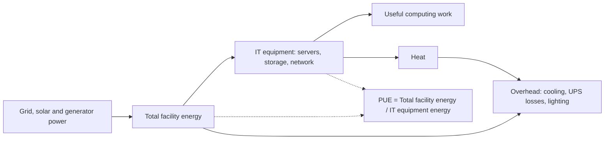

## Introduction

Information technology is often presented as weightless: data "in the cloud", services delivered "virtually". In reality every email, transaction and AI query runs on physical equipment that consumes electricity, requires cooling, is manufactured from mined materials and eventually becomes waste. As digital services grow, so does this physical footprint. Data centres, networks and billions of end-user devices together form a significant and growing source of electricity demand and material use.

Green computing is the discipline of designing, using and disposing of IT in ways that minimise environmental harm while still delivering business value. It is also good management: energy is a major operating cost for data centres, particularly in Ghana where electricity tariffs are high, supply interruptions push organisations towards diesel generators, and a hot, humid climate increases cooling loads. This lesson explains the principles of green computing, the most widely used data centre efficiency metric, Power Usage Effectiveness (PUE), practical efficiency measures, and the challenge of electronic waste, including a careful account of Accra's Agbogbloshie site.

## Learning Objectives

- Explain the scope of green computing across the IT lifecycle: design, manufacture, use and disposal.
- Calculate Power Usage Effectiveness and interpret what it does and does not measure.
- Recommend energy-efficiency measures for data centres, networks and end-user devices.
- Analyse the environmental, health and social dimensions of e-waste, including informal recycling at Agbogbloshie.
- Evaluate a green IT improvement plan for a Ghanaian organisation in financial and environmental terms.

## Prerequisite Knowledge

- Familiarity with data centres, servers and cloud computing from earlier modules.
- Basic arithmetic with kilowatts (kW) and kilowatt-hours (kWh).

## Key Terminology

- **Green computing (green IT)**: The environmentally responsible design, manufacture, use and disposal of computing resources.
- **Power Usage Effectiveness (PUE)**: The ratio of total energy used by a data centre facility to the energy delivered to its IT equipment; introduced by The Green Grid and standardised as ISO/IEC 30134-2.
- **IT equipment energy**: Energy consumed by servers, storage and network equipment that perform computing work.
- **Facility overhead**: Energy used by cooling, power conversion and distribution losses, lighting and other non-IT systems.
- **Virtualisation**: Running multiple virtual machines on one physical server so that hardware is used more fully and fewer servers are needed.
- **Free cooling**: Using outside air or water, rather than energy-intensive mechanical refrigeration, to remove heat when conditions allow.
- **E-waste (WEEE)**: Discarded electrical and electronic equipment, which contains both valuable materials and hazardous substances.
- **Embodied emissions**: Greenhouse gas emissions generated in manufacturing and transporting a product before it is used.
- **Informal recycling**: Recovery of materials outside regulated facilities, often using hazardous methods such as open burning or acid leaching.

## Detailed Explanation

### The scope of green computing

Murugesan (2008) described a holistic approach to green IT spanning four areas: **green use** (reducing energy consumption of computers and systems), **green disposal** (reuse, refurbishment and proper recycling), **green design** (energy-efficient and environmentally sound components and systems) and **green manufacturing** (minimising waste and pollution in production). This lifecycle view matters because a focus only on electricity use misses the substantial environmental impact of manufacturing devices, especially short-lived ones such as smartphones and laptops, where embodied emissions can be a large share of lifetime impact.

### Where IT energy goes

Energy use in IT falls into three broad places:

1. **Data centres**: servers, storage and networking, plus cooling and power infrastructure. Large cloud data centres are usually far more efficient per unit of computing than small server rooms, because of scale, specialised cooling and high utilisation.
2. **Networks**: mobile base stations, fibre networks and core routers. In Ghana, many telecom towers in areas with unreliable grid power rely on diesel generators, making network energy both costly and carbon-intensive.
3. **End-user devices**: PCs, laptops, phones, printers and displays. Individually small, they are numerous, and their manufacture has a large footprint.

### Inside a data centre: IT load and overhead

Servers convert almost all the electricity they consume into heat, which must be removed. Cooling systems (chillers, computer room air conditioners, fans and pumps), uninterruptible power supplies (UPS), transformers and lighting all consume energy without doing computing work. The ratio between total facility energy and IT energy is therefore a key indicator of facility efficiency.

### Energy-efficiency measures

**IT layer**

- **Virtualisation and consolidation**: many traditional servers run at low utilisation while still drawing a large share of their peak power. Consolidating workloads onto fewer, well-utilised hosts cuts both IT and cooling energy.
- **Retiring "zombie" servers**: decommissioning servers that are powered on but no longer perform useful work.
- **Efficient hardware**: newer processors and storage typically deliver more work per watt; solid-state storage reduces power for many workloads.
- **Power management**: enabling processor power states and scheduling non-urgent batch work at times when renewable energy or cheaper power is available.
- **Efficient software**: well-designed code, appropriate data retention and avoiding unnecessary computation reduce demand at source.

**Facility layer**

- **Hot-aisle/cold-aisle containment**: arranging racks so that cold supply air and hot exhaust air do not mix.
- **Raising temperature set points** within equipment manufacturers' and industry guidance ranges, reducing chiller work.
- **Free cooling and economisers** where climate allows; in hot, humid climates such as southern Ghana opportunities are more limited, so efficient chillers, liquid cooling and careful airflow management matter more.
- **Efficient power infrastructure**: modern UPS systems with high efficiency at typical loads, and minimising conversion steps.
- **On-site renewables and storage**: solar photovoltaic panels with batteries can reduce diesel generator use during outages.

**Organisational layer**

- **Cloud migration** can reduce energy if workloads move from inefficient server rooms to efficient hyperscale facilities, but only if the cloud resources are right-sized and switched off when not needed.
- **Procurement standards** specifying energy efficiency, repairability and take-back.
- **Device lifecycle extension**: keeping laptops and phones in service longer through repair and refurbishment reduces embodied emissions.

### Electronic waste

E-waste is one of the fastest-growing waste streams globally. It contains valuable materials (copper, aluminium, gold, palladium) and hazardous substances (lead, mercury, cadmium, brominated flame retardants). When recycled properly in regulated facilities, e-waste can be a source of secondary raw materials, an idea often called "urban mining". When handled informally, it can expose workers and communities to toxic substances.

Ghana's Parliament passed the **Hazardous and Electronic Waste Control and Management Act, 2016 (Act 917)**, which provides for the control and management of hazardous and electronic waste and introduced an advance eco-levy on imported electrical and electronic equipment intended to fund proper management. Implementation and enforcement have faced practical challenges, as in many countries.

### Agbogbloshie: an accurate and careful account

Agbogbloshie, in central Accra near the Korle Lagoon and the Odaw River, was for many years the site of a large informal scrap and recycling area as well as a food market and residential settlement. Workers there dismantled discarded vehicles, appliances and electronic equipment to recover metals for sale. Some practices, notably the **open burning of cables and plastic casings to recover copper**, released smoke containing hazardous substances, and researchers documented contamination of soil and health concerns among workers and nearby residents.

Several points require care when discussing the site:

- It was frequently described in international media as "the world's largest e-waste dump". Researchers working in Ghana have challenged this framing, noting that the site was primarily a scrap metal recycling and trading hub, that much of the material processed was generated within Ghana and the wider region from used equipment at the end of its life, and that the label obscured the site's economic and social complexity.
- Thousands of people, many of them migrants from northern Ghana, earned livelihoods there, and the informal sector played a real role in recovering materials that would otherwise have been dumped.
- The imported second-hand electronics trade is complex: much of it consisted of functioning or repairable equipment meeting real demand, though some was close to the end of its life on arrival.
- In July 2021 the authorities demolished the scrapyard; recycling activity dispersed to other locations, so the underlying challenge of safe e-waste management was not eliminated.

The managerial lesson is that responsible e-waste management requires collection systems, safe recycling technology, decent work for informal workers, enforcement against dumping, and producer responsibility, not merely the removal of a visible site.

## Theories, Frameworks and Models

### Power Usage Effectiveness

The Green Grid introduced PUE as a simple metric of data centre infrastructure efficiency:

`PUE = Total facility energy / IT equipment energy`

A PUE of 1.0 would mean all energy goes to IT equipment, with zero overhead, which is a theoretical ideal. A PUE of 2.0 means that for every kilowatt-hour used by IT, another kilowatt-hour is used by cooling and power infrastructure. The reciprocal, sometimes called Data Centre infrastructure Efficiency (DCiE), expresses IT energy as a percentage of total energy.

**What PUE does not measure.** PUE says nothing about whether IT equipment does useful work: a facility full of idle "zombie" servers can still have a good PUE. Indeed, virtualising and removing servers can *worsen* PUE while cutting total energy, because the fixed overhead is spread over less IT load. PUE also ignores the carbon intensity of the electricity and water consumption, which is why The Green Grid also defined companion metrics such as Carbon Usage Effectiveness (CUE) and Water Usage Effectiveness (WUE). PUE should be measured over a full year, because cooling demand varies with weather.

### The lifecycle view

| Lifecycle stage | Main impacts | Green IT responses |
|---|---|---|
| Design and manufacture | Mining, energy and chemicals; embodied emissions | Efficient designs, recycled materials, modularity |
| Distribution | Transport emissions, packaging | Consolidated shipping, reduced packaging |
| Use | Electricity, cooling, water | Efficiency, virtualisation, renewables |
| End of life | Hazardous substances, lost materials | Reuse, refurbishment, certified recycling, take-back |

## Worked Example

**Illustrative scenario.** *Densu Data Services* (a fictional Accra colocation provider) meters its facility over a year. The IT equipment draws an average of 400 kW, and total facility load averages 720 kW.

Step 1: Current PUE.
`PUE = 720 / 400 = 1.8`
For every 1 kWh delivered to IT, a further 0.8 kWh is used by overhead.

Step 2: Annual energy (8,760 hours in a year).
IT energy = `400 × 8,760 = 3,504,000 kWh`
Total energy = `720 × 8,760 = 6,307,200 kWh`

Step 3: Target improvement. Containment, chiller upgrades and UPS replacement are projected to reduce PUE to 1.5 with the same IT load.
New total load = `400 × 1.5 = 600 kW`
New total energy = `600 × 8,760 = 5,256,000 kWh`
Annual saving = `6,307,200 − 5,256,000 = 1,051,200 kWh`

Step 4: Financial value. Using an *illustrative* tariff of GHS 2.00 per kWh (an assumption for calculation only, not a quoted tariff):
Saving = `1,051,200 × 2.00 = GHS 2,102,400` per year.

Step 5: Carbon value. Using an *illustrative* grid emission factor of 0.4 kg CO2e per kWh (an assumption; real factors must be taken from official national or supplier sources):
Emissions avoided = `1,051,200 × 0.4 = 420,480 kg ≈ 420 tonnes CO2e` per year.

Step 6: Interpretation. The improvement saves about 17% of total facility energy (`1,051,200 / 6,307,200 ≈ 0.167`). If the firm also consolidated servers, reducing IT load to 320 kW while overhead fell only slightly, PUE might rise even though total energy fell, which shows why PUE should be reported alongside absolute energy and carbon figures.

## Ghanaian Business Application

**Illustrative scenario.** *Akwaaba Microfinance* (fictional) runs an on-premises server room in Kumasi with ageing servers at low utilisation, domestic split air-conditioners running continuously at low set points, and a diesel generator that runs frequently during supply interruptions. Its laptops are replaced every three years and old equipment is stored in a cupboard or sold to informal collectors.

A green IT plan might include:

1. **Measure**: install metering to establish IT and total energy, generator fuel use and a baseline PUE.
2. **Consolidate and virtualise**: move workloads onto two modern hosts, decommission unused servers and move suitable workloads to a cloud provider, considering data protection obligations.
3. **Cooling**: seal the room, arrange equipment to separate hot and cold air, and raise set points within manufacturer guidance.
4. **Power**: add solar photovoltaic panels and battery storage sized to reduce generator running hours.
5. **Devices**: extend laptop life to four or five years with battery replacement and repair; buy energy-efficient models.
6. **E-waste**: contract a licensed recycler, wipe data securely before disposal, and donate functioning equipment to schools where appropriate, in line with Act 917.
7. **Report**: track energy cost, fuel use and emissions quarterly.

The business case combines lower electricity and fuel costs, improved resilience during outages, reduced data-breach risk from discarded drives, and reputational benefits with investors and partners who increasingly ask about environmental performance.

## International Case Study

### Machine learning for data centre cooling at Google

In 2016 Google and its AI research subsidiary DeepMind publicly reported that they had applied machine learning to data centre cooling. Using historical sensor data on temperatures, power, pump speeds and set points, neural networks predicted future PUE and temperatures and recommended actions to operators; Google reported a substantial reduction in the energy used for cooling at the facility where it was tested. Google later described moving towards more autonomous control of cooling, with safety constraints and the ability for operators to override.

Lessons for managers:

- Once basic measures are in place, data and analytics can unlock further efficiency gains.
- Comprehensive metering is a prerequisite; you cannot optimise what you do not measure.
- Automated control of physical infrastructure needs safety limits and human override.
- Efficiency is a competitive advantage for cloud providers, which is one reason why large cloud facilities tend to achieve lower PUE than small server rooms.

## Diagram

## Common Misconceptions

- **Misconception:** A low PUE means a data centre is environmentally friendly. **Correction:** PUE measures only infrastructure overhead; idle servers, carbon-intensive electricity and water use are not captured.
- **Misconception:** Moving to the cloud is automatically green. **Correction:** Cloud facilities are usually more efficient, but over-provisioned or idle cloud resources still consume energy; the electricity source also matters.
- **Misconception:** Energy use is the only environmental impact of IT. **Correction:** Manufacturing (embodied emissions), water use and end-of-life waste are also significant.
- **Misconception:** Agbogbloshie was simply a dump for foreign e-waste. **Correction:** It was a complex informal scrap recycling hub that processed much locally generated material and supported many livelihoods, although its burning practices caused serious environmental and health harm.
- **Misconception:** Recycling is always the best end-of-life option. **Correction:** Reuse and refurbishment usually deliver greater environmental benefit than recycling, which should follow when equipment can no longer be used.

## Common Examination Mistakes

- Inverting the PUE formula (IT energy divided by total energy is DCiE, not PUE).
- Forgetting to convert average kW to annual kWh by multiplying by 8,760 hours.
- Presenting assumed tariffs or emission factors as real data without labelling them.
- Describing Agbogbloshie with sensational or inaccurate claims, or ignoring livelihoods and local generation of waste.
- Proposing green measures without a business case or measurement plan.

## Critical Thinking Questions

1. If consolidation lowers total energy but raises PUE, how should a data centre manager report performance to the board?
2. In Ghana's climate, which data centre efficiency measures are most and least promising? Why?
3. Should Ghana restrict imports of used electronics, or would that harm affordability and digital inclusion? Weigh the arguments.
4. How could informal e-waste workers be integrated into a safer formal recycling system rather than displaced?
5. Is it better for a Ghanaian bank to build an efficient local data centre or to use a foreign hyperscale cloud region? Consider energy, sovereignty and resilience.

## Practical Exercises

1. **PUE calculation.** A server room has an average IT load of 50 kW and total load of 95 kW. Calculate PUE, annual total energy and the annual saving if PUE falls to 1.6. *Expected output:* PUE = 1.9; total energy = 832,200 kWh; saving at PUE 1.6 = 131,400 kWh, with workings shown.
2. **Green IT audit.** Audit an office or computer laboratory you have access to. *Expected output:* an inventory of devices, estimated usage hours, observed waste (devices left on, idle equipment) and five prioritised recommendations.
3. **E-waste policy.** Draft a one-page e-waste policy for an illustrative Ghanaian SME. *Expected output:* sections on reuse, data sanitisation, licensed recyclers, record-keeping and compliance with Act 917.

## Key Takeaways

- Green computing covers design, manufacture, use and disposal, not only electricity.
- PUE = total facility energy / IT energy; 1.0 is the ideal, and it must be read alongside absolute energy, carbon and water.
- Virtualisation, containment, efficient cooling and power, renewables and device-life extension are core measures.
- Ghana's climate, tariffs and supply interruptions make efficiency and solar especially valuable.
- E-waste requires reuse, safe recycling and producer responsibility; Act 917 provides the legal framework.
- Agbogbloshie should be described accurately: a complex informal recycling hub with serious harms, demolished in 2021.

## Further Reading

- Murugesan, S. (2008). Harnessing green IT: Principles and practices. *IT Professional, 10*(1), 24-33.
- The Green Grid. (2012). *PUE: A comprehensive examination of the metric* (White Paper No. 49). The Green Grid.
- International Organization for Standardization & International Electrotechnical Commission. (2016). *Information technology, Data centres, Key performance indicators: Part 2: Power usage effectiveness (PUE)* (ISO/IEC 30134-2:2016).
- Republic of Ghana. (2016). *Hazardous and Electronic Waste Control and Management Act, 2016 (Act 917)*.

## Video Resources

- [The Green Grid](https://www.thegreengrid.org/): The Green Grid. Official site of the consortium that developed PUE, with resources on data centre efficiency metrics.
- [International Energy Agency](https://www.iea.org/): IEA. Official site with analysis of energy use by data centres, networks and digital technologies.
- [United Nations Environment Programme](https://www.unep.org/): UNEP. Official site with material on e-waste, chemicals and sustainable consumption.

## Revision Summary

Green computing reduces the environmental impact of IT across its lifecycle. In data centres, PUE (total facility energy divided by IT energy) measures infrastructure overhead but not useful work, carbon or water, so it must be reported with absolute figures. Efficiency comes from virtualisation, retiring idle servers, efficient hardware, airflow containment, efficient cooling and power, renewables and longer device life. E-waste needs reuse, safe recycling and producer responsibility under Act 917; Agbogbloshie illustrates both harms of informal recycling and the risks of oversimplified narratives.

- PUE = total / IT; DCiE = IT / total.
- Annual kWh = average kW × 8,760.
- Consolidation can raise PUE while cutting total energy.
- Ghana: hot climate, high tariffs, generator use make efficiency and solar valuable.
- Reuse before recycling; never dispose of drives without data sanitisation.
- Label assumed tariffs and emission factors as illustrative.
