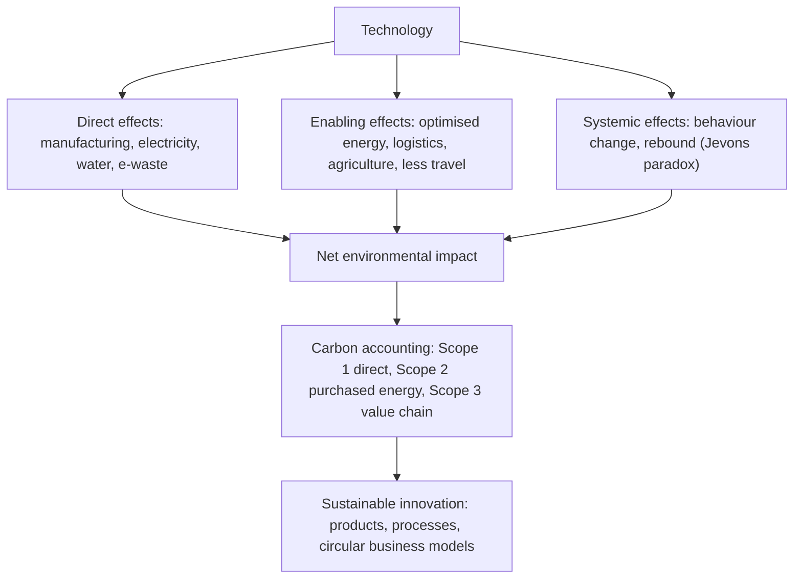

## Introduction

Technology has a double relationship with the environment. On one hand it is part of the problem: manufacturing devices consumes energy and scarce minerals, data centres and networks draw large amounts of electricity, and discarded electronics create hazardous waste. The rapid growth of artificial intelligence has made these questions newly urgent, as training and running large models requires substantial computing infrastructure. On the other hand technology is part of the solution: smart grids integrate renewable energy, sensors cut water and fertiliser use on farms, digital services replace some physical travel, and data allows organisations to measure and manage their emissions.

Sustainable innovation is the deliberate pursuit of new products, processes and business models that create economic value while reducing environmental and social harm. For businesses this is no longer a matter of public relations alone. Investors, regulators, large customers and employees increasingly expect credible measurement and disclosure of environmental impact. This lesson equips you to assess technology's environmental effects honestly, to understand carbon accounting at an overview level, to discuss AI's energy use qualitatively and accurately, and to evaluate innovation strategies that align profit with sustainability.

## Learning Objectives

- Distinguish the direct, enabling and systemic (rebound) environmental effects of technology.
- Explain the Greenhouse Gas Protocol's scope 1, 2 and 3 emissions and apply them to an IT-intensive business.
- Discuss, qualitatively and accurately, the energy and resource implications of AI.
- Apply sustainable innovation frameworks, including the triple bottom line and the circular economy, to a business case.
- Evaluate claims of "green" technology and identify the risk of greenwashing.

## Prerequisite Knowledge

- The previous lesson on green computing and energy efficiency, including PUE and e-waste.
- General understanding of business strategy and innovation.

## Key Terminology

- **Sustainable innovation**: Innovation in products, processes or business models that creates value while reducing environmental and social harm.
- **Triple bottom line**: A framework, associated with John Elkington, for assessing organisational performance on economic, social and environmental dimensions ("profit, people, planet").
- **Circular economy**: An economic model that keeps products and materials in use for as long as possible through design for durability, reuse, repair, remanufacturing and recycling, rather than a linear "take, make, dispose" model.
- **Scope 1 emissions**: Direct greenhouse gas emissions from sources owned or controlled by an organisation, such as its generators and vehicles.
- **Scope 2 emissions**: Indirect emissions from the generation of purchased electricity, heat, steam or cooling consumed by the organisation.
- **Scope 3 emissions**: All other indirect emissions in the value chain, upstream (such as purchased goods, including IT equipment and cloud services) and downstream (such as use of sold products).
- **Rebound effect**: The tendency for efficiency improvements to lower costs and thereby increase consumption, offsetting some or all of the expected savings.
- **Greenwashing**: Misleading claims that exaggerate the environmental benefits of a product, service or organisation.
- **Enabling effect**: Environmental benefit that a technology produces by changing other activities, such as reducing travel or optimising energy use.

## Detailed Explanation

### Three orders of environmental effect

Researchers on ICT and sustainability commonly distinguish three levels of effect, which together provide a balanced assessment.

1. **Direct (first-order) effects**: the footprint of the technology itself, including mining, manufacturing, transport, electricity for operation, cooling, water use and end-of-life waste.
2. **Enabling (second-order) effects**: changes the technology causes in other processes, such as route optimisation that reduces truck fuel, smart irrigation that reduces water use, videoconferencing that replaces some flights, or digital receipts that replace paper.
3. **Systemic (third-order) effects**: longer-term changes in behaviour, markets and society, including **rebound effects**. When a technology makes something cheaper or easier, people may do more of it. The economist William Stanley Jevons observed in the nineteenth century that more efficient steam engines led to greater, not lower, coal consumption, an idea now known as the Jevons paradox.

A credible assessment considers all three. A ride-hailing app may reduce empty taxi trips (enabling) but also increase total car travel if it attracts people away from walking or buses (rebound).

### Carbon accounting: scopes 1, 2 and 3

The Greenhouse Gas (GHG) Protocol, developed by the World Resources Institute and the World Business Council for Sustainable Development, is the most widely used framework for corporate emissions accounting. Its Corporate Standard groups emissions into three scopes.

| Scope | Definition | IT-related examples for a Ghanaian bank |
|---|---|---|
| Scope 1 | Direct emissions from owned or controlled sources | Diesel burned in backup generators at branches and the data centre; fuel for company vehicles; refrigerant leaks from owned air-conditioning |
| Scope 2 | Indirect emissions from purchased electricity, heat or cooling | Grid electricity used by the head office, branches and on-premises servers |
| Scope 3 | All other value-chain emissions | Manufacturing of purchased laptops, ATMs and servers; cloud services bought from providers; business travel; employee commuting; disposal of equipment |

Several points matter for IT managers:

- **Moving to the cloud shifts emissions between scopes.** Electricity used by on-premises servers is scope 2 for the bank; once the same workload runs in a cloud provider's data centre, it becomes part of the bank's scope 3 (purchased services). Emissions do not disappear, although they may fall if the provider is more efficient or uses cleaner power.
- **Scope 3 is usually the largest and hardest to measure.** It depends on data from suppliers, which is often estimated.
- **Location-based and market-based scope 2.** The GHG Protocol's scope 2 guidance allows reporting based on the average emissions of the local grid (location-based) and based on contractual instruments such as renewable energy purchases (market-based).
- **Emission factors** convert activity data (kWh, litres of fuel) into tonnes of CO2-equivalent; they must come from authoritative, documented sources.

### The environmental footprint of AI

Artificial intelligence, especially large-scale generative AI, has become a prominent sustainability concern. The main points can be stated accurately without precise figures, which vary widely by model, hardware, data centre and electricity source:

- **Training** large models requires running thousands of specialised accelerators (GPUs or similar) for weeks or months, consuming substantial electricity. Strubell, Ganesh and McCallum (2019) helped draw attention to the energy and carbon costs of training large natural-language models.
- **Inference**, the everyday use of trained models to answer queries, is far less intensive per request but occurs billions of times, so in aggregate it can exceed the energy used for training.
- **Data centre growth**: the International Energy Agency and others have highlighted AI as a significant driver of growth in data centre electricity demand, creating pressure on electricity grids in some regions and on companies' climate targets.
- **Water use**: data centre cooling often consumes water directly, and electricity generation consumes water indirectly.
- **Hardware and materials**: accelerators require advanced semiconductor manufacturing, with its own energy, water and mineral demands, and short hardware refresh cycles increase e-waste.
- **Location and timing matter**: the same computation can have very different emissions depending on the carbon intensity of the local grid and the time of day.
- **Mitigation options** include using smaller or more efficient models where adequate, reusing pre-trained models rather than training from scratch, efficient hardware, high-utilisation data centres, scheduling flexible work when renewable supply is high, and choosing providers powered by low-carbon electricity.

AI can also produce enabling benefits, such as optimising energy systems, improving weather and climate prediction, and reducing waste in logistics and agriculture. The net effect depends on how and for what AI is used.

### Sustainable innovation

Sustainable innovation operates at several levels:

- **Product innovation**: energy-efficient, durable, repairable or recyclable products.
- **Process innovation**: cleaner, less wasteful production and operations.
- **Business model innovation**: new ways of creating and capturing value, such as product-as-a-service (leasing devices and taking them back), refurbishment marketplaces, sharing platforms and pay-as-you-go access to solar energy.
- **Systemic innovation**: changes across value chains and infrastructure, such as smart grids or circular supply chains.

## Theories, Frameworks and Models

### The Porter hypothesis and the natural-resource-based view

Porter and van der Linde (1995) argued that well-designed environmental regulation can stimulate innovation that reduces costs and improves competitiveness, because pollution often signals wasted resources. Hart (1995) proposed a natural-resource-based view of the firm, in which capabilities in pollution prevention, product stewardship and sustainable development can become sources of competitive advantage. Both perspectives challenge the assumption that environmental performance and profit are always in conflict, although critics note that win-win outcomes are not guaranteed.

### The triple bottom line

Elkington's (1997) triple bottom line asks organisations to account for social and environmental performance alongside financial results. Its value is in broadening what managers measure; its weakness is that the three dimensions are hard to compare, and it can be used selectively. Elkington himself later called for the concept to be applied more rigorously rather than as a reporting slogan.

### The circular economy

The Ellen MacArthur Foundation popularised the circular economy as an alternative to the linear model. For IT the key loops, in order of preference, are:

1. **Maintain and extend life** (repair, software support, battery replacement).
2. **Reuse and redistribute** (second-hand markets, donation).
3. **Refurbish and remanufacture** (restoring devices or components).
4. **Recycle** materials when the above are no longer possible.

The inner loops preserve more value and avoid more embodied emissions than recycling.

### Evaluating green claims: a checklist

| Question | Warning sign of greenwashing |
|---|---|
| Is the claim specific and measurable? | Vague words such as "eco-friendly" or "green" with no data |
| Does it cover the whole lifecycle? | Highlighting a small benefit while ignoring a large impact elsewhere |
| Are boundaries and scopes clear? | "Carbon neutral" claims that omit scope 3 or rely only on offsets |
| Is there independent verification? | Self-declared labels and unverifiable statistics |
| Are rebound effects considered? | Efficiency claims that ignore increased use |

## Ghanaian Business Application

**Illustrative scenario.** *Sankofa Devices* (a fictional Accra start-up) proposes a circular business model for laptops sold to universities, schools and SMEs. Rather than selling new devices outright, it offers refurbished, business-grade laptops on a subscription that includes repairs, battery replacement, software updates and guaranteed take-back after three to five years. Returned devices are refurbished again or stripped for parts, and residual components are passed to a licensed recycler in line with the Hazardous and Electronic Waste Control and Management Act, 2016 (Act 917).

Analysis using this lesson's frameworks:

- **Direct effects**: extending device life reduces embodied emissions per year of use and reduces e-waste; refurbishment workshops use some energy.
- **Enabling effects**: affordable devices support digital learning and SME productivity.
- **Rebound**: lower prices could increase total device numbers, though if they replace new purchases the net effect is likely positive.
- **Business model**: recurring revenue, customer lock-in through service quality, and value recovery from returned devices; risks include supply of quality used devices, warranty costs, and competition from cheap imported second-hand equipment.
- **Carbon accounting**: for a client university, the subscription affects scope 3 (purchased goods and services); Sankofa can provide documented estimates to support the client's reporting.
- **Social dimension**: the start-up could recruit and train technicians from the informal repair sector, offering safer, formal work.

A second **illustrative scenario** concerns a telecom tower company replacing diesel generators at off-grid sites with solar and battery hybrids, reducing scope 1 emissions, fuel costs, theft of diesel and maintenance visits, at the cost of higher upfront capital.

## International Case Study

### Fairphone

Fairphone is a Dutch social enterprise that emerged from a campaign about conflict minerals in electronics and began selling smartphones in 2013. Its strategy is a well-documented example of sustainable innovation through product and business model design. Later models are modular, allowing users to replace components such as the battery, screen and camera with basic tools, and the company emphasises long software support periods, sourcing of fairer and recycled materials, and improving working conditions in its supply chain.

Lessons for managers:

- Durability and repairability can be designed in, directly addressing embodied emissions and e-waste.
- A sustainability mission can define a niche brand, but scale, cost and competition with large manufacturers remain challenging.
- Transparency about supply chains and remaining shortcomings builds credibility and reduces greenwashing risk.
- Regulatory developments, such as moves in the European Union towards repairability and replaceable batteries, can turn early sustainable innovators' practices into industry norms, consistent with the Porter hypothesis.

## Diagram

## Common Misconceptions

- **Misconception:** Digital technology is inherently environmentally friendly because it is "virtual". **Correction:** It has substantial physical footprints in manufacturing, electricity, water and waste.
- **Misconception:** Moving workloads to the cloud eliminates their emissions. **Correction:** Emissions shift from scope 2 to scope 3; they may fall if the provider is more efficient or uses cleaner power, but they do not vanish.
- **Misconception:** Efficiency improvements always reduce total consumption. **Correction:** Rebound effects can offset savings when lower costs increase use.
- **Misconception:** AI's environmental impact comes only from training. **Correction:** Inference at scale, hardware manufacture and water use also matter, and aggregate inference can exceed training energy.
- **Misconception:** Recycling is the core of the circular economy. **Correction:** Life extension, reuse and refurbishment preserve more value and should come first; recycling is the last loop.

## Common Examination Mistakes

- Confusing scope 2 (purchased electricity) with scope 3 (value chain), especially for cloud services.
- Quoting precise statistics about AI or data centre energy without a reliable source.
- Discussing only negative or only positive effects of technology rather than direct, enabling and systemic effects together.
- Treating the triple bottom line or circular economy as slogans without applying them to the case.
- Accepting green claims at face value without considering lifecycle, scope and verification.

## Critical Thinking Questions

1. Should a Ghanaian firm prioritise reducing its scope 1 diesel emissions or its scope 3 emissions from purchased IT? What data would you need to decide?
2. Is it ethical for organisations to adopt generative AI widely when its energy demands are uncertain and growing? Under what conditions is it justified?
3. Can the circular economy succeed in Ghana where an informal repair and reuse culture already exists? How could formal businesses build on it rather than displace it?
4. When does carbon offsetting become greenwashing?
5. Does the Porter hypothesis hold for small firms in developing economies, or mainly for large firms in rich economies?

## Practical Exercises

1. **Scope classification.** Classify twelve emission sources of an illustrative Ghanaian telecom company (tower generators, office electricity, purchased handsets for resale, staff flights, cloud hosting, refrigerant leaks, fleet fuel, customer phone charging, network equipment manufacture, employee commuting, leased office cooling, waste disposal). *Expected output:* a table assigning each to scope 1, 2 or 3 with justification.
2. **Three-order assessment.** Choose one technology (for example drone delivery, mobile money, or an AI chatbot for customer service). *Expected output:* a table of direct, enabling and systemic effects with an overall judgement.
3. **Greenwashing review.** Find a published sustainability claim by a technology company. *Expected output:* an evaluation using the five-question checklist and a rewritten, more credible version of the claim.
4. **Circular business model canvas.** Design a circular model for mobile phones in Ghana. *Expected output:* a short canvas covering value proposition, customers, take-back, refurbishment, revenue, partners and risks.

## Key Takeaways

- Assess technology through direct, enabling and systemic (rebound) effects.
- GHG Protocol: scope 1 direct, scope 2 purchased energy, scope 3 value chain; cloud moves emissions into scope 3.
- AI's footprint includes training, large-scale inference, hardware and water; location and model choice matter.
- Sustainable innovation spans products, processes, business models and systems.
- Circular strategies prioritise life extension and reuse over recycling.
- Specific, lifecycle-based, verified claims avoid greenwashing.

## Further Reading

- World Resources Institute & World Business Council for Sustainable Development. (2004). *The greenhouse gas protocol: A corporate accounting and reporting standard* (Rev. ed.). WRI/WBCSD. <https://ghgprotocol.org/>
- Elkington, J. (1997). *Cannibals with forks: The triple bottom line of 21st century business*. Capstone.
- Porter, M. E., & van der Linde, C. (1995). Toward a new conception of the environment-competitiveness relationship. *Journal of Economic Perspectives, 9*(4), 97-118.
- Hart, S. L. (1995). A natural-resource-based view of the firm. *Academy of Management Review, 20*(4), 986-1014.
- Strubell, E., Ganesh, A., & McCallum, A. (2019). Energy and policy considerations for deep learning in NLP. In *Proceedings of the 57th Annual Meeting of the Association for Computational Linguistics* (pp. 3645-3650).
- Ellen MacArthur Foundation. (2013). *Towards the circular economy* (Vol. 1). Ellen MacArthur Foundation.

## Video Resources

- [Greenhouse Gas Protocol](https://ghgprotocol.org/): WRI and WBCSD. Official site with standards, guidance and training material on scope 1, 2 and 3 accounting.
- [Ellen MacArthur Foundation](https://www.ellenmacarthurfoundation.org/): Ellen MacArthur Foundation. Official site with explanatory material and videos on the circular economy.
- [International Energy Agency](https://www.iea.org/): IEA. Official site with analysis of energy demand from data centres and AI.

## Revision Summary

Technology's environmental impact combines direct effects (manufacture, energy, water, waste), enabling effects (efficiency gains elsewhere) and systemic effects, including rebound. The GHG Protocol divides emissions into scope 1 (direct), scope 2 (purchased energy) and scope 3 (value chain); cloud adoption shifts emissions into scope 3. AI adds energy, water and hardware demands through training and especially large-scale inference, but also offers enabling benefits. Sustainable innovation, guided by the Porter hypothesis, the natural-resource-based view, the triple bottom line and the circular economy, seeks value with lower harm while avoiding greenwashing.

- Direct + enabling + systemic = net impact.
- Scope 1 generators; scope 2 grid power; scope 3 purchased IT and cloud.
- AI: training plus inference plus hardware plus water; choose efficient models and clean power.
- Circular loops: maintain, reuse, refurbish, then recycle.
- Fairphone: designed-in repairability as sustainable innovation.
- Test green claims for specificity, lifecycle scope and verification.
